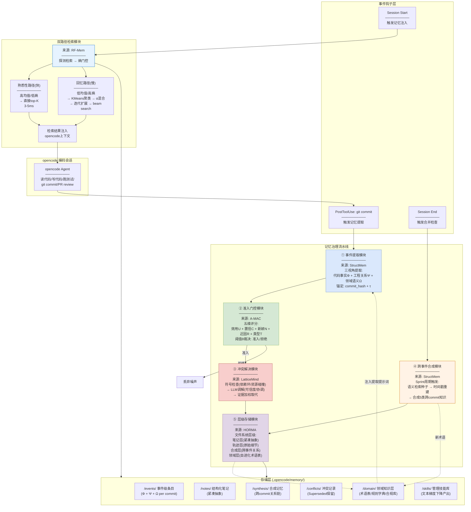
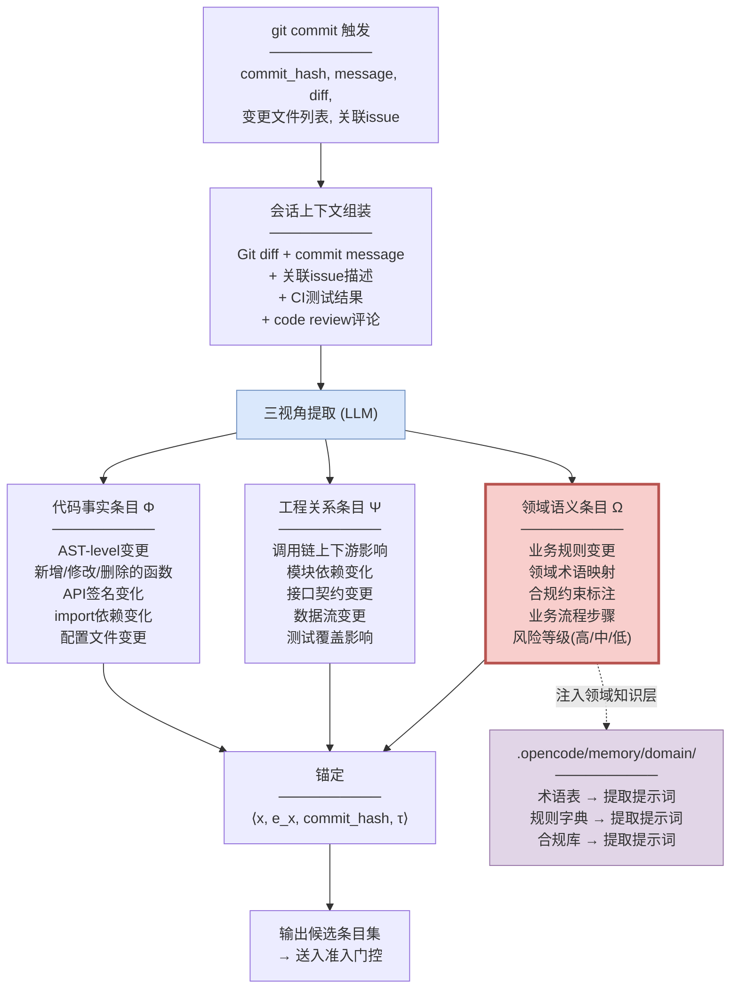
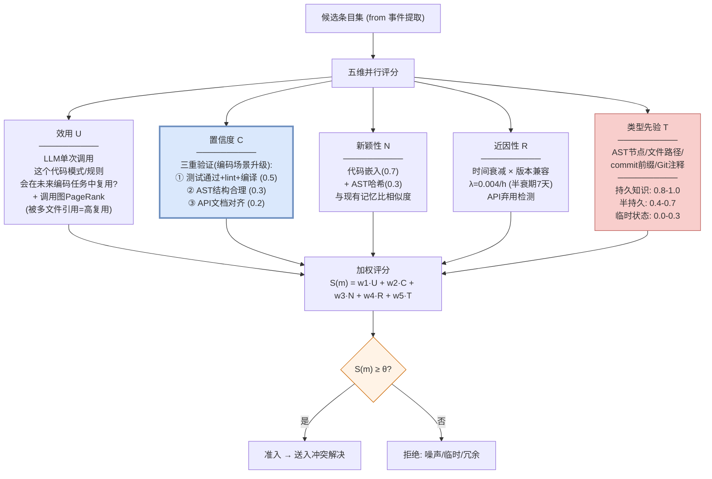
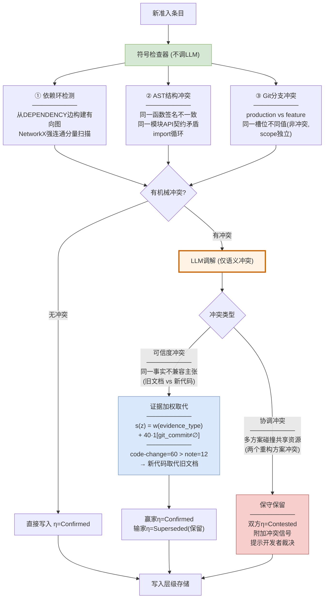
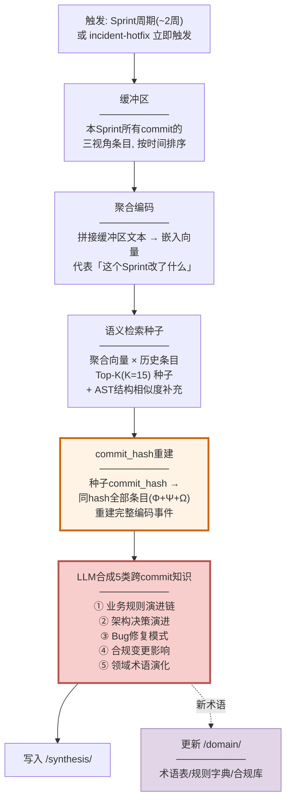
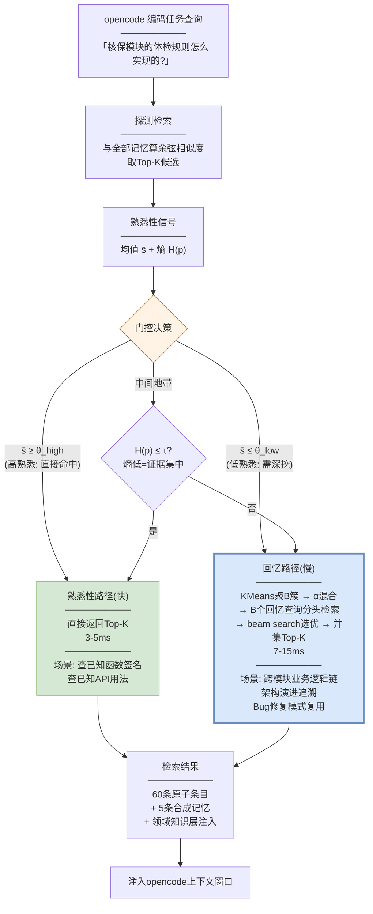
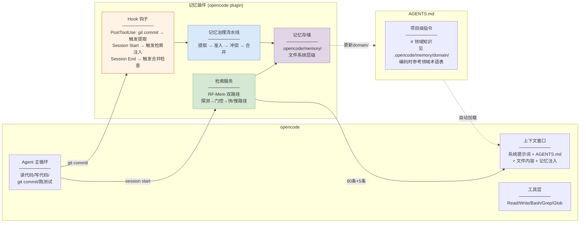

# 编码 Agent 记忆优化 POC 技术方案

> 融合 A-MAC / RF-Mem / HORMA / StructMem / LatticeMind 五篇论文核心技术，基于 opencode 编码 Agent 设计 POC 原型验证方案。

---

## 一、五篇论文核心技术点与编码场景映射

### 1.1 论文技术点提取

| 论文 | 核心技术点 | 编码场景对应 | POC 采纳模块 |
|------|----------|------------|-------------|
| **A-MAC** | 五维准入评分（效用/置信度/新颖性/近因性/类型先验）+ 学习权重 + 阈值裁决 | 代码知识入库前筛选：哪些 commit 值得记忆、哪些是噪声 | **准入门控模块** |
| **RF-Mem** | 熟悉性(快路径)/回忆(慢路径)双路径检索 + 熵引导自适应切换 + α混合聚类扩展 | 编码任务检索历史知识：简单查询走快路径、复杂跨模块推理走慢路径 | **双路径检索模块** |
| **HORMA** | 文件系统层级记忆 + 组织(文本梯度下降)/检索(GRPO)解耦 + 笔记+轨迹双层 + Bash导航 | opencode 的文件系统天然适配：`.opencode/memory/` 目录层级 + 技能精炼 | **层级记忆存储 + 导航检索** |
| **StructMem** | 事件级绑定(双视角提取+时间锚定) + 跨事件合并(语义检索+时间戳重建+合成) | commit 级事件提取 + 跨 commit 业务规则链合成 | **事件提取 + 跨事件合成模块** |
| **LatticeMind** | 冲突感知原语(显式状态机) + 符号检查先行 + LLM调解仅限语义冲突 + 证据加权取代 | 新旧代码逻辑冲突校验 + 多 session 记忆冲突解决 | **冲突检测与解决模块** |

### 1.2 技术融合逻辑

五篇论文不是简单拼凑，而是构成一条**完整的记忆治理流水线**：

```
编码会话产物(commit/PR/session)
  │
  ├─ ① StructMem: 三视角提取(代码事实+工程关系+领域语义) + commit锚定
  │
  ├─ ② A-MAC: 五维准入评分 → 过滤噪声 → 只存有长期价值的记忆
  │
  ├─ ③ LatticeMind: 冲突检测(符号先行) → 新旧记忆矛盾时证据加权取代
  │
  ├─ ④ HORMA: 层级文件系统存储(笔记+轨迹双层) + 技能精炼
  │
  └─ ⑤ RF-Mem: 检索时双路径(简单走top-K/复杂走聚类扩展) + 熵引导切换
```

**融合关系**：StructMem 负责"提取什么"，A-MAC 负责"要不要存"，LatticeMind 负责"和已有的冲突怎么办"，HORMA 负责"怎么组织和存储"，RF-Mem 负责"怎么检索出来"。

---

## 二、POC 总体架构



---

## 三、各模块详细设计

### 3.1 事件提取模块（StructMem → 编码适配）



**关键适配点**：领域语义条目(Ω)提取时，从 `.opencode/memory/domain/` 读取领域术语表注入 LLM 提示词。术语表是自进化的——合成模块产出的新术语会自动更新术语表，下次提取时 LLM 就能识别。

### 3.2 准入门控模块（A-MAC → 编码适配）



**关键适配点**：
- **置信度 C 从 ROUGE-L 升级为三重验证**（测试+AST+文档）——编码场景独有优势
- **类型先验 T 用 commit 前缀分类**：`feat:`→持久(0.85)、`fix:`→Bug修复模式(0.85)、`refactor:`→架构决策(0.85)、`chore:`→半持久(0.5)、`wip:`→临时(0.1)
- **权重需要重新学习**：编码场景置信度 C 预期成为最强因子（原文中 T 最强）

### 3.3 冲突解决模块（LatticeMind → 编码适配）



**关键适配点**：
- **证据权重分层**：`code-change(60)+git-bonus(40)` > `config-observation(45)` > `runtime-observation(40)` > `human-note(12)` > `stale-observation(4)`——代码提交直接取代旧文档
- **分支scope独立**：`(u, σ, branch, env)` 规范键使 production 和 feature 分支的同一槽位不同值和平共存
- **Superseded 不删除**：旧文档被新代码取代后标记失效但保留，可追溯"原来文档怎么说的、什么时候被代码取代的"

### 3.4 跨事件合成模块（StructMem → 编码适配）



### 3.5 层级存储模块（HORMA → opencode 适配）

```
.opencode/memory/
├── events/                    # 事件级条目 (StructMem 三视角)
│   ├── 2026-03/
│   │   ├── a1b2c3d/           # commit_hash 目录
│   │   │   ├── facts.json     # 代码事实 Φ
│   │   │   ├── relations.json  # 工程关系 Ψ
│   │   │   └── domain.json    # 领域语义 Ω
│   │   └── e4f5g6h/
│   │       └── ...
│   └── 2026-04/
│       └── ...
├── notes/                     # 结构化笔记 (HORMA 笔记层)
│   ├── module-underwriting.md  # 模块级摘要
│   ├── module-claim.md
│   └── module-policy.md
├── synthesis/                 # 合成记忆 (StructMem 跨事件)
│   ├── rule-evolution/         # 业务规则演进链
│   ├── architecture/          # 架构决策演进
│   ├── bug-patterns/          # Bug修复模式
│   ├── compliance/            # 合规变更影响
│   └── terminology/           # 领域术语演化
├── conflicts/                 # 冲突记录 (LatticeMind)
│   ├── superseded/            # 被取代的旧记忆(保留)
│   └── contested/             # 待裁决的争议项
├── domain/                    # 领域知识层 (自进化)
│   ├── glossary.json          # 领域术语表
│   ├── rules.json             # 业务规则→代码映射
│   ├── compliance.json        # 合规约束→影响范围
│   └── process.json           # 业务流程→模块映射
└── skills/                    # 管理技能库 (HORMA 文本梯度下降)
    └── management-skills.md   # 组织技能列表
```

**HORMA 笔记+轨迹双层**：`notes/` 存紧凑摘要（检索时省token），`events/` 存原始三视角条目（需要细节时展开）。链接通过 commit_hash 关联。

### 3.6 双路径检索模块（RF-Mem → 编码适配）



**关键适配点**：
- **快路径**：opencode 查已知函数签名/已知API用法时走快路径，3-5ms返回——和现在无记忆时延迟几乎一样
- **慢路径**：opencode 做跨模块业务逻辑分析/架构演进追溯/Bug修复模式复用时走慢路径，7-15ms——比无记忆时需要 LLM 自己从头分析快得多
- **嵌入模型**：用代码专用嵌入模型（CodeBERT/UniXcoder）替代通用 SBERT

---

## 四、opencode 集成方案

### 4.1 集成架构



### 4.2 三种集成触点

| 触点 | 时机 | 动作 | 来源论文 |
|------|------|------|---------|
| **PostToolUse Hook** | opencode 执行 `git commit` 后 | 触发三视角提取 → 准入 → 冲突 → 存储 | StructMem + A-MAC + LatticeMind |
| **Session Start** | opencode 新 session 启动时 | RF-Mem 双路径检索 → 注入60条原子+5条合成 | RF-Mem + HORMA |
| **Session End** | opencode session 结束时 | 检查是否达到 Sprint 阈值 → 触发跨事件合成 | StructMem |
| **AGENTS.md** | 每次自动加载 | 领域知识层注入 → LLM 懂业务术语 | StructMem 领域语义 + HORMA 技能精炼 |

### 4.3 实现方式

**零改动 opencode 核心**：通过 opencode 的插件/hook 机制实现，不需要修改 opencode 本身：

```python
# .opencode/plugins/memory/hook.py (伪代码)

class MemoryHook:
    def on_post_tool_use(self, tool_name: str, result: str):
        """git commit 后触发"""
        if tool_name == "bash" and "git commit" in result:
            commit_hash = extract_commit_hash(result)
            pipeline = MemoryPipeline()
            pipeline.extract_and_store(commit_hash)
    
    def on_session_start(self) -> str:
        """session 启动时注入记忆"""
        retriever = RFMemRetriever()
        results = retriever.retrieve(current_task_context)
        return format_memory_context(results)
    
    def on_session_end(self):
        """session 结束时检查合并"""
        consolidator = CrossEventConsolidator()
        if consolidator.should_trigger():
            consolidator.consolidate()
```

---

## 五、垂域业务知识场景技术亮点

### 5.1 场景设定：保险核心业务系统

以保险核心业务系统（投保→核保→缴费→出单→保全→理赔）为垂域场景，展示 POC 的技术亮点。

### 5.2 技术亮点一：领域语义自动提取与自进化（StructMem 适配）

**痛点**：保险系统代码中的业务规则（"高龄投保人需额外体检""大额保单需人工核保"）散落在 if-else 分支中，通用 LLM 不理解"保单批改""核保规则""赔付系数"等术语。

**POC 方案**：
```
commit a1b2c3d: UnderwritingRule.java 新增 requireMedicalExam(age >= 60)

三视角提取:
  Φ 代码事实: requireMedicalExam() 方法新增, 参数 age >= 60
  Ψ 工程关系: UnderwritingService.evaluate() 调用链新增分支
  Ω 领域语义: ⭐ 业务规则"高龄投保人(≥60岁)需额外体检"
               业务流程步骤: 核保
               风险等级: 中
               合规约束: 待确认(可能因银保监新规)

Ω 提取时注入领域知识层:
  /domain/glossary.json:
    "高龄投保人": "年龄≥60岁的投保人"
    "体检规则": "核保环节对高风险投保人要求额外体检"
  
  → LLM 提示词包含上述术语 → 能正确提取"高龄投保人"语义
```

**自进化闭环**：3个月后 commit i7j8k9l 把阈值从60改为55 → 合成模块发现"高龄投保人"定义变更 → 自动更新 glossary.json `"高龄投保人": "年龄≥55岁的投保人"` → 下次提取时 LLM 自动使用新定义。

**技术亮点**：Agent **越用越懂业务**——领域术语表从 commit 历史中自进化，不需要人工维护术语表。

### 5.3 技术亮点二：代码证据自动取代旧文档（LatticeMind 适配）

**痛点**：保险系统文档与代码经常不一致——文档说"审批走邮件流程"，但代码早已改为"审批走 request_permissions 工具"。人工审查跟不上。

**POC 方案**：
```
记忆库中有:
  m_old (2026-01): "审批走邮件流程" [Confirmed]
                    evidence_type = human-note, weight = 12

新 commit e4f5g6h (2026-03):
  代码事实: ApprovalFlow.java 改为调用 request_permissions 工具
  evidence_type = code-change, git_commit = e4f5g6h

LatticeMind 冲突解决:
  符号检查: 非依赖环/非资源碰撞 → 转LLM调解
  分类: 可信度冲突(同一事实不兼容主张)
  证据比较:
    s(m_old) = w(human-note) + 0 = 12
    s(m_new) = w(code-change) + 40·1[git_commit≠∅] = 60 + 40 = 100
  
  → m_new 胜出 → η=Confirmed
  → m_old 失败 → η=Superseded (保留, 记录"被e4f5g6h取代, 原因: 代码证据>人工笔记")

渲染记忆视图:
  当前状态: 审批走 request_permissions 工具 [Confirmed]
  变迁历史: 审批走邮件流程 [Superseded, 被e4f5g6h取代, 原因: 代码证据更强]
```

**技术亮点**：新代码 commit 自动取代旧文档，**不需要人工审查**——代码证据(weight=100)碾压人工笔记(weight=12)，系统自动维护"当前可信的项目状态"。同时旧文档不删除，可追溯"原来文档怎么说的、什么时候被代码取代的"。

### 5.4 技术亮点三：跨 commit 业务规则演进链（StructMem 适配）

**痛点**：保险业务规则随监管变化频繁调整——"体检阈值从60→55""赔付免赔额从0→500→0（附加rider后）"，散落在多次 commit 中，无法追溯完整演变。

**POC 方案**：
```
Sprint 结束触发跨事件合并:
  缓冲区: 本Sprint 4个commit的12条三视角条目
  语义检索种子: 找到3个月前 commit x9y8z7w "搭建体检规则框架"
  commit_hash重建: x9y8z7w → 找回框架搭建时的全部条目

LLM合成: 业务规则演进链
  ─────────────────────────────────────────────────
  "高龄投保人体检规则:
   3个月前(x9y8z7w): 建框架, age >= 60
   本Sprint(a1b2c3d): 新增规则, age >= 60  
   本Sprint(i7j8k9l): 阈值下调, age >= 55
   演进原因: 可能因银保监[2026]12号文要求扩大体检覆盖范围(待确认)"
  ─────────────────────────────────────────────────

下次 opencode 查询:
  「核保模块的体检规则是怎么演化的?」
  → 检索合成记忆 → 直接返回演进链
  → 不需要 LLM 从头分析多次commit
```

**技术亮点**：**跨 commit 合成新信息**——不存在于任何单条 commit 中的演进脉络，通过合成多个 commit 的领域语义条目推断出来。突破扁平检索60条饱和瓶颈。

### 5.5 技术亮点四：双路径检索自适应（RF-Mem 适配）

**痛点**：保险系统模块多、依赖复杂——简单查询（查已知函数签名）和复杂查询（跨模块业务逻辑链）的检索策略应该不同。

**POC 方案**：
```
场景① opencode 问: "UnderwritingService 的 checkAgeRule 方法签名是什么?"
  探测检索: s̄=0.85(高), H=0.08(低) → 证据集中
  → 走快路径: 直接top-K, 3ms
  → 返回: "public boolean checkAgeRule(int age, boolean requireExam)"

场景② opencode 问: "保单从投保到理赔的完整数据流经过哪些模块?"
  探测检索: s̄=0.38(低), H=0.35(高) → 证据分散
  → 走慢路径: KMeans聚3簇(投保/核保/理赔)
  → α混合生成3个回忆查询分头检索
  → beam search选优, 12ms
  → 返回: 跨模块完整数据流链

场景③ opencode 问: "上次修的那个赔付计算Bug怎么修的?"
  探测检索: s̄=0.52(中间), H=0.22(中) → 中间地带
  → 熵裁决: H > τ=0.2 → 走慢路径
  → 检索合成记忆中的Bug修复模式
```

**技术亮点**：**熵引导自适应**——简单查询走快路径几乎零开销，复杂查询走慢路径深入挖掘。Agent 不需要手动选择检索策略，系统自动判断。

### 5.6 技术亮点五：组织技能精炼（HORMA 适配）

**痛点**：opencode 的 AGENTS.md 是静态的——不管处理多少 commit，组织记忆的策略不变。

**POC 方案**：
```
对比分析:
  D_exo (信息丢失): 用原始历史能正确修改, 用记忆后失败了
    → 反馈: "保留物体初始状态信息, 当前笔记丢失了"
  
  D_end (结构有帮助): 用记忆后能正确修改, 用原始历史失败了
    → 反馈: "结构化笔记过滤了过时文档噪声, 提升了推理质量"

文本梯度下降:
  P_m^(k+1) = LLM(技能增强指令, P_m^(k), {Feedback})
  
4轮精炼后技能库:
  /skills/management-skills.md
  ─────────────────────────────────────────────────
  1. Clean类任务保留物体初始状态(clean/dirty)
  2. 记录函数签名变化(不只是函数体)
  3. 区分持久规则vs临时workaround(看commit前缀)
  4. 合规相关commit必须标注合规约束引用
  5. 保险业务流程步骤必须标注(投保/核保/缴费/出单/保全/理赔)
  ... (63条技能)
  ─────────────────────────────────────────────────

技能库注入 AGENTS.md:
  → opencode 下次 session 自动加载
  → 记忆组织质量持续提升
```

**技术亮点**：**记忆管理技能自进化**——通过对比成功/失败案例自动学习"怎么组织记忆更好"，技能库持续增长。opencode 的 AGENTS.md 从静态变为动态自进化。

---

## 六、POC 验证指标

### 6.1 量化指标

| 指标 | 基线(无记忆) | POC目标 | 验证方法 |
|------|------------|---------|---------|
| 跨session记忆保留率 | 0% (完全失忆) | ≥90% | 相同问题跨session回答一致性 |
| 代码逆向文档准确率 | 80% | **≥90%** | 人工标注+LLM-as-judge |
| 过时文档自动识别率 | 0% (无机制) | ≥85% | 代码vs文档不一致时自动标记 |
| 跨模块推理准确率 | ~60% (LLM从头分析) | ≥80% | 多跳问题回答准确率 |
| 检索延迟(p50) | 0ms (无记忆) | ≤5ms | 快路径延迟 |
| 检索延迟(p95) | 0ms (无记忆) | ≤15ms | 慢路径延迟 |
| 领域术语识别率 | ~40% (通用LLM) | ≥85% | 领域术语在提取中被正确标注的比例 |
| 冲突解决准确率 | 0% (无机制) | ≥90% | 新旧记忆冲突时正确取代的比例 |

### 6.2 对比实验设计

| 实验组 | 配置 | 验证什么 |
|--------|------|---------|
| A: 无记忆基线 | opencode 原始能力 | 基线性能 |
| B: 扁平记忆 | Dense Retrieval top-K | 比A好但无结构 |
| C: 准入门控 | B + A-MAC五维评分 | 准入过滤的增益 |
| D: 冲突解决 | C + LatticeMind | 冲突解决的增益 |
| E: 跨事件合成 | D + StructMem合成 | 跨commit推理的增益 |
| F: 双路径检索 | E + RF-Mem | 自适应检索的增益 |
| G: 完整POC | F + HORMA技能精炼 | 全部融合的最终效果 |

### 6.3 消融实验

| 移除模块 | 预期影响 | 验证什么 |
|---------|---------|---------|
| 移除领域语义视角(Ω) | 领域术语识别率暴跌 | Ω视角的核心价值 |
| 移除置信度三重验证 | 退化为ROUGE-L | 编码场景C因子升级的价值 |
| 移除冲突解决 | 过时记忆干扰推理 | LatticeMind的价值 |
| 移除跨事件合成 | 多跳推理退化为扁平检索 | StructMem合成的价值 |
| 移除双路径(只走快) | 复杂查询召回不足 | RF-Mem慢路径的价值 |
| 移除双路径(只走慢) | 简单查询延迟增大 | RF-Mem快路径的价值 |
| 移除技能精炼 | 组织质量不随使用提升 | HORMA自进化的价值 |

---

## 七、POC 实施计划

### 7.1 分阶段实施

| 阶段 | 目标 | 周期 | 交付物 |
|------|------|------|--------|
| **Phase 1** | 事件提取 + 层级存储 | 2周 | `.opencode/memory/` 目录结构 + 三视角提取hook |
| **Phase 2** | 准入门控 + 冲突解决 | 2周 | A-MAC评分 + LatticeMind冲突检测 |
| **Phase 3** | 跨事件合成 | 2周 | Sprint周期合并 + 5类合成 |
| **Phase 4** | 双路径检索 + 注入 | 2周 | RF-Mem检索 + session启动注入 |
| **Phase 5** | 领域知识层 + 技能精炼 | 2周 | 自进化术语表 + HORMA技能库 |
| **Phase 6** | 验证 + 消融 | 2周 | 量化指标 + 消融实验 |

### 7.2 冷启动数据

| 数据源 | 用途 | 处理方式 |
|--------|------|---------|
| 过去6个月Git历史 | 冷启动记忆库 | 批量跑三视角提取 |
| 现有PRD/设计文档 | 领域知识层初始版 | 预提取术语表+规则字典 |
| 保险法规手册 | 合规约束库 | 手动标注→自动更新 |
| 10个典型编码任务 | 验证集 | 人工标注期望答案 |

### 7.3 技术栈

| 组件 | 选型 | 理由 |
|------|------|------|
| 嵌入模型 | UniXcoder / CodeBERT | 代码专用嵌入 |
| AST解析 | tree-sitter | 多语言支持 |
| 聚类 | scikit-learn KMeans | 轻量级 |
| 图分析 | NetworkX | 依赖环检测 |
| 存储 | 文件系统(JSON/MD) | opencode天然可读 |
| LLM | opencode当前模型 | 不引入额外模型 |
| hook | opencode plugin API | 零改动核心 |

---

## 八、风险与缓解

| 风险 | 影响 | 缓解措施 |
|------|------|---------|
| 三视角提取LLM调用成本 | 每次commit调3次LLM | 批量提取(攒一个Sprint一起跑); 只对feat/fix/refactor前缀的commit提取 |
| 领域语义条目幻觉 | 提取出不存在的业务规则 | 约束合成(Constrained模式) + 时间戳引用 + commit_hash溯源 |
| 跨事件合成时机不准 | Sprint内未攒够事件就触发 | 动态阈值: 根据commit数量和代码变更行数自适应 |
| 权重学习数据不足 | A-MAC权重不准确 | 冷启动用论文权重, 随使用积累标注数据后重学习 |
| 慢路径延迟过高 | 复杂查询阻塞opencode | 设置最大轮数R=3, beam=3, 超时降级为快路径 |
| 领域术语表冷启动空 | 初始提取质量低 | 用现有PRD/文档预填充术语表 |

---

*方案生成日期: 2026-10-12*
