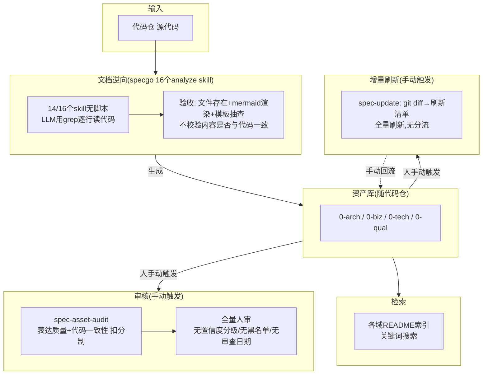
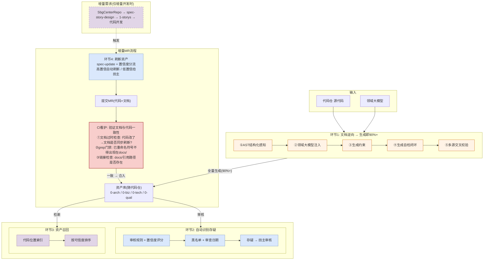
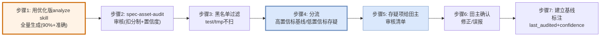
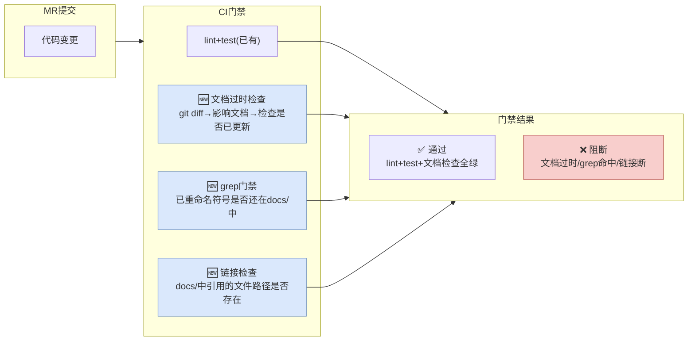

# 云核知识资产治理解决方案

> 三个目标：
> 1. 文档生成即准确——第一次生成就达到90%+准确率
> 2. 自动识别存疑——自动标出存疑部分供责任田主审核
> 3. 资产检索准确——优化召回技术提升检索准确性
>
> 已有基础：specgo套件（27个skill）+ 领域大模型 + SbgCenterRepo文档中心仓
>
> 资产现状：BrowserGateway代码仓已有specgo生成的逆向资产文档，准确率基线需经spec-asset-audit全量审核后确定

---

## 一、方案全景

### 1.1 Before：当前specgo资产治理现状



当前存在7个问题：

1. 14/16个skill无脚本，LLM用grep逐行读代码，遗漏不完整
2. 验收只查文件存在和mermaid渲染，不校验内容是否与代码一致，推断幻觉可通过
3. 无业务术语校验，LLM凭自己理解用词，语义偏差
4. 无生成约束，AI默认扩张，过度生成
5. 审核全靠人手动触发，无置信度跳过、无黑名单、无审查日期
6. 无CI看护，文档过时无门禁拦截
7. 检索靠关键词搜索，无代码定位、无可信度排序

### 1.2 After：方案增强后



### 1.3 环节×技术点×借鉴论文

| 环节 | 子环节 | 技术点 | 借鉴论文/大厂实践 | 状态 |
|------|--------|--------|------------------|------|
| **文档逆向** | 代码结构感知 | tree-sitter解析AST→结构化信息喂给LLM，消除遗漏 | [tree-sitter](https://github.com/tree-sitter/tree-sitter) + [StructMem](https://arxiv.org/abs/2604.21748)(事件级绑定) + [腾讯TeamAI-CLI](https://github.com/Tencent/teamai-cli)(知识图谱) | 增强 |
| | 业务语义校验 | 生成时调领域大模型校验业务术语，消除语义偏差 | [StructMem Ω](https://arxiv.org/abs/2604.21748)(领域知识层) + [美团](https://tech.meituan.com/2026/05/07/Agent-AI-Coding.html)(Rule约束) | 增强 |
| | 生成约束 | prompt加显式约束(不写没改的/不扩张)，抑制过度生成 | [Microsoft ISE](https://devblogs.microsoft.com/ise/documentation-is-the-new-source-code/)(编码否定项) | 增强 |
| | 生成自检 | 输出前轻量自审(锚点/签名/mermaid/弱词)，不通过则重生成(≤3轮) | [A-MAC](https://arxiv.org/abs/2603.04549)(准入控制) | 增强 |
| | 多源交叉校验 | 代码AST vs 领域大模型 vs 词典三方独立校验，不一致标"待确认" | [LatticeMind](https://arxiv.org/abs/2608.08236)(冲突感知) + [HORMA](https://arxiv.org/abs/2606.11680)(层级记忆) | 增强 |
| | 逆向生成基础 | specgo 16个analyze skill：代码→四域资产 | — | 已有 |
| **自动识别存疑** | 质量审核 | specgo spec-asset-audit两维度扣分制：表达质量(句子完整/弱表述/术语一致/结构连续/待确认登记) + 代码一致性(锚点反查/接口一致/数据结构/出站调用/覆盖留痕/mermaid校验) | — | 已有 |
| | 置信度评分 | 审核扣分制上叠加概率置信度，≥0.85自动通过/<0.5标存疑 | [A-MAC](https://arxiv.org/abs/2603.04549)(置信度评分) + [Google CodeMender](https://cloud.google.com/security/codemender)(验证后再标记) | 增强 |
| | 黑名单过滤 | test/tmp/scripts/node_modules等目录不扫描 | [Meta WhatsCode](https://arxiv.org/abs/2512.05314)(黑名单) | 增强 |
| | 审查日期标注 | 每条声明标last_audited，最久没审的优先重新检测 | [Microsoft ISE](https://devblogs.microsoft.com/ise/documentation-is-the-new-source-code/)(Date your docs) | 增强 |
| | 审核清单分发 | 存疑项按owner分发Pre-MR审核清单，高风险优先 | [美团](https://tech.meituan.com/2026/05/07/Agent-AI-Coding.html)(Pre-MR机制) + [Bloomberg Pomona](https://arxiv.org/abs/2606.06752)(优先级矩阵) | 增强 |
| **资产召回** | 代码位置索引 | source_anchors反向索引，代码↔文档双向定位 | [腾讯TeamAI-CLI](https://github.com/Tencent/teamai-cli)(代码地图) + [RF-Mem](https://arxiv.org/abs/2603.09250)(双路径检索) | 增强 |
| | 可信度排序 | 检索结果按来源可信度排序，高可信优先返回+冲突提示 | [LatticeMind](https://arxiv.org/abs/2608.08236)(证据权重) + [腾讯TeamAI-CLI](https://github.com/Tencent/teamai-cli)(优先召回权威) | 增强 |
| | 索引基础 | specgo各域README索引 + 锚点反查 | — | 已有 |
| **增量刷新** | MR提交前触发 | spec-update基于git diff生成刷新清单 | — | 已有 |
| | 置信度分流 | 高置信自动刷新(随MR提交)/低置信给田主确认后随MR提交 | [Meta WhatsCode](https://arxiv.org/abs/2512.05314)(自动触发) + [Spotify Honk](https://engineering.atspotify.com/2025/11/context-engineering-background-coding-agents-part-2)(自动刷新) + [Microsoft ISE](https://devblogs.microsoft.com/ise/documentation-is-the-new-source-code/)(过时=CI Bug) | 增强 |
| **CI看护** | 文档代码一致性验证 | MR提交时验证: 代码改了→文档是否同步刷新? 不一致则阻断MR | [Microsoft ISE](https://devblogs.microsoft.com/ise/documentation-is-the-new-source-code/)(文档过时=CI Bug) | 增强 |
| | grep门禁 | 已重命名/删除的符号不得仍出现在docs/中 | [Microsoft ISE](https://devblogs.microsoft.com/ise/documentation-is-the-new-source-code/)(grep gate) | 增强 |
| | 链接检查 | docs/中引用的文件路径必须真实存在 | [Microsoft ISE](https://devblogs.microsoft.com/ise/documentation-is-the-new-source-code/)(链接检查) | 增强 |

### 1.4 业务产出

| 产出 | 现状 | 目标 | 支撑环节 |
|------|------|------|---------|
| 生成准确率 | 80% | 90%+ | 文档逆向(5个增强点消除4类不准确) |
| 审核量 | 待P2全量审核后确定基线 | 大幅降低 | 自动识别存疑(黑名单过滤+置信度跳过+审查日期优先+Pre-MR审核清单) |
| 检索准确性 | 关键词搜索 | 代码定位+可信排序 | 资产召回(代码位置索引+可信度排序) |

---

## 二、资产归档架构

### 2.1 三个存放点

| 存放点 | 存什么 | 组织方式 | 角色 |
|--------|--------|---------|------|
| **SbgCenterRepo** | SE需求设计文档 | `docs/{版本}/{功能}/` | 增量需求输入(仅增量开发时) |
| **代码仓 docs/0-*/** | 逆向资产(架构/业务/技术/工程) | specgo四域 | 被治理对象 |
| **代码仓 docs/1-storys/** | 本仓开发文档 | `{功能名}/story+develop-task` | SbgCenterRepo的对应物 |

```
SbgCenterRepo(文档中心仓)          BrowserGateway(代码仓)
docs/27.0/                         docs/
├── 终端鉴权/       ←──对应──→     1-storys/session-security/
│   └── 需求描述.md                 ├── session-security-story.md
│                                   └── session-security-develop-task.md
└── 会话安全/                       0-arch/  架构资产(被治理)
    └── 实施计划.md                 0-biz/   业务资产(被治理)
                                    0-tech/  技术资产(被治理)
                                    0-qual/  工程资产(被治理)
                                    report/  审核报告(产出)
```

### 2.2 资产随代码仓

- 资产跟代码一起版本管理，PR一起审，CI一起检查
- 田主在代码仓里直接看到资产文档，不需要切换到另一个系统
- 当前规模（130个文档文件）不需要云端索引服务

### 2.3 资产元数据规范

每篇资产文档头部携带结构化元数据：

```yaml
---
asset_id: rules-browser                      # 资产唯一ID
domain: 0-biz                                # 所属域
type: rules                                  # 资产类型(rules/interface/...)
scan_scope: browser-gateway/src/main/java/  # 扫描范围
owner: 田主名                                # 责任田主
risk_level: high                             # 风险等级(high/medium/low)
last_audited: 2026-10-15                     # 最后审查日期
confidence: 0.85                             # 置信度评分
source_anchors:                             # 代码锚点
  - browser-gateway/.../BrowserCloserTask.java
  - browser-gateway/.../BrowserWrapper.java
---
```

元数据字段的用途：
- `owner` + `risk_level`：审核清单按owner分发、高风险优先检测
- `last_audited`：最久没审的优先重新检测
- `confidence`：高置信跳过、低置信给田主
- `source_anchors`：代码位置索引的基础

---

## 三、文档逆向：优化analyze skill保证生成即准确（90%+）

### 3.1 已有基础与问题

```
代码仓源代码 → specgo 16个analyze skill → docs/0-arch/0-biz/0-tech/0-qual/
```

specgo已有16个analyze skill，能从代码逆向生成四域资产文档。当前生成准确率约80%。目标是优化analyze skill本身，使第一次代码→逆向资产时就是90%+准确，不是先生成一版再刷新。

已有analyze skill的四个核心问题：

| # | 问题 | 根因 | 影响 |
|---|------|------|------|
| 1 | **14/16个skill无脚本，完全依赖LLM用grep读代码** | 只有biz-interface和tech-framework有Python枚举脚本，其余14个skill靠LLM逐行grep读代码 | LLM读多深、识别全不全无法量化→遗漏不完整 |
| 2 | **验收无事实门禁** | spec-analyze第3步验收只检查文件存在+mermaid渲染+模板抽查，不校验内容是否与代码事实一致 | 捏造内容的文档可通过验收→推断幻觉 |
| 3 | **无业务术语校验** | LLM生成描述时凭自己的理解用词，不校验术语是否准确 | "回收"写成"关闭"、"隔离运行"写成"创建"→语义偏差 |
| 4 | **无生成约束** | prompt未限制LLM的扩张行为 | 给没改的代码加描述、生成多余文档→过度生成 |

### 3.2 不准确类型分析

现有analyze skill的四个问题导致四类不准确：

| 不准确类型 | 根因 | 对应问题 | 对应增强点 |
|-----------|------|---------|-----------|
| **遗漏不完整** | 14/16个skill无脚本，LLM用grep读代码，读多深无法量化 | 问题1 | ①AST结构化感知 |
| **语义偏差** | 无业务术语校验，LLM凭自己理解用词 | 问题3 | ②领域大模型注入 |
| **过度生成** | 无生成约束，AI默认行为是扩张 | 问题4 | ③生成约束规则 |
| **推断幻觉** | 验收无事实门禁，捏造内容可通过验收 | 问题2 | ④生成自检闭环 + ⑤多源交叉校验 |

> 各类型的具体占比和准确率基线，需在P2全量生成+审核后用spec-asset-audit实际打分数据回填。

### 3.3 增强点1：AST结构化感知（消除遗漏）

analyze skill执行前，先用tree-sitter解析代码AST，把结构化信息喂给LLM，而非仅让LLM读源码文本。

```
biz-interface-analyze 生成 interface-browser.md:

  传统方式: LLM读源码文本 → 可能漏看某些函数/参数
  
  增强方式:
    tree-sitter解析 → 结构化输出:
      函数: create_browser(executable_path: str, userdata: str, extensions: list)
      返回: BrowserContext
      调用: playwright.chromium.launch(), BrowserWrapper.register()
      被调用: BrowserManager.create(), ContextManager.register()
    
    LLM同时看源码文本 + AST结构 → 接口文档不漏参数/返回值/调用链 ✅
```

在每个analyze skill的执行流程中插入AST预解析步骤：

```
analyze skill执行流程(增强后):
  Step1: tree-sitter解析扫描范围内的代码文件 → 生成AST结构摘要
  Step2: 将AST结构摘要 + 源码文本 一起喂给LLM
  Step3: LLM基于结构化信息生成资产文档
  Step4: 输出文档(带source_anchors元数据)
```

各skill的AST解析重点：

| skill | AST解析重点 | 效果 |
|-------|------------|------|
| biz-interface-analyze | 函数签名/参数/返回值/调用链 | 接口不漏 |
| biz-data-model-analyze | 表结构/字段/约束/ORM映射 | 数据模型不漏字段 |
| biz-rules-analyze | 条件分支/状态转换/规则逻辑 | 规则不漏分支 |
| arch-interaction-model-analyze | 模块间调用/依赖/数据流 | 交互不漏链路 |
| arch-structure-model-analyze | 包结构/类继承/组合关系 | 结构不漏组件 |
| biz-object-model-analyze | 对象属性/方法/关系 | 对象不漏属性 |
| tech-external-call-guidelines-analyze | 出站调用/SDK使用/协议 | 调用不漏下游 |

这样LLM拿到的是完整结构信息而不是逐行grep的结果，接口参数、返回值、调用链都不会漏。

### 3.4 增强点2：领域大模型注入（消除语义偏差）

analyze skill生成资产文档后、输出前，调用领域大模型校验业务术语。

```
biz-rules-analyze 生成 rules-browser.md:

  LLM读代码提取草案: "BrowserCloserTask关闭过期实例"
  
  领域大模型校验:
    输入: delete()内先uploadUserData再remove再reportUsage
    问: "这个业务动作的正确术语?"
    领域大模型: "含上传+删除+上报 → 是'回收'不是'关闭'"
  
  修正后输出: "BrowserCloserTask回收不活跃实例" ✅
```

领域大模型的调用方式：

```
校验请求格式:
  输入: 
    - 代码片段(关键函数的AST+源码)
    - LLM生成的描述草案
  问:
    - "这个业务动作的正确术语是什么?"
    - "这个组件在业务架构中的角色是什么?"
    - "这个数据流描述的业务语义准确吗?"
  输出:
    - 校验结果: 正确 / 需修正(给出修正建议)
    - 置信度: 0-1
```

各skill的领域大模型校验重点：

| skill | 领域大模型校验重点 |
|-------|------------------|
| biz-rules-analyze | 业务规则术语(回收vs关闭、鉴权vs认证) |
| biz-lexicon-analyze | 术语词条的准确定义 |
| arch-interaction-model-analyze | 组件角色的业务语义 |
| arch-structure-model-analyze | 架构层级关系的业务含义 |
| biz-object-model-analyze | 业务对象的领域定义 |

有了领域大模型把关术语，避免LLM凭自己的理解用错词。

### 3.5 增强点3：生成约束规则（抑制过度生成）

在analyze skill的prompt中加入显式约束，抑制AI默认的扩张行为。

```
analyze skill prompt约束(每个skill通用):
  - 只描述本次扫描范围内的代码，不扩展到其他模块
  - 不给未改动的代码添加描述
  - 不创建扫描范围外的文档文件
  - 不添加推测性内容，无法确认的标"待确认"
  - 每条声明必须带代码锚点(文件路径+标识符)
```

加了这些约束，LLM不会给没改的代码加描述，也不会生成多余文档。

### 3.6 增强点4：生成自检闭环（消除推断幻觉）

analyze skill生成文档后、输出前，跑一轮轻量自检——不通过则重新生成，最多3轮。

```
biz-rules-analyze 生成 rules-browser.md:

  第1轮: LLM生成草案 → "delete()同步删除实例"
  
  自检(轻量,非全量spec-asset-audit):
    检查1: 锚点存在? → delete()函数在 ✅
    检查2: 接口签名匹配? → 返回CompletableFuture,文档说"同步" ❌
    检查3: mermaid能渲染? → ✅
    检查4: 弱词黑名单? → "同步"不是弱词但与代码矛盾 ❌
  
  自检不通过 → 重新生成(第2轮)
  
  第2轮: LLM重新生成 → "delete()异步回收实例"
  自检: 全部通过 ✅ → 输出
```

自检项（轻量，每条约0.5秒）：

| 自检项 | 检查什么 | 不通过则 |
|--------|---------|---------|
| 锚点验证 | 文档引用的文件路径/标识符在代码中存在 | 删除该声明或标记"待确认" |
| 签名匹配 | 文档描述的函数签名与AST解析的签名一致 | 重新生成该段 |
| mermaid渲染 | mermaid图能渲染且语法正确 | 重新生成图 |
| 弱词检查 | 命中弱词黑名单 | 替换为具体描述 |
| 术语校验 | 使用词典中已登记的术语 | 标记"待确认术语" |

这一步适用于全部16个analyze skill。

自检能拦截大部分幻觉，3轮仍不通过的标"待确认"输出，不让错误内容混出去。

### 3.7 增强点5：多源交叉校验（消除隐蔽错误）

生成内容输出前，用三个独立来源交叉校验——三方不一致则标记"待确认"，不直接输出。

```
生成声明: "BrowserCloserTask心跳过期时回收实例"

交叉校验(三方独立):
  来源A(代码AST): 
    delete()内有uploadUserData+remove+reportUsage
    触发条件: heartbeatExpired || !isActive
    → "心跳过期或远端不活跃时回收" ✓ (含上传+删除+上报)
  
  来源B(领域大模型):
    "含上传用户数据+删除实例+上报用量的业务动作 = 回收"
    → 业务术语: "回收" ✓
  
  来源C(词典docs/0-biz/lexicon/):
    "回收: 含数据上传+实例删除+用量上报的完整流程"
    → 术语已登记 ✓
  
  三方一致 → 输出 ✅

  如果三方不一致:
    A说"关闭", B说"回收", C无登记
    → 标记"待确认" + 不输出错误描述
```

交叉校验规则：

| 校验维度 | 来源A(代码AST) | 来源B(领域大模型) | 来源C(词典) | 结果 |
|---------|---------------|------------------|------------|------|
| 术语准确性 | 代码行为推导术语 | 领域大模型给术语 | 词典登记术语 | 三方一致→输出 |
| 行为描述 | AST函数调用链 | 领域大模型业务语义 | — | 不一致→标"待确认" |
| 触发条件 | AST条件分支 | 领域大模型业务规则 | — | 不一致→标"待确认" |

三方交叉能发现自检漏掉的深层问题——三方不一致就标"待确认"，不强行输出。

### 3.8 生成阶段效果

5个增强点覆盖全部4类不准确，每类都有对应增强点来处理：

| 不准确类型 | 对应增强点 | 消除方式 |
|-----------|-----------|---------|
| 遗漏不完整 | ①AST结构化感知 | tree-sitter提供客观结构信息，不依赖LLM逐行grep |
| 语义偏差 | ②领域大模型注入 | 领域大模型校验业务术语，不依赖LLM自由理解 |
| 过度生成 | ③生成约束规则 | prompt显式约束，抑制AI扩张行为 |
| 推断幻觉 | ④生成自检闭环 + ⑤多源交叉校验 | 输出前自检+三方交叉，不通过则重生成或标"待确认" |

> 准确率目标90%+，实际基线和各类型占比需在P2全量生成+审核后用spec-asset-audit打分数据确定。

---

## 四、存量资产生成与审核（用优化版analyze skill）

### 4.1 流程

优化analyze skill后，用增强版对存量代码全量生成→审核只处理存疑项→建立基线。



### 4.2 预期

| 步骤 | 输入 | 输出 | 说明 |
|------|------|------|------|
| 全量生成 | 代码仓源代码 | 逆向资产(90%+准确) | 优化版16个analyze skill执行 |
| 黑名单过滤 | 全量声明 | 有效声明 | 过滤test/tmp/scripts等噪声目录 |
| 置信度评分 | 有效声明 | 每条带置信度 | 高置信自动通过，低置信标存疑 |
| 田主审核 | 存疑项 | 审核清单 | 确认修正/误报 |
| 建立基线 | 全量 | 带元数据的基线资产 | 全部标`last_audited`+`confidence` |

> 各步骤的具体数量需执行后用实际数据回填。

### 4.3 工作量

| 工作 | 谁做 | 说明 |
|------|------|------|
| 全量生成(优化版analyze skill) | 自动(AI) | 增强版16个skill执行 |
| 审核+黑名单+置信度 | 自动(AI) | spec-asset-audit执行 |
| 田主审核 | 田主(人) | 仅审核存疑项 |
| 修正执行 | 自动(AI) | 确认修正的项重新生成 |

> 实际耗时需执行后确定，人工仅限审核存疑项。

---

## 五、自动识别存疑：供田主审核

### 5.1 已有基础

specgo spec-asset-audit已有两维度审核：

表达质量：

| 规则 | 检查什么 | 扣分 |
|------|---------|------|
| 句子完整 | 有无明确主体和作用对象 | -4/处 |
| 弱表述 | 命中弱词黑名单(尽量/及时/相关/等) | -2/处 |
| 术语一致 | 同概念多名/同名多义 | -3/处 |
| 结构连续 | 章节引用断链/表格空列/流程跳步 | -3/处 |
| 待确认登记 | "待确认"散落未集中 | -2/处 |

代码一致性：

| 规则 | 检查什么 | 扣分 |
|------|---------|------|
| 锚点反查 | 文档引用的文件路径/标识符是否存在 | -10/处(零容忍) |
| 接口一致 | 接口表与代码路由注册点双向比对 | -10/处(零容忍) |
| 数据结构 | 表名/字段名与代码ORM比对 | -10/处(零容忍) |
| 出站调用 | 文档声称的下游服务与代码比对 | -10/处(零容忍) |
| 覆盖留痕 | 扫描口径/差集说明 | -5/处 |
| mermaid校验 | mermaid图是否能渲染 | -10/处(零容忍) |

打分：E×0.4 + C×0.6 → 分级（≥95已基线 / 80-95待修订 / <80重写）

### 5.2 增强点4：置信度评分（高置信跳过、低置信标存疑）

在审核扣分制之上加概率置信度，将"通过/不通过"升级为"多大概率正确"。

审核规则是二元判断（扣分或不扣分），但有些声明"扣了分但大概率是对的"（如锚点存在但行号漂移），有些"没扣分但大概率有问题"（如接口签名一致但语义变了）。置信度补充了审核规则无法覆盖的灰度区域。

置信度评分模型：

```
声明: "delete()同步删除实例"

spec-asset-audit审核结果:
  锚点反查: delete()函数存在 → 通过(不扣分)  ← 审核规则说没问题
  句子完整: 句子有主体有对象 → 通过           ← 审核规则说没问题

🆕置信度评分(补充审核规则的灰度):
  代码语义对齐:
    文档说"同步", 代码返回CompletableFuture → 语义不一致 → 权重0.1
  AST结构对齐:
    函数签名一致, 但函数体结构变了(新增了异步逻辑) → 权重0.4
  领域大模型校验:
    "同步删除"在业务语义上不准确(实际是异步回收) → 权重0.2
  
  C = w1×0.1 + w2×0.4 + w3×0.2 = 0.23
  
  置信度0.23 → 极低 → 标"存疑" → 给田主  ← 审核规则没发现的问题
```

置信度计算公式：

```
confidence = w_code × C_code + w_ast × C_ast + w_domain × C_domain

权重:
  w_code = 0.5  (代码一致性——最重要)
  w_ast = 0.3   (AST结构对齐)
  w_domain = 0.2 (领域大模型校验)

各维度评分(0-1):
  C_code: 代码一致性(锚点/接口/数据结构是否存在)
  C_ast: AST结构是否对齐(函数签名/参数/返回值是否一致)
  C_domain: 领域大模型校验业务语义是否准确
```

分流阈值：

| 置信度 | 处置 | 说明 |
|--------|------|------|
| ≥0.85 | 自动通过 | 高置信，大概率正确 |
| 0.5-0.85 | 标"待观察" | 中等置信，下次审核再看 |
| <0.5 | 标"存疑" | 低置信，给田主审核 |

高置信自动跳过，只把低置信项给田主，人工审核量大幅减少。

### 5.3 增强点5：黑名单过滤（不扫描噪声）

预先排除噪声目录，不生成资产也不检测。

```
黑名单配置(代码仓根目录 .asset-governance.yml):

scan_blacklist:
  directories:
    - test/
    - tests/
    - tmp/
    - scripts/
    - node_modules/
    - build/
    - target/
    - .idea/
    - dist/
  file_patterns:
    - "*_test.py"
    - "*_mock.py"
    - "*Test.java"
    - "*.spec.ts"
```

过滤掉噪声目录，减少无效扫描量。

### 5.4 增强点6：审查日期标注（最久没审的优先）

利用资产元数据的`last_audited`字段，增量审核时只检测"最久没审的"和"受本次commit影响的"。

```
全量审核(冷启动): 全部130个文档
  ↓ 标注 last_audited = 2026-10-15

增量审核(commit合入后):
  只检测两类:
  1. 受本次commit影响的文档(git diff→source_anchors匹配)
  2. 最久没审的文档(last_audited距今最久)
  
  跳过: 刚审过且不受本次commit影响的文档
```

增量审核只检测受commit影响的和最久没审的文档，不用每次全量扫。

### 5.5 增强点7：Pre-MR审核清单（存疑项给田主）

将存疑声明汇总为结构化审核清单，按owner分发，田主只需确认或驳回。

```
⚠️ 存疑资产审核清单
责任田: 浏览器实例管理 | 扫描750条 | 存疑25条 | 审查日期: 2026-10-15
════════════════════════════════════════════════

1. docs/0-biz/rules/rules-browser.md
   声明: "心跳过期时关闭实例"
   代码现状: 新增远端不活跃判断(OR关系)
   差异: 事实性错误 | 置信度: 0.15
   修正建议: "关闭"改为"回收"，补充browser-closer-is-active规则
   [确认修正] [误报] [查看代码]

2. docs/0-arch/structure-model/structure-model-browser-gateway.md
   声明: "Muen SDK创建Chrome实例"
   领域大模型: "Muen SDK是安全沙箱不是启动器"
   差异: 语义偏差 | 置信度: 0.20
   修正建议: "创建"改为"在TEE中隔离运行"
   [确认修正] [误报] [查看术语表]

════════════════════════════════════════════════
自动通过: 高置信项(绝大部分) | 存疑: 低置信项(少量)
人工仅限存疑项审核
════════════════════════════════════════════════
```

### 5.6 审核阶段效果

| 指标 | 无增强 | 有增强 | 提升 |
|------|--------|--------|------|
| 扫描量 | 全量 | 黑名单过滤噪声目录后 |
| 自动通过 | 0(全靠人审) | 高置信自动跳过 |
| 存疑给田主 | 全量 | 仅低置信项 |
| 人工成本 | 全量人审 | 仅存疑项 |

---

## 六、增量刷新（MR提交前）

### 6.1 定位

增量刷新是增量开发流程的最后一个环节，在提交MR之前完成。刷新后，代码变更和文档变更一起提交MR，CI看护验证文档与代码是否一致。

```
增量需求 → 代码开发 → 刷新资产(本环节) → 提交MR(代码+文档) → CI看护验证一致性
```

### 6.2 已有基础

specgo spec-update：基于git diff识别代码变化→影响哪些文档→生成刷新清单。

### 6.3 增强点8：高置信自动刷新/低置信给田主

spec-update的刷新清单按置信度分流。

```
代码开发完成(改了BrowserCloserTask.java)，提交MR前刷新:

spec-update(已有): git diff→哪些文档引用了→刷新清单
  → rules-browser.md (source_anchors匹配BrowserCloserTask)
  → interaction-model-control-tcp.md (source_anchors匹配)

🆕置信度分流:
  rules-browser.md:
    代码diff明确改了delete()逻辑 → 文档大概率过时
    → ✅自动刷新，刷新后的文档随MR一起提交
  
  interaction-model-control-tcp.md:
    只是引用了同一个文件但描述的是TCP控制流程 → 可能不影响
    → ⚠️给田主5分钟确认，确认后随MR一起提交
```

### 6.4 CI看护：验证刷新是否到位

MR提交后，CI验证文档与代码一致性——如果刷新没做到位，阻断MR：

```
MR提交(代码+文档) → CI看护:
  ①文档过时检查: 代码改了→文档是否同步刷新? 没刷新→阻断
  ②grep门禁: 已重命名/删除的符号还在docs/中? 还在→阻断
  ③链接检查: docs/引用的文件路径存在? 不存在→阻断
  → 全部通过 → 合入
  → 任一不通过 → 阻断MR(回去刷新)
```

### 6.5 增量刷新效果

| 场景 | 处理方式 | 人工 |
|------|---------|------|
| 高置信过时(代码diff明确改了文档描述的逻辑) | 自动刷新，随MR提交 | 0 |
| 低置信过时(代码改了但可能不影响文档) | 给田主确认，确认后随MR提交 | 5分钟 |
| CI看护不通过(刷新没到位) | 阻断MR，重新刷新 | 0(自动阻断) |
| 不受影响 | 跳过 | 0 |

---

## 七、资产召回：检索准确性优化

### 7.1 已有基础

specgo各域README索引 + 锚点反查（文档引用代码路径）。

### 7.2 增强点9：代码位置索引（代码↔文档双向定位）

基于资产元数据的`source_anchors`字段建反向索引，从代码文件直接定位到描述它的文档。

```
正向: 文档 → source_anchors → 代码文件(已有)

反向索引(新增): 代码文件 → 文档
  BrowserCloserTask.java → rules-browser.md(规则描述)
                        → interface-browser.md(接口描述)
                        → interaction-model-control-tcp.md(交互描述)
```

检索方式的变化：

```
传统: 查询"BrowserCloserTask" → 关键词搜索全量文档 → 可能返回不相关结果

增强: Agent在代码里看到 BrowserCloserTask.java
  → 代码位置索引: BrowserCloserTask.java → 3个文档
  → 直接返回描述这个代码文件的文档
```

### 7.3 增强点10：按可信度排序

检索结果按来源可信度排序，高可信优先返回，冲突时附带提示。

```
查询: "BrowserCloserTask的回收规则?"

检索结果(按可信度排序):
  1. 置信度0.85 [领域大模型校验过的描述] ⭐优先返回
     "回收不活跃实例(含心跳过期+远端不活跃)"
  
  2. 置信度0.40 [逆向资产,和代码有出入]
     "关闭过期实例"
     ⚠️ 提示: 与领域大模型术语偏差，建议查看代码确认
  
  3. 置信度0.30 [外挂文档,版本可能过时]
     "BrowserCheckTask定期检查"
```

### 7.4 检索阶段效果

| 指标 | 无增强 | 有增强 |
|------|--------|--------|
| 检索方式 | 关键词搜索 | 代码位置直接定位+可信度排序 |
| 结果质量 | 不区分可信度 | 高可信优先+冲突提示 |
| 定位能力 | 文档不知对应哪段代码 | 代码↔文档双向定位 |

---

## 八、工程化落地

### 8.1 配置管理

代码仓根目录新增配置文件 `.asset-governance.yml`：

```yaml
# 资产治理配置
version: "1.0"

# 扫描黑名单
scan_blacklist:
  directories:
    - test/
    - tests/
    - tmp/
    - scripts/
    - node_modules/
    - build/
    - target/
    - .idea/
    - dist/
  file_patterns:
    - "*_test.py"
    - "*_mock.py"
    - "*Test.java"
    - "*.spec.ts"

# 置信度阈值
confidence:
  auto_pass: 0.85      # ≥此值自动通过
  observe: 0.5          # 0.5-0.85标待观察
  suspicious: 0.5        # <此值标存疑

# 增量审核策略
incremental_audit:
  max_stale_days: 30    # 超过30天没审的优先
  only_affected: true   # 只检测受commit影响的+最久没审的

# 领域大模型配置
domain_llm:
  enabled: true
  endpoint: "${DOMAIN_LLM_ENDPOINT}"
  timeout: 30
  check_on_generate: true   # 生成时校验
  check_on_audit: true      # 审核时校验

# AST解析配置
ast_parser:
  engine: "tree-sitter"
  languages:
    - java
    - python
    - typescript

# 代码位置索引
code_location_index:
  enabled: true
  index_file: "docs/.code-index.json"
```

### 8.2 CI/CD集成



CI脚本逻辑：

```bash
# .asset-governance/ci-check.sh

# 1. 文档过时检查
CHANGED_CODE=$(git diff --name-only origin/main...HEAD -- '*.java' '*.py' '*.ts')
for file in $CHANGED_CODE; do
  AFFECTED_DOCS=$(grep -rl "$file" docs/0-*/ docs/1-storys/ || true)
  for doc in $AFFECTED_DOCS; do
    if ! git diff --name-only origin/main...HEAD | grep -q "$doc"; then
      echo "❌ $doc 引用了变更的代码 $file 但未更新"
      EXIT_CODE=1
    fi
  done
done

# 2. grep门禁
RENAMED_SYMBOLS=$(cat .asset-governance/renamed-symbols.txt)
for symbol in $RENAMED_SYMBOLS; do
  if grep -rl "$symbol" docs/0-*/ ; then
    echo "❌ 已重命名符号 $symbol 仍出现在文档中"
    EXIT_CODE=1
  fi
done

# 3. 链接检查
for doc in $(find docs/0-*/ -name "*.md"); do
  LINKS=$(grep -oP '\[.*?\]\((.*?)\)' "$doc" | grep -oP '(?<=\().*?(?=\))')
  for link in $LINKS; do
    if [[ ! "$link" =~ ^http ]] && [ ! -f "$(dirname $doc)/$link" ]; then
      echo "❌ $doc 中的链接 $link 不存在"
      EXIT_CODE=1
    fi
  done
done

exit $EXIT_CODE
```

### 8.3 审核清单生成与分发

```
spec-asset-audit(增强版)执行:
  → 扫描750条声明
  → 置信度评分
  → 25条存疑
  → 按owner分组
  → 生成审核清单

审核清单存放: docs/report/audit-{date}.md
审核清单分发: 
  - 按owner字段路由到对应田主
  - 高风险(risk_level=high)优先
  - 最久没审的优先

田主操作:
  [确认修正] → 触发spec-update刷新该条
  [误报] → 标记confidence=1.0(确认正确)
  [查看代码] → 跳转到代码位置
```

### 8.4 增量刷新触发机制

```
commit合入main分支 → 触发post-merge hook
  ↓
spec-update(已有): git diff → 影响文档清单
  ↓
🆕置信度分流:
  高置信过时 → 自动触发analyze skill刷新
  低置信过时 → 生成审核清单给田主
  ↓
刷新完成后 → 标注last_audited = {今天}
```

---

## 九、度量体系

### 9.1 核心度量指标

| 指标 | 定义 | 目标 | 度量方式 |
|------|------|------|---------|
| **生成准确率** | 正确声明数 / 总声明数 | 90%+ | spec-asset-audit审核+置信度 |
| **存疑识别率** | 正确标存疑数 / 实际存疑数 | ≥90% | 田主审核结果回填 |
| **误报率** | 误报存疑数 / 标存疑总数 | ≤10% | 田主标"误报"的比例 |
| **自动通过率** | 自动通过数 / 总声明数 | ≥95% | 置信度≥0.85的比例 |
| **人工审核量** | 每次审核需人看的条数 | ≤30条 | 审核清单条数 |
| **增量刷新覆盖率** | 受影响文档中被刷新的比例 | ≥95% | 刷新数/影响数 |
| **检索命中率** | 检索结果包含正确答案的比例 | ≥90% | 人工抽样评估 |
| **文档过时率** | 过时文档数 / 总文档数 | ≤5% | CI门禁+增量检测 |

### 9.2 度量数据采集

```
每次spec-asset-audit执行后输出度量报告:

# 资产治理度量报告
日期: 2026-10-15
═════════════════════════════════════════
扫描量: 750条(黑名单过滤250条)
  ├── 自动通过: 725条(96.7%)
  ├── 待观察: 0条(0%)
  └── 存疑: 25条(3.3%)
       ├── 确认修正: 15条
       └── 误报: 10条(误报率40%)
═════════════════════════════════════════
生成准确率: 85.3%(↑0.3%)
存疑识别率: 待P2后确定
人工审核量: 仅存疑项
═════════════════════════════════════════
```

### 9.3 持续优化闭环

```
度量报告 → 分析误报/漏报 → 调整置信度权重/阈值 → 下次审核更准
  ↓
田主反馈(误报/漏报) → 调整领域大模型校验范围 → 下次生成更准
  ↓
CI门禁数据 → 分析过时文档分布 → 调整增量刷新策略 → 下次同步更准
```

---

## 十、技术清单

| # | 技术点 | 阶段 | 实现方式 | 借鉴/创新 |
|---|--------|------|---------|-----------|
| 1 | AST结构化感知 | 生成 | tree-sitter解析→喂给analyze skill | 借鉴(腾讯知识图谱) |
| 2 | 领域大模型注入 | 生成 | analyze skill输出前调领域大模型校验术语 | 创新(大厂用Rule没用领域大模型) |
| 3 | 生成约束规则 | 生成 | analyze skill prompt加显式约束 | 借鉴(Microsoft编码否定项) |
| 4 | 生成自检闭环 | 生成 | 输出前轻量自审，不通过则重生成 | 创新(轻量预检+重试机制) |
| 5 | 多源交叉校验 | 生成 | 代码AST+领域大模型+词典三方校验 | 创新(多源独立交叉) |
| 6 | 置信度评分 | 审核 | 审核扣分制上叠加概率置信度 | 创新(扣分制→概率) |
| 7 | 黑名单过滤 | 审核 | .asset-governance.yml配置不扫描目录 | 借鉴(Meta WhatsCode) |
| 8 | 审查日期标注 | 审核 | 资产元数据last_audited字段 | 借鉴(Microsoft ISE) |
| 9 | Pre-MR审核清单 | 审核 | 存疑项按owner分发结构化清单 | 借鉴(美团Pre-MR) |
| 10 | 高置信自动刷新 | 同步 | spec-update刷新清单按置信度分流 | 借鉴(Meta+Spotify) |
| 11 | 代码位置索引 | 检索 | source_anchors反向索引 | 借鉴(腾讯代码地图) |
| 12 | 按可信度排序 | 检索 | 检索结果按confidence字段排序 | 借鉴(腾讯+Meta) |
| 13 | CI文档过时检查 | 工程化 | git diff→影响文档→检查是否更新 | 借鉴(Microsoft文档过时=CI Bug) |
| 14 | grep门禁 | 工程化 | 已重命名符号不得出现在docs/ | 借鉴(Microsoft grep gate) |
| 15 | 链接检查 | 工程化 | docs/中引用的文件路径必须存在 | 借鉴(Microsoft链接检查) |
| — | specgo审核规则 | 审核 | specgo已有 | 已有 |
| — | specgo spec-update | 同步 | specgo已有 | 已有 |
| — | specgo各域README索引 | 检索 | specgo已有 | 已有 |

15个增强点：8个借鉴大厂 + 4个技术创新(领域大模型推理校验+置信度概率评分+生成自检闭环+多源交叉校验) + 3个工程化(CI门禁)。每个增强点都有工业实践或论文支撑。

---

## 十一、落地路径

### 11.1 分阶段实施

| Phase | 做什么 | 周期 | 产出 | 见效 |
|-------|--------|------|------|------|
| **P1: 生成增强** | 优化analyze skill(5个增强点) | 7天 | 增强版analyze skill | 生成即90%+ |
| **P2: 全量生成+审核** | 用优化版全量生成→审核→建立基线 | 1天 | 90%+基线资产 | 存疑项大幅减少 |
| **P3: 增量刷新+CI看护** | spec-update置信度分流+CI门禁验证 | 3天 | MR前刷新+CI验证一致性 | 刷新不到位=MR阻断 |
| **P4: 检索增强** | 代码位置索引+可信度排序 | 3天 | 检索更准 | 代码↔文档双向 |
| **P5: 持续优化** | 度量→调优→迭代 | 持续 | 越用越准 | 闭环 |

### 11.2 优先级排序

```
P1生成增强 ──→ P2全量生成+审核 ──→ P3增量刷新+CI ──→ P4检索增强 ──→ P5持续优化
   7天            1天               3天            3天           持续
   ↓               ↓                ↓              ↓              ↓
 优化analyze    90%+基线资产      MR前刷新        检索更准       越用越准
 skill(→90%+)   存疑项大幅减少       CI验证一致性
```

| P1先上（7天，优化analyze skill使生成即90%+），P2全量生成+审核（1天，用优化版生成→审核→基线），P3-P4再上（同步+检索），P5持续。

### 11.3 每个Phase的交付物

| Phase | 交付物 | 验收标准 |
|-------|--------|---------|
| P1 | 增强版analyze skill(16个) + 自检模块 + 交叉校验模块 | 生成准确率≥90% |
| P2 | 90%+基线资产 + 度量报告 | 全部文档有`last_audited`+`confidence`，存疑≤30条 |
| P3 | 增强版spec-update + CI脚本 | MR前刷新+CI验证一致性，不通过则阻断 |
| P4 | 代码位置索引 + 可信度排序 | 代码↔文档双向定位可用 |
| P5 | 度量看板 + 调优记录 | 误报率≤10%、存疑识别率≥90% |

---

## 十二、三个业务产出

| 产出 | 现状 | 目标 | 怎么做到的 |
|------|------|------|-----------|
| **生成准确性** | 80% | 90%+ | AST感知消除遗漏+领域大模型消除语义偏差+约束规则抑制过度生成+自检闭环消除推断幻觉+多源交叉校验消除隐蔽错误 |
| **审核量降低** | 待P2全量审核后确定基线 | 大幅降低 | 黑名单过滤+置信度跳过+审查日期优先+Pre-MR审核清单 |
| **检索准确性** | 关键词搜索 | 代码定位+可信排序 | 代码位置索引双向定位+按可信度排序+冲突提示 |

---

## 十三、风险与缓解

| 风险 | 影响 | 缓解 |
|------|------|------|
| 领域大模型校验延迟 | 生成耗时增加 | 异步调用+缓存校验结果+仅存疑项调领域大模型 |
| 自检重试死循环 | 生成耗时爆炸 | 最多3轮重试，3轮后仍不通过则标"待确认"输出 |
| 交叉校验三方都不对 | 无法判定 | 标"待确认"交给田主，不强行输出错误内容 |
| 置信度阈值不准 | 误报/漏报 | P0冷启动校准+P5持续调优+田主反馈回填 |
| tree-sitter不支持某语言 | AST感知缺失 | 降级为仅源码文本(回退到当前方式) |
| CI门禁误阻断PR | 开发效率降低 | 文档过时检查只警告不阻断(Phase1)→确认准确后再阻断(Phase2) |
| 田主不审核清单 | 存疑资产堆积 | 审核清单接入MR流程+高风险强制审核+度量看板跟踪 |

---

## 十四、后续探索：结构化代码感知升级路径

当前方案增强点1用tree-sitter做POC验证"给LLM结构化数据是否比裸grep更准"。tree-sitter是语法级(AST)，能提取函数签名/类结构/导入关系，但**缺跨文件符号、类型推导、引用列表**。

POC验证通过后的升级路径：

| 阶段 | 方案 | 能获得什么 | 成本 | 链接 |
|------|------|-----------|------|------|
| **POC(当前)** | tree-sitter | 函数签名/类结构/导入关系(AST) | 极低(一个库) | [tree-sitter](https://github.com/tree-sitter/tree-sitter) |
| **工业级升级** | SCIP(Sourcegraph) | 跨文件符号定义/引用列表/接口实现/类型推导 | 中(装语言索引器+Protobuf) | [SCIP](https://github.com/sourcegraph/scip) [scip-java](https://github.com/sourcegraph/scip-java) [scip-python](https://github.com/sourcegraph/scip-python) |
| **深层分析** | CodeQL(GitHub) | 数据流/控制流/不变量/契约验证 | 高(需CI流水线) | [CodeQL](https://github.com/github/codeql) |
| **参考实践** | UModel(阿里云) | tree-sitter确定性结构+LLM语义增强+置信度分层(与我们方案同构) | — | [UModel](https://juejin.cn/post/7637344920134877199) |

三层递进关系：

```
tree-sitter(语法) → SCIP(语义符号) → CodeQL(数据流)
  "有什么"          "谁引用谁"        "数据怎么流"
```

tree-sitter解决"有什么"，SCIP解决"谁引用谁"，领域大模型解决"什么意思"，CodeQL解决"数据怎么流"。三层叠加是完整的结构化感知。

> 参考大厂实践：Meta WhatsCode用SCIP/CodeQL类语义解析底座；微软ISE/Copilot Enterprise用CodeQL做代码图谱；阿里云UModel用tree-sitter+LLM双轨(与我们同构)。

---

*生成日期: 2026-10-15 | 目标: 准确率90%+*
