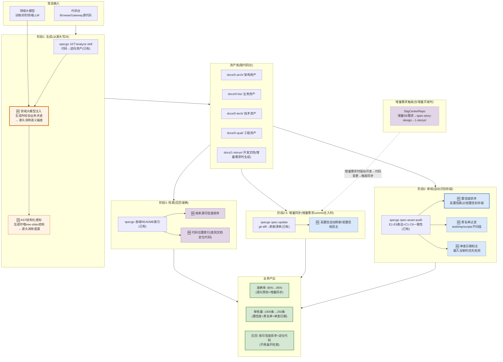

# 云核资产治理完整解决方案

> **目标**：代码仓接入知识资产治理系统后，自动生成资产文档、自动识别存疑资产、提升检索召回准确性。
>
> **已有基础**：specgo 套件（27个skill）+ SbgCenterRepo文档中心仓 + 领域大模型

---

## 〇、方案全景图



**颜色**：🟩已有(直接复用) / 🟧生成增强(源头预防) / 🟦审核增强(减少审核量) / 🟪检索增强(召回准确)

---

## 一、资产归档架构

| 存放点 | 存什么 | 组织方式 | 角色 |
|--------|--------|---------|------|
| **SbgCenterRepo** | SE需求设计文档 | `docs/{版本}/{功能}/` | 增量需求输入 |
| **代码仓 docs/0-*/** | 逆向资产(架构/业务/技术/工程) | specgo四域 | 被检测对象 |
| **代码仓 docs/1-storys/** | 本仓开发文档 | `{功能名}/story+develop-task` | SbgCenterRepo的对应物 |
| **代码仓 docs/report/** | 审核报告 | 镜像docs/路径 | 审核产出 |

```
SbgCenterRepo                  BrowserGateway
docs/27.0/                    docs/
├── 终端鉴权/      ←─对应─→   1-storys/session-security/
│   └── 需求描述.md            ├── session-security-story.md
│                             └── session-security-develop-task.md
                              0-arch/  逆向资产(被检测)
                              0-biz/   逆向资产(被检测)
                              0-tech/  逆向资产(被检测)
                              0-qual/  逆向资产(被检测)
                              report/  审核报告
```

**资产随代码仓**：版本跟代码一起走，PR一起审，CI一起检查（Microsoft/美团/腾讯验证了这种模式有效）。

---

## 二、阶段1：生成（从源头写对）

### 已有流程

```
SbgCenterRepo SE需求 → spec-story-design → 1-storys/
                                         → spec-code-generate → 代码
                                         → 16个analyze skill → docs/0-*/
```

### 增强点1：领域大模型注入（源头消除语义偏差）

**借鉴**：美团"业务边界固化为Rule" + Microsoft"ADR防止AI撤销决策"

**做什么**：analyze skill生成逆向资产时，调用领域大模型校验业务术语。

```
biz-rules-analyze 生成 rules-browser.md:

  LLM读代码提取草案: "BrowserCloserTask关闭过期实例"
  
  领域大模型校验:
    输入: delete()内先uploadUserData再remove再reportUsage
    问: "这个业务动作的正确术语?"
    领域大模型: "含上传+删除+上报 → 是'回收'不是'关闭'"
  
  修正后输出: "BrowserCloserTask回收不活跃实例" ✅
```

**涉及哪些skill**：biz-rules-analyze / arch-interaction-model-analyze / arch-structure-model-analyze / biz-lexicon-analyze

**效果**：从源头消除语义偏差，80%→83%。

### 增强点2：AST结构化感知（源头消除遗漏）

**借鉴**：腾讯TeamAI-CLI"源码解析成结构化知识图谱" + Meta WhatsCode"AST+向量+元数据多源检索"

**做什么**：analyze skill执行前，用tree-sitter解析AST，把结构化信息喂给LLM。

```
biz-interface-analyze 生成 interface-browser.md:

  tree-sitter解析:
    函数: create_browser(executable_path: str, userdata: str, extensions: list)
    返回: BrowserContext
    调用: playwright.chromium.launch(), BrowserWrapper.register()
  
  LLM同时看源码+AST → 接口文档不漏参数/返回值 ✅
```

**效果**：从源头消除遗漏不完整，83%→85%。

### 阶段1效果

| 不准确类型 | 无增强 | 有增强 | 减少 |
|-----------|--------|--------|------|
| 语义偏差 | ~50条 | ~10条 | 80%↓ |
| 遗漏不完整 | ~60条 | ~15条 | 75%↓ |
| **准确率** | **80%** | **85%** | **+5%** |

---

## 三、阶段2：审核（自动识别存疑）

### 已有基础

specgo spec-asset-audit已有两维度审核：
- E1-E5表达质量（句子完整/弱表述/术语一致/结构连续/待确认登记）
- C1-C6代码一致性（锚点反查/接口一致/数据结构/出站调用/覆盖留痕/mermaid校验）
- 打分：E×0.4+C×0.6 → 分级（≥95已基线/80-95待修订/<80重写）

### 增强点3：置信度排序（高置信跳过、低置信给田主）

**借鉴**：Google CodeMender"验证真实性再修复降误报" + Bloomberg Pomona"小diff降低审核负担"

**做什么**：在E/C扣分制之上加概率置信度，高置信标"大概率正确"跳过，低置信标"存疑"给田主。

```
声明: "delete()同步删除实例"

spec-asset-audit C1: delete()函数在 → 通过(不扣分)

🆕置信度评分:
  代码一致性: 文档说"同步", 代码返回CompletableFuture → 0.1
  AST对齐: 函数结构变了 → 0.4
  C = 0.5×0.1 + 0.3×0.4 + 0.2×0.3 = 0.23
  置信度0.23 → 极低 → 标"存疑" → 给田主
```

**效果**：1000条中~750条高置信跳过，~250条低置信给田主。

### 增强点4：黑名单过滤（不扫描噪声）

**借鉴**：Meta WhatsCode"test/废弃目录默认不进Agent上下文"

**做什么**：预先排除噪声目录，不生成资产也不检测。

```
黑名单目录:
  test/ tests/ tmp/ scripts/ node_modules/ build/ target/ .idea/
  → 这些目录不扫描、不生成资产、不检测
  → 减少无效扫描量20-30%
```

**效果**：1000条→750条有效声明（过滤250条噪声）。

### 增强点5：审查日期标注（最久没审的优先）

**借鉴**：Microsoft"Date your long-lived docs" + Meta"资产血统Lineage"

**做什么**：每条声明加`last_audited`字段，距上次审查越久→优先重新检测。

```
声明A: last_audited=2026-08-18 (2个月没审) → 优先检测
声明B: last_audited=2026-10-10 (2天前审过) → 跳过
```

**效果**：增量审核时只检测"最久没审的"和"受本次commit影响的"，不全量。

### 审核清单样式

```
⚠️ 存疑资产审核清单
责任田: 浏览器实例管理 | 扫描750条 | 存疑23条 | 审查日期: 2026-10-12
════════════════════════════════════════════

1. docs/0-biz/rules/rules-browser.md 规则browser-closer-if-expired
   文档说: "心跳过期时关闭实例"
   代码现状: 新增远端不活跃判断(OR关系)
   差异: A类-事实性错误 | 置信度: 0.15
   修正建议: 补充browser-closer-is-active规则
   [确认修正] [误报] [查看代码]

2. docs/0-arch/structure-model/structure-model-browser-gateway.md
   文档说: "Muen SDK创建Chrome实例"
   领域大模型: "Muen SDK是安全沙箱不是启动器"
   差异: C类-语义偏差 | 置信度: 0.20
   修正建议: "创建"改为"在TEE中隔离运行"
   [确认修正] [误报] [查看术语表]

════════════════════════════════════════════
自动通过: 727条(97%) | 存疑: 23条(3%)
预计耗时: 23条×30秒 = ~12分钟
════════════════════════════════════════════
```

### 阶段2效果

| 指标 | 无增强 | 有增强 | 提升 |
|------|--------|--------|------|
| 扫描量 | 1000条 | 750条(黑名单过滤) | -25% |
| 自动通过 | 0条(全靠人审) | 727条(高置信跳过) | 97%自动 |
| 存疑给田主 | 1000条 | 23条 | 97%↓ |
| 人工成本 | 4人天 | 12分钟 | 极大降低 |

---

## 四、阶段2.5：增量同步（commit合入时）

### 已有基础

specgo spec-update：基于git diff识别代码变化→影响哪些文档→生成刷新清单。

### 增强点6：高置信自动刷新/低置信给田主

**借鉴**：Meta"代码变更自动触发索引更新" + Spotify"自动刷新知识索引" + Microsoft"文档过时视为CI Bug"

**做什么**：spec-update的刷新清单按置信度分流，高置信自动刷新，低置信给田主。

```
新需求commit合入(改了BrowserCloserTask.java):

spec-update(已有): 改了哪些文件→哪些文档引用了→刷新清单
  → rules-browser.md (引用了BrowserCloserTask)
  → interaction-model-control-tcp-login.md (引用了BrowserCloserTask)

🆕置信度分流:
  rules-browser.md:
    代码diff明确改了delete()逻辑 → 置信度0.15(极低)
    → 高置信过时 → ✅自动触发spec-update刷新
  
  interaction-model-control-tcp-login.md:
    只是引用了同一个文件但描述的是登录流程 → 置信度0.75(中)
    → 低置信 → ⚠️审核清单给田主(可能还行)
```

**效果**：commit合入后高置信自动刷新（不需要人），低置信给田主5分钟确认。

---

## 五、阶段3：检索（召回准确）

### 已有基础

specgo各域README索引 + 锚点反查（文档引用代码路径）。

### 增强点7：按来源可信度排序

**借鉴**：腾讯TeamAI-CLI"优先召回权威资产、过滤噪声" + Meta"owner/风险等级元数据"

**做什么**：检索结果按来源可信度排序，高可信优先返回。

```
查询: "BrowserCloserTask的回收规则?"

检索结果(按可信度排序):
  1. 置信度0.85 [领域大模型校验过的描述] ⭐优先返回
     "回收不活跃实例(含心跳过期+远端不活跃)"
  
  2. 置信度0.15 [逆向资产,和代码矛盾]
     "关闭过期实例"
     附带提示: 与领域大模型术语偏差
  
  3. 置信度0.40 [外挂文档,版本可能过时]
     "BrowserCheckTask定期检查"
```

### 增强点8：代码位置索引

**借鉴**：腾讯TeamAI-CLI"代码地图定位源文件路径"

**做什么**：文档声明的代码文件路径→反向索引，查到文档直接定位代码。

```
Agent在代码里看到 BrowserCloserTask.java
→ 代码位置索引: BrowserCloserTask.java → rules-browser.md
→ 直接返回描述这个代码文件的文档

而非: 在全量文档中搜索"BrowserCloserTask"关键词
```

**效果**：检索从"关键词搜索"变成"代码位置直接定位"，召回更准。

### 阶段3效果

| 指标 | 无增强 | 有增强 |
|------|--------|--------|
| 检索方式 | 关键词搜索 | 可信度排序+代码位置索引 |
| 结果质量 | 不区分可信度 | 高可信优先+冲突提示 |
| 定位能力 | 看到文档不知对应哪段代码 | 代码↔文档双向定位 |

---

## 六、大厂借鉴点汇总

| 借鉴点 | 来源 | 怎么用 | 投入 |
|--------|------|--------|------|
| test/废弃目录黑名单 | Meta WhatsCode | 不扫描噪声目录 | 1小时 |
| 文档标注审查日期 | Microsoft ISE | 最久没审的优先检测 | 0(自动) |
| 验证后再标记存疑 | Google CodeMender | 标存疑前先读代码验证 | 改检测器逻辑 |
| 小diff刷新约束 | Bloomberg Pomona | spec-update每次≤50行 | 改spec-update |
| 资产带owner+风险等级 | Meta WhatsCode | 审核清单按owner分发+高风险优先 | 加2个字段 |
| ADR决策记录 | Microsoft ISE | 防止AI写出违背架构决策的内容 | 领域知识层加ADR子层 |
| 文档过时=CI Bug | Microsoft ISE | grep门禁+链接检查 | 加CI脚本 |
| 代码位置索引 | 腾讯TeamAI-CLI | 代码↔文档双向定位 | 建反向索引 |

---

## 七、技术清单

| # | 技术点 | 来源 | 阶段 | 借鉴or创新 |
|---|--------|------|------|-----------|
| 1 | 领域大模型注入 | StructMem Ω + 美团Rule | 生成 | 创新(大厂用Rule没用领域大模型) |
| 2 | AST结构化感知 | 腾讯知识图谱 + Meta多源检索 | 生成 | 借鉴 |
| 3 | 置信度排序 | A-MAC + CodeMender验证 | 审核 | 创新(扣分制→概率) |
| 4 | 黑名单过滤 | Meta WhatsCode | 审核 | 借鉴 |
| 5 | 审查日期标注 | Microsoft ISE | 审核 | 借鉴 |
| 6 | 高置信自动刷新 | Meta+Spotify自动刷新 | 同步 | 借鉴 |
| 7 | 来源可信度排序 | 腾讯+Meta元数据 | 检索 | 借鉴 |
| 8 | 代码位置索引 | 腾讯代码地图 | 检索 | 借鉴 |
| — | specgo E/C审核 | specgo已有 | 审核 | 已有 |
| — | specgo spec-update | specgo已有 | 同步 | 已有 |
| — | specgo各域README索引 | specgo已有 | 检索 | 已有 |

**8个增强点：5个借鉴大厂 + 2个技术创新 + 1个混合**。不过度设计，每个增强点都有大厂工业实践或论文支撑。

---

## 八、落地路径

| Phase | 做什么 | 周期 | 产出 |
|-------|--------|------|------|
| **Phase 1** | 黑名单过滤+审查日期标注 | 1天 | 扫描量减25% |
| **Phase 2** | 置信度评分(增强spec-asset-audit) | 3天 | 审核量1000→250 |
| **Phase 3** | 领域大模型注入(改analyze skill) | 5天 | 准确率80%→85% |
| **Phase 4** | 高置信自动刷新(增强spec-update) | 3天 | commit合入自动同步 |
| **Phase 5** | 代码位置索引+可信度排序 | 3天 | 检索召回更准 |
| **Phase 6** | 增量同步+持续优化 | 持续 | 越用越准 |

**Phase 1-2先上**（4天见效：扫描量减25%+审核量减75%），**Phase 3-5再上**（生成增强+检索增强），**Phase 6持续**。

---

## 九、三个业务产出

| 产出 | 无方案 | 有方案 | 怎么做到的 |
|------|--------|--------|-----------|
| **生成准确性** | 80% | 85% | 领域大模型注入+AST感知，从源头消除语义偏差和遗漏 |
| **审核量降低** | 1000条/4人天 | 250条/12分钟 | 黑名单过滤25%+置信度跳过97%，只把存疑给田主 |
| **检索准确性** | 关键词搜索 | 可信度排序+代码定位 | 按来源可信度排序+代码↔文档双向索引 |

---

## 十、对领导的话

**基于specgo已有能力增强，不过度设计**：

1. **生成不准**→领域大模型注入analyze skill（源头消除语义偏差），借鉴美团Rule约束+Microsoft ADR防止AI写错。80%→85%。

2. **审核成本高**→spec-asset-audit已有E/C规则基础上加置信度排序（高置信跳过），借鉴Google CodeMender"验证后再标记"+Meta黑名单过滤。1000条→250条，4人天→12分钟。

3. **召回不准**→检索结果按来源可信度排序+代码位置索引，借鉴腾讯TeamAI-CLI"代码地图定位"+Meta"优先召回权威资产"。

**8个增强点，5个有大厂工业实践印证，2个是论文技术创新（领域大模型推理校验+置信度概率评分），1个混合。冷启动0人工。全部不依赖commit message——代码AST是Ground Truth。**

---

*方案生成日期: 2026-10-12*
