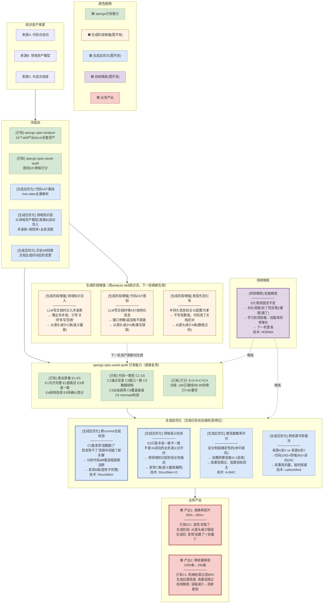
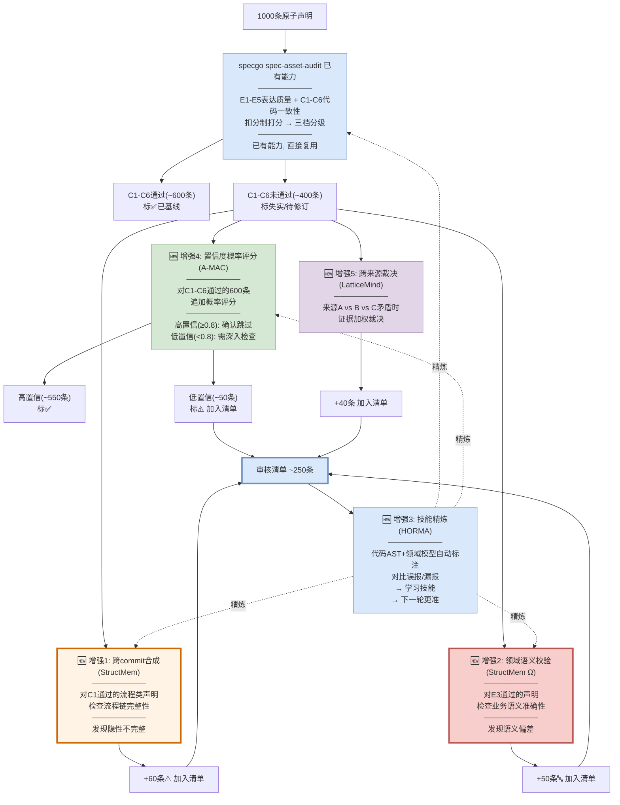

# 存量知识资产治理解决方案（基于 specgo 增强）

> **基础**：specgo 的 `spec-asset-audit` 已有完整的表达质量(E1-E5)+代码一致性(C1-C6)两维度审核。
>
> **增强**：在此基础上叠加5篇论文的技术，补上 spec-asset-audit 缺失的三类检测能力 + 持续精炼 + 多来源裁决。
>
> **面向两个业务场景**：
> 1. **最终产出的文档准确率提升**（80% → 90%+）
> 2. **交给人审核的内容自动识别，人不需要全看**（1000条 → ~250条）

---

## 〇、方案全景图

> **颜色说明**：
> - 🟩 绿色 = specgo 已有能力（直接复用，不开发）
> - 🟧 橙色 = 生成阶段增强（需开发，改analyze skill提示词，下一轮资产刷新生效）
> - 🟦 蓝色 = 生成后优化（需开发，文档已存在后做检测/修正）
> - 🟪 紫色 = 持续精炼（需开发，每轮审核后学习）
> - 🟥 红框 = 业务产出



**全景图读法**：

| 颜色 | 含义 | 开发量 | 生效时机 |
|------|------|--------|---------|
| 🟩 绿色 | specgo已有能力 | 0（直接复用） | 已生效 |
| 🟧 橙色 | 生成阶段增强 | 改analyze skill提示词 | 下一轮spec-update/spec-analyze刷新时 |
| 🟦 蓝色 | 生成后优化 | 新增检测器+评分模块 | 补充冷启动后立即生效 |
| 🟪 紫色 | 持续精炼 | 新增学习模块 | 第一轮审核后开始积累 |
| 🟥 红框 | 业务产出 | — | — |

**落地顺序**：先上蓝色（生成后优化，文档已存在见效快）→ 再上紫色（持续精炼，第一轮后开始）→ 最后上橙色（生成阶段增强，下一轮刷新时生效）。

---

## 一、specgo 已有能力：spec-asset-audit 做了什么

### 1.1 两个审核维度

spec-asset-audit 已经实现了两个维度的质量审核：

**维度一：表达质量（E1-E5）**

| 规则 | 检查什么 | 怎么查 |
|------|---------|--------|
| E1 句子完整 | 语句是否有明确主体和作用对象 | 逐句扫描，缺主语/缺触发条件检出 |
| E2 弱表述 | 是否用了黑名单模糊词（尽量/及时/相关/等） | 弱词黑名单匹配 |
| E3 术语一致 | 同一概念是否只用一个名字 | 抽样比对 `docs/0-biz/lexicon/` 词条 |
| E4 结构连续 | 章节引用是否指向真实存在、流程编号是否连续 | 引用双向比对 |
| E5 待确认登记 | "待确认"标注是否汇总到清单节 | 散落检出 |

**维度二：代码一致性（C1-C6）**

| 规则 | 检查什么 | 怎么查 | spec-asset-audit的能力边界 |
|------|---------|--------|------------------------|
| C1 锚点反查 | 文档引用的代码路径/类名/函数名是否还存在 | grep验证 | ✅ 能发现"函数删了/类改名了" |
| C2 接口一致 | 文档接口表 vs 代码路由注册点 | 双向比对 | ✅ 能发现"接口下线/未登记" |
| C3 数据结构 | 文档表名/字段名 vs 代码ORM/SQL | 比对 | ✅ 能发现"表/字段对不上" |
| C4 出站调用 | 文档声称的下游服务 vs 代码实际调用 | 抽样反查 | ✅ 能发现"调用不存在/未登记" |
| C5 覆盖留痕 | 元信息是否有扫描口径说明 | 检查 | ✅ 记"待修订" |
| C6 mermaid校验 | 图是否渲染成功 | 脚本验证 | ✅ INVALID=失实 |

### 1.2 打分模型

```
通用分(表达质量) = 100 - E1扣分(-4/处) - E2(-2/处) - E3(-3/处) - E4(-3/处) - E5(-2/处)
专项分(代码一致性) = 100 - C1/C2/C3/C4/C6零容忍(-10/处) - C5(-5/处)
总分 = 通用分 × 0.4 + 专项分 × 0.6
分级: ≥95已基线 / 80-95待修订 / <80重写 / 零容忍≥3处直接重写
```

### 1.3 spec-asset-audit 的盲区（论文技术要补的）

| 盲区 | spec-asset-audit做不到 | 论文技术怎么补 |
|------|----------------------|-------------|
| **流程链完整性** | C1能发现"函数删了"但发现不了"函数还在但中间插了新步骤" | StructMem跨commit合成 |
| **业务语义准确性** | E3只查"术语一致不一致"但不查"AI逆向的业务语义对不对" | StructMem领域知识层 |
| **规则进化** | E/C规则固定不变，不会从误报/漏报中学习 | HORMA技能精炼 |
| **概率置信度** | 扣分制是确定性的（命中就扣），不能表达"有多大概率是错的" | A-MAC置信度评分 |
| **多来源裁决** | 只审docs/资产，不处理来源A/B/C之间的矛盾 | LatticeMind证据加权 |

---

## 二、增强1：跨commit合成检测（补 C1 的盲区）

### 问题

spec-asset-audit 的 C1 锚点反查能发现"函数删了/改名了"，但**发现不了"函数还在但流程中间插了新步骤"**：

```
文档说: "登录流程3步: Login → onControlTcpConnected → 事件处理"

C1锚点反查:
  Login()还在 ✓ | onControlTcpConnected()还在 ✓ | 事件处理还在 ✓
  → C1通过: "锚点都在，无失实"

但实际上:
  9月diff: Login和onControlTcpConnected之间插入了registerChannel()
  9月diff: onControlTcpConnected之后插入了reportLoginResult()
  实际流程: Login → registerChannel(新) → onControlTcpConnected → reportLoginResult(新) → 事件处理
  
  → 文档3步 vs 实际5步 → 不完整！
  → C1发现不了，因为单个函数都在
```

### 增强方案

**关键技术：跨commit合成（来源：StructMem）**

```
在spec-asset-audit的C1-C6之后，增加一步C7:

C7 跨commit流程链完整性(新增):
  Step 1: 对每条流程类声明，确认C1锚点反查通过(每个步骤的函数都在)
  Step 2: 分析文档生成时间后的代码diff(不看commit message)
  Step 3: 检查这些函数之间的调用关系是否插入了新步骤
  Step 4: 文档N步 vs 实际M步 → M>N → 不完整

发现: 隐性不完整(C1发现不了的)
产出: +60条不完整审核清单
```

### BGW示例

```
审核: docs/0-arch/interaction-model/interaction-model-control-tcp-login.md

spec-asset-audit C1结果: Login()在✓ onControlTcpConnected()在✓ → 通过

🆕 C7跨commit合成:
  文档生成时间: 2026-08-18
  搜索8月18日后的代码diff:
    diff 1(9月): Login和onControlTcpConnected之间新增registerChannel()
    diff 2(9月): onControlTcpConnected之后新增reportLoginResult()
  
  文档流程: 3步
  实际流程: 5步
  → ⚠️ 不完整，缺少registerChannel和reportLoginResult两步
  
  扣分建议: C7非零容忍(-5/处)，2处缺失 → -10分
```

---

## 三、增强2：领域语义校验（补 E3 的盲区）

### 问题

spec-asset-audit 的 E3 术语一致只检查"同一概念是否用了同一名字"，但**不检查"AI逆向的业务语义理解对不对"**：

```
文档说: "BrowserCloserTask关闭过期实例"

E3术语一致检查:
  "关闭"这个词在全文一致使用 → E3通过
  "BrowserCloserTask"在lexicon/有登记 → E3通过

但实际上:
  代码delete()内部: 先uploadUserData→再remove→再reportUsage
  业务动作是"回收"(含上传+删除+上报)，不是"关闭"(仅stopProcess)
  → AI逆向时把"回收"理解成了"关闭" → 业务语义偏差
  → E3发现不了，因为术语用得"一致"(全篇都写"关闭")
```

### 增强方案

**关键技术：领域知识层（来源：StructMem Ω视角）**

```
在spec-asset-audit的E3之后，增加一步E6:

E6 业务语义准确性(新增):
  Step 1: 从领域知识层(来源B)获取术语的正确业务含义
  Step 2: 对来源A(逆向)的每条声明，校验其业务描述是否和领域知识一致
  Step 3: 不一致 → 标"语义偏差"

领域知识基准(冷启动时从领域资产模型来源B自动导入):
  "回收" = 系统判断不活跃后清理(含上传+删除+上报)
  "关闭" = 仅stopProcess
  "Muen SDK" = 可信虚拟化平台(安全沙箱), 不是Chrome启动器

发现: 语义偏差(E3发现不了的)
产出: +50条语义偏差审核清单
```

### BGW示例

```
审核: docs/0-arch/structure-model/structure-model-browser-gateway.md

spec-asset-audit E3结果: "Muen SDK"在lexicon有登记 → 术语一致 → 通过

🆕 E6领域语义校验:
  文档说(来源A逆向): "Muen SDK创建Chrome实例"
  领域知识基准(来源B): "Muen SDK是可信虚拟化平台,在TEE中隔离运行Chrome"
  
  文档把Muen当"启动器" → 实际是"安全沙箱"
  → 🔤 业务语义偏差
  
  扣分建议: E6非零容忍(-3/处)
```

---

## 四、增强3：技能精炼（让 E/C 规则进化）

### 问题

spec-asset-audit 的 E/C 规则是**固定的**——E1-E5和C1-C6的规则定义不变，不会从审核结果中学习。第一轮和第一百轮用同样的规则，误报率和漏报率不会改善。

### 增强方案

**关键技术：文本梯度下降技能精炼（来源：HORMA）**

```
每轮审核后对比分析:

D_exo(误报): spec-asset-audit标了"失实"但实际正确的
  → 分析为什么误报
  → 生成技能: "什么情况不该标失实"
  
  示例: 
    C1标了ChromeSet类"不存在" → 实际是重构时改了包路径
    → 技能: "类名grep零命中时,先试全仓模糊匹配再判失实"

D_end(漏报): spec-asset-audit标了"通过"但实际有问题的
  → 分析为什么漏报
  → 生成技能: "什么情况应该查但没查"
  
  示例:
    C1通过(函数名在)但函数体从同步改成了异步
    → 技能: "delete/insert/update类方法C1通过后,追加检查返回类型是否变了"

技能库持续增长:
  第1轮: 8条技能
  第2轮: +7条, 共15条
  ...
  每轮误报↓漏报↓ → E/C规则越来越准
```

### 效果

| 指标 | 无技能精炼 | 有技能精炼(第3轮) |
|------|----------|-----------------|
| 误报率 | ~15% | ~5% |
| 漏报率 | ~12% | ~5% |
| 审核清单条数 | 250条 | 200条 |

---

## 五、增强4：置信度概率评分（增强扣分制）

### 问题

spec-asset-audit 的扣分制是**确定性的**——命中C1就扣10分，不命中就不扣。但实际中有些情况是"大概率错了但不100%确定"：

```
C1锚点反查: 函数名还在但签名变了(参数从1个变成2个)
  → spec-asset-audit: C1命中, 扣10分 (确定性)
  → 但实际上: 可能是新参数有默认值, 旧调用方式仍然兼容 → 文档不算完全错
  → 需要概率评分: "0.6置信度——可能有问题但不确定"
```

### 增强方案

**关键技术：五维置信度评分（来源：A-MAC）**

```
在spec-asset-audit的扣分制之上,增加概率置信度:

对每条声明计算:
  置信度C = 代码一致性(0.5) + AST结构对齐(0.3) + API签名匹配(0.2)
  综合评分S = 效用U×w1 + 置信度C×w2 + 新颖性N×w3 + 近因性R×w4 + 类型先验T×w5

  高置信(≥0.8): 标"大概率正确" → 跳过
  低置信(<0.8): 标"疑似问题" → 给田主

与spec-asset-audit扣分制的关系:
  spec-asset-audit扣分制: 判"失实/待修订/已基线"(三档)
  🆕置信度评分: 给"疑似问题"的概率分(0-1连续)
  
  → 两者结合: spec-asset-audit判"待修订"的, 再用置信度排序
  → 置信度低的优先给田主
```

### BGW示例

```
声明: "chromeSet.delete()同步删除实例"

spec-asset-audit C1: delete()函数在 → C1通过
spec-asset-audit C2: 不涉及接口 → 跳过
spec-asset-audit结论: 已基线(无C规则命中)

🆕置信度评分:
  代码一致性: 文档说"同步", 代码返回CompletableFuture → 0.1
  AST对齐: 函数结构变了 → 0.4
  API签名: 返回类型从void变成CompletableFuture → 0.3
  C = 0.5×0.1 + 0.3×0.4 + 0.2×0.3 = 0.23
  近因性: 文档8月, 代码10月改 → 0.7
  综合 = 0.23 × 0.7 = 0.16 → 极低置信 → 标记审核

→ spec-asset-audit判"已基线", 但置信度评分判"极低置信"
→ 两者矛盾时以置信度为准, 标记给田主
```

---

## 六、增强5：跨来源冲突裁决（多来源场景新增）

### 问题

spec-asset-audit 只审 `docs/` 下的资产，不处理来源A(逆向)、来源B(领域)、来源C(外挂)之间的矛盾。当三个来源对同一事实描述不一致时，没有裁决机制。

### 增强方案

**关键技术：冲突检测+证据加权（来源：LatticeMind）**

```
三来源矛盾时, 按证据权重裁决:

  代码当前实现(code-change)     = 100  ← 最高
  领域资产模型(domain_model)     = 60
  外挂官方文档(official_doc)     = 70
  代码逆向(reverse_engineered)   = 45

裁决规则: 权重高的赢, 输的标Contested(保留不删)

BGW示例:
  来源A(逆向): "BrowserCloserTask关闭过期实例" (权重45)
  来源B(领域): "BrowserCloserTask回收不活跃实例" (权重60)
  代码AST: delete()含upload+remove+report → 是"回收"
  → 来源B(60) > 来源A(45) → 来源B赢
  → 来源A标Contested: "术语偏差,关闭应为回收"
```

---

## 七、冷启动阶段（specgo已有 + 补充基线）

### specgo 已完成的冷启动

| 已完成 | 说明 |
|--------|------|
| specgo spec-analyze | 16个analyze skill已产出docs/全套资产(130个文件) |
| specgo spec-asset-audit | 首轮E/C审核已跑过(打分分级) |
| docs/0-biz/lexicon/ | 领域术语表已由biz-lexicon-analyze产出(13个文件) |
| docs/0-biz/rules/ | 业务规则已由biz-rules-analyze产出(6个文件) |

### 需要补充的冷启动（论文技术需要）

| 补充项 | 做什么 | 人力 | 技术 |
|--------|--------|------|------|
| 代码AST基线 | tree-sitter解析全部源码→函数签名/import/配置/枚举索引 | 0(自动) | StructMem时间戳重建 |
| 历史diff回填 | 用文档生成时间搜索之后的代码diff(不看message) | 0(自动) | StructMem时间戳重建 |
| 领域知识层补充 | 从领域资产模型(来源B)自动导入术语表+规则库 | **0** | StructMem Ω视角 |
| 首轮权重校准 | 代码AST+领域模型自动标注→校准A-MAC权重 | **0** | A-MAC置信度 |

**补充冷启动成本：0人工 + 1-2天自动**。specgo已完成的资产不重做，领域知识层从来源B自动导入，权重校准用代码AST(代码矛盾=自动确认过时)和领域模型(语义偏差=自动确认)做自动标注。

---

## 八、增强后的完整审核流程



### 审核流程总结

| 环节 | 来源 | 做什么 | 过滤/发现 |
|------|------|--------|----------|
| specgo E/C审核 | 已有 | E1-E5+C1-C6扣分制打分 | 过滤600条(C通过) |
| 🆕置信度评分 | A-MAC | 对C通过的追加概率评分 | 过滤550条(高置信) |
| 🆕跨commit合成 | StructMem | 检查流程链完整性 | +60条(隐性不完整) |
| 🆕领域语义校验 | StructMem Ω | 校验业务术语准确性 | +50条(语义偏差) |
| 🆕跨来源裁决 | LatticeMind | 三来源矛盾时证据加权 | +40条(来源冲突) |
| 🆕技能精炼 | HORMA | 对比误报/漏报学习技能 | 持续提升 |
| **最终审核清单** | | | **~250条** |

---

## 九、两个业务产出

### 产出1：准确率提升（80% → 90%+）

| 阶段 | 准确率 | 发现来源 | 技术 |
|------|--------|---------|------|
| specgo E/C审核 | 85% | C1-C6发现"函数删了/接口变了/表对不上" | 已有 |
| 🆕跨commit合成 | 88% | 发现"流程链断了" | StructMem |
| 🆕领域语义校验 | 90%+ | 发现"业务术语偏了" | StructMem Ω |
| 🆕技能精炼 | 92-95% | 误报漏报减少 | HORMA |

### 产出2：审核量降低（1000条 → 250条）

| 阶段 | 审核量 | 技术 |
|------|--------|------|
| specgo C1-C6机械检查 | 400条(过滤600条) | 已有 |
| 🆕置信度评分 | 350条(过滤50条高置信) | A-MAC |
| 🆕跨commit+领域+跨来源 | +250条(新增发现) | StructMem+LatticeMind |
| 🆕技能精炼(第二轮) | 200条(误报减少) | HORMA |
| **最终** | **~250条, 1人天** | |

---

## 十、关键技术索引

| # | 关键技术 | 来源论文 | 在specgo基础上增强什么 | 增强类型 |
|---|---------|---------|---------------------|---------|
| 1 | 跨commit合成 | StructMem | 新增C7规则: 流程链完整性检测 | **新增能力** |
| 2 | 领域知识层(Ω) | StructMem | 新增E6规则: 业务语义准确性校验 | **新增能力** |
| 3 | 文本梯度下降技能精炼 | HORMA | 让E/C规则从误报/漏报中学习进化 | **新增能力** |
| 4 | 五维置信度评分 | A-MAC | 在扣分制之上加概率置信度排序 | **增强** |
| 5 | 冲突检测+证据加权 | LatticeMind | 三来源矛盾时自动裁决 | **新增能力** |
| 6 | 时间戳重建 | StructMem | 用文档生成时间精准定位相关diff | **增强** |
| 7 | 符号检查器 | LatticeMind | specgo C1已有等价能力,不重复 | 已有 |
| 8 | 类型先验分类 | A-MAC | 持久知识跳过/半持久重点查,缩小范围 | **增强** |
| 9 | 双路径检索 | RF-Mem | 审核清单检索时快慢自适应 | **增强** |

**增强类型说明**：
- **新增能力**：spec-asset-audit完全没有的，论文技术补上的
- **增强**：spec-asset-audit有基础能力，论文技术让它更准/更快

---

## 十一、对领导的话

**基础**：specgo 的 spec-asset-audit 已经能做 E/C 两维度审核——表达质量(E1-E5)和代码一致性(C1-C6)，扣分制打分三档分级。这是已有的基础能力。

**增强**：在这个基础上，5篇论文技术补上5个 spec-asset-audit 做不到的事：
1. **跨commit合成**（StructMem）：spec-asset-audit能发现"函数删了"但发现不了"流程中间插了新步骤"
2. **领域语义校验**（StructMem Ω）：spec-asset-audit的E3只查术语一致但不查"AI逆向的业务语义对不对"
3. **技能精炼**（HORMA）：spec-asset-audit的E/C规则固定不变，不能从误报/漏报中学习
4. **置信度评分**（A-MAC）：spec-asset-audit的扣分制是确定性的，不能表达"有多大概率是错的"
5. **跨来源裁决**（LatticeMind）：spec-asset-audit不处理来源A/B/C之间的矛盾

**效果**：
- 准确率：specgo E/C(85%) + 论文增强(90%+) + 技能精炼(92-95%)
- 审核量：specgo C1过滤600条 + 🆕置信度过滤50条 + 🆕新增发现150条 = 最终250条
- 人工：4人天 → 1人天（75%降低）
- 冷启动：specgo已完成资产产出，领域知识层从来源B自动导入，补充1-2天自动(AST基线+diff回填+权重自动校准)，无需人工

---

*方案生成日期: 2026-10-12*
