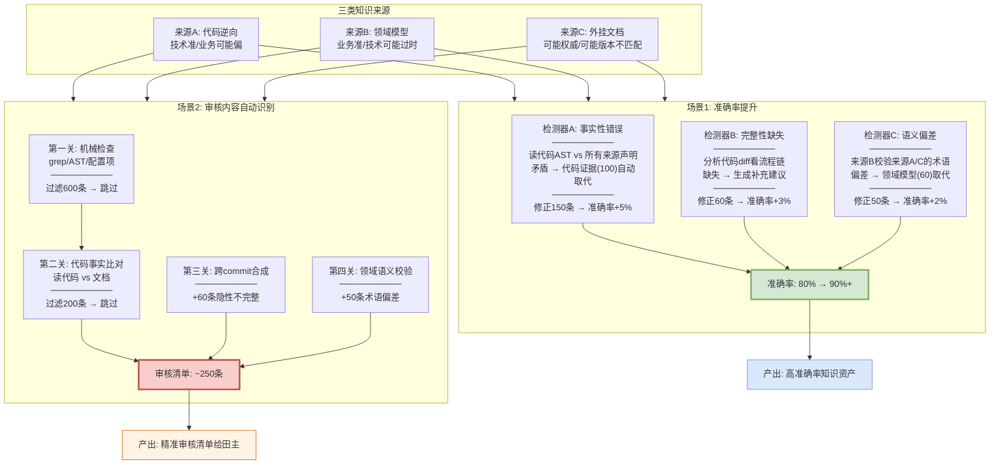

# 存量知识资产治理解决方案

> **面向两个业务场景**：
> 1. **最终产出的文档准确率提升**（80% → 90%+）
> 2. **交给人审核的内容自动识别，人不需要全看**（1000条 → ~250条）

---

## 一、两个业务场景的技术解法

### 场景1：文档准确率提升（80% → 90%+）

**问题**：三类来源（代码逆向/领域模型/外挂文档）产出的知识，80%正确20%有问题。问题分三种：说错了、说漏了、说偏了。

**解法**：三个检测器自动识别三类问题 + 三来源交叉验证修正 + 代码AST作为Ground Truth。

| 问题类型 | 占比 | 检测器 | 怎么发现 | 怎么修正 |
|---------|------|--------|---------|---------|
| 说错了(事实性错误) | 40% | A检测器 | 读当前代码AST，和文档逐条比对 | 代码证据(100)取代文档(45)，自动修正 |
| 说漏了(完整性缺失) | 35% | B检测器 | 分析代码diff，看流程链断没断 | 补充缺失步骤，生成修正建议 |
| 说偏了(语义偏差) | 25% | C检测器 | 用领域模型(来源B)校验逆向(来源A)的术语 | 领域模型(60)取代逆向(45)，术语修正 |

**准确率提升路径**：
```
原始准确率: 80%（1000条中200条有问题）
                ↓
检测器A扫完: 修正"说错了"的150条 → 准确率升至 85%
                ↓
检测器B扫完: 补充"说漏了"的60条 → 准确率升至 88%
                ↓
检测器C扫完: 修正"说偏了"的50条 → 准确率升至 90%+
                ↓
最终: 85-90%的问题自动发现和修正建议
      剩余10-15%通过技能精炼(HORMA)逐步提升
```

### 场景2：审核内容自动识别（1000条 → ~250条）

**问题**：1000条知识声明，人工全量审核4人天。大部分时间花在"其实没错"的条目上。

**解法**：四关过滤，只把疑似有问题的给田主。

| 过滤关 | 做什么 | 过滤掉多少 | 剩余 | 成本 |
|--------|--------|-----------|------|------|
| 第一关：机械检查 | grep函数名/AST签名/配置项 | 600条(函数还在签名没变) | 400条 | 零LLM秒级 |
| 第二关：代码事实比对 | 读代码AST vs 文档声明 | 200条(确认一致) | 200条 | LLM分钟级 |
| 第三关：跨commit合成 | 看流程链断没断 | — | +60条(隐性不完整) | LLM分钟级 |
| 第四关：领域语义校验 | 领域模型校验业务术语 | — | +50条(术语偏差) | LLM分钟级 |
| **最终给田主** | | | **~250条** | **1人天** |

**田主收到的审核清单**：每条附带"文档说了什么/代码现状是什么/哪个commit导致的/建议怎么改"，每条30秒确认。**从4人天降到1人天，75%降低**。

---

## 二、两个场景怎么协同



### 两个场景的关系

**场景1和场景2是同一条流水线的两个产出**：

- **场景1**是"自动修正"——检测器发现的问题中，有明确证据的（代码vs文档直接矛盾）自动修正，准确率从80%升到90%+
- **场景2**是"需要人确认的"——检测器发现的问题中，不能100%自动确定的（语义偏差/隐性不完整）给田主审核

```
检测器扫完1000条:
  ──────────────────────────────────
  768条高置信(没问题) → 标✅ 跳过
  
  232条低置信(疑似有问题):
    ├── 150条有明确代码证据 → 自动修正建议(场景1)
    │   └── 田主快速确认即可(场景2)
    ├── 60条隐性不完整 → 生成补充建议(场景1)
    │   └── 田主确认补充(场景2)
    └── 50条语义偏差 → 生成术语修正建议(场景1)
        └── 田主确认修正(场景2)
  ──────────────────────────────────
  
  场景1产出: 260条修正建议 → 准确率80%→90%+
  场景2产出: 260条审核清单 → 人工4人天→1人天
```

**两个场景共享同一套检测结果**——检测器跑一遍，同时产出"修正建议"（场景1）和"审核清单"（场景2）。

---

## 三、三来源交叉验证怎么提升准确率

### 来源A(逆向) vs 来源B(领域) 的交叉

```
来源A说: "BrowserCloserTask关闭过期实例"
来源B说: "BrowserCloserTask回收不活跃实例"

交叉验证:
  术语不同: "关闭" vs "回收"
  读代码delete()内部: 先uploadUserData→再remove→再reportUsage
  → 代码动作是"回收"(含上传+删除+上报)
  → 来源A的"关闭"偏差 → 用来源B的"回收"修正
  
准确率提升: 来源A的业务语义被来源B校准
```

### 来源A(逆向) vs 代码 的交叉

```
来源A说: "检查周期默认1800000ms"
代码application.yaml: "check-browser-period: 300000"

交叉验证:
  数值不一致: 1800000 vs 300000
  → 代码是Ground Truth(100) → 来源A过时(45)
  → 自动修正为300000
  
准确率提升: 来源A的技术事实被代码校准
```

### 来源B(领域) vs 代码 的交叉

```
来源B说: "大额保单需人工核保(>100万)"
代码: if (amount > 500000) return MANUAL_REVIEW

交叉验证:
  阈值不一致: 100万 vs 50万
  → 代码是Ground Truth → 来源B过时
  → 来源B标过时，建议田主更新领域模型
  
准确率提升: 来源B的业务规则被代码校准
```

### 来源C(外挂) vs 代码 的交叉

```
来源C说: "Chrome通过Playwright persistent_context启动"
代码: playwright.chromium.launch() → 改了

交叉验证:
  启动方式不一致
  → 代码是Ground Truth → 来源C过时
  → 自动修正为launch()
  
准确率提升: 来源C的技术描述被代码校准
```

### 交叉验证矩阵

| | 来源A(逆向) | 来源B(领域) | 来源C(外挂) | 代码(真相) |
|--|-----------|-----------|-----------|-----------|
| **来源A** | — | C检测器校验术语 | 交叉比对 | A检测器比对事实 |
| **来源B** | C检测器校验术语 | — | 交叉比对 | A检测器比对规则 |
| **来源C** | 交叉比对 | 交叉比对 | — | A检测器比对描述 |
| **代码** | A检测器比对 | A检测器比对 | A检测器比对 | — |

**任何两个来源矛盾时，代码(权重100)是最终裁判。**

---

## 四、审核清单给田主时长什么样

```
══════════════════════════════════════════════════════
逆向知识资产审核清单
责任田: 浏览器实例管理
自动扫描: 2026-10-12 | 总扫描180条 | 需审核23条
══════════════════════════════════════════════════════

【A类-事实性错误（代码已变，自动修正建议）】

1. docs/0-biz/rules/rules-browser.md 规则browser-closer-if-expired
   文档说(来源A): "心跳过期时关闭实例"
   代码现状: 新增了远端不活跃判断(OR关系)
   自动修正: 补充browser-closer-is-active规则
   置信度: 0.15 | 来源: A vs 代码矛盾
   [确认修正] [误报] [查看代码]

2. docs/0-tech/.../concurrency-guidelines-browser-check-task.md
   文档说(来源A): "检查周期默认1800000ms"
   代码现状: application.yaml已改为300000ms
   自动修正: 更新为300000ms
   置信度: 0.20 | 来源: A vs 代码矛盾
   [确认修正] [误报] [查看代码]

【B类-完整性缺失（说漏了，补充建议）】

3. docs/0-arch/.../interaction-model-control-tcp-login.md
   文档说(来源A): "登录流程3步: Login→onControlTcpConnected→事件处理"
   代码diff: 实际5步(中间插入了registerChannel和reportLoginResult)
   自动修正: 时序图补充2个步骤
   置信度: 0.35 | 来源: A不完整(跨commit合成发现)
   [确认补充] [误报] [查看代码]

【C类-语义偏差（说偏了，术语修正建议）】

4. docs/0-arch/.../structure-model-browser-gateway.md
   文档说(来源A): "Muen SDK创建Chrome实例"
   来源B(领域模型): "Muen SDK在TEE中隔离运行Chrome"
   自动修正: 更正为"通过Muen SDK在可信执行环境中隔离运行Chrome"
   置信度: 0.20 | 来源: A vs B术语矛盾
   [确认修正] [误报] [查看术语表]

5. docs/0-biz/rules/rules-browser.md
   文档说(来源A): "关闭过期实例"
   来源B(领域模型): "回收不活跃实例"
   代码验证: delete()含uploadUserData+remove+reportUsage → 是"回收"
   自动修正: "关闭"改为"回收"
   置信度: 0.48 | 来源: A vs B vs 代码三方验证
   [确认修正] [误报] [查看代码]

══════════════════════════════════════════════════════
自动扫描统计:
  总扫描: 180条
  ✅ 高置信(自动通过): 157条 (87%)
  ⚠️ 需审核: 23条 (13%)
    其中: A类8条 / B类10条 / C类5条
  
  每条附带:
    - 文档原文(来源A/B/C哪个说的)
    - 代码现状(AST/diff)
    - 差异类型和置信度
    - 自动修正建议
    - [确认] [误报] [查看代码] 按钮
  
  预计耗时: 23条 × 30秒 = ~12分钟
══════════════════════════════════════════════════════
```

---

## 五、效果量化

### 场景1：准确率提升

| 阶段 | 准确率 | 提升来源 | 修正条数 |
|------|--------|---------|---------|
| 原始 | 80% | — | — |
| +检测器A(事实性错误) | 85% | 代码AST取代过时文档 | 150条 |
| +检测器B(完整性缺失) | 88% | 跨commit合成补充缺失 | 60条 |
| +检测器C(语义偏差) | 90%+ | 领域模型校准业务术语 | 50条 |
| +技能精炼迭代 | 92-95% | HORMA学习误报/漏报模式 | 持续 |

### 场景2：审核量降低

| 阶段 | 审核量 | 人工成本 |
|------|--------|---------|
| 全量人工 | 1000条 | 4人天 |
| +机械检查过滤 | 400条 | 1.5人天 |
| +代码事实比对过滤 | 250条 | 1人天 |
| +技能精炼(第二轮) | 200条 | 0.8人天 |

### 两个场景的协同效果

| 指标 | 数值 |
|------|------|
| 自动修正建议 | 260条（含代码证据的自动修正） |
| 人工审核量 | ~250条（从1000条降75%） |
| 人工成本 | 1人天（从4人天降75%） |
| 最终准确率 | 90%+（从80%提升10+个百分点） |
| 漏检率 | 10-15%（通过技能精炼降至5-8%） |

---

## 六、技术方案

### 五篇论文在两个场景中的分工

| 论文 | 场景1(准确率) | 场景2(审核量) |
|------|-------------|-------------|
| **LatticeMind** | 冲突检测+证据加权:代码(100)取代文档(45) → 自动修正 | 符号检查器:grep/AST秒级过滤60% |
| **A-MAC** | 置信度评分:不一致的标低置信 | 类型先验:持久知识跳过、半持久重点查 |
| **StructMem** | 跨commit合成:发现隐性不完整 → 补充 | 领域知识层:来源B校验来源A/C术语 |
| **HORMA** | 技能精炼:学习误报/漏报 → 准确率持续提升 | 技能精炼:减少误报 → 审核量持续降低 |
| **RF-Mem** | — | 检索审核清单时双路径(简单走快/复杂走慢) |

### 全部不依赖commit message

三个检测器全部读代码AST和代码diff作为Ground Truth。commit message写得再烂也不影响——我们比对的是"文档说了什么" vs "代码现在是什么"。

---

## 七、对领导的话

**两个场景一个方案解决**：

1. **准确率提升（80%→90%+）**：三个检测器自动识别"说错了/说漏了/说偏了"，三来源交叉验证，代码证据(100)自动取代过时文档(45)，领域模型(60)校准逆向(45)的业务术语。

2. **审核量降低（1000条→250条，75%降低）**：四关过滤把"大概率没错的"筛掉，只把"疑似有问题的"给田主。每条附带"文档说了什么/代码现状/建议怎么改"，30秒确认一条。

**两个场景共享同一套检测结果**——检测器跑一遍，同时产出"修正建议"（场景1）和"审核清单"（场景2）。一次扫描，两个产出。

**关键优势**：
- 不依赖commit message——直接读代码AST/diff作为Ground Truth
- 三来源交叉验证——不是单一来源自说自话
- 每条审核项附带完整证据链——田主不需要从头分析
- 技能精炼持续提升——越用越准、越用审核量越少

---

*方案生成日期: 2026-10-12*
