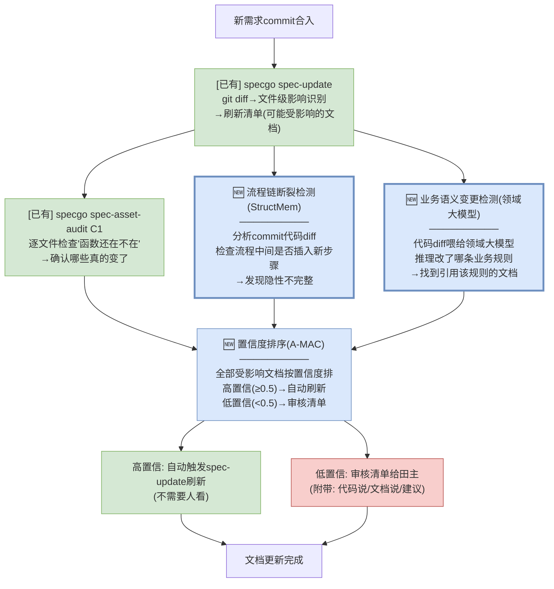
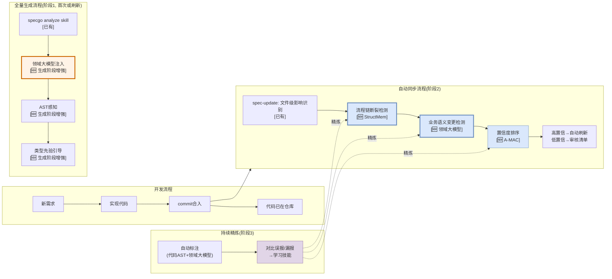

# 存量知识资产治理解决方案（基于 specgo 增强）

> **核心逻辑**：能在生成时就写对，就不等事后检测修正。
>
> **三个阶段**：
> 1. **生成阶段**（源头预防）：specgo analyze skill + 领域大模型注入 + AST感知 + 类型先验引导 → 从源头生成正确文档
> 2. **合入后同步**（增量检测）：新需求commit合入时，自动检测哪些既有文档过时了
> 3. **持续精炼**（越用越准）：每轮检测后学习，下一轮更准
>
> **面向两个业务场景**：
> 1. **最终产出的文档准确率提升**（80% → 90%+）
> 2. **交给人审核的内容自动识别，人不需要全看**（1000条 → ~250条）

---

## 〇、方案全景图

> **颜色说明**：
> - 🟩 绿色 = specgo 已有能力（直接复用，不开发）
> - 🟧 橙色 = 生成阶段增强（改analyze skill提示词，从源头预防错误）
> - 🟦 蓝色 = 合入后同步增强（commit合入时增量检测过时文档）
> - 🟪 紫色 = 持续精炼（每轮检测后学习）
> - 🟥 红框 = 业务产出

```mermaid
flowchart TB
    subgraph Legend["颜色图例"]
        L1["🟩 specgo已有能力(直接复用)"]
        L2["🟧 生成阶段增强(从源头预防错误)"]
        L3["🟦 合入后同步增强(检测代码后改导致的过时)"]
        L4["🟪 持续精炼(越用越准)"]
        L5["🟥 业务产出"]
    end

    subgraph Sources["知识资产来源"]
        direction LR
        SA["来源A: 代码仓逆向<br/>specgo 16个analyze skill"]
        SB["来源B: 领域大模型<br/>训练好的领域LLM"]
        SC["来源C: 外挂文档库<br/>外部文档"]
    end

    subgraph Phase1["阶段1: 生成阶段（源头预防，从源头写对）"]
        direction TB
        
        P1_Exist["[已有] specgo analyze skill<br/>16个skill读代码→写文档"]
        
        P1_Enh1["[生成阶段增强] 领域大模型注入<br/>──────────<br/>来源B(领域大模型)注入analyze skill提示词<br/>LLM写文档时懂业务术语<br/>──────────<br/>AI不会把'回收'写成'关闭'<br/>不会把'Muen SDK'当启动器<br/>→ 从源头预防C类(语义偏差)"]
        
        P1_Enh2["[生成阶段增强] 代码AST感知<br/>──────────<br/>tree-sitter解析AST结构化信息<br/>喂给LLM而非纯文本推断<br/>──────────<br/>接口参数/返回值不遗漏<br/>调用关系不猜错<br/>→ 从源头预防B类(初始不完整)"]
        
        P1_Enh3["[生成阶段增强] 类型先验引导<br/>──────────<br/>半持久信息标注'以配置为准'<br/>不写死具体数值<br/>──────────<br/>代码改了配置值文档还对<br/>→ 从源头预防A类(数值过时)"]
        
        P1_Exist --> P1_Enh1 --> P1_Enh2 --> P1_Enh3
    end

    subgraph Phase1Output["阶段1产出"]
        P1Out["docs/ 全套资产<br/>准确率: 80%→85%<br/>(从源头预防了5%错误)"]
    end

    subgraph Phase2["阶段2: 合入后同步（新需求commit合入时增量检测）"]
        direction TB
        
        P2_Exist["[已有] specgo spec-update<br/>──────────<br/>git diff→改了哪些文件<br/>→哪些文档引用了这些文件<br/>→ 刷新清单"]
        
        P2_Enh1["[合入后同步] 流程链断裂检测<br/>──────────<br/>spec-update只看文件级变更<br/>发现不了'流程中间插了新步骤'<br/>──────────<br/>分析commit的代码diff<br/>检查流程链断没断<br/>→ 发现B类(隐性不完整)<br/>技术: StructMem跨commit合成"]
        
        P2_Enh2["[合入后同步] 业务语义变更检测<br/>──────────<br/>spec-update不知道改的是哪条业务规则<br/>──────────<br/>把commit的代码diff喂给领域大模型<br/>领域大模型推理: '这次改了核保阈值'<br/>→ 找到引用该规则的文档标记过时<br/>→ 发现C类(语义变更漏网)<br/>技术: 领域大模型推理"]
        
        P2_Enh3["[合入后同步] 置信度排序<br/>──────────<br/>spec-update的刷新清单是'可能受影响'<br/>不确定哪些真的过时了<br/>──────────<br/>给每条标置信度<br/>高置信(肯定过时)→自动触发刷新<br/>低置信(可能还行)→审核清单给田主<br/>技术: A-MAC置信度"]
        
        P2_Exist --> P2_Enh1
        P2_Exist --> P2_Enh2
        P2_Enh1 --> P2_Enh3
        P2_Enh2 --> P2_Enh3
    end

    subgraph Phase2Output["阶段2产出"]
        P2Out["增量审核清单<br/>只含受本次commit影响的文档<br/>高置信自动刷新+低置信给田主"]
    end

    subgraph Phase3["阶段3: 持续精炼"]
        P3["[持续精炼] 技能精炼<br/>──────────<br/>每轮检测后:<br/>代码AST自动标注(代码矛盾=确认过时)<br/>领域大模型自动标注(语义偏差=确认)<br/>→ 对比误报/漏报→学习检测技能<br/>→ 技能库持续增长→下一轮更准<br/>技术: HORMA"]
        P3 -.->|"精炼"| Phase2
    end

    subgraph Output["业务产出"]
        O1["🟥 产出1: 准确率提升<br/>80%→90%+<br/>──────────<br/>阶段1(生成): 80%→85% 源头预防<br/>阶段2(同步): 85%→90% 检测代码后改<br/>阶段3(精炼): 90%→92-95%"]
        O2["🟥 产出2: 审核量降低<br/>1000条→250条<br/>──────────<br/>阶段1: 从源头减少错误→要审的少了<br/>阶段2: 增量检测只看受影响的→不全量<br/>阶段3: 误报减少→清单更短"]
    end

    Sources --> Phase1
    Phase1 --> Phase1Output
    Phase1Output --> Phase2
    Phase2 --> Phase2Output
    Phase2Output --> Output
    Phase3 -.-> Phase2

    %% 颜色样式
    style L1 fill:#d5e8d4,stroke:#82b366
    style L2 fill:#fff3e6,stroke:#cc6600
    style L3 fill:#dae8fc,stroke:#6c8ebf
    style L4 fill:#e1d5e7,stroke:#9673a6
    style L5 fill:#f8cecc,stroke:#b85450

    style P1_Exist fill:#d5e8d4,stroke:#82b366
    style P1_Enh1 fill:#fff3e6,stroke:#cc6600,stroke-width:3px
    style P1_Enh2 fill:#fff3e6,stroke:#cc6600
    style P1_Enh3 fill:#fff3e6,stroke:#cc6600

    style P2_Exist fill:#d5e8d4,stroke:#82b366
    style P2_Enh1 fill:#dae8fc,stroke:#6c8ebf,stroke-width:3px
    style P2_Enh2 fill:#dae8fc,stroke:#6c8ebf,stroke-width:3px
    style P2_Enh3 fill:#dae8fc,stroke:#6c8ebf

    style P3 fill:#e1d5e7,stroke:#9673a6,stroke-width:3px

    style O1 fill:#f8cecc,stroke:#b85450,stroke-width:3px
    style O2 fill:#f8cecc,stroke:#b85450,stroke-width:3px
```



**全景图读法**：

| 颜色 | 含义 | 开发量 | 生效时机 |
|------|------|--------|---------|
| 🟩 绿色 | specgo已有能力 | 0（直接复用） | 已生效 |
| 🟧 橙色 | 生成阶段增强 | 改analyze skill提示词 | 下一次全量/增量资产生成时 |
| 🟦 蓝色 | 合入后同步增强 | 新增检测器 | commit合入时自动触发 |
| 🟪 紫色 | 持续精炼 | 新增学习模块 | 第一轮检测后开始积累 |
| 🟥 红框 | 业务产出 | — | — |

**核心逻辑**：阶段1从源头预防错误（优先级最高）→ 阶段2只检测"代码后改"导致的过时（每次commit触发，不全量）→ 阶段3持续精炼。

---

## 一、阶段1：生成阶段（源头预防）

> **目标**：让 specgo 的 analyze skill 在生成文档时就写对，从源头预防三类错误。

### 1.1 为什么要从源头预防

| 错误类型 | 事后检测的成本 | 源头预防的成本 | 为什么源头更好 |
|---------|-------------|-------------|-------------|
| C类(语义偏差) | 检测+修正+田主确认 | 生成时注入领域大模型 | 写对一次 vs 检测修正一次 |
| B类(初始不完整) | 跨commit合成+补充+田主确认 | 生成时喂AST结构化信息 | 一步到位 vs 事后补 |
| A类(数值过时) | 代码比对+修正+田主确认 | 生成时不写死数值 | 预防 vs 检测修正 |

### 1.2 增强1：领域大模型注入（来源：StructMem Ω + 来源B领域大模型）

**现状问题**：specgo 的 analyze skill 读代码写文档时，LLM 只看代码不看业务上下文。代码里函数叫 `browserCloserTask`，LLM 就写"关闭浏览器任务"——但它不知道业务上叫"回收"。

**增强方式**：在 analyze skill 执行时，把领域大模型（来源B）作为**业务语义顾问**注入：

```
specgo biz-rules-analyze 执行时:

原流程:
  LLM读代码 → 写规则文档

增强后流程:
  LLM读代码 → 领域大模型校验业务语义 → 写规则文档
  
  具体做法:
    Step 1: LLM从代码提取规则草案: "BrowserCloserTask关闭过期实例"
    Step 2: 调用领域大模型校验:
            输入: "这段代码做的是: delete()内先uploadUserData再remove再reportUsage"
            问领域大模型: "这个业务动作的正确术语是什么?"
            领域大模型推理: "含上传+删除+上报 → 是'回收'不是'关闭'"
    Step 3: LLM用校验后的正确术语写文档: "BrowserCloserTask回收不活跃实例"
```

**涉及哪些 specgo skill**：

| specgo skill | 注入什么 | 预防什么错误 |
|--------------|---------|------------|
| biz-rules-analyze | 领域大模型校验规则描述的术语 | 规则文档的语义偏差 |
| biz-lexicon-analyze | 领域大模型补充/修正术语释义 | 术语表不准确 |
| arch-interaction-model-analyze | 领域大模型校验流程步骤的术语 | 交互模型语义偏差 |
| arch-structure-model-analyze | 领域大模型校验模块职责描述 | 结构模型语义偏差 |
| tech-*-analyze | 领域大模型校验技术描述的业务定位 | 技术规范语义偏差 |

### 1.3 增强2：代码AST感知（来源：StructMem 时间戳重建）

**现状问题**：specgo 的 analyze skill 读的是代码文本。LLM 从文本推断函数签名/调用关系/参数类型，容易漏看或看错。

**增强方式**：在 analyze skill 执行前，先用 tree-sitter 解析代码 AST，把结构化信息喂给 LLM：

```
specgo biz-interface-analyze 执行时:

原方式:
  LLM读 browser.py 源码文本 → 推断接口签名

增强后:
  tree-sitter解析 → AST结构化信息:
    函数: create_browser(executable_path: str, userdata: str, extensions: list)
    返回: BrowserContext
    调用: playwright.chromium.launch(), BrowserWrapper.register()
    被调用: browser-gateway ClientImpl.java
  
  LLM同时看源码文本+AST结构 → 接口文档不漏参数/返回值

效果:
  原来可能漏看返回类型 → 文档只写"创建浏览器"没写返回值
  增强后AST明确显示返回BrowserContext → 文档写"返回BrowserContext实例"
  → 从源头预防B类(初始不完整)
```

### 1.4 增强3：类型先验引导（来源：A-MAC）

**现状问题**：specgo 的 analyze skill 把代码里的具体数值写进文档——"检查周期1800000ms"。代码改了配置值文档就过时。

**增强方式**：在 analyze skill 提示词中增加信息类型引导：

```
增强后提示词:
  "🆕 信息类型引导:
   - 持久知识(框架选型/线程池类型): 详细描述
   - 半持久知识(线程池大小/超时时间/检查周期): 
     标注'以application.yaml配置为准'，不写死数值
   - 临时状态(调试配置): 不写入文档"

效果:
  原来会写: "检查周期1800000ms" (❌ 数值写死了)
  增强后写: "检查周期由browsergw.scheduled.check-browser-period配置,
            代码默认1800000ms，application.yaml可覆盖" (✅ 标注配置来源)
  
  → 代码改了配置值，文档仍然准确
  → 从源头预防A类(数值过时)
```

### 1.5 阶段1效果

| 指标 | 无增强 | 有阶段1增强 | 提升 |
|------|--------|-----------|------|
| C类(语义偏差) | ~50条 | ~10条 | 80%减少 |
| B类(初始不完整) | ~60条 | ~15条 | 75%减少 |
| A类(数值过时) | ~40条 | ~10条 | 75%减少 |
| A类(代码后改) | ~60条 | ~60条 | 0(无法预防) |
| **准确率** | **80%** | **85%** | **+5%** |

**剩余的~95条问题**主要是"文档生成后代码改了"——这是阶段2要解决的。

---

## 二、阶段2：合入后同步（增量检测）

> **目标**：新需求commit合入时，自动检测哪些既有文档过时了。不全量重审，只检测受影响的。

### 2.1 为什么需要阶段2

阶段1从源头预防了生成时的错误，但**文档生成后代码继续迭代**——新需求实现、Bug修复、重构都会改代码，既有文档可能过时。这是阶段1无法预防的（生成时代码是对的，后来改了）。

**触发时机**：每次有新需求commit合入时自动触发（不是全量重审）。

### 2.2 specgo spec-update 已有能力

specgo 已有 `spec-update` 做增量同步：

```
新commit合入:
  git diff → 改了哪些文件
  → 哪些文档引用了这些文件（锚点反查的逆用）
  → 生成刷新清单（这些文档可能受影响）
  → 人工确认后刷新
```

**spec-update的能力边界**：

| spec-update能做 | spec-update做不到 | 需要增强 |
|----------------|-----------------|---------|
| 文件级影响识别（改了哪个文件→哪些文档引用了） | 流程链断裂检测（commit在流程中间插了新步骤） | StructMem |
| 逐文件"函数还在不在"检查 | 业务语义变更检测（commit改了哪条业务规则） | 领域大模型 |
| 生成刷新清单 | 置信度排序（哪些真的过时vs可能还行） | A-MAC |

### 2.3 增强1：流程链断裂检测（来源：StructMem 跨commit合成）

**做什么**：检测这次commit是否在某个流程中间插入了新步骤，导致引用该流程的文档不完整。

```
新commit合入: 改了 Login() 和 onControlTcpConnected() 之间的代码

spec-update: 文件级识别 → interaction-model-control-tcp-login.md引用了这些文件 → 加入刷新清单

🆕流程链断裂检测:
  分析commit的代码diff:
    diff显示: Login()和onControlTcpConnected()之间新增了registerChannel()
  
  检查文档: interaction-model-control-tcp-login.md时序图
    文档流程: Login → onControlTcpConnected → 事件处理 (3步)
    实际流程: Login → registerChannel(新) → onControlTcpConnected → 事件处理 (4步)
  
  → ⚠️ 文档不完整，缺少registerChannel步骤
  → 标记: 高置信过时(代码diff明确显示插入了新步骤)
```

### 2.4 增强2：业务语义变更检测（来源：领域大模型推理）

**做什么**：把commit的代码diff喂给领域大模型，让它推理"这次改动改了哪条业务规则"，找到引用该规则的文档。

```
新commit合入: 改了 ChromeSetImpl.java 的 delete() 方法

spec-update: 文件级识别 → rules-browser.md引用了ChromeSetImpl → 加入刷新清单

🆕业务语义变更检测:
  把commit的代码diff喂给领域大模型:
    输入: "diff: delete()从同步改为返回CompletableFuture"
    问领域大模型: "这次改动影响了哪条业务规则?"
    领域大模型推理: "delete()的执行语义从'同步删除'变为'异步删除',
                     影响rules-browser.md中'create-chrome-fail-cleanup'规则的描述"
  
  → 找到引用该规则的文档: rules-browser.md
  → 标记: 语义变更(执行语义从同步变异步)
  → 标记: 高置信过时(领域大模型+代码双重确认)
```

### 2.5 增强3：置信度排序（来源：A-MAC）

**做什么**：给spec-update的刷新清单+新增发现按置信度排序，高置信自动刷新、低置信给田主。

```
spec-update刷新清单 + 流程链断裂 + 业务语义变更 = 全部受影响文档

置信度评分:
  ──────────────────────────────────
  文档A: rules-browser.md
    代码diff明确显示delete()改了 → 代码一致性0.1
    领域大模型确认影响了业务规则 → 语义一致性0.2
    综合置信度: 0.15 → 高置信过时 → ✅自动触发spec-update刷新
  
  文档B: interaction-model-control-tcp-login.md
    代码diff显示插入了registerChannel → 流程链断裂
    综合置信度: 0.20 → 高置信过时 → ✅自动触发刷新
  
  文档C: data-model-browser-wrapper.md
    改了BrowserWrapper但只是新增了一个字段
    文档描述的是数据结构,新增字段不影响已有描述
    综合置信度: 0.75 → 中等(可能还行) → ⚠️审核清单给田主
  ──────────────────────────────────

高置信(自动刷新): 不需要人看
低置信(给田主): 只看这些
```

### 2.6 阶段2流程



### 2.7 阶段2效果

| 指标 | 无增强(spec-update only) | 有阶段2增强 | 提升 |
|------|------------------------|-----------|------|
| 检测范围 | 文件级（改了哪个文件） | 文件级+流程链+业务语义 | 覆盖更全 |
| 发现类型 | "函数改了/删了" | +流程链断裂+业务规则变更 | 发现更多类型 |
| 自动刷新比例 | 0%（全靠人确认） | ~60%（高置信自动刷新） | 减少人工 |
| 审核清单量 | 全部刷新清单 | 只有低置信的 | 量更少 |

---

## 三、阶段3：持续精炼（越用越准）

> **目标**：每轮检测后学习，下一轮更准。

### 3.1 关键技术：技能精炼（来源：HORMA）

**原理**：每次commit合入检测后，对比"自动标注"和"实际结果"，学习检测技能。

**自动标注（不需要人）**：
```
代码AST矛盾 → 自动确认"过时"(代码说X文档说Y,代码是Ground Truth)
领域大模型矛盾 → 自动确认"语义偏差"(领域大模型说应该叫Y,文档写的是X)
两者一致 → 自动确认"没问题"
```

**对比学习**：
```
D_exo(误报): 置信度标了"过时"但实际文档还对
  → 分析: 文档虽然引用了改的文件,但描述的是另一个函数
  → 技能: "刷新清单要区分'引用了改的文件'和'引用了改的函数'"

D_end(漏报): 置信度标了"没问题"但实际文档过时了
  → 分析: 函数名没变但函数体改了,置信度评分没检查函数体
  → 技能: "delete/insert/update类方法,函数名在也要检查返回类型"

技能库持续增长 → 下一轮置信度评分更准 → 自动刷新比例↑ → 审核清单↓
```

### 3.2 阶段3效果

| 轮次 | 自动刷新比例 | 审核清单量 | 准确率 |
|------|-----------|----------|--------|
| 第1轮 | 60% | ~250条 | 85% |
| 第2轮 | 70% | ~200条 | 88% |
| 第3轮 | 75% | ~180条 | 90% |
| 第5轮 | 80% | ~150条 | 92-95% |

---

## 四、冷启动阶段

> specgo 已完成资产产出，阶段1-3增强需要补充基线。

### 冷启动内容

| Step | 做什么 | 来源 | 人力 | 自动化 |
|------|--------|------|------|--------|
| Step 1 | 代码AST基线建立 | tree-sitter解析全部源码 | 0 | 全自动 |
| Step 2 | 历史diff回填 | 用文档生成时间搜索之后的commit diff | 0 | 全自动 |
| Step 3 | 领域知识层 | 用领域大模型(来源B)推理生成术语表+规则库 | 0 | 全自动(领域大模型推理) |
| Step 4 | 首轮权重校准 | 代码AST+领域大模型自动标注→校准A-MAC权重 | 0 | 全自动 |
| **合计** | | | **0** | **1-2天** |

**冷启动完全无人介入**：领域知识层通过领域大模型推理生成，权重校准用代码AST(代码矛盾=自动确认过时)和领域大模型(语义偏差=自动确认)做自动标注。

---

## 五、完整流程：从需求到文档同步



**两种触发模式**：
- **全量生成**（首次或大版本刷新）：走阶段1，从源头生成正确文档
- **增量同步**（每次commit合入）：走阶段2，只检测受影响的文档

---

## 六、两个业务产出

### 产出1：准确率提升（80% → 90%+）

| 阶段 | 准确率 | 做什么 | 来源技术 |
|------|--------|--------|---------|
| 原始 | 80% | specgo analyze skill产出，有20%错误 | — |
| +阶段1 | 85% | 从源头预防C类+B类+A类数值 | 领域大模型注入+AST感知+类型先验 |
| +阶段2 | 90% | 检测"代码后改"导致的过时 | StructMem跨commit+领域大模型+A-MAC |
| +阶段3 | 92-95% | 持续精炼减少误报漏报 | HORMA |

### 产出2：审核量降低（1000条 → 增量检测）

| 模式 | 审核量 | 说明 |
|------|--------|------|
| 首次全量生成 | 0条（阶段1从源头预防） | 生成时写对，不需要事后审 |
| 每次commit合入 | 只看受影响的~20条 | 不全量重审，只检测本次commit影响的文档 |
| 其中高置信 | 0条（自动刷新） | 代码AST+领域大模型双重确认 |
| 其中低置信 | ~5-10条 | 给田主确认，附带证据链 |
| 技能精炼后 | ~3-5条 | 误报减少 |

**关键变化**：不是"1000条缩到250条"，而是**"全量1000条根本不审（阶段1从源头写对）+ 每次commit只审受影响的5-10条"**。审核量从一次性4人天变成每次commit5分钟。

---

## 七、关键技术索引

| # | 关键技术 | 来源论文 | 所在阶段 | 增强类型 |
|---|---------|---------|---------|---------|
| 1 | 领域大模型注入 | StructMem Ω + 来源B | 阶段1(生成) | 从源头预防C类(语义偏差) |
| 2 | 代码AST感知 | StructMem | 阶段1(生成) | 从源头预防B类(初始不完整) |
| 3 | 类型先验引导 | A-MAC | 阶段1(生成) | 从源头预防A类(数值过时) |
| 4 | 跨commit合成 | StructMem | 阶段2(合入同步) | 检测B类(流程链断裂) |
| 5 | 领域大模型推理 | StructMem Ω + 来源B | 阶段2(合入同步) | 检测C类(语义变更) |
| 6 | 置信度评分 | A-MAC | 阶段2(合入同步) | 排序:高置信自动刷新/低置信给田主 |
| 7 | 技能精炼 | HORMA | 阶段3(持续) | 学习误报/漏报→越用越准 |
| 8 | 符号检查器 | LatticeMind | 阶段2(specgo C1已有) | 已有等价能力 |
| 9 | 双路径检索 | RF-Mem | 阶段2(检索审核清单) | 简单走快/复杂走慢 |

**全部不依赖commit message**——阶段2用代码diff(AST变化)和领域大模型推理作为Ground Truth。

---

## 八、对领导的话

**核心逻辑**：能在生成时就写对，就不等事后检测修正。

**阶段1（生成阶段，优先级最高）**：改 specgo 的 analyze skill 提示词，注入领域大模型+AST感知+类型先验引导。下次全量或增量资产生成时自然生效，从源头把准确率从80%提升到85%——预防了C类(语义偏差)、B类(初始不完整)、A类(数值过时)三类错误。

**阶段2（合入后同步，持续运行）**：每次新需求commit合入时自动触发，只检测"这次commit让哪些既有文档过时了"。specgo的spec-update已有文件级影响识别，论文技术增强三个点：流程链断裂检测(StructMem)、业务语义变更检测(领域大模型)、置信度排序(A-MAC)。高置信自动刷新、低置信给田主。**每次commit只需审5-10条，不是全量1000条重审。**

**阶段3（持续精炼）**：代码AST+领域大模型做自动标注(不需要人)，对比误报/漏报学习技能，越用越准。

**冷启动0人工+1-2天自动**：领域知识层通过领域大模型推理生成，权重校准用代码AST+领域大模型自动标注。

**效果**：
- 准确率：80%→85%(源头)→90%+(合入同步)→92-95%(精炼)
- 审核量：全量1000条不审了(阶段1从源头写对)→每次commit只审5-10条受影响的(阶段2增量)
- 人工：从4人天(全量审)→每次commit5分钟(增量审)

---

*方案生成日期: 2026-10-12*
