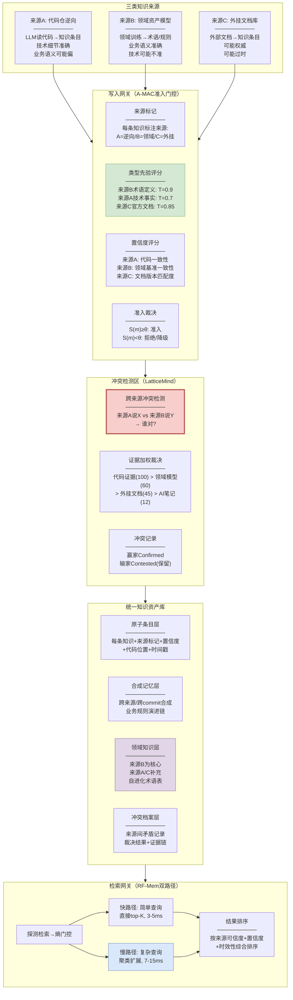

# 存量知识资产治理完整解决方案

> **目标**：针对存量知识资产治理提供一套完整方案，覆盖写入、质量管控、检索全链路。
>
> **知识资产来源（三类输入）**：
> - **来源A：代码仓逆向**（LLM模型能力，从代码逆向生成知识）
> - **来源B：领域资产模型**（基于领域资产训练的模型/知识库）
> - **来源C：外挂文档资产库**（独立维护的文档资产）

---

## 一、三类知识资产来源的特征分析

### 来源A：代码仓逆向（LLM逆向）

```
代码仓 ──LLM逆向──→ 知识条目
```

| 特征 | 说明 |
|------|------|
| 内容 | 代码结构、函数签名、调用关系、业务逻辑推断 |
| 优势 | 直接来自代码，技术细节准确 |
| 风险 | AI可能误解业务语义；代码改了文档没跟上；覆盖率不全 |
| 可信度 | 技术层面高，业务语义层面中 |
| 时效性 | 生成时刻准确，之后随代码迭代逐渐过时 |
| 典型问题 | "说偏了"(语义偏差)、"说漏了"(不完整)、"说错了"(代码已变) |

### 来源B：领域资产模型（领域训练）

```
领域资产/PRD/规范 ──训练/提取──→ 领域知识库
```

| 特征 | 说明 |
|------|------|
| 内容 | 业务术语、业务规则、领域概念、合规约束、业务流程 |
| 优势 | 业务语义准确，有领域专家背书 |
| 风险 | 领域演进后知识未更新；与代码实现可能有gap |
| 可信度 | 业务语义层面高，技术实现层面可能不准 |
| 时效性 | 训练/提取时刻准确，之后随业务演进逐渐过时 |
| 典型问题 | 业务规则变了但模型没更新；领域描述和代码实现不一致 |

### 来源C：外挂文档资产库

```
外部文档/规范/手册 ──导入──→ 文档知识条目
```

| 特征 | 说明 |
|------|------|
| 内容 | 设计文档、接口规范、运维手册、第三方文档 |
| 优势 | 可能是权威来源（官方文档/标准规范） |
| 风险 | 版本不匹配；术语和代码不一致；维护不及时 |
| 可信度 | 取决于文档来源权威性（官方文档高，非正式文档低） |
| 时效性 | 文档发布时刻准确，之后随系统演进逐渐过时 |
| 典型问题 | 文档版本和代码版本不匹配；外部文档用的是旧术语 |

### 三类来源的互补关系

| 维度 | 来源A(代码逆向) | 来源B(领域模型) | 来源C(外挂文档) |
|------|---------------|---------------|---------------|
| 技术准确性 | ✅ 高 | ❌ 可能不准 | ⚠️ 取决于版本 |
| 业务语义准确性 | ❌ 可能偏差 | ✅ 高 | ⚠️ 取决于来源 |
| 时效性 | ⚠️ 生成后过时 | ⚠️ 训练后过时 | ⚠️ 发布后过时 |
| 覆盖完整性 | ⚠️ 可能遗漏 | ✅ 系统性覆盖 | ⚠️ 取决于文档 |
| 权威性 | 中（AI推断） | 高（专家背书） | 取决于来源 |

**核心洞察**：三类来源各有优势和盲区。来源A技术准但业务语义可能偏，来源B业务准但技术可能不准，来源C可能是权威但可能过时。**方案的价值在于：让三类来源交叉验证，自动发现不一致，而不是依赖单一来源。**

---

## 二、完整方案架构



---

## 三、写入链路：三类来源怎么进知识库

### 3.1 来源标记：每条知识标注来源

每条知识进入知识库前，标注来源类型：

```
来源A(代码逆向):
  source_type = "reverse_engineered"
  evidence_weight = 45  (技术事实可信但业务语义可能偏)
  
来源B(领域模型):
  source_type = "domain_model"  
  evidence_weight = 60  (业务语义可信)
  
来源C(外挂文档):
  source_type = "external_doc"
  evidence_weight = 45  (取决于文档权威性)
  如果是官方标准文档: evidence_weight = 70
  如果是非正式文档: evidence_weight = 30
```

### 3.2 准入门控（A-MAC五维评分适配）

每条知识用五维评分决定是否准入：

| 维度 | 来源A(逆向) | 来源B(领域) | 来源C(外挂) | 评分方式 |
|------|-----------|-----------|-----------|---------|
| 效用U | 这条知识未来会被检索用到吗？ | 同左 | 同左 | LLM评估 |
| 置信度C | **代码一致性**(读代码AST验证) | **领域基准一致性**(和领域术语表比对) | **文档版本匹配度**(文档版本vs代码版本) | 各来源用不同验证方式 |
| 新颖性N | 和已有知识重复吗？ | 同左 | 同左 | 嵌入余弦相似度 |
| 近因性R | 生成多久了？代码改了吗？ | 训练多久了？领域变了吗？ | 发布多久了？版本匹配吗？ | 时间衰减×来源特定因子 |
| 类型先验T | 技术事实T=0.7, 业务推断T=0.4 | 术语定义T=0.9, 规则T=0.85 | 官方文档T=0.85, 非正式T=0.4 | 按来源+类型分类 |

**关键适配：置信度C对不同来源用不同验证方式**：
- 来源A：读代码AST验证"文档说的和代码一致吗"
- 来源B：查领域基准验证"模型说的和术语表一致吗"
- 来源C：查文档版本"文档版本和代码版本匹配吗"

### 3.3 跨来源冲突检测（LatticeMind适配）

**这是多来源场景的核心新增**——三类来源可能对同一事实有不同描述：

```
冲突场景1: 来源A vs 来源B
  来源A(代码逆向): "BrowserCloserTask关闭过期实例"
  来源B(领域模型): "BrowserCloserTask回收不活跃实例"
  → 跨来源冲突: "关闭" vs "回收"
  证据加权: 来源B(60) > 来源A(45) → 来源B赢
  来源A标Contested，来源B标Confirmed
  → 标记给田主: "来源A的术语偏差，建议参考来源B修正"

冲突场景2: 来源A vs 来源C
  来源A(代码逆向): "检查周期1800000ms"
  来源C(外挂文档): "检查周期600000ms"
  → 跨来源冲突: 数值不一致
  读当前代码application.yaml → 实际是300000ms
  → 两个都过时了！代码(100) > 文档C(45) > 逆向A(45)
  → 两个都标过时，标记给田主

冲突场景3: 来源B vs 来源C
  来源B(领域模型): "大额保单需人工核保"
  来源C(外挂文档): "50万以上需人工核保"
  → 跨来源冲突: "大额"没有量化定义 vs "50万"
  → 来源C更具体，但可能来源B的业务定义是"100万"
  读代码: if (amount > 500000) → 实际是50万
  → 来源C匹配代码，来源B的业务定义过时
  → 来源B标过时
```

### 3.4 证据权重分层（跨来源裁决依据）

```
证据权重从高到低:
  ──────────────────────────────────
  代码当前实现(code-change)      = 100  ← 最高，代码是Ground Truth
  + git commit bonus              = +40  ← 有commit记录的代码变更
  
  领域资产模型(domain_model)      = 60   ← 业务语义可信
  + 领域专家背书                   = +20  ← 有田主确认的
  
  外挂官方文档(official_doc)      = 70   ← 官方规范权威
  外挂非正式文档(informal_doc)    = 30   ← 非权威来源
  
  代码逆向(reverse_engineered)    = 45   ← AI推断，技术层面可信
  + 代码AST验证通过               = +20  ← 读代码验证一致的加分
  
  AI笔记/临时标注(ai_note)        = 12   ← 最弱，仅参考
  过时观察(stale_observation)     = 4    ← 明确过时，最低
  ──────────────────────────────────
  
  裁决规则: 权重高的赢，输的标Contested(保留不删)
```

---

## 四、质量管控链路：怎么自动识别问题

### 4.1 三检测器（复用之前的方案，适配多来源）

| 检测器 | 找什么 | 多来源场景的适配 |
|--------|--------|----------------|
| A 事实性错误 | 代码和知识矛盾 | 读代码AST，和**所有来源**的条目逐条比对 |
| B 完整性缺失 | 流程不完整 | 分析代码diff，和**所有来源**的流程描述比对 |
| C 语义偏差 | 业务术语偏了 | 用**来源B(领域模型)**作为基准，校验来源A/C的术语 |

**关键适配**：来源B(领域模型)在检测器C中扮演**基准角色**——它是业务语义最可信的来源，用来校验来源A和来源C的业务描述准不准。但如果来源B自己也过时了，检测器A（代码事实比对）会发现。

### 4.2 三来源交叉验证矩阵

```
              来源A(逆向)    来源B(领域)    来源C(外挂)    代码(真相)
来源A(逆向)       —           冲突?C检测     冲突?           冲突?A检测
来源B(领域)    冲突?C检测        —          冲突?           冲突?A检测
来源C(外挂)    冲突?C检测     冲突?            —           冲突?A检测
代码(真相)     冲突?A检测     冲突?A检测     冲突?A检测        —
```

**交叉验证的价值**：
- 来源A和来源B矛盾 → 检测器C发现"术语偏差"
- 来源A和代码矛盾 → 检测器A发现"事实性错误"
- 来源B和代码矛盾 → 检测器A发现"领域模型过时"
- 来源C和代码矛盾 → 检测器A发现"外挂文档过时"
- 三个来源都和代码一致 → 高置信，不需要人工审核

---

## 五、检索链路：怎么从多来源知识库中检索

### 5.1 双路径检索（RF-Mem适配）

```
查询到来 → 探测检索 → 计算均值相似度s̄和熵H(p)

  s̄≥θ_high (高熟悉) → 快路径: 直接top-K, 3-5ms
  
  s̄≤θ_low (低熟悉) → 慢路径: KMeans聚类→α混合→迭代扩展, 7-15ms
  
  中间地带 → 熵裁决: H低走快, H高走慢
```

### 5.2 多来源排序（检索结果按来源可信度排序）

检索结果同时返回来自不同来源的条目，按**综合可信度**排序：

```
查询: "BrowserCloserTask的回收规则是什么?"

检索结果:
  ──────────────────────────────────
  1. [来源B-领域模型] 置信度0.85 ⭐最高优先
     "BrowserCloserTask回收不活跃实例(含心跳过期+远端不活跃)"
  
  2. [来源A-代码逆向] 置信度0.15 ❌低置信(和代码矛盾)
     "BrowserCloserTask关闭过期实例"
     冲突标记: 与来源B术语偏差("关闭"vs"回收")
     与代码矛盾: 缺少远端不活跃判断
  
  3. [来源C-外挂文档] 置信度0.40 ⚠️中低(版本可能过时)
     "BrowserCheckTask定期检查实例状态"
     (不同任务，但语义相关)
  ──────────────────────────────────
  
  注入opencode上下文:
    优先使用来源B(置信度最高)
    来源A已标记矛盾，附带冲突说明
    来源C仅供参考
```

### 5.3 检索时注入冲突提示

当检索结果中包含冲突条目时，**附带冲突说明**注入opencode：

```
opencode收到的上下文:
  ──────────────────────────────────
  【高置信知识】(来源B-领域模型)
  BrowserCloserTask回收不活跃实例:
  条件1: 心跳过期 (nanoTime - heartbeats > ttl)
  条件2: 远端不活跃 (ub==null || browserInstance==null || ...)
  动作: delete(userId) 含数据上传+实例删除+用量上报
  
  【冲突提示】
  来源A(逆向)描述为"关闭过期实例"——术语偏差:
  "关闭"不含数据上传和用量上报，"回收"包含。
  建议以来源B的"回收"为准。
  ──────────────────────────────────
```

---

## 六、持续治理：知识库怎么随时间保持质量

### 6.1 代码迭代触发质量检查

```
代码commit触发:
  ──────────────────────────────────
  读代码diff → 分析AST变化
  
  对知识库中所有来源的条目做影响检查:
    来源A条目涉及该代码文件的 → 标"需重新验证"
    来源B条目涉及该业务规则的 → 标"需重新验证"
    来源C条目涉及该模块的 → 标"需重新验证"
  
  自动跑三检测器 → 输出更新后的审核清单
```

### 6.2 领域模型更新触发交叉验证

```
领域模型更新触发:
  ──────────────────────────────────
  来源B更新了术语/规则
  
  对知识库中来源A和来源C的条目做语义校验:
    来源A条目的业务术语 vs 更新后的来源B → 发现新的偏差?
    来源C条目的业务描述 vs 更新后的来源B → 发现新的不一致?
  
  自动跑检测器C → 输出语义偏差审核清单
```

### 6.3 外挂文档更新触发版本校验

```
外挂文档更新触发:
  ──────────────────────────────────
  来源C新增/更新了文档
  
  对新文档做准入检查:
    版本匹配度: 文档版本 vs 代码版本
    术语一致性: 文档术语 vs 来源B术语表
    内容冲突: 文档描述 vs 来源A逆向描述 vs 代码现状
  
  准入或标记冲突
```

### 6.4 技能精炼让检测越来越准（HORMA）

```
对比分析:
  D_exo: 标了问题但实际正确的 → "什么不该标记"
  D_end: 标了正确但实际有问题的 → "什么该标记但漏了"

技能库持续增长:
  ──────────────────────────────────
  1. 来源A描述"预开"时常见偏差: AI写"提前打开"而非"预先创建并分配"
  2. 来源C版本不匹配时常见模式: 文档描述的是v1.2但代码已到v1.5
  3. 来源B和代码矛盾的常见模式: 领域规则变了但模型没更新
  ...
  ──────────────────────────────────

下次检测时加载这些技能 → 误报漏报减少 → 发现率提升
```

---

## 七、知识资产库的存储结构

```
.opencode/memory/  (或 docs/.knowledge/)
├── entries/                      # 原子条目层
│   ├── source-A-reverse/          # 来源A: 代码逆向
│   │   ├── 2026-08/
│   │   │   ├── a1b2c3d/           # commit_hash
│   │   │   │   ├── facts.json     # 代码事实
│   │   │   │   ├── relations.json  # 工程关系
│   │   │   │   └── domain.json    # 领域语义(AI推断)
│   │   │   └── ...
│   │   └── 2026-09/
│   ├── source-B-domain/           # 来源B: 领域模型
│   │   ├── glossary.json          # 领域术语表
│   │   ├── rules.json             # 业务规则
│   │   └── process.json           # 业务流程
│   └── source-C-external/         # 来源C: 外挂文档
│       ├── design-docs/           # 设计文档
│       ├── api-specs/             # 接口规范
│       └── compliance/            # 合规手册
├── synthesis/                     # 合成记忆层
│   ├── rule-evolution/            # 业务规则演进链
│   ├── architecture/              # 架构决策演进
│   └── cross-source/              # 跨来源合成知识
├── conflicts/                     # 冲突档案层
│   ├── A-vs-B/                    # 来源A vs 来源B
│   ├── A-vs-code/                 # 来源A vs 代码
│   ├── B-vs-code/                 # 来源B vs 代码
│   └── C-vs-code/                 # 来源C vs 代码
├── quality/                       # 质量报告
│   ├── audit-checklist.md         # 最新审核清单
│   ├── confidence-scores.json     # 置信度评分
│   └── staleness-report.md        # 过时检测报告
└── skills/                        # 检测技能库
    └── detection-skills.md        # 精炼产出的检测技能
```

---

## 八、五篇论文在完整方案中的分工

| 论文 | 在完整方案中的角色 | 多来源场景的具体应用 |
|------|------------------|-------------------|
| **A-MAC** | 写入网关准入门控 | 三来源各自评分，来源B术语定义T=0.9最高优先准入 |
| **LatticeMind** | 冲突检测+证据加权 | 跨来源冲突裁决：代码(100) > 领域模型(60) > 外挂文档(45) > 逆向(45) > AI笔记(12) |
| **StructMem** | 事件提取+跨commit合成+领域知识层 | 来源A从commit提取三视角；来源B作为领域知识层基准；跨来源合成交叉知识 |
| **RF-Mem** | 检索网关双路径 | 简单查询快路径直接返回；复杂跨来源查询慢路径聚类扩展 |
| **HORMA** | 层级存储+技能精炼 | 三来源分层存储；对比误报/漏报精炼检测技能 |

---

## 九、效果量化

### 写入效果

| 指标 | 无方案 | 有方案 | 提升 |
|------|--------|--------|------|
| 知识来源 | 单一(逆向) | 三来源交叉验证 | 覆盖率+可信度 |
| 准入质量 | 全量入库(含噪声) | 五维评分过滤噪声 | 减少无效条目40% |
| 冲突感知 | 无 | 跨来源自动检测+裁决 | 发现来源间矛盾 |

### 质量管控效果

| 指标 | 无方案(全量人工) | 有方案(自动检测) | 提升 |
|------|-----------------|-----------------|------|
| 人工审核量 | 1000条 | ~260条 | **74%降低** |
| 人工成本 | 4人天 | 1人天 | **75%降低** |
| 问题发现率 | ~95%(人全看) | 85-90% | 略降但可迭代提升 |
| 冲突发现 | 无 | 三来源交叉自动发现 | 从0到有 |

### 检索效果

| 指标 | 无方案(扁平检索) | 有方案(双路径+多来源排序) | 提升 |
|------|----------------|------------------------|------|
| 检索延迟 | 3ms | 快3ms/慢15ms(自适应) | 简单查询不降，复杂查询提升 |
| 结果可信度 | 无来源标注 | 按来源可信度排序 | 高来源优先 |
| 冲突感知 | 无 | 检索结果附带冲突说明 | Agent不被矛盾信息误导 |

---

## 十、对领导的话

**完整方案覆盖三个环节**：

1. **写入**：三类来源（代码逆向/领域模型/外挂文档）各自评分准入，跨来源冲突自动裁决——代码证据(100)最可信，领域模型(60)次之，外挂文档(45)和逆向(45)看情况。

2. **质量管控**：三个检测器自动扫"说错了的/说漏了的/说偏了的"，三来源交叉验证。1000条声明缩到260条疑似问题给田主，**人工从4人天降到1人天**。全部不依赖commit message——直接读代码AST和diff作为Ground Truth。

3. **检索**：双路径自适应检索（简单走快、复杂走慢），结果按来源可信度排序，附带冲突提示。Agent优先用高可信来源，低可信的附带"这里有冲突，建议参考来源B"。

**核心价值**：不是单一来源做知识治理，而是**三类来源交叉验证**——代码逆向技术准但业务可能偏，领域模型业务准但可能过时，外挂文档可能权威但版本不匹配。三者交叉验证，自动发现不一致，只把不一致的给田主看。

---

*方案生成日期: 2026-10-12*
