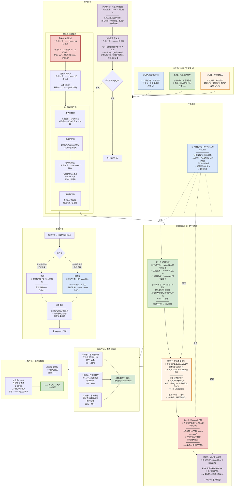
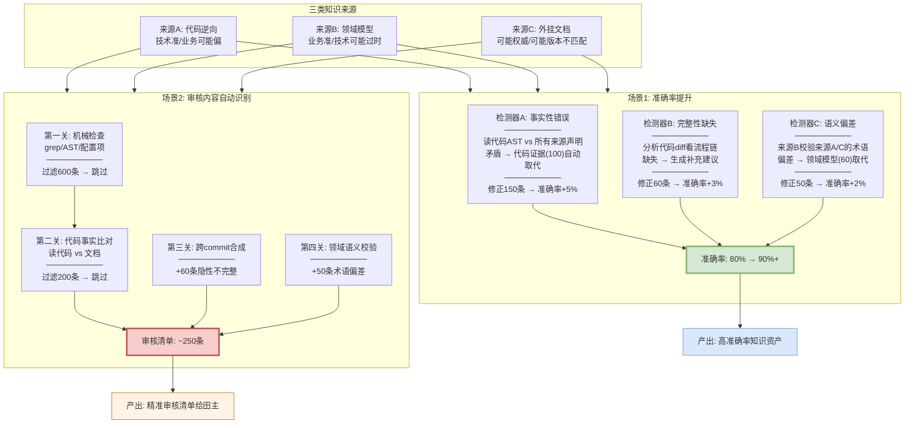
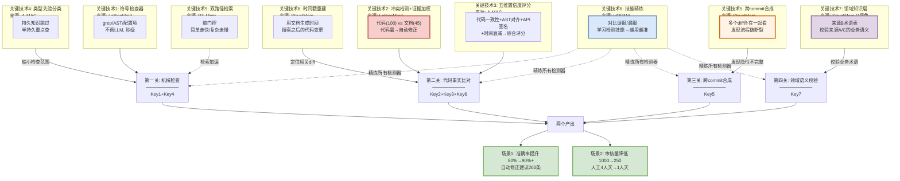

# 存量知识资产治理解决方案

> **面向两个业务场景**：
> 1. **最终产出的文档准确率提升**（80% → 90%+）
> 2. **交给人审核的内容自动识别，人不需要全看**（1000条 → ~250条）

---

## 〇、方案全景图



**全景图读法**：

| 层级 | 做什么 | 关键技术 |
|------|--------|---------|
| **来源层** | 三类知识输入(逆向/领域/外挂)，各有优势和盲区 | — |
| **写入网关** | 来源标记→类型先验分类→五维评分→准入裁决 | 技术4类型先验 + 技术3置信度 |
| **冲突检测** | 三来源矛盾比对→证据加权裁决(代码100>领域60>逆向45) | 技术2冲突检测+证据加权 |
| **知识库** | 四层存储(原子/合成/领域/冲突档案) | 技术7领域知识层 |
| **质量检测** | 四关过滤：机械检查→代码比对→跨commit合成→领域校验 | 技术1符号检查 + 技术2冲突 + 技术3置信 + 技术5跨commit合成 + 技术6时间戳 + 技术7领域知识层 |
| **技能精炼** | 对比误报/漏报→学习检测技能→越用越准 | 技术8技能精炼 |
| **检索网关** | 熵门控双路径：简单走快/复杂走慢+来源排序+冲突提示 | 技术9双路径检索 |
| **产出1** | 准确率80%→90%+（自动修正260条） | 技术2+5+7 |
| **产出2** | 审核量1000→250（75%降低） | 技术1+3+4+8 |

**全部9个关键技术不依赖commit message**——直接读代码AST和代码diff作为Ground Truth。

---

## 一、两个业务场景的技术解法

### 场景1：文档准确率提升（80% → 90%+）

**问题**：三类来源（代码逆向/领域模型/外挂文档）产出的知识，80%正确20%有问题。问题分三种：说错了、说漏了、说偏了。

**解法**：三个检测器自动识别三类问题 + 三来源交叉验证修正 + 代码AST作为Ground Truth。

| 问题类型 | 占比 | 检测器 | 怎么发现 | 怎么修正 |
|---------|------|--------|---------|---------|
| 说错了(事实性错误) | 40% | A检测器 | 读当前代码AST，和文档逐条比对 | 代码证据(100)取代文档(45)，自动修正 |
| 说漏了(完整性缺失) | 35% | B检测器 | 分析代码diff，看流程链断没断 | 补充缺失步骤，生成修正建议 |
| 说偏了(语义偏差) | 25% | C检测器 | 用领域模型(来源B)校验逆向(来源A)的术语 | 领域模型(60)取代逆向(45)，术语修正 |

**准确率提升路径**：
```
原始准确率: 80%（1000条中200条有问题）
                ↓
检测器A扫完: 修正"说错了"的150条 → 准确率升至 85%
                ↓
检测器B扫完: 补充"说漏了"的60条 → 准确率升至 88%
                ↓
检测器C扫完: 修正"说偏了"的50条 → 准确率升至 90%+
                ↓
最终: 85-90%的问题自动发现和修正建议
      剩余10-15%通过技能精炼(HORMA)逐步提升
```

### 场景2：审核内容自动识别（1000条 → ~250条）

**问题**：1000条知识声明，人工全量审核4人天。大部分时间花在"其实没错"的条目上。

**解法**：四关过滤，只把疑似有问题的给田主。

| 过滤关 | 做什么 | 过滤掉多少 | 剩余 | 成本 |
|--------|--------|-----------|------|------|
| 第一关：机械检查 | grep函数名/AST签名/配置项 | 600条(函数还在签名没变) | 400条 | 零LLM秒级 |
| 第二关：代码事实比对 | 读代码AST vs 文档声明 | 200条(确认一致) | 200条 | LLM分钟级 |
| 第三关：跨commit合成 | 看流程链断没断 | — | +60条(隐性不完整) | LLM分钟级 |
| 第四关：领域语义校验 | 领域模型校验业务术语 | — | +50条(术语偏差) | LLM分钟级 |
| **最终给田主** | | | **~250条** | **1人天** |

**田主收到的审核清单**：每条附带"文档说了什么/代码现状是什么/哪个commit导致的/建议怎么改"，每条30秒确认。**从4人天降到1人天，75%降低**。

---

## 二、两个场景怎么协同



### 两个场景的关系

**场景1和场景2是同一条流水线的两个产出**：

- **场景1**是"自动修正"——检测器发现的问题中，有明确证据的（代码vs文档直接矛盾）自动修正，准确率从80%升到90%+
- **场景2**是"需要人确认的"——检测器发现的问题中，不能100%自动确定的（语义偏差/隐性不完整）给田主审核

```
检测器扫完1000条:
  ──────────────────────────────────
  768条高置信(没问题) → 标✅ 跳过
  
  232条低置信(疑似有问题):
    ├── 150条有明确代码证据 → 自动修正建议(场景1)
    │   └── 田主快速确认即可(场景2)
    ├── 60条隐性不完整 → 生成补充建议(场景1)
    │   └── 田主确认补充(场景2)
    └── 50条语义偏差 → 生成术语修正建议(场景1)
        └── 田主确认修正(场景2)
  ──────────────────────────────────
  
  场景1产出: 260条修正建议 → 准确率80%→90%+
  场景2产出: 260条审核清单 → 人工4人天→1人天
```

**两个场景共享同一套检测结果**——检测器跑一遍，同时产出"修正建议"（场景1）和"审核清单"（场景2）。

---

## 三、三来源交叉验证怎么提升准确率

### 来源A(逆向) vs 来源B(领域) 的交叉

```
来源A说: "BrowserCloserTask关闭过期实例"
来源B说: "BrowserCloserTask回收不活跃实例"

交叉验证:
  术语不同: "关闭" vs "回收"
  读代码delete()内部: 先uploadUserData→再remove→再reportUsage
  → 代码动作是"回收"(含上传+删除+上报)
  → 来源A的"关闭"偏差 → 用来源B的"回收"修正
  
准确率提升: 来源A的业务语义被来源B校准
```

### 来源A(逆向) vs 代码 的交叉

```
来源A说: "检查周期默认1800000ms"
代码application.yaml: "check-browser-period: 300000"

交叉验证:
  数值不一致: 1800000 vs 300000
  → 代码是Ground Truth(100) → 来源A过时(45)
  → 自动修正为300000
  
准确率提升: 来源A的技术事实被代码校准
```

### 来源B(领域) vs 代码 的交叉

```
来源B说: "大额保单需人工核保(>100万)"
代码: if (amount > 500000) return MANUAL_REVIEW

交叉验证:
  阈值不一致: 100万 vs 50万
  → 代码是Ground Truth → 来源B过时
  → 来源B标过时，建议田主更新领域模型
  
准确率提升: 来源B的业务规则被代码校准
```

### 来源C(外挂) vs 代码 的交叉

```
来源C说: "Chrome通过Playwright persistent_context启动"
代码: playwright.chromium.launch() → 改了

交叉验证:
  启动方式不一致
  → 代码是Ground Truth → 来源C过时
  → 自动修正为launch()
  
准确率提升: 来源C的技术描述被代码校准
```

### 交叉验证矩阵

| | 来源A(逆向) | 来源B(领域) | 来源C(外挂) | 代码(真相) |
|--|-----------|-----------|-----------|-----------|
| **来源A** | — | C检测器校验术语 | 交叉比对 | A检测器比对事实 |
| **来源B** | C检测器校验术语 | — | 交叉比对 | A检测器比对规则 |
| **来源C** | 交叉比对 | 交叉比对 | — | A检测器比对描述 |
| **代码** | A检测器比对 | A检测器比对 | A检测器比对 | — |

**任何两个来源矛盾时，代码(权重100)是最终裁判。**

---

## 四、审核清单给田主时长什么样

```
══════════════════════════════════════════════════════
逆向知识资产审核清单
责任田: 浏览器实例管理
自动扫描: 2026-10-12 | 总扫描180条 | 需审核23条
══════════════════════════════════════════════════════

【A类-事实性错误（代码已变，自动修正建议）】

1. docs/0-biz/rules/rules-browser.md 规则browser-closer-if-expired
   文档说(来源A): "心跳过期时关闭实例"
   代码现状: 新增了远端不活跃判断(OR关系)
   自动修正: 补充browser-closer-is-active规则
   置信度: 0.15 | 来源: A vs 代码矛盾
   [确认修正] [误报] [查看代码]

2. docs/0-tech/.../concurrency-guidelines-browser-check-task.md
   文档说(来源A): "检查周期默认1800000ms"
   代码现状: application.yaml已改为300000ms
   自动修正: 更新为300000ms
   置信度: 0.20 | 来源: A vs 代码矛盾
   [确认修正] [误报] [查看代码]

【B类-完整性缺失（说漏了，补充建议）】

3. docs/0-arch/.../interaction-model-control-tcp-login.md
   文档说(来源A): "登录流程3步: Login→onControlTcpConnected→事件处理"
   代码diff: 实际5步(中间插入了registerChannel和reportLoginResult)
   自动修正: 时序图补充2个步骤
   置信度: 0.35 | 来源: A不完整(跨commit合成发现)
   [确认补充] [误报] [查看代码]

【C类-语义偏差（说偏了，术语修正建议）】

4. docs/0-arch/.../structure-model-browser-gateway.md
   文档说(来源A): "Muen SDK创建Chrome实例"
   来源B(领域模型): "Muen SDK在TEE中隔离运行Chrome"
   自动修正: 更正为"通过Muen SDK在可信执行环境中隔离运行Chrome"
   置信度: 0.20 | 来源: A vs B术语矛盾
   [确认修正] [误报] [查看术语表]

5. docs/0-biz/rules/rules-browser.md
   文档说(来源A): "关闭过期实例"
   来源B(领域模型): "回收不活跃实例"
   代码验证: delete()含uploadUserData+remove+reportUsage → 是"回收"
   自动修正: "关闭"改为"回收"
   置信度: 0.48 | 来源: A vs B vs 代码三方验证
   [确认修正] [误报] [查看代码]

══════════════════════════════════════════════════════
自动扫描统计:
  总扫描: 180条
  ✅ 高置信(自动通过): 157条 (87%)
  ⚠️ 需审核: 23条 (13%)
    其中: A类8条 / B类10条 / C类5条
  
  每条附带:
    - 文档原文(来源A/B/C哪个说的)
    - 代码现状(AST/diff)
    - 差异类型和置信度
    - 自动修正建议
    - [确认] [误报] [查看代码] 按钮
  
  预计耗时: 23条 × 30秒 = ~12分钟
══════════════════════════════════════════════════════
```

---

## 五、效果量化

### 场景1：准确率提升

| 阶段 | 准确率 | 提升来源 | 修正条数 |
|------|--------|---------|---------|
| 原始 | 80% | — | — |
| +检测器A(事实性错误) | 85% | 代码AST取代过时文档 | 150条 |
| +检测器B(完整性缺失) | 88% | 跨commit合成补充缺失 | 60条 |
| +检测器C(语义偏差) | 90%+ | 领域模型校准业务术语 | 50条 |
| +技能精炼迭代 | 92-95% | HORMA学习误报/漏报模式 | 持续 |

### 场景2：审核量降低

| 阶段 | 审核量 | 人工成本 |
|------|--------|---------|
| 全量人工 | 1000条 | 4人天 |
| +机械检查过滤 | 400条 | 1.5人天 |
| +代码事实比对过滤 | 250条 | 1人天 |
| +技能精炼(第二轮) | 200条 | 0.8人天 |

### 两个场景的协同效果

| 指标 | 数值 |
|------|------|
| 自动修正建议 | 260条（含代码证据的自动修正） |
| 人工审核量 | ~250条（从1000条降75%） |
| 人工成本 | 1人天（从4人天降75%） |
| 最终准确率 | 90%+（从80%提升10+个百分点） |
| 漏检率 | 10-15%（通过技能精炼降至5-8%） |

---

## 六、关键技术

### 关键技术1：符号检查器（来源：LatticeMind）

**技术原理**：不需要LLM，用机械方法快速判断"文档提到的代码还在不在"。能机械判断的不调LLM，秒级过滤。

**怎么用**：
```
文档说: "BrowserCloserTask 定时检查实例"
  → grep "BrowserCloserTask" src/ → 类还在 ✓
  → 解析AST → scheduleAtFixedRate() 方法签名没变 ✓
  → grep "browsergw.scheduled.check-browser-period" application.yaml → 配置还在 ✓
  → 机械检查通过 → 标"大概率正确" → 不需要人工看

文档说: "OldManager 管理浏览器实例"
  → grep "OldManager" src/ → 找不到了 ❌ (代码重构删了)
  → 机械检查未通过 → 需要深入检查
```

**在两个场景中的作用**：

| 场景 | 作用 | 效果 |
|------|------|------|
| 场景1(准确率) | 快速定位"文档提到的函数/类/配置是否还存在" | 缩小深入检查范围 |
| 场景2(审核量) | 秒级过滤60%的声明，标"大概率正确"跳过 | 1000条→400条 |

---

### 关键技术2：冲突检测+证据加权取代（来源：LatticeMind）

**技术原理**：拿代码的AST和逻辑作为"真相"(权重100)，和文档声明(权重45)逐条比对。矛盾时代码赢，文档标过时。**代码是Ground Truth，commit message不是。**

**证据权重分层**：
```
代码当前实现(code-change)         = 100  ← 最高，代码是Ground Truth
+ git commit bonus                 = +40  ← 有commit记录的代码变更
领域资产模型(domain_model)         = 60   ← 业务语义可信
+ 领域专家背书                      = +20  ← 有田主确认的
外挂官方文档(official_doc)         = 70   ← 官方规范权威
外挂非正式文档(informal_doc)       = 30   ← 非权威来源
代码逆向(reverse_engineered)       = 45   ← AI推断
+ 代码AST验证通过                   = +20  ← 读代码验证一致加分
AI笔记/临时标注(ai_note)           = 12   ← 最弱
过时观察(stale_observation)        = 4    ← 明确过时，最低
```

**怎么用**：
```
文档声明: "chromeSet.delete()同步删除实例" (来源A逆向, 权重45)
代码AST: delete()返回CompletableFuture (权重100+40=140)
→ 140 >> 45 → 代码赢
→ 文档标"事实性错误"
→ 自动修正建议: "delete()已改为异步，返回CompletableFuture"
```

**在两个场景中的作用**：

| 场景 | 作用 | 效果 |
|------|------|------|
| 场景1(准确率) | 代码证据自动取代过时文档 → 生成修正建议 | 修正150条事实性错误 |
| 场景2(审核量) | 有明确代码证据的自动修正，只把不确定的给田主 | 减少需要人工判断的量 |

---

### 关键技术3：五维置信度评分（来源：A-MAC）

**技术原理**：对每条知识声明，从五个维度打分，综合评分决定"这条知识有多可信"。

**五个维度**：
```
置信度C = 代码一致性(0.5)    → 文档描述和代码AST逻辑是否一致
       + AST结构对齐(0.3)    → 文档描述的函数结构和AST解析的结构是否一致
       + API签名匹配(0.2)    → 文档描述的函数签名和当前签名是否一致
       
综合评分S(m) = w1·效用U + w2·置信度C + w3·新颖性N + w4·近因性R + w5·类型先验T
```

**具体计算示例**：
```
声明: "检查周期默认1800000ms"

  代码一致性: 文档说1800000，yaml是300000 → 0.1 (严重不一致)
  AST对齐: 配置项结构没变 → 0.9
  API签名: 不涉及 → 0.8
  C = 0.5×0.1 + 0.3×0.9 + 0.2×0.8 = 0.08 + 0.27 + 0.16 = 0.51
  
  近因性R: 文档8月生成，代码9月改了 → 时间衰减0.7
  
  综合置信度 = C × R = 0.51 × 0.7 = 0.36 → 低置信 → 标记审核
```

**在两个场景中的作用**：

| 场景 | 作用 | 效果 |
|------|------|------|
| 场景1(准确率) | 低置信的条目=有问题的概率高 → 优先修正 | 精准定位问题 |
| 场景2(审核量) | 高置信(≥0.8)跳过、低置信(<0.8)给田主 | 1000条→250条 |

---

### 关键技术4：类型先验分类（来源：A-MAC）

**技术原理**：不同类型的知识"过期概率"不同——持久知识(项目用Java)不太会变，半持久知识(检查周期/阈值)容易变。按类型分配优先级，减少检查范围。

**分类规则**：
```
持久知识(T=0.9): 不需要重点检查
  - 项目语言/框架: "项目用Java+Python"
  - 核心架构: "browser-gateway调用browser-proxy"
  - 数据模型定义: "UserChrome包含userId/chrome/status"

半持久知识(T=0.5): 重点检查
  - 配置值: "检查周期1800000ms"
  - 阈值: "心跳TTL=60000ms"
  - 枚举值: "play_mode: 0=JPG, 1=REALTIME"
  - 接口参数: "POST /api/browsers 接收executable_path/userdata"

临时状态(T=0.1): 跳过
  - wip/临时commit产生的描述
  - 调试日志相关描述
```

**怎么用**：
```
1000条声明:
  持久知识~600条 → T=0.9 → 快速扫一遍(只做机械检查) → 大部分跳过
  半持久~350条 → T=0.5 → 重点检查(跑全部检测器)
  临时~50条 → T=0.1 → 直接跳过
  
检查范围: 1000条 → 350条重点检查 + 600条快速扫 + 50条跳过
```

**在两个场景中的作用**：

| 场景 | 作用 | 效果 |
|------|------|------|
| 场景1(准确率) | 半持久知识是"说错了"的高发区，重点查 | 提升检测精度 |
| 场景2(审核量) | 持久知识快速跳过，缩小检查范围 | 1000→400 |

---

### 关键技术5：跨commit合成（来源：StructMem）

**技术原理**：分析多个代码diff（不看commit message，只看AST变化），把它们合在一起看——单个diff看每个函数没变，但多个diff合起来发现流程链断了。这是发现"说漏了"的核心技术。

**怎么用**：
```
文档说: "登录流程3步: Login → onControlTcpConnected → 事件处理"

Step 1: 确认每个步骤当前代码都还在
  Login()还在 ✓ | onControlTcpConnected()还在 ✓ | 事件处理还在 ✓
  → 单个看都没变(机械检查通过)

Step 2: 分析代码diff(不看commit message，只看AST变化)
  diff 1(9月): Login()和onControlTcpConnected()之间
    新增了 TcpChannelMonitor.registerChannel()
    (从代码diff的AST变化看出，commit message是"fix"无所谓)
  
  diff 2(9月): onControlTcpConnected()之后
    新增了 ServiceReporter.reportLoginResult()
  
Step 3: 合成
  实际流程: Login → registerChannel(新增) → onControlTcpConnected 
           → reportLoginResult(新增) → 事件处理
  
  文档3步 vs 实际5步 → "说漏了" → 生成补充建议
```

**在两个场景中的作用**：

| 场景 | 作用 | 效果 |
|------|------|------|
| 场景1(准确率) | 发现隐性不完整 → 生成补充建议 | 修正60条完整性缺失 |
| 场景2(审核量) | 补充建议给田主确认 | +60条审核清单 |

---

### 关键技术6：时间戳重建（来源：StructMem）

**技术原理**：文档头部有"生成时间"（如`> 生成时间：2026-08-18`），用这个时间戳搜索之后的所有代码变更——不需要看全部历史，只看"文档生成后代码改了什么"。

**怎么用**：
```
文档生成时间: 2026-08-18

搜索8月18日之后的代码diff(不看commit message):
  git log --since=2026-08-18 --format=%H -- <文档涉及的代码文件>
  
  → 找到3个commit改了相关文件:
    a1b2c3d (9月5日): 改了BrowserCloserTask.java
    e4f5g6h (9月20日): 改了browser.py
    i7j8k9l (10月8日): 改了browser_wrapper.py
  
  → 只检查这3个commit的代码diff
  → 不需要看8月18日之前的60个commit(那时文档还没生成，不涉及过时问题)
```

**在两个场景中的作用**：

| 场景 | 作用 | 效果 |
|------|------|------|
| 场景1(准确率) | 精准定位"文档生成后的代码变更" | 只检查相关的diff，不浪费时间 |
| 场景2(审核量) | 缩小代码比对范围 | 加速检测过程 |

---

### 关键技术7：领域知识层（来源：StructMem Ω视角）

**技术原理**：从来源B（领域资产模型）提取术语表和规则库作为"业务语义基准"，用这个基准校验来源A（逆向）和来源C（外挂文档）的业务术语是否准确。这是发现"说偏了"的核心技术。

**怎么用**：
```
领域知识基准(从来源B提取):
  术语: 预开(PreOpen)
  正确含义: 为用户预先创建并分配Chrome实例，在用户连接前完成初始化
  
  术语: 回收(Recycle)
  正确含义: 系统判断实例不活跃后自动清理(含数据上传+实例删除+用量上报)
  与"关闭"的区别: "关闭"仅stopProcess，"回收"含upload+delete+report
  
  术语: Muen SDK
  正确含义: 华为可信虚拟化平台，在TEE中隔离运行Chrome
  常见误解: 不是"创建Chrome的SDK"，是"运行Chrome的安全容器"

校验来源A(逆向)的声明:
  来源A说: "BrowserCloserTask关闭过期实例"
  基准说: BrowserCloserTask做的是"回收"不是"关闭"
  → 🔤 术语偏差 → 标记"C类-语义偏差"
  → 修正建议: "关闭"改为"回收"
  
  来源A说: "Muen SDK创建Chrome实例"
  基准说: Muen SDK是安全沙箱不是启动器
  → 🔤 语义偏差 → 标记
  → 修正建议: "创建"改为"在TEE中隔离运行"
```

**在两个场景中的作用**：

| 场景 | 作用 | 效果 |
|------|------|------|
| 场景1(准确率) | 领域模型校准逆向的业务术语 → 术语修正 | 修正50条语义偏差 |
| 场景2(审核量) | 术语偏差的给田主确认(田主懂业务) | +50条审核清单 |

---

### 关键技术8：文本梯度下降技能精炼（来源：HORMA）

**技术原理**：第一轮检测完后，对比分析"误报"（标了问题但实际正确的）和"漏报"（标了正确但实际有问题的），用自然语言生成检测技能，下一轮检测更准。

**怎么用**：
```
第一轮检测后对比分析:

  D_exo(误报): 
    声明"ChromeSet使用ConcurrentHashMap" → 标了疑似过时
    实际: 没变，代码确实还在用ConcurrentHashMap
    → 反馈: "import没变不等于实现没变，要检查方法体"
    → 新技能: "检查ConcurrentHashMap时要看方法体是否改了"
  
  D_end(漏报):
    声明"delete()同步删除" → 标了正确(函数名还在)
    实际: 函数体改成了异步(返回CompletableFuture)
    → 反馈: "函数名没变不代表实现没变，要解析AST看返回类型"
    → 新技能: "delete/insert/update类方法要检查返回类型是否变了"

技能库持续增长:
  /skills/detection-skills.md
  ──────────────────────────────────
  第1轮(8条技能):
    1. 检查ConcurrentHashMap时看方法体
    2. delete/insert/update方法检查返回类型
    3. 文档提到"UDP"时重点查传输协议
    4. 配置值要查application.yaml实际值
    5. import变化意味着实现可能整体替换
    6. 枚举值要检查enum定义是否扩展
    7. 接口参数要检查方法签名
    8. equalsConfig类方法要检查比较字段列表
  
  第2轮(+7条，共15条):
    9. @Value注解的默认值可能和yaml不一致
    10. 定时任务周期看yaml不看代码默认值
    ...
  ──────────────────────────────────
  
  每轮检测加载这些技能 → 误报漏报减少 → 准确率提升、审核量降低
```

**在两个场景中的作用**：

| 场景 | 作用 | 效果 |
|------|------|------|
| 场景1(准确率) | 误报减少=修正建议更精准；漏报减少=发现率提升 | 85% → 92-95% |
| 场景2(审核量) | 误报减少=审核清单更短 | 250条 → 200条 |

---

### 关键技术9：双路径自适应检索（来源：RF-Mem）

**技术原理**：检索知识库时，先做一次探测检索算相似度均值和熵。高相似度低熵=证据集中→走快路径直接返回top-K；低相似度高熵=证据分散→走慢路径聚类扩展。简单查询快、复杂查询全。

**怎么用**：
```
场景1: opencode查"delete()的返回类型是什么?"
  探测: s̄=0.85(高), H=0.08(低) → 证据集中
  → 快路径: 直接返回top-K, 3ms
  → 返回: "delete()返回CompletableFuture<Void>"

场景2: opencode查"浏览器实例从创建到销毁的完整流程是什么?"
  探测: s̄=0.38(低), H=0.35(高) → 证据分散
  → 慢路径: KMeans聚3簇(创建/运行/销毁) → α混合 → 迭代检索
  → 12ms返回: 跨多个模块的完整流程链

场景3: 审核清单检索"哪些声明涉及BrowserCloserTask?"
  探测: s̄=0.72(高), H=0.15(低) → 证据集中
  → 快路径: 直接返回所有涉及BrowserCloserTask的声明
```

**在两个场景中的作用**：

| 场景 | 作用 | 效果 |
|------|------|------|
| 场景1(准确率) | 复杂跨模块查询走慢路径，找到更多相关代码 | 提升检测覆盖 |
| 场景2(审核量) | 简单查询走快路径秒级返回，不阻塞流程 | 加速审核 |

---

### 关键技术全景图



---

### 全部不依赖commit message

9个关键技术全部读代码AST和代码diff作为Ground Truth。commit message写得再烂也不影响——我们比对的是"文档说了什么" vs "代码现在是什么"，不是"文档说了什么" vs "commit message说了什么"。领域语义(Ω)用LLM读代码diff推断，不读commit message。

---

## 七、对领导的话

**两个场景一个方案解决**：

1. **准确率提升（80%→90%+）**：三个检测器自动识别"说错了/说漏了/说偏了"，三来源交叉验证，代码证据(100)自动取代过时文档(45)，领域模型(60)校准逆向(45)的业务术语。

2. **审核量降低（1000条→250条，75%降低）**：四关过滤把"大概率没错的"筛掉，只把"疑似有问题的"给田主。每条附带"文档说了什么/代码现状/建议怎么改"，30秒确认一条。

**两个场景共享同一套检测结果**——检测器跑一遍，同时产出"修正建议"（场景1）和"审核清单"（场景2）。一次扫描，两个产出。

**关键优势**：
- 不依赖commit message——直接读代码AST/diff作为Ground Truth
- 三来源交叉验证——不是单一来源自说自话
- 每条审核项附带完整证据链——田主不需要从头分析
- 技能精炼持续提升——越用越准、越用审核量越少

---

*方案生成日期: 2026-10-12*
