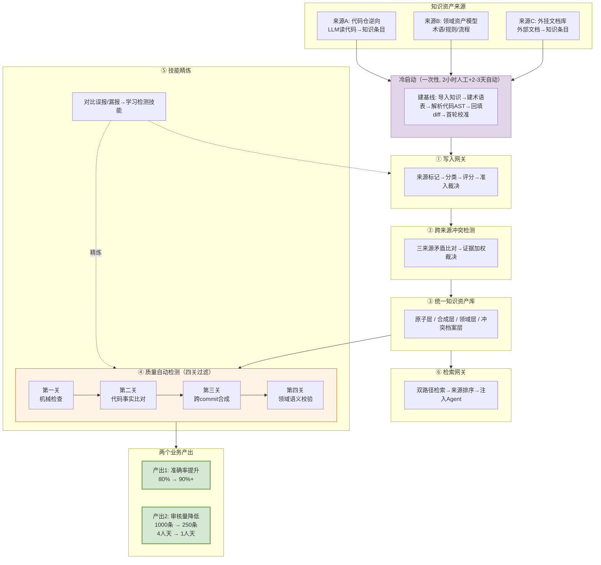
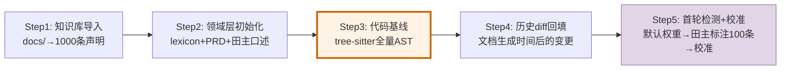
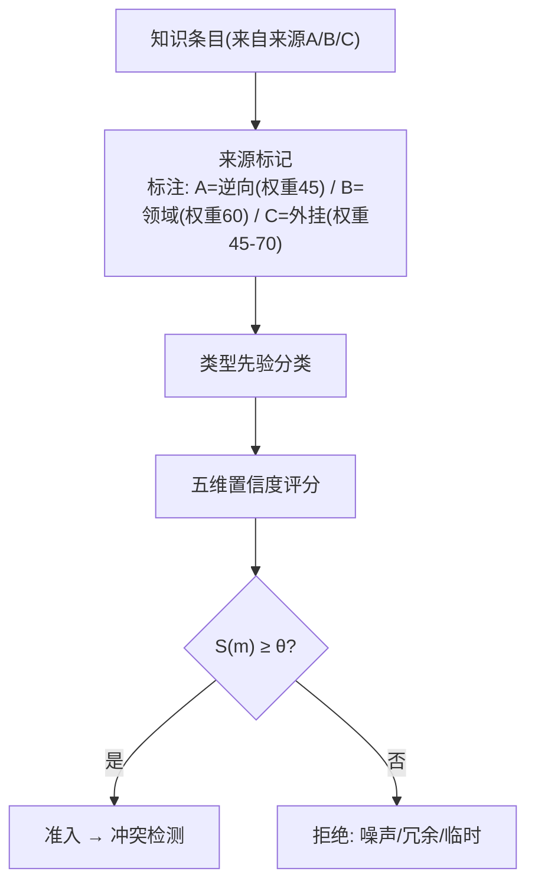
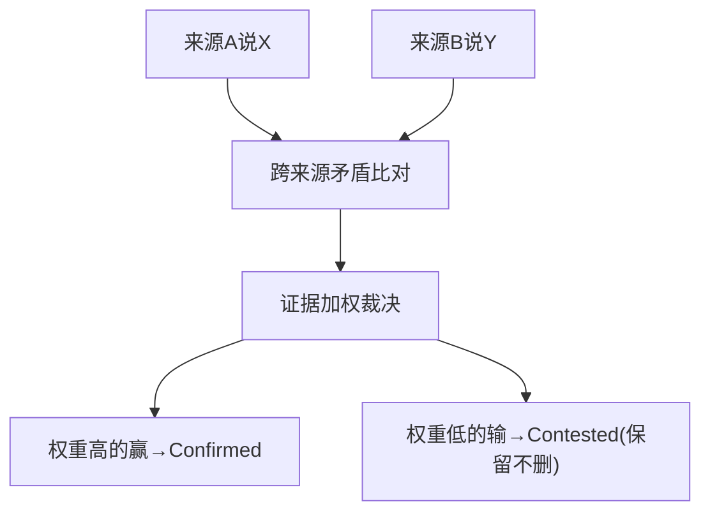
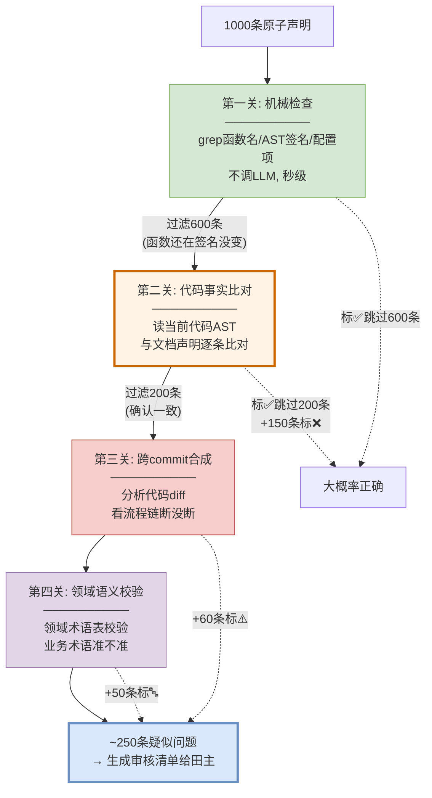
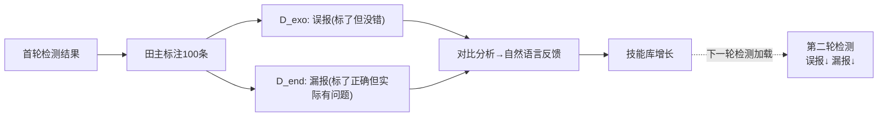
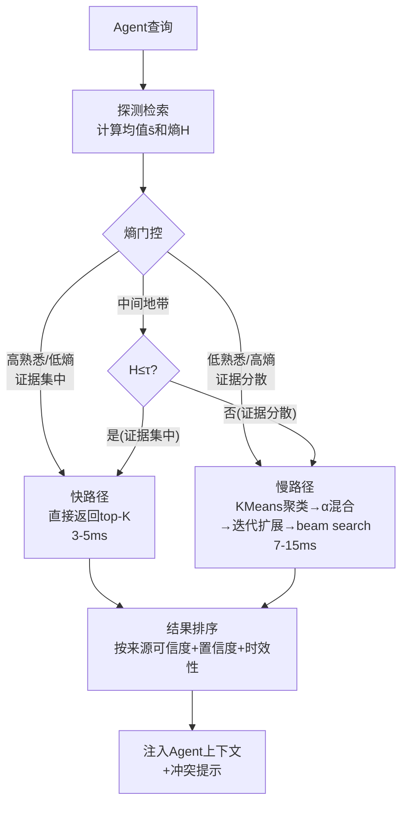

# 存量知识资产治理解决方案

> **面向两个业务场景**：
> 1. **最终产出的文档准确率提升**（80% → 90%+）
> 2. **交给人审核的内容自动识别，人不需要全看**（1000条 → ~250条）

---

## 〇、方案流程全景图

> 以下只看流程，不展开技术。每个环节的技术细节在对应章节详解。



**流程读法**：三类来源经冷启动建基线 → 写入网关准入 → 冲突检测 → 入库 → 四关质量检测 → 两个产出。技能精炼持续优化检测，检索网关支撑Agent使用知识。

---

## 一、冷启动阶段

> 系统第一次运行前建基线。没有基线就没有"Ground Truth"可比对。

### 1.1 冷启动流程



### 1.2 各步骤详解

**Step 1: 知识库导入（0.5天，全自动）**

把 `docs/` 目录130个文件导入为1000条原子声明：
- 解析每个文件的 `> 生成时间：YYYY-MM-DD` → 作为时间锚点
- 拆成原子声明（每条描述一个事实/规则/流程）
- 提取文档中标注的代码文件路径
- 标注来源类型（A/B/C）

**Step 2: 领域知识层初始化（0.5天，1小时人工）**

| 数据源 | 怎么用 | 产出 |
|--------|--------|------|
| `docs/0-biz/lexicon/` (13个文件, 已有) | 解析术语映射表 | glossary.json (~50个术语) |
| `docs/0-biz/rules/` (6个文件, 已有) | 解析规则表 | rules.json (~80条规则) |
| PRD/需求文档(如有) | LLM提取业务流程 | process.json |
| **田主口述**（1小时, 最少20个术语） | 补充核心术语 | +20个术语 |

**关键**：田主口述重点补充"AI逆向最容易搞错的术语"——如"预开"≠"提前打开"、"回收"≠"关闭"、"Muen SDK"≠"Chrome启动器"。不求全，只求准。

**Step 3: 代码基线建立（1天，全自动）**

用 tree-sitter 解析全部源代码，建立Ground Truth索引：

```
产出:
  function_signatures.json   ← 所有函数签名(检测器A用)
  import_graph.json         ← import依赖图
  config_index.json         ← 所有配置项及当前值
  enum_index.json           ← 所有枚举及当前值
```

**这是最关键的一步——代码AST是全部检测的Ground Truth。** 后续所有检测器都读这个基线做比对。

**Step 4: 历史diff回填（0.5天，全自动）**

用文档生成时间(2026-08-18)搜索之后的代码变更：
- `git log --since=2026-08-18` → 找到约60次commit
- 对每个commit提取代码diff（**不看commit message，只看AST变化**）
- 产出按commit_hash组织的AST变化记录

B检测器（跨commit合成）用这些diff发现"流程链断裂"。

**Step 5: 首轮检测+权重校准（0.5天，1小时人工）**

| 操作 | 做什么 | 产出 |
|------|--------|------|
| 用默认权重跑首轮检测 | 四关检测器跑1000条 | 首轮审核清单~250条 |
| 田主标注100条 | 确认/误报 | D_exo(误报)+D_end(漏报) |
| 权重校准 | 网格搜索最大化F1 | 校准后权重配置 |
| 产出首批技能 | 从D_exo/D_end学习 | 8-10条检测技能 |

### 1.3 冷启动成本

| 项目 | 人力 | 自动化 |
|------|------|--------|
| Step1 知识库导入 | 0 | 全自动 |
| Step2 领域层初始化 | **1小时**（田主口述20个术语） | 半自动 |
| Step3 代码基线 | 0 | 全自动 |
| Step4 历史diff | 0 | 全自动 |
| Step5 首轮检测+校准 | **1小时**（田主标注100条） | 半自动 |
| **合计** | **2小时人工** | **2-3天脚本** |

---

## 二、写入网关

> 三类来源的知识进入知识库前，先过准入检查。

### 2.1 写入流程



### 2.2 关键技术：类型先验分类（来源：A-MAC）

**原理**：不同类型的知识"过期概率"不同，按类型分配检查优先级，缩小检查范围。

```
持久知识(T=0.9): 不需重点检查
  - 项目语言/框架: "BrowserGateway用Java+Python"
  - 核心架构: "browser-gateway调用browser-proxy"
  - 数据模型: "UserChrome包含userId/chrome/status"

半持久知识(T=0.5): 重点检查
  - 配置值: "检查周期1800000ms"
  - 阈值: "心跳TTL=60000ms"
  - 枚举值: "play_mode: 0=JPG, 1=REALTIME"
  - 接口参数: "POST /api/browsers"

临时状态(T=0.1): 跳过
  - wip/调试相关描述
```

**效果**：1000条声明 → 持久知识600条快速扫过 → 半持久350条重点查 → 临时50条跳过。检查范围从1000缩到350。

### 2.3 关键技术：五维置信度评分（来源：A-MAC）

**原理**：从五个维度给每条知识打分，综合评分决定可信度。

```
S(m) = w1·效用U + w2·置信度C + w3·新颖性N + w4·近因性R + w5·类型先验T

置信度C对不同来源用不同验证:
  来源A(逆向): 代码一致性(读AST验证) + AST对齐 + API签名匹配
  来源B(领域): 领域基准一致性(和术语表比对)
  来源C(外挂): 文档版本匹配度(文档版本vs代码版本)
```

**BGW示例**：
```
声明: "检查周期默认1800000ms" (来源A逆向)
  代码一致性: 文档说1800000, yaml是300000 → 0.1
  AST对齐: 配置项结构没变 → 0.9
  API签名: 不涉及 → 0.8
  C = 0.5×0.1 + 0.3×0.9 + 0.2×0.8 = 0.51
  近因性R: 文档8月生成, 代码9月改 → 衰减0.7
  综合置信度 = 0.51 × 0.7 = 0.36 → 低置信 → 标记审核
```

---

## 三、跨来源冲突检测

> 三类来源可能对同一事实有不同描述，需要自动裁决谁对。

### 3.1 冲突检测流程



### 3.2 关键技术：冲突检测+证据加权取代（来源：LatticeMind）

**原理**：拿代码的AST作为"真相"(权重100)，和各来源的声明逐条比对。矛盾时代码赢，其他来源标Contested（保留不删，记录证据链）。

**证据权重分层**：
```
代码当前实现(code-change)     = 100  ← 最高, 代码是Ground Truth
+ git commit bonus             = +40
领域资产模型(domain_model)     = 60
+ 领域专家背书                  = +20
外挂官方文档(official_doc)     = 70
外挂非正式文档(informal_doc)   = 30
代码逆向(reverse_engineered)   = 45
+ 代码AST验证通过              = +20
AI笔记                         = 12
过时观察                       = 4
```

**BGW示例**：
```
冲突场景: 来源A vs 来源B
  来源A(逆向): "BrowserCloserTask关闭过期实例" (权重45)
  来源B(领域): "BrowserCloserTask回收不活跃实例" (权重60)
  读代码AST: delete()内部先uploadUserData→remove→reportUsage
  → 代码动作是"回收"(含上传+删除+上报)
  → 来源B(60) > 来源A(45) → 来源B赢
  → 来源A标Contested: "术语偏差,关闭应为回收"
```

**全部不依赖commit message**——代码AST是Ground Truth，不是commit message。

---

## 四、质量自动检测（四关过滤）

> 核心环节：从1000条声明中自动筛出~250条疑似问题给田主。

### 4.1 四关过滤流程



### 4.2 第一关：机械检查

**做什么**：不需要LLM，用机械方法快速判断"文档提到的代码还在不在"。

**关键技术：符号检查器（来源：LatticeMind）** + **类型先验（来源：A-MAC）** + **时间戳重建（来源：StructMem）**

| 子技术 | 原理 | BGW示例 |
|--------|------|---------|
| 符号检查器 | grep函数名/AST签名/配置项，不调LLM | grep `BrowserCloserTask` → 还在✓ / grep `OldManager` → 不在了❌ |
| 类型先验 | 持久知识(0.9)快速跳过，半持久(0.5)重点查 | "项目用Java"跳过 / "检查周期1800000ms"重点查 |
| 时间戳重建 | 用文档生成时间搜索之后的代码变更 | 8月18日后只查60次commit，不查之前的历史 |

**效果**：秒级过滤600条（函数还在签名没变→大概率正确），剩下400条进入第二关。

### 4.3 第二关：代码事实比对

**做什么**：拉取当前代码AST，和文档声明逐条比对。矛盾的就是事实性错误。

**关键技术：冲突检测+证据加权（来源：LatticeMind）** + **五维置信度（来源：A-MAC）**

| 子技术 | 原理 | BGW示例 |
|--------|------|---------|
| 冲突检测 | 代码AST vs 文档声明逐条比对 | 文档说"delete同步" → AST显示"返回CompletableFuture异步" → ❌矛盾 |
| 证据加权 | 代码(100) > 文档(45) → 代码赢 | 代码WebSocket(140) vs 文档UDP(45) → 文档过时 |
| 置信度评分 | 不一致→低置信, 一致→高置信 | "1800000ms"评分0.36(低) → 标记审核 |

**效果**：400条中200条确认一致（标✅跳过），150条确认矛盾（标❌事实性错误），进入审核清单。

### 4.4 第三关：跨commit合成

**做什么**：分析多个代码diff（不看commit message），合在一起看流程链断没断。发现"单看没改但合起来不完整"的隐性过时。

**关键技术：跨commit合成（来源：StructMem）** + **时间戳重建（来源：StructMem）**

**原理**：
```
文档说: "登录流程3步: Login → onControlTcpConnected → 事件处理"
单看: Login()还在✓ onControlTcpConnected()还在✓ 事件处理还在✓ → 机械检查通过

跨commit合成:
  diff 1(9月): Login和onControlTcpConnected之间新增了registerChannel()
  diff 2(9月): onControlTcpConnected之后新增了reportLoginResult()
  实际流程: Login → registerChannel → onControlTcpConnected → reportLoginResult → 事件处理
  文档3步 vs 实际5步 → ⚠️不完整 → 生成补充建议
```

**效果**：+60条隐性不完整进入审核清单。

### 4.5 第四关：领域语义校验

**做什么**：用领域知识层（来源B术语表）校验来源A/C的业务术语准不准。

**关键技术：领域知识层（来源：StructMem Ω视角）**

**原理**：
```
领域知识基准(冷启动时从lexicon+田主口述建立):
  术语: 回收(Recycle) = 系统判断不活跃后清理(含上传+删除+上报)
  术语: 关闭(Close) = 仅stopProcess
  术语: Muen SDK = 可信虚拟化平台(安全沙箱), 不是Chrome启动器

校验来源A(逆向):
  来源A说: "BrowserCloserTask关闭过期实例"
  基准说: 动作是"回收"不是"关闭"
  → 🔤 术语偏差 → 修正建议: "关闭"改为"回收"

  来源A说: "Muen SDK创建Chrome实例"
  基准说: Muen SDK是安全沙箱不是启动器
  → 🔤 语义偏差 → 修正建议: "创建"改为"在TEE中隔离运行"
```

**效果**：+50条语义偏差进入审核清单。

### 4.6 四关检测总结

| 关卡 | 过滤/发现 | 剩余/新增 | 用到的关键技术 |
|------|----------|----------|--------------|
| 第一关 机械检查 | 过滤600条(还在) | 400条 | 符号检查器+类型先验+时间戳重建 |
| 第二关 代码比对 | 过滤200条(一致)+150条❌ | 200条+150条 | 冲突检测+证据加权+置信度评分 |
| 第三关 跨commit合成 | +60条⚠️(隐性不完整) | +60条 | 跨commit合成+时间戳重建 |
| 第四关 领域校验 | +50条🔤(术语偏差) | +50条 | 领域知识层 |
| **最终审核清单** | | **~250条** | **6个关键技术** |

---

## 五、技能精炼

> 让检测器越用越准。每轮检测后对比误报/漏报，学习检测技能。

### 5.1 精炼流程



### 5.2 关键技术：文本梯度下降技能精炼（来源：HORMA）

**原理**：用自然语言反馈做"梯度下降"——不修改LLM参数，只更新检测提示词/规则。

**BGW示例**：
```
D_exo(误报): 
  声明"ChromeSet用ConcurrentHashMap" → 标了疑似过时
  实际: 没变，代码确实还在用
  → 反馈: "import没变不等于实现没变，要检查方法体"
  → 新技能: "检查集合类时看方法体是否改了"

D_end(漏报):
  声明"delete()同步删除" → 标了正确(函数名还在)
  实际: 函数体改成了异步(返回CompletableFuture)
  → 反馈: "函数名没变不代表实现没变，要解析AST看返回类型"
  → 新技能: "delete/insert/update类方法检查返回类型"
```

**技能库增长**：
```
第1轮: 8-10条技能
第2轮: +7条, 共15条
第3轮: +5条, 共20条
...
每轮误报漏报减少 → 准确率↑ → 审核量↓
```

**效果**：准确率从85%逐步提升至92-95%，审核量从250条降至200条。

---

## 六、检索网关

> Agent使用知识库时，通过双路径检索自适应查询复杂度。

### 6.1 检索流程



### 6.2 关键技术：双路径自适应检索（来源：RF-Mem）

**原理**：先做探测检索算相似度均值和熵。高熟悉（证据集中）走快路径直接返回；低熟悉（证据分散）走慢路径聚类扩展。

**BGW示例**：
```
快路径场景: "delete()的返回类型是什么?"
  探测: s̄=0.85(高), H=0.08(低) → 证据集中
  → 快路径: 直接top-K, 3ms
  → 返回: "delete()返回CompletableFuture<Void>"

慢路径场景: "浏览器实例从创建到销毁完整流程?"
  探测: s̄=0.38(低), H=0.35(高) → 证据分散
  → 慢路径: 聚3簇(创建/运行/销毁)→α混合→迭代检索
  → 12ms返回: 跨多模块完整流程链

检索结果附带:
  来源A(逆向)置信度0.15 → 低优先
  来源B(领域)置信度0.85 → 优先使用
  来源A vs B冲突提示 → "关闭"应为"回收"
```

---

## 七、两个业务产出

### 7.1 产出1：准确率提升（80% → 90%+）

| 阶段 | 准确率 | 修正来源 | 修正条数 | 关键技术 |
|------|--------|---------|---------|---------|
| 原始 | 80% | — | — | — |
| +检测器A | 85% | 代码AST取代过时文档 | 150条 | 冲突检测+证据加权 |
| +检测器B | 88% | 跨commit合成补充缺失 | 60条 | 跨commit合成 |
| +检测器C | 90%+ | 领域模型校准术语 | 50条 | 领域知识层 |
| +技能精炼 | 92-95% | 学习误报/漏报 | 持续 | 文本梯度下降 |

### 7.2 产出2：审核量降低（1000条 → 250条）

| 阶段 | 审核量 | 人工成本 | 关键技术 |
|------|--------|---------|---------|
| 全量人工 | 1000条 | 4人天 | — |
| +第一关机械检查 | 400条 | 1.5人天 | 符号检查器+类型先验+时间戳重建 |
| +第二关代码比对 | 250条 | 1人天 | 冲突检测+置信度评分 |
| +技能精炼(第二轮) | 200条 | 0.8人天 | 文本梯度下降 |

### 7.3 两个产出的协同

**检测器跑一遍，同时产出两个结果**：
- 有明确代码证据的 → 自动修正建议（产出1）
- 不确定的 → 审核清单给田主（产出2）

```
检测器扫完1000条:
  768条高置信 → 标✅ 跳过
  232条低置信:
    150条有代码证据 → 自动修正建议(产出1) + 田主快速确认(产出2)
    60条隐性不完整 → 补充建议(产出1) + 田主确认(产出2)
    50条语义偏差 → 术语修正(产出1) + 田主确认(产出2)
```

### 7.4 审核清单样式

田主收到的每条审核项附带完整证据链：
```
⚠️ docs/0-biz/rules/rules-browser.md 规则 browser-closer-if-expired
──────────────────────────────────────
文档说(来源A): "心跳过期时关闭实例"
代码现状: 新增远端不活跃判断(OR关系)
差异类型: A类-事实性错误
置信度: 0.15
自动修正建议: 补充 browser-closer-is-active 规则
证据来源: 代码AST (非commit message)
──────────────────────────────────────
[确认修正] [AI误报] [查看代码]
```

田主每条30秒确认，~250条共1人天。

### 7.5 总效果

| 指标 | 数值 |
|------|------|
| 自动修正建议 | 260条 |
| 人工审核量 | ~250条（从1000条降75%） |
| 人工成本 | 1人天（从4人天降75%） |
| 最终准确率 | 90%+（技能精炼后92-95%） |
| 冷启动成本 | 2小时人工 + 2-3天自动 |
| 全部不依赖commit message | 代码AST/diff是Ground Truth |

---

## 八、关键技术索引

> 9个关键技术按流程环节索引，方便查阅对应论文洞察报告。

| # | 关键技术 | 来源论文 | 所在流程环节 | 论文洞察报告 |
|---|---------|---------|------------|-------------|
| 1 | 符号检查器 | LatticeMind | 冷启动Step3 + 质量检测第一关 | paper/5. LatticeMind_Paper_Insight_Report.md |
| 2 | 冲突检测+证据加权 | LatticeMind | 冲突检测 + 质量检测第二关 | 同上 |
| 3 | 五维置信度评分 | A-MAC | 写入网关 + 质量检测第二关 | paper/1. A-MAC_Paper_Insight_Report.md |
| 4 | 类型先验分类 | A-MAC | 写入网关 + 质量检测第一关 | 同上 |
| 5 | 跨commit合成 | StructMem | 质量检测第三关 | paper/4. StructMem_Paper_Insight_Report.md |
| 6 | 时间戳重建 | StructMem | 冷启动Step4 + 质量检测第一关 | 同上 |
| 7 | 领域知识层(Ω视角) | StructMem | 冷启动Step2 + 质量检测第四关 | 同上 |
| 8 | 文本梯度下降技能精炼 | HORMA | 技能精炼环节 | paper/3. HORMA_Paper_Insight_Report.md |
| 9 | 双路径自适应检索 | RF-Mem | 检索网关 | paper/2. RF-Mem_Paper_Insight_Report.md |

---

*方案生成日期: 2026-10-12*
