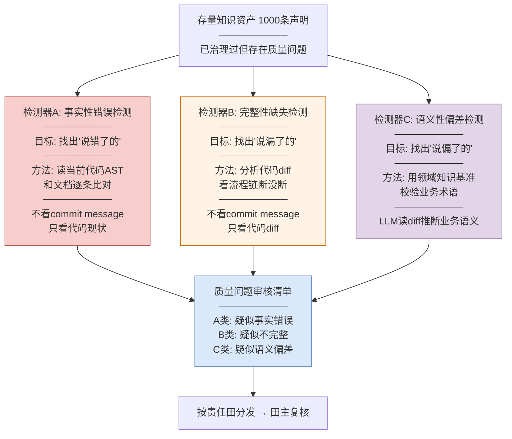
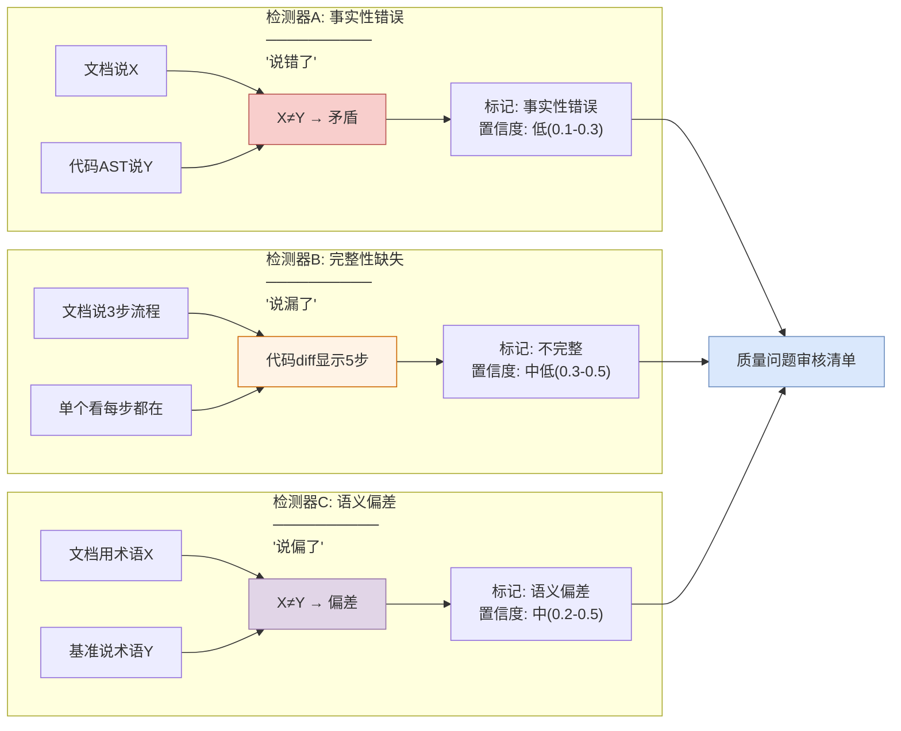

# 存量知识资产质量问题自动识别方案

> **核心场景**：存量知识资产已经治理过了（逆向+人工审核已产出），但其中部分场景/知识存在质量问题。如何自动化识别哪些知识有问题？

---

## 一、存量知识资产的质量问题到底长什么样

你的 BrowserGateway 文档目录（130个文件、1000条声明）已经过一轮治理。但治理后仍然存在质量问题，分三类：

### 类型A：知识"说错了"——事实性错误

文档描述的逻辑和代码实际逻辑**直接矛盾**。

```
文档说: "BrowserCloserTask 检查心跳过期时关闭实例"
代码是: "心跳过期 OR 远端不活跃 → 才关闭"（9月新增了远端不活跃判断）
→ 文档只写了一半条件，事实性错误
```

**根因**：治理时代码是对的，但治理后代码改了，文档没跟上。

### 类型B：知识"说漏了"——完整性缺失

文档描述的逻辑**部分正确但不完整**，缺少新增的步骤或字段。

```
文档说: "登录流程: Login → onControlTcpConnected → 事件处理"
代码是: "Login → registerChannel → onControlTcpConnected → reportLoginResult → 事件处理"
→ 文档中间漏了2步，完整性缺失
```

**根因**：治理时只描述了当时看到的函数，后续新增的中间步骤没补充。

### 类型C：知识"说偏了"——语义性偏差

文档描述的**技术层面部分正确，但业务语义理解有偏差**。

```
文档说: "Muen SDK创建Chrome实例"（把Muen当启动器）
实际是: "Muen SDK在可信执行环境中隔离运行Chrome"（Muen是安全沙箱）
→ 技术描述偏了，业务角色理解错误
```

**根因**：AI逆向时只看了函数调用关系，没理解业务上下文。

### 三类问题的比例预估

| 类型 | 占比 | 特征 | 自动识别难度 |
|------|------|------|------------|
| A 说错了 | ~40% | 有明确矛盾，代码 vs 文档直接冲突 | 低（机械检查+代码比对） |
| B 说漏了 | ~35% | 无直接矛盾但不完整 | 中（跨commit合成） |
| C 说偏了 | ~25% | 技术描述部分对但业务语义偏 | 高（需要领域知识基准） |

---

## 二、关键前提：不依赖commit message

### 问题

实际项目中 commit message 质量参差不齐——"fix"、"update"、"wip"、"改了点东西"这类message无法提取业务语义。如果方案依赖commit message，就会在真实项目中失效。

### 方案不依赖commit message

**因为我们比对的是"文档说了什么" vs "代码现在是什么"，不是"文档说了什么" vs "commit message说了什么"。代码是Ground Truth，commit message不是。**

| 方案步骤 | 用什么 | 依赖commit message吗 |
|---------|--------|---------------------|
| 机械检查（grep函数名/AST签名/配置项） | **代码文件本身** | ❌ 不依赖 |
| 代码事实比对（文档vs代码现状） | **当前代码的AST和逻辑** | ❌ 不依赖 |
| 跨commit合成（流程链断没断） | **代码diff的AST变化** | ❌ 不依赖 |
| 时间戳检索（文档生成后的改动） | **commit时间戳**（不看message） | ❌ 不依赖 |
| 领域语义提取（Ω视角） | **LLM读代码diff推断**（不读message） | ❌ 不依赖 |

### 具体说明：commit message是"fix"也能检测

```
commit a1b2c3d
Author: zhangsan
Date: 9月5日
Message: "fix"                           ← 没用，跳过

代码diff:                                  ← 这才是真相
  + // 远端不活跃判断（新增）
  + if (ub == null || browserInstance == null 
  +     || !browserInstance.equals(config.getSelfAddr()) 
  +     || heartbeats == null) {
  +     chromeSet.delete(userId);
  +     return;
  + }
  + if (System.nanoTime() - heartbeats > ttl) {  // 原来的
  +     chromeSet.delete(userId);
  + }

检测器A直接拿diff和文档比对:
  文档说"心跳过期时关闭" → diff显示新增了"远端不活跃"判断
  → ❌ 文档不完整 → 标记

不依赖commit message说"改了什么"——diff自己说了。
```

### Ω视角（领域语义）用LLM读diff替代读message

commit message是"fix"时，message层面提取不出业务语义。但可以用LLM直接分析代码diff推断：

```
LLM读diff:
  "这段diff新增了对UserBind和browserInstance的null检查，
   以及config.getSelfAddr()的地址匹配判断。
   推断: 这是浏览器实例活跃性检测的新增逻辑。
   涉及业务规则: 浏览器实例回收规则"

→ Ω条目: "实例回收规则新增远端不活跃判断"
```

**LLM读diff比读人写的message更准确**——diff不会骗人，message会。

### 补充信号源

除了commit message，还有其他信号可以辅助：

| 信号源 | 质量 | 怎么用 |
|--------|------|--------|
| **代码diff本身** | 100%准确 | 直接分析AST变化，不用message |
| **PR/MR标题和描述** | 通常比commit message好 | 如果用PR流程，PR描述更详细 |
| **Jira/Issue编号** | 有业务关联 | commit里提到 #PROJ-1234 → 关联需求描述 |
| **Code Review评论** | 有业务上下文 | "这里为什么要加远端检查？"→"因为CSE迁移后心跳不准了" |
| **修改的文件路径** | 有语义暗示 | 改了 `scheduled/BrowserCloserTask.java` → 跟定时回收相关 |
| **配置项变化** | 有业务含义 | `check-browser-period: 600000→300000` → 检查频率调高了 |

---

## 三、自动识别方案：三类问题三套检测器



---

## 四、检测器A：事实性错误检测（找"说错了的"）

### 原理

**读文档标注的代码文件，解析当前AST，和文档声明逐条比对。矛盾的就是事实性错误。不看commit message，只看代码现状。**

### 怎么做

```
对每条文档声明:

Step 1: 提取文档声明涉及的代码位置
  ──────────────────────────────────
  文档说: "chromeSet.delete()同步删除实例"
  代码位置标注: ChromeSet.delete() → ChromeSetImpl.java
  
  文档说: "检查周期默认1800000ms"
  代码位置标注: browsergw.scheduled.check-browser-period → application.yaml

Step 2: 读当前代码（不看commit message）
  ──────────────────────────────────
  读ChromeSetImpl.java → 解析AST → delete()方法当前实现
  读application.yaml → check-browser-period当前值

Step 3: 逐条比对
  ──────────────────────────────────
  文档说"同步删除" → AST显示delete()返回CompletableFuture
  → ❌ 矛盾 → 标记"事实性错误"
  
  文档说"1800000ms" → yaml是"300000ms"
  → ❌ 矛盾 → 标记"事实性错误"
```

### 具体例子（BrowserGateway真实案例）

```
扫描: docs/0-biz/rules/rules-browser.md 规则 browser-closer-if-expired

文档声明:
  条件: System.nanoTime() - chromeSet.getHeartbeats(userId) > ttl
  动作: chromeSet.delete(userId)

读当前代码 BrowserCloserTask.java:
  // 第67行
  if (ub == null || browserInstance == null 
      || !browserInstance.equals(config.getSelfAddr()) 
      || heartbeats == null) {        // ← 文档没有这段
      chromeSet.delete(userId);
      return;
  }
  if (System.nanoTime() - heartbeats > ttl) {  // ← 文档有这段
      chromeSet.delete(userId);
  }

比对结果: ❌ 文档只写了第二个条件，缺少第一个(远端不活跃)
检测类型: A类-事实性错误
置信度: 0.15
证据来源: 代码AST（非commit message）
```

### 用到的技术

| 技术点 | 来源 | 作用 |
|--------|------|------|
| 符号检查器 | LatticeMind | 先做廉价检查：函数还在不在、签名变没变 |
| 冲突检测 | LatticeMind | 代码AST vs 文档声明逐条比对 |
| 证据加权取代 | LatticeMind | 代码证据(weight=100) vs 文档证据(weight=12) |
| 置信度评分 | A-MAC | 代码一致性(0.5)+AST对齐(0.3)+API签名(0.2)+时间衰减 |

### 预期效果

- 扫描1000条 → 约400条触发比对（其余600条机械检查确认没变）
- 比对后 → 约150条确认矛盾（A类事实性错误）
- 150条进入审核清单

---

## 五、检测器B：完整性缺失检测（找"说漏了的"）

### 原理

**分析代码diff（AST变化），看文档描述的流程中间有没有插入新步骤。单个看每步都对，但代码diff显示中间多了步骤——文档不完整。不看commit message，只看代码diff。**

### 怎么做

```
对每条流程类声明（交互模型/规则链）:

Step 1: 确认文档描述的每个步骤当前代码中都还在
  ──────────────────────────────────
  文档说: "登录流程: Login → onControlTcpConnected → 事件处理"
  读代码: Login()还在✓ onControlTcpConnected()还在✓ 事件处理还在✓
  机械检查通过——单个函数都没变

Step 2: 分析这些函数之间的调用关系（看代码diff不看message）
  ──────────────────────────────────
  搜索8月18日之后的代码diff:
  
  diff 1(9月): Login()成功后、onControlTcpConnected()之前
    新增了 TcpChannelMonitor.registerChannel(channel)
    （从代码diff看出，不看commit message）
  
  diff 2(9月): onControlTcpConnected()之后
    新增了 ServiceReporter.reportLoginResult(userId, success)
  
  实际调用链: Login → registerChannel → onControlTcpConnected 
              → reportLoginResult → 事件处理

Step 3: 比对流程完整性
  ──────────────────────────────────
  文档流程: 3步 (Login → onControlTcpConnected → 事件处理)
  实际流程: 5步 (多了registerChannel和reportLoginResult)
  
  → ⚠️ 文档缺少2步，完整性缺失
```

### 具体例子（BrowserGateway真实案例）

```
扫描: docs/0-arch/interaction-model/interaction-model-control-tcp-login.md

文档时序图(8月18日):
  GW → API → Login → onControlTcpConnected → 事件处理完成

分析代码diff（不看commit message）:
  ──────────────────────────────────
  9月diff: 在Login()成功后、onControlTcpConnected()之前，
    新增了 TcpChannelMonitor.registerChannel(channel)
    
  9月diff: 在onControlTcpConnected()之后，
    新增了 ServiceReporter.reportLoginResult(userId, success)
    
  合成结论:
    登录流程从3步变为5步
    文档描述的3步流程不完整，缺少中间2步

检测类型: B类-完整性缺失（隐性，单个函数没变但流程链断了）
置信度: 0.35
证据来源: 代码diff AST分析（非commit message）
```

### 用到的技术

| 技术点 | 来源 | 作用 |
|--------|------|------|
| 事件级绑定 | StructMem | 从代码diff提取事实，锚定到时间戳 |
| 时间戳重建 | StructMem | 用文档生成时间搜索之后的代码diff |
| 跨commit合成 | StructMem | 多个diff合在一起看，发现流程链断裂 |
| 语义检索种子 | StructMem | 用文档描述的流程搜索相关diff |

### 预期效果

- 扫描约350条流程类声明 → 约80条触发合成检查
- 合成后 → 约60条确认不完整（B类完整性缺失）
- 60条进入审核清单

---

## 六、检测器C：语义性偏差检测（找"说偏了的"）

### 原理

**建领域知识基准（术语表+规则库），拿基准去校验文档的业务描述。LLM读代码diff推断真实业务语义，和文档的描述比对——偏了就是语义偏差。**

### 前提：先建领域知识基准

```
数据源1: docs/0-biz/lexicon/ 已有的13个术语文件
  → 提取为 domain_glossary.json

数据源2: 产品PRD/需求文档中的业务描述
  → 提取为 business_rules.json

数据源3: 田主口述的领域知识（录音/访谈→文本）
  → 补充到 glossary 和 rules

领域知识基准示例:
  ──────────────────────────────────
  术语: 预开（PreOpen）
  正确含义: 为用户预先创建并分配Chrome实例，在用户连接前完成初始化
  常见错误理解: "提前打开浏览器"（× 偏差：少了"分配"和"初始化"语义）
  
  术语: 回收（Recycle）
  正确含义: 系统判断实例不活跃后自动清理（含数据上传+实例删除+用量上报）
  常见错误理解: "关闭"（× 偏差："关闭"不含数据上传和用量上报）
  
  术语: Muen SDK
  正确含义: 华为可信虚拟化平台，在TEE中隔离运行Chrome
  常见错误理解: "创建Chrome的SDK"（× 偏差：把安全沙箱理解成启动器）
  ──────────────────────────────────
```

### 怎么做

```
对每条文档声明中的业务术语:

Step 1: 提取文档中使用的业务术语
  ──────────────────────────────────
  文档说: "BrowserCloserTask在心跳过期时关闭实例"
  提取术语: "BrowserCloserTask"、"关闭"

Step 2: 查领域知识基准
  ──────────────────────────────────
  术语表: "BrowserCloserTask" → 实例回收任务
  术语表: "关闭" vs "回收" → 业务语义不同

Step 3: LLM读代码diff验证业务语义
  ──────────────────────────────────
  diff显示: delete()内部先uploadUserData()再remove()再reportUsage()
  → 业务动作是"回收"（含数据上传+删除+用量上报）
  → 不是"关闭"（仅stopProcess）

Step 4: 校验
  ──────────────────────────────────
  文档用"关闭" → 代码diff显示是"回收"
  → 🔤 术语偏差: "关闭"应为"回收"
  → 标记"C类-语义偏差"
```

### 具体例子（BrowserGateway真实案例）

```
扫描: docs/0-arch/structure-model/structure-model-browser-gateway.md

文档描述:
  "browser-gateway通过Muen SDK创建Chrome实例"

领域知识基准:
  术语: Muen SDK
  正确含义: 华为可信虚拟化平台(Trusted Hypervisor)
           在可信执行环境(TEE)中隔离运行Chrome
           作用: 安全隔离，防止恶意网页访问宿主系统
  代码角色: 不是"创建Chrome的工具"，是"运行Chrome的安全容器"

校验:
  文档说"Muen SDK创建Chrome" → 把Muen当启动器
  基准说"Muen SDK隔离运行Chrome" → Muen是安全沙箱
  → 🔤 语义偏差: 技术角色理解错误

检测类型: C类-语义偏差
置信度: 0.20
证据来源: 领域知识基准 + 代码分析（非commit message）
```

### 用到的技术

| 技术点 | 来源 | 作用 |
|--------|------|------|
| 领域知识层(Ω视角) | StructMem | 建领域术语表+规则库作为基准 |
| 冲突检测 | LatticeMind | 文档术语描述 vs 基准正确含义比对 |
| 类型先验 | A-MAC | 持久知识(术语定义)给高先验重点校验 |

### 预期效果

- 扫描约300条含业务术语的声明 → 约100条触发语义校验
- 校验后 → 约50条确认偏差（C类语义偏差）
- 50条进入审核清单

---

## 七、三个检测器的协同关系



### 三个检测器的互补关系

| 检测器 | 找什么问题 | 怎么找 | 能漏什么 | 漏的由谁补 |
|--------|-----------|--------|---------|-----------|
| A 事实性错误 | 代码和文档直接矛盾 | 读当前代码AST逐条比对 | 单看没矛盾但合起来不完整 | B补 |
| B 完整性缺失 | 流程链断了 | 分析代码diff合成 | 技术对了但业务语义偏了 | C补 |
| C 语义偏差 | 业务术语理解错了 | 领域基准+LLM读diff校验 | 术语对了但代码变了 | A补 |

**三者缺一不可**：A能发现"delete改异步了"但发现不了"流程多了2步"；B能发现"流程多了2步"但发现不了"术语用错了"；C能发现"术语用错了"但发现不了"代码改了"。三个检测器跑完，覆盖三类质量问题。

**全部不依赖commit message**——A看代码AST、B看代码diff、C看领域基准+代码分析。

---

## 八、自动识别效果

### 数量预估

| 检测器 | 扫描范围 | 触发检查 | 确认有问题 | 进入审核清单 |
|--------|---------|---------|-----------|------------|
| A 事实性错误 | 1000条 | 400条(机械检查未过) | 150条 | 150条 |
| B 完整性缺失 | 350条(流程类) | 80条(合成检查) | 60条 | 60条 |
| C 语义偏差 | 300条(含术语) | 100条(语义校验) | 50条 | 50条 |
| **合计** | **1000条** | — | — | **~260条** |

### 效果对比

| 方式 | 审核量 | 成本 | 发现率 |
|------|--------|------|--------|
| 全量人工审核 | 1000条 | 4人天 | ~95% |
| **三检测器自动识别** | **~260条** | **1人天** | **85-90%** |
| 随机抽查10% | 100条 | 0.5人天 | ~10% |

### 漏检分析

| 漏检类型 | 原因 | 占比 | 补救 |
|---------|------|------|------|
| 领域基准不全导致C类漏检 | 术语表没覆盖所有术语 | ~5-8% | 随使用积累术语表，发现率逐步提升 |
| 跨commit合成遗漏 | 语义检索种子没找到相关diff | ~2-3% | 调整Top-K参数或补充AST结构相似度 |
| 机械检查假阳性 | 函数名没变但内部逻辑完全重写了 | ~2-3% | A检测器的代码事实比对比机械检查更深入 |

**总漏检率约10-15%**，可通过HORMA技能精炼（对比分析误报/漏报→学习检测技能）逐步降至5-8%。

---

## 九、落地路径

### Phase 1: A检测器（2周）

先做事实性错误检测——最容易、收益最大：
- 机械检查（grep/AST/配置项）秒级过滤
- 代码事实比对（读当前代码AST vs 文档声明）
- 输出A类审核清单

**预期产出**：150条事实性错误审核清单，人工1.5小时复核

### Phase 2: B检测器（2周）

加完整性缺失检测——需要分析代码diff：
- 用文档生成时间搜索后续代码diff
- 跨diff合成发现流程链断裂
- 输出B类审核清单

**预期产出**：60条不完整审核清单，人工30分钟复核

### Phase 3: C检测器（2周）

加语义偏差检测——需要建领域知识基准：
- 从lexicon/PRD/田主口述建术语表
- 用术语表校验文档业务描述
- LLM读代码diff验证业务语义
- 输出C类审核清单

**预期产出**：50条语义偏差审核清单，人工25分钟复核

### Phase 4: 技能精炼（持续）

用HORMA的对比分析学习误报/漏报模式：
- D_exo: 标了问题但实际正确的 → 学习"什么不该标记"
- D_end: 标了正确但实际有问题的 → 学习"什么该标记但漏了"
- 技能库持续增长，发现率从85%逐步提升至90%+

---

## 十、对领导的话

**你的痛点是**：存量知识资产已经治理过了，但治理后代码继续迭代，部分知识出现了质量问题（说错了/说漏了/说偏了），人工全量复查成本太高。

**方案是**：三个自动检测器分别扫"说错了的"（A）、"说漏了的"（B）、"说偏了的"（C），把1000条声明缩到260条疑似问题给田主复核。

**三个检测器全部不依赖commit message**——直接读代码AST和代码diff作为Ground Truth。commit message写得再烂也不影响检测能力，因为我们比对的是"文档说了什么"vs"代码现在是什么"，不是"文档说了什么"vs"commit message说了什么"。

**关键数字**：
- 人工审核：1000条 → 260条（**74%降低**）
- 人工成本：4人天 → 1人天（**75%降低**）
- 发现率：85-90%（通过技能精炼逐步提升至90%+）
- 落地周期：Phase 1-3各2周，Phase 1即可产出价值

**技术成熟度**：LatticeMind(冲突检测) + A-MAC(置信度) + StructMem(跨commit合成+领域知识层) 三篇论文融合，其中StructMem(蚂蚁集团联署，GitHub 1188 stars)最接近工程化。

---

*方案生成日期: 2026-10-12*
