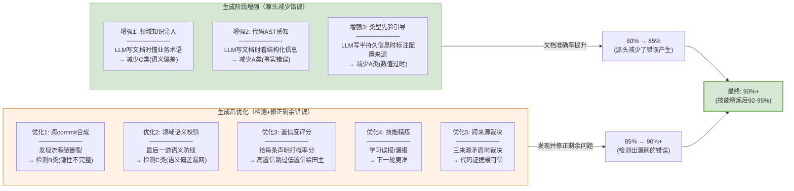

# 生成阶段增强 vs 生成后优化

> **核心问题**：哪些技术在 specgo 的 analyze skill 生成文档时就介入（从源头减少错误），哪些在文档已生成后做质量检测和修正？

---

## 一、两个阶段的定位

```
生成阶段(源头)                    生成后阶段(检测+修正)
─────────────────────           ──────────────────────
specgo 16个analyze skill          文档已存在(130个文件)
读代码→写文档                     质量检测→发现问题→修正

目标: 让生成的文档尽量对           目标: 发现已生成的文档中哪些有问题
效果: 减少20%错误的发生            效果: 发现剩余的20%错误
```

| 阶段 | 时机 | 目标 | 类比 |
|------|------|------|------|
| 生成阶段增强 | specgo analyze skill执行时 | **让AI写文档时少犯错** | 防患于未然 |
| 生成后优化 | 文档已生成后 | **发现已生成的文档中哪些有问题** | 亡羊补牢 |

**两者互补**：生成阶段减少错误产生，生成后阶段发现漏网的错误。两个阶段一起做，准确率才能从80%到90%+。

---

## 二、生成阶段增强（在 specgo analyze skill 执行时介入）

### 增强1：领域知识层注入（来源：StructMem Ω视角）

**做什么**：在 specgo 的 analyze skill 读代码写文档时，把领域知识层（术语表+规则库）注入到 LLM 提示词中，让 AI 写文档时就懂业务术语。

**现状问题**：specgo 的 analyze skill（如 biz-rules-analyze）读代码写规则文档时，LLM 只看代码不看业务上下文。代码里函数叫 `browserCloserTask`，LLM 就写"关闭浏览器任务"——但它不知道业务上这个动作叫"回收"不叫"关闭"。

**增强方式**：
```
specgo biz-rules-analyze 执行时:

原提示词:
  "从代码中提取业务规则, 按条件→动作格式整理"

增强后提示词:
  "从代码中提取业务规则, 按条件→动作格式整理
  
   🆕 领域知识注入:
   以下是本项目的领域术语表:
   - '回收(Recycle)' = 系统判断实例不活跃后自动清理
     (含数据上传+实例删除+用量上报), 不是简单的'关闭'
   - '预开(PreOpen)' = 为用户预先创建并分配Chrome实例
   - 'Muen SDK' = 可信虚拟化平台, 安全沙箱, 不是Chrome启动器
   - 'BrowserCloserTask' 做的是'回收'不是'关闭'
   
   提取规则时请使用正确的业务术语。"

效果:
  原来会写: "BrowserCloserTask关闭过期实例" (❌ 术语偏差)
  增强后写: "BrowserCloserTask回收不活跃实例" (✅ 术语正确)
  
  → 从源头避免了C类(语义偏差)问题的产生
```

**涉及哪些 specgo skill**：

| specgo skill | 增强什么 | 效果 |
|--------------|---------|------|
| biz-rules-analyze | 注入术语表，规则描述用正确业务术语 | 规则文档的业务语义准确 |
| biz-lexicon-analyze | 增强术语提取能力，补充田主口述术语 | 术语表更全更准 |
| arch-interaction-model-analyze | 注入业务流程定义，时序图步骤用正确术语 | 交互模型业务语义准确 |
| arch-structure-model-analyze | 注入模块职责定义，模块描述用正确业务定位 | 结构模型业务定位准确 |
| tech-*guidelines-analyze | 注入框架/技术的正确业务定位 | 技术规范描述准确 |

### 增强2：代码AST感知（来源：StructMem 时间戳重建）

**做什么**：在 analyze skill 执行时，不仅让 LLM 读代码文本，还把 tree-sitter 解析的 AST 结构信息一起喂给 LLM，让它基于结构化信息写文档而非基于文本猜测。

**现状问题**：specgo 的 analyze skill 读的是代码文本。LLM 从文本中推断函数签名/调用关系/参数类型，容易漏看或看错。如果直接喂 AST 结构化信息，准确率更高。

**增强方式**：
```
specgo biz-interface-analyze 执行时:

原方式:
  LLM读 browser.py 源码文本 → 推断接口签名

增强后:
  tree-sitter解析 browser.py → AST结构化信息:
    函数: create_browser(executable_path: str, userdata: str, extensions: list)
    返回: BrowserContext
    调用: playwright.chromium.launch(), BrowserWrapper.register()
    被调用: browser-gateway ClientImpl.java
  
  LLM同时看源码文本+AST结构 → 写出的接口文档更准确
  
  原来可能漏看返回类型 → 写"创建浏览器"没写返回值
  增强后AST明确显示返回BrowserContext → 写"返回BrowserContext实例"
```

**涉及哪些 specgo skill**：

| specgo skill | 增强什么 | 效果 |
|--------------|---------|------|
| biz-interface-analyze | 喂AST接口签名而非文本 | 接口参数/返回值不遗漏 |
| biz-data-model-analyze | 喂AST数据结构定义而非文本 | 字段/类型不遗漏 |
| arch-interaction-model-analyze | 喂AST调用关系而非文本推断 | 时序图调用链准确 |
| tech-concurrency-guidelines-analyze | 喂AST线程池/锁结构 | 并发原语描述准确 |

### 增强3：类型先验引导（来源：A-MAC）

**做什么**：在 analyze skill 执行时，告诉 LLM 哪些信息是持久知识（不太会变，可以详细写）、哪些是半持久（容易变，要标注"以代码为准"），引导 LLM 对不同类型的信息用不同的描述精度。

**增强方式**：
```
specgo tech-concurrency-guidelines-analyze 执行时:

增强后提示词增加:
  "🆕 信息类型引导:
   - 持久知识(框架选型/线程池类型/锁类型): 详细描述, 这些不太会变
   - 半持久知识(线程池大小/超时时间/重试次数): 标注'以application.yaml配置为准'
     不要把具体数值写死在文档里, 因为容易变
   - 临时状态(当前Sprint的调试配置): 不需要写入文档"

效果:
  原来会写: "检查周期1800000ms" (❌ 数值写死了, 代码改了文档就过时)
  增强后写: "检查周期由browsergw.scheduled.check-browser-period配置,
            代码默认1800000ms, application.yaml可覆盖" (✅ 标注了配置来源)
  
  → 代码改了配置值, 文档仍然准确(因为写的是配置键不是写死数值)
  → 从源头减少了A类(事实性错误)问题的产生
```

---

## 三、生成后优化（文档已存在时做检测和修正）

### 优化1：跨commit合成检测（来源：StructMem）

**做什么**：文档已生成后，代码继续迭代。用跨commit合成检测发现"流程链断了"——spec-asset-audit的C1发现不了的。

**什么时候做**：每次代码迭代后（增量）或Sprint结束（批量）。

```
文档8月18日生成, 9月代码改了:

spec-asset-audit C1: Login()还在✓ → 通过

🆕跨commit合成:
  9月diff: Login和onControlTcpConnected之间插入了registerChannel()
  → 文档3步流程实际已变5步 → ⚠️不完整 → 生成补充建议

这个只能在生成后做——因为生成时(8月18日)还没有9月的代码变更。
```

### 优化2：领域语义校验（来源：StructMem Ω）

**做什么**：文档已生成后，用领域知识层校验生成的文档中业务术语准不准。

**什么时候做**：首次审核（全量）或领域模型更新后（增量）。

```
文档已生成: "Muen SDK创建Chrome实例"

🆕领域语义校验:
  领域知识基准: "Muen SDK是安全沙箱不是启动器"
  → 🔤 语义偏差 → 生成修正建议

虽然生成阶段已经注入了领域知识(增强1),
但LLM可能仍然理解错了, 或者领域知识层后来更新了新术语
→ 生成后校验是最后一道防线
```

### 优化3：置信度概率评分（来源：A-MAC）

**做什么**：文档已生成后，给每条声明打概率置信度，高置信跳过、低置信给田主。

**什么时候做**：spec-asset-audit审核时。

```
spec-asset-audit C1通过(函数还在) → 判"已基线"

🆕置信度评分:
  函数名在但返回类型从void改成CompletableFuture → 置信度0.16
  → spec-asset-audit判通过, 但置信度判极低
  → 标记审核

这个只能在生成后做——因为评分需要和"当前代码"比对,
而生成时写的是"当时代码", 评分要检测"现在代码和当时文档一不一致"。
```

### 优化4：技能精炼（来源：HORMA）

**做什么**：审核结果出来后，对比误报/漏报，学习检测技能，让下一轮更准。

**什么时候做**：每轮审核后。

```
第一轮审核后:
  D_exo: C1标了失实但实际正确 → 学习"什么不该标"
  D_end: C1标了通过但实际有问题 → 学习"什么该查但漏了"
  
  → 产出8条检测技能
  → 第二轮审核加载这些技能, 误报↓漏报↓

这个只能在生成后做——因为需要审核结果才能对比分析。
```

### 优化5：跨来源冲突裁决（来源：LatticeMind）

**做什么**：多个来源（逆向/领域/外挂）的文档都已生成后，检测来源间的矛盾并裁决。

**什么时候做**：多个来源都入库后。

```
来源A(逆向)说: "关闭实例"
来源B(领域)说: "回收实例"

🆕跨来源裁决:
  代码AST: delete()含upload+remove+report → 是"回收"
  → 来源B(60) > 来源A(45) → 来源B赢
  → 来源A标Contested

这个只能在生成后做——因为需要多个来源都已生成才能比对。
```

---

## 四、两个阶段的技术分配总表

| 技术 | 来源论文 | 生成阶段 | 生成后 | 说明 |
|------|---------|---------|--------|------|
| 领域知识层注入 | StructMem Ω | ✅ 注入LLM提示词 | ✅ 校验已生成文档 | 两阶段都做：生成时注入减少错误，生成后校验查漏 |
| 代码AST感知 | StructMem | ✅ 喂AST给LLM | ✅ 用AST做代码事实比对 | 两阶段都做：生成时喂结构化信息，生成后用AST做Ground Truth |
| 类型先验引导 | A-MAC | ✅ 引导LLM写半持久信息时标注配置来源 | ✅ 按类型分配检查优先级 | 两阶段都做：生成时引导描述方式，生成后按类型缩范围 |
| 跨commit合成 | StructMem | ❌ | ✅ | 只在生成后做：检测文档生成后的代码变更导致的流程链断裂 |
| 领域语义校验 | StructMem Ω | ❌ | ✅ | 只在生成后做：校验已生成文档的业务语义（生成时已注入但可能仍出错） |
| 置信度评分 | A-MAC | ❌ | ✅ | 只在生成后做：需要和"当前代码"比对打分 |
| 技能精炼 | HORMA | ❌ | ✅ | 只在生成后做：需要审核结果才能对比学习 |
| 跨来源裁决 | LatticeMind | ❌ | ✅ | 只在生成后做：需要多个来源都已生成 |
| 符号检查器 | LatticeMind | ❌ | ✅ | specgo C1已有等价能力，生成后做 |
| 双路径检索 | RF-Mem | ❌ | ✅ | 生成后检索审核清单时用 |

---

## 五、两个阶段的协同效果



### 准确率提升路径

| 阶段 | 准确率 | 来源 | 做什么 |
|------|--------|------|--------|
| 原始(无增强) | 80% | — | specgo analyze skill 产出，有20%错误 |
| +生成阶段增强 | 85% | 领域注入+AST感知+类型引导 | 从源头减少5%错误产生 |
| +生成后检测 | 90%+ | 跨commit合成+语义校验+置信度 | 发现并修正剩余5%错误 |
| +技能精炼 | 92-95% | HORMA对比学习 | 持续提升发现率 |

### 审核量降低路径

| 阶段 | 审核量 | 来源 | 做什么 |
|------|--------|------|--------|
| 原始(无增强) | 1000条 | — | 全量人工 |
| +生成阶段增强 | 800条 | 领域注入+类型引导减少错误产生 | 错误少了要审的也少了 |
| +specgo C1-C6 | 400条 | 已有机械检查过滤 | 函数还在的跳过 |
| +置信度评分 | 350条 | A-MAC概率评分 | 高置信跳过 |
| +新增检测发现 | 250条 | 跨commit+语义+跨来源 | +150条新发现 |
| +技能精炼 | 200条 | HORMA减少误报 | 误报少了清单更短 |

---

## 六、落地优先级

### 优先级1：生成后优化先上（2周）

**理由**：文档已经生成了（130个文件已在），错误已经存在了，先做检测和修正见效最快。

| 步骤 | 做什么 | 周期 | 产出 |
|------|--------|------|------|
| 补充冷启动 | AST基线+diff回填+领域知识层 | 3天 | Ground Truth基线 |
| spec-asset-audit+置信度 | 跑已有E/C+新增置信度评分 | 2天 | 250条审核清单 |
| 跨commit合成 | 增加C7检测 | 3天 | +60条不完整清单 |
| 领域语义校验 | 增加E6检测 | 2天 | +50条语义偏差清单 |

**Phase 1产出**：~250条审核清单，准确率80%→88%，审核量1000→250

### 优先级2：技能精炼（持续）

| 步骤 | 做什么 | 周期 | 产出 |
|------|--------|------|------|
| 田主标注100条 | 确认/误报 | 1小时 | D_exo+D_end |
| 权重校准 | 调A-MAC权重 | 1天 | 校准后权重 |
| 首批技能 | 从误报/漏报学习 | 1天 | 8-10条技能 |

**Phase 2产出**：审核量250→200，发现率85%→90%

### 优先级3：生成阶段增强（下一轮资产刷新时）

**理由**：生成阶段增强需要修改 specgo 的 analyze skill 提示词，等下一轮 spec-update 或 spec-analyze 刷新资产时自然生效。

| 步骤 | 做什么 | 周期 | 产出 |
|------|--------|------|------|
| 领域知识注入 | 修改16个analyze skill提示词，注入术语表 | 3天 | 下一轮生成时业务术语准确 |
| AST感知 | analyze skill加tree-sitter预处理 | 3天 | 下一轮生成时技术描述准确 |
| 类型先验引导 | analyze skill加信息类型引导 | 1天 | 下一轮生成时半持久信息标注配置来源 |

**Phase 3产出**：下一轮资产刷新时，新生成的文档准确率从80%提升到85%（从源头减少错误）

---

## 七、一句话总结

**生成阶段增强**（领域知识注入+AST感知+类型先验引导）从源头减少5%错误产生，准确率80%→85%。

**生成后优化**（跨commit合成+领域语义校验+置信度评分+技能精炼+跨来源裁决）发现并修正剩余错误，准确率85%→90%+。

**先上生成后优化**（文档已存在，检测修正见效快），**再上生成阶段增强**（下一轮资产刷新时自然生效）。

---

*方案生成日期: 2026-10-12*
