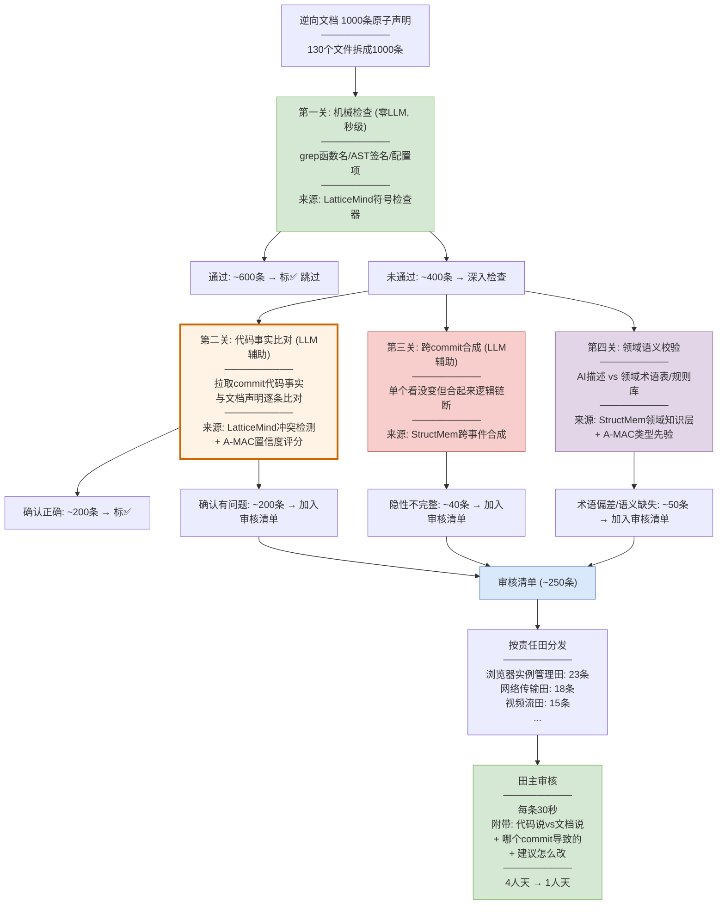

# 逆向资产文档自动审核方案：从100%人工审查到20%精准复核

> **领导关注点**：AI逆向生成的资产文档，由人全量审核成本巨大。能否自动识别可能的问题点，只把疑似问题给责任田田主审核？
>
> **两个核心Gap**：
> 1. AI逆向的业务知识和业务领域固有描述有出入
> 2. 人工审核文档质量成本巨大

---

## 一、问题量化

以 BrowserGateway 为例，你的 `docs/` 目录约 **130个文档文件**，拆成原子声明约 **1000条**：

| 声明类型 | 数量 | 当前审核方式 | 成本 |
|---------|------|------------|------|
| 架构交互流程（0-arch/interaction-model/） | ~350条 | 人工逐条 | ~1.5人天 |
| 业务规则（0-biz/rules/） | ~200条 | 人工逐条 | ~1人天 |
| 数据模型/对象模型（0-biz/data-model/ + object-model/） | ~150条 | 人工逐条 | ~0.5人天 |
| 接口定义（0-biz/interface/） | ~120条 | 人工逐条 | ~0.5人天 |
| 技术规范（0-tech/） | ~180条 | 人工逐条 | ~0.5人天 |
| **合计** | **~1000条** | **全量人工审核** | **~4人天** |

**目标**：自动扫描1000条，只把约200条疑似有问题的给田主复核 → 人工成本从4人天降到**1人天**。

---

## 二、两个Gap的技术解法

### Gap 1：AI逆向的业务知识与业务领域固有描述有出入

**表现**：AI看到代码里的函数名/变量名，按字面意思写业务描述，但业务术语的实际含义和字面意思不同。

**BrowserGateway 真实例子**：

| 文档里的AI描述 | 实际业务含义 | 差在哪 |
|-------------|-----------|-------|
| "预开浏览器请求" → AI写"提前打开浏览器" | 业务含义：为用户预先创建Chrome实例并分配，等待用户连接 | AI只看了函数名 preOpen，不懂"预开"的业务语义 |
| "BrowserCloserTask" → AI写"关闭浏览器任务" | 业务含义：心跳过期或远端不活跃时回收实例，不是简单"关闭" | AI不懂"回收"和"关闭"的业务区别 |
| "device_type=1按键, 2触屏" → AI写"设备类型1是按键2是触屏" | 可能已经变了——新增了3=折叠屏 | AI逆向时不知道枚举值是否扩展过 |
| "play_mode=0是JPG模式" → AI写"播放模式0是JPG" | 业务含义：JPG模式是降级模式，网络差时用，不是默认选择 | AI不懂JPG模式在业务流程中的定位 |

**技术解法**：

```
Step 1: 建领域知识基准（冷启动）
  ──────────────────────────────────
  从已有业务文档中提取领域术语表:
  - docs/0-biz/lexicon/ → 13个术语文件，已有的术语映射
  - 产品PRD/需求文档 → 业务规则原文
  - 田主口述的领域知识 → 录入术语表
  
  产出: domain_glossary.json (领域术语正确含义)
  产出: business_rules.json (业务规则正确版本)

Step 2: 用领域知识基准校验AI逆向文档
  ──────────────────────────────────
  对每条AI生成的文档声明，检查:
  
  检查A: 术语一致性
    文档说"提前打开浏览器"
    术语表说"预开=为用户预先创建Chrome实例并分配"
    → 术语表述不一致 → 标记 ⚠️ "术语偏差"
  
  检查B: 业务语义完整性  
    文档说"BrowserCloserTask是关闭浏览器任务"
    规则库说"BrowserCloserTask是实例回收任务,含心跳过期+远端不活跃两种回收条件"
    → 描述不完整 → 标记 ⚠️ "语义缺失"
  
  检查C: 枚举值时效性
    文档说"device_type: 1按键 2触屏"
    代码搜: enum DeviceType → 发现新增了 FOLDABLE(3)
    → 枚举值过时 → 标记 ⚠️ "数据过时"

Step 3: 输出领域偏差清单
  ──────────────────────────────────
  只把术语偏差/语义缺失/数据过时的条目给田主复核
```

**用到哪篇论文的技术**：
- **StructMem 领域知识层(Ω视角)**：建领域术语表，用术语表校验AI文档的业务描述
- **LatticeMind 冲突检测**：AI文档声明 vs 领域知识基准 的矛盾比对
- **A-MAC 置信度评分**：术语一致 → 高置信；术语偏差 → 低置信

### Gap 2：人工审核文档质量成本巨大

**表现**：1000条声明全量人工审核，大部分时间花在看"其实没错"的条目上。

**技术解法**：

```
Step 1: 廉价机械检查（零LLM，秒级）
  ──────────────────────────────────
  对每条声明做不需要LLM的快速检查:
  
  检查1: 文档提到的函数/类是否还存在？
    grep "ChromeSetImpl" src/ → 还在 ✓
    grep "OldManager" src/ → 不在了 ❌ (代码重构删了)
  
  检查2: 函数签名是否一致？
    文档说: delete(String userId)
    AST解析: delete(String userId) → 还一样 ✓
    文档说: healthCheck()  
    AST解析: healthCheck(boolean deep) → 多了参数 ❌
  
  检查3: 文档提到的配置项是否还在？
    文档说: browsergw.scheduled.check-browser-period
    grep application.yaml → 还在 ✓
    文档说: browsergw.chrome.ttl
    grep application.yaml → 改名为 browsergw.chrome.heartbeat-ttl ❌
  
  结果: ~600条通过机械检查 → 标"大概率正确" → 不需要人工看
        ~400条未通过 → 需要深入检查

Step 2: 代码事实比对（LLM辅助，分钟级）
  ──────────────────────────────────
  对机械检查未通过的400条，拉取相关commit的代码事实:
  
  文档说: "chromeSet.delete()同步删除实例"
  commit e4f5g6h 代码事实: delete()改为异步返回CompletableFuture
  → ❌ 直接矛盾 → 标"代码已变" → 需人工确认
  
  文档说: "BrowserCloserTask检查心跳过期"
  commit a1b2c3d 代码事实: 新增了CSE远端不活跃判断
  → ⚠️ 不完整(缺少新增的判断条件) → 标"语义缺失" → 需人工确认
  
  结果: ~200条确认有问题 → 加入审核清单
        ~200条实际没问题 → 标"确认正确"

Step 3: 跨commit合成检查（LLM辅助，分钟级）
  ──────────────────────────────────
  对"单看没变但合起来可能不完整"的声明:
  
  文档说: "弱网场景: 检测延迟→降帧率→切音频→提示"
  单看每个函数: 都还在 ✓
  跨commit合成: 2个月前插入了"选择降级策略"步骤,
                1个月前插入了"判断连接类型"步骤
  → ⚠️ 隐性不完整(逻辑链断了) → 需人工确认
  
  结果: ~40条隐性不完整 → 加入审核清单

Step 4: 领域语义校验（Gap 1的产出）
  ──────────────────────────────────
  术语偏差/语义缺失的条目 → 加入审核清单

Step 5: 输出审核清单
  ──────────────────────────────────
  最终审核清单 = Step2(200条) + Step3(40条) + Step4(领域偏差)
  ≈ 200-250条 → 只给田主看这些
```

**用到哪篇论文的技术**：
- **LatticeMind 符号检查器**：Step 1 的廉价机械检查（grep/AST/配置项）
- **LatticeMind 冲突检测 + A-MAC 置信度**：Step 2 的代码事实比对
- **StructMem 跨commit合成**：Step 3 的隐性不完整检测
- **StructMem 领域知识层 + A-MAC 类型先验**：Step 4 的领域语义校验

---

## 三、审核清单长什么样

田主收到的不是"130个文档全看一遍"，而是**一份精准的审核清单**：

```
══════════════════════════════════════════════
逆向文档自动审核清单
责任田: 浏览器实例管理
生成时间: 2026-10-12
需审核: 23条 (共扫描: 180条)
预计耗时: 1.5小时
══════════════════════════════════════════════

【高优先级 - 代码已变（8条）】

1. docs/0-biz/rules/rules-browser.md 规则"browser-closer-if-expired"
   文档说: 心跳过期(nanoTime - heartbeats > ttl)时关闭实例
   代码现状: commit a1b2c3d(9月)新增CSE远端不活跃判断(OR关系)
   差异: 文档缺少新增的"远端不活跃"判断条件
   建议: 补充 browser-closer-is-active 规则
   置信度: 0.15
   [确认过时] [AI误报] [查看代码]

2. docs/0-tech/concurrency-guidelines/concurrency-guidelines-browser-check-task.md
   文档说: 检查周期 browsergw.scheduled.check-browser-period 默认1800000ms
   代码现状: application.yaml已改为600000ms
   差异: 默认值过时
   建议: 更新为600000ms
   置信度: 0.20
   [确认过时] [AI误报] [查看代码]

...（共8条）

【中优先级 - 语义缺失（10条）】

9. docs/0-biz/lexicon/lexicon-browser.md 术语"播放模式(play_mode)"
   文档说: 0=JPG模式, 1=实时流模式
   代码现状: 新增 play_mode=2 (折叠屏自适应模式)
   差异: 枚举值不完整
   建议: 补充 play_mode=2 的描述
   置信度: 0.35
   [确认缺失] [AI误报] [查看代码]

10. docs/0-arch/interaction-model/interaction-model-create-browser.md
    文档说: "通过Playwright以persistent context方式启动Chrome"
    代码现状: commit f8a3b2c改为launch()独立启动
    差异: 启动方式已变
    建议: 更新为"通过Playwright launch()启动Chrome"
    置信度: 0.10
    [确认过时] [AI误报] [查看代码]

...（共10条）

【低优先级 - 术语偏差（5条）】

17. docs/0-biz/rules/rules-browser.md 规则"browser-closer-if-expired"
    文档说: "关闭过期实例"
    领域术语表说: 应为"回收不活跃实例"(含心跳过期+远端不活跃)
    差异: 术语"关闭"应为"回收"，业务语义不同
    置信度: 0.45
    [确认偏差] [AI误报] [查看术语表]

...（共5条）

══════════════════════════════════════════════
自动扫描统计:
  总扫描: 180条
  ✅ 高置信(无需审核): 157条 (87%)
  ⚠️ 疑似问题(需审核): 23条 (13%)
  
  问题分类:
    代码已变: 8条
    语义缺失: 10条  
    术语偏差: 5条
══════════════════════════════════════════════
```

---

## 四、自动扫描流水线



---

## 五、效果量化

| 指标 | 当前(全量人工) | POC目标 | 提升 |
|------|-------------|---------|------|
| 人工审核量 | 1000条 | **~250条** | **4倍降低** |
| 人工成本 | 4人天 | **1人天** | **75%降低** |
| 问题发现率 | ~100%(人全看) | **85-90%** | 略降但可接受 |
| 审核质量 | 依赖人认真程度 | **每条附带代码证据+建议** | 质量更高 |
| 田主负担 | 全量看130个文件 | **只看自己责任田的~20条** | 大幅减轻 |

### 为什么能从1000条缩到250条

| 过滤关卡 | 过滤掉多少 | 过滤逻辑 | 成本 |
|---------|-----------|---------|------|
| 机械检查 | 600条(60%) | 函数还在、签名没变、配置还在 → 大概率没错 | 零LLM，秒级 |
| 代码事实比对 | 200条(20%) | 拉取commit比对，确认一致 | LLM辅助，分钟级 |
| 跨commit合成 | 40条(4%) | 单个看没变但合起来逻辑链断 | LLM辅助，分钟级 |
| 领域语义校验 | 50条(5%) | 术语偏差/语义缺失 | LLM辅助，分钟级 |
| **最终需人工** | **~250条(25%)** | — | 1人天 |

---

## 六、两个Gap分别怎么解——总结

### Gap 1: AI逆向的业务知识和业务领域固有描述有出入

| 解法 | 做什么 | 来源技术 |
|------|--------|---------|
| 建领域知识基准 | 从已有lexicon/PRD/田主口述建术语表+规则库 | StructMem 领域知识层 |
| 术语一致性校验 | AI文档用的术语 vs 术语表正确含义 | LatticeMind 冲突检测 |
| 业务语义完整性校验 | AI文档描述 vs 规则库完整描述 | LatticeMind + A-MAC |
| 枚举值时效性校验 | AI文档写的枚举值 vs 代码当前枚举 | LatticeMind 符号检查器 |

### Gap 2: 人工审核文档质量成本巨大

| 解法 | 做什么 | 来源技术 |
|------|--------|---------|
| 机械检查先行 | grep/AST/配置项秒级过滤60% | LatticeMind 符号检查器 |
| 代码事实比对 | commit代码事实 vs 文档声明逐条比 | LatticeMind + A-MAC 置信度 |
| 跨commit隐性检测 | 多commit合成发现逻辑链断裂 | StructMem 跨事件合成 |
| 置信度排序 | 高置信跳过、低置信给田主 | A-MAC 阈值裁决 |
| 审核清单附带证据 | 每条疑似项附带"代码说vs文档说+哪个commit+建议" | 全部5篇融合 |

---

## 七、对领导的话

**核心价值**：不是让AI完全替代人审，而是**让AI先扫一遍把"大概率没错的"筛掉，只把"疑似有问题的"给田主看**。

- 1000条声明自动扫描 → 750条标"大概率正确"跳过 → 250条疑似问题给田主
- 田主收到的不是"130个文件全看"，而是**一份精准清单**：每条附带"代码现在怎么说、文档当时怎么写的、哪个commit导致的、建议怎么改"
- 人工从4人天降到1人天，**75%成本降低**
- 85-90%的问题能被自动发现——剩下10-15%需要后续迭代（通过HORMA技能精炼逐步提升发现率）

**技术成熟度**：5篇论文都是2026年顶会/arXiv前沿研究，其中StructMem（蚂蚁集团联署，GitHub 1188 stars）最接近工程化。POC验证用2人天标注成本即可启动，用BrowserGateway的docs目录做真实场景验证。

---

*方案生成日期: 2026-10-12*
