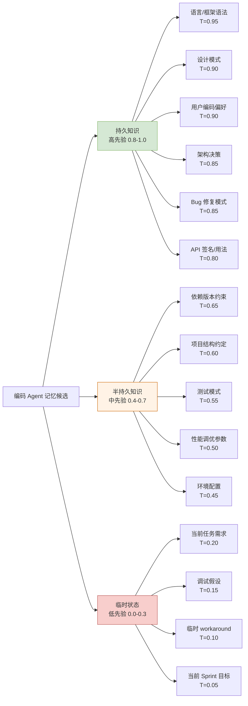
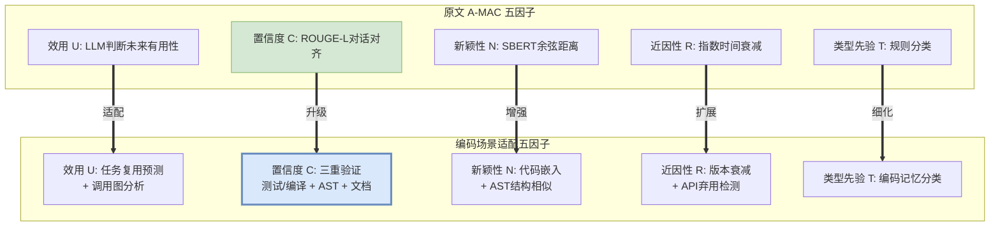
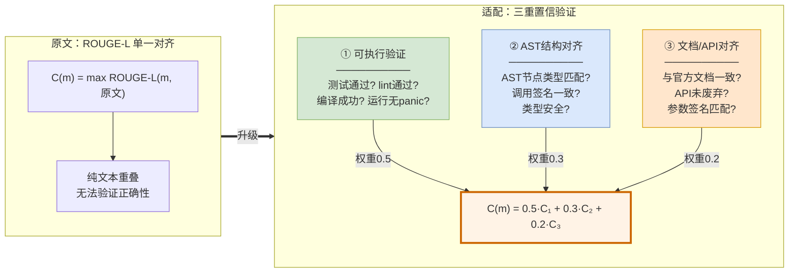
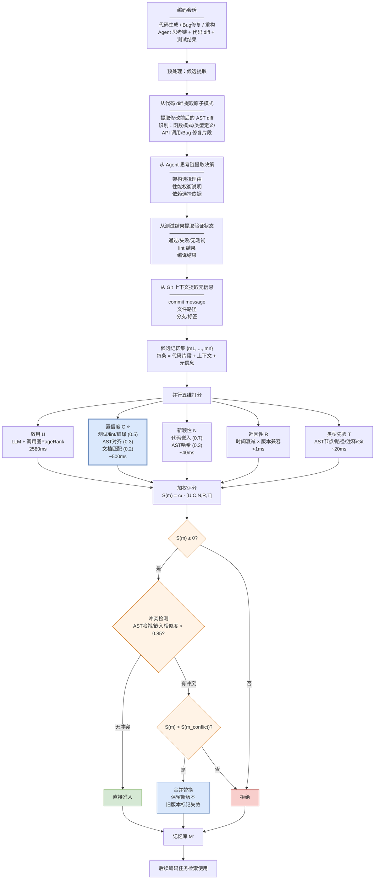
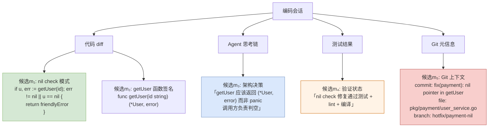
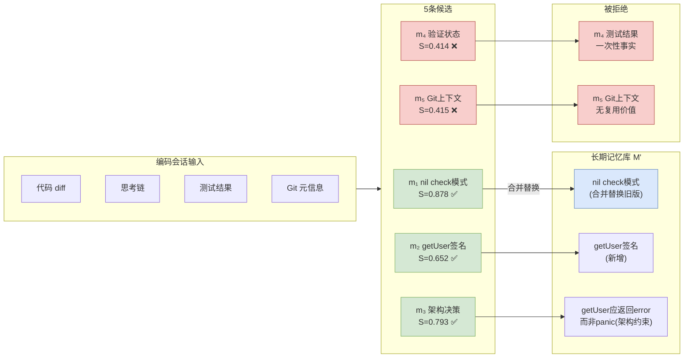

# A-MAC 策略适配方案：编码 Agent 代码生成场景

> 基于 arXiv:2603.04549 (A-MAC) 的五维记忆准入控制框架，适配到编码 Agent 的代码生成与工程实践场景。

---

## 概述

编码 Agent 与对话 Agent 的核心区别在于：代码是**可执行、可验证、有结构、有版本**的。这意味着记忆准入控制可以利用对话场景没有的信号——测试通过率、编译结果、AST 结构、API 文档对齐——来做更精确的准入决策。

适配后的架构仍分两条路径：

- **写入路径**：从编码会话中提取候选记忆（代码模式、Bug 修复、架构决策、API 用法等），用五个适配后的因子打分，决定准入/更新/拒绝；
- **检索路径**：当下次编码任务需要相关记忆时，从记忆库中检索并通过结构化上下文注入 LLM。

关键变化：**置信度因子从"ROUGE-L 文本对齐"升级为"可执行验证 + AST 对齐 + 文档匹配"的三重置信**——这是代码场景独有的优势，也是适配的核心增益点。

---

## 一、记忆类型分类（编码场景的 Type Prior 基础）

A-MAC 原文中"类型先验"是最强因子。编码场景的信息类型更丰富，需要先建立分类体系：



### 为什么这样分？

**持久知识（高先验）**：语言语法不会变、设计模式跨项目复用、用户偏好（"我习惯用 error-wrap 模式"）贯穿所有任务、架构决策（"选了 gRPC 不选 REST"）长期生效、Bug 修复模式（"nil pointer panic 要先判空"）可以跨场景复用、API 签名相对稳定。这些信息存了长期有用。

**半持久知识（中先验）**：依赖版本会升级（"用的是 Go 1.21"）、项目结构约定（"handler 层不放业务逻辑"）在项目内有效但跨项目不一定适用、测试模式（"我们用 table-driven test"）在团队内有效、性能参数（"连接池设了100"）可能调优后变化、环境配置（"本地用 Docker 跑 PG"）会迁移。这些信息有时间窗口限制。

**临时状态（低先验）**：当前任务需求（"给支付模块加退款功能"）完成就没用了、调试假设（"我猜是 goroutine 泄漏"）验证完就过期、临时 workaround（"先 hardcode 绕过"）不是长期方案、Sprint 目标过完就翻篇。

---

## 二、五维因子适配



### 逐因子适配详解

#### 因子1：效用 U(m) — 从"对话有用性"到"代码复用预测"

| 原文 | 适配 |
|------|------|
| LLM 判断"是否支持后续问题" | LLM 判断"是否会在未来编码任务中复用" |
| 单次 LLM 调用 | 单次 LLM 调用，但增加**调用图分析**作为辅助信号 |
| 温度0，可缓存 | 温度0，可缓存 |

**适配设计**：LLM 被问的问题变成编码语境的：
- 这段代码模式是否可跨任务复用？
- 这个 Bug 修复方案是否对同类问题通用？
- 这个架构决策是否长期约束后续开发？
- 这个 API 用法是否在该框架中频繁出现？

**新增辅助信号——调用图分析**：如果候选记忆涉及的函数/模块在调用图中被频繁引用（高 PageRank 或高入度），其复用概率更高。这是对话场景没有的结构化信号。例如 `utils/logger.go` 中的日志模式被 30 个文件调用，存它的用法模式价值远高于只被调用一次的 `scripts/migrate.go` 中的迁移逻辑。

#### 因子2：置信度 C(m) — 从"文本对齐"到"三重可执行验证" ⭐核心升级

这是编码场景**最大的适配增益**。代码不是自然语言——它可以被执行、可以被解析、可以与文档对齐。



**① 可执行验证（权重0.5）**——对话场景完全不具备的优势：
- 候选代码模式能否通过现有测试套件？
- 能否通过 lint（golangci-lint / eslint / ruff）？
- 能否编译/运行无 panic？
- 如果是 Bug 修复，修复后对应测试是否通过？

打分规则：
- 测试通过 + lint 通过 + 编译通过 → C₁ = 1.0
- 编译通过但无测试覆盖 → C₁ = 0.6（能跑不代表对）
- 编译失败或测试失败 → C₁ = 0.1（不阻止写入但标低置信，便于后续修正）
- 无法执行（纯架构决策类记忆） → C₁ = 0.5（跳过此项，靠 AST + 文档兜底）

**② AST 结构对齐（权重0.3）**：
- 解析候选代码的 AST，检查节点类型是否符合语言惯用法
- 函数签名是否类型安全
- 是否存在明显反模式（如 Go 中 `init()` 中的网络调用、Python 中裸 `except:`）

**③ 文档/API 对齐（权重0.2）**：
- 如果候选涉及 API 调用，与官方文档/类型定义比对
- 检查 API 是否已废弃（deprecation detection）
- 参数签名是否匹配当前版本

**为什么权重这样分**：可执行验证是最可靠的（代码能跑就是能跑），AST 次之（结构合理但运行时可能还有问题），文档对齐最弱（文档可能滞后）。但三者叠加比原文的 ROUGE-L 强得多——ROUGE-L 只能告诉你"候选和原文文字重叠多不多"，不能告诉你代码对不对。

#### 因子3：新颖性 N(m) — 从"语义余弦"到"代码嵌入 + AST 结构"

| 原文 | 适配 |
|------|------|
| Sentence-BERT 嵌入 | 代码专用嵌入模型（UniXcoder / CodeBERT / codedit） |
| 余弦相似度 | 余弦相似度 **+ AST 结构哈希** |

**适配设计**：
- 用代码专用嵌入模型（而非通用 SBERT）计算语义相似度——代码的语义空间与自然语言不同，`for range` 和 `forEach` 在代码语义上等价但 SBERT 不一定这样认为。
- 新增 **AST 结构指纹**：将候选代码的 AST 做哈希，如果与已有记忆的 AST 哈希相同（结构完全一致），即使变量名不同也判定为冗余。这解决了"同一段代码模式只是变量名不同"的冗余问题——SBERT 可能因为变量名不同给低相似度，但 AST 哈希能识别它们是同一个模式。

```
N(m) = 1 - max(α · cos(φ_code(m), φ_code(m')), β · AST_hash_match(m, m'))
     其中 α=0.7, β=0.3
```

#### 因子4：近因性 R(m) — 从"时间衰减"到"版本衰减 + API 弃用"

| 原文 | 适配 |
|------|------|
| 纯时间指数衰减 | 时间衰减 **× 版本兼容因子** |
| 半衰期 69 小时 | 半衰期延长至 **7 天**（代码知识的时效远长于对话） |
| 无弃用检测 | 新增 **API 弃用检测** |

**适配设计**：
- 代码知识的时效远长于对话——"如何处理 nil pointer"这个知识不会在3天后过期。将 λ 从 0.01/小时降至约 0.004/小时（半衰期约7天）。
- 新增**版本兼容因子** V(m)：如果候选涉及的 API/依赖在当前版本中仍有效，V=1.0；如果已废弃，V=0.1；如果版本不确定，V=0.8。

```
R(m) = exp(-λ · τ(m)) × V(m)
     λ = 0.004/小时 (半衰期 ≈ 7天)
```

#### 因子5：类型先验 T(m) — 从"偏好/情绪二分"到"编码记忆六分类"

见第一节的分类图。从原文的"偏好 vs 情绪"二分类，扩展为"持久知识 / 半持久知识 / 临时状态"三大类十二小类。分类规则从"词性匹配"升级为：

- **AST 节点类型**：函数声明/类型定义/接口定义 → 持久知识；临时变量/匿名函数 → 临时状态
- **文件路径模式**：`pkg/`、`internal/`、`cmd/` 下的代码 → 持久知识；`tmp/`、`test/`、`scripts/` → 半持久或临时
- **注释标记**：`// TODO`、`// FIXME`、`// HACK` → 降低先验；`// Pattern:`、`// Convention:` → 提高先验
- **Git 元信息**：commit message 中的 `fix:`、`feat:` → Bug 修复模式或功能模式（持久）；`chore:`、`wip:` → 临时

---

## 三、准入流水线（编码场景完整版）



### 与原文流水线的关键差异

| 环节 | 原文（对话场景） | 适配（编码场景） | 差异原因 |
|------|----------------|-----------------|---------|
| 候选来源 | 对话历史轮次 | 代码 diff + 思考链 + 测试结果 + Git 元信息 | 代码场景的信息源更多维 |
| 预处理 | 拆原子单元 + 消解共指 | AST diff + 决策提取 + 验证状态 + Git 上下文 | 代码有结构化解析能力 |
| 置信度 | ROUGE-L 文本对齐 (18ms) | 三重验证：测试+AST+文档 (~500ms) | 代码可执行可验证 |
| 新颖性 | SBERT 余弦 (32ms) | 代码嵌入 + AST 哈希 (~40ms) | 代码有结构指纹 |
| 近因性 | 纯时间衰减 λ=0.01/h | 时间衰减 × 版本兼容 λ=0.004/h | 代码知识时效更长 |
| 类型先验 | 偏好/情绪二分类 | 六大类十二小类 + AST/路径/注释/Git 规则 | 代码记忆类型更丰富 |
| 冲突检测 | SBERT 相似度 > 0.85 | AST 哈希 + 嵌入相似度 > 0.85 | 代码结构完全相同才算冲突 |

---

## 四、权重重新学习（编码场景的策略适配）

原文的权重是在 LoCoMo 对话基准上学的。编码场景需要重新学习，因为各因子的相对重要性会变：

```mermaid
flowchart LR
    subgraph Original["原文权重（对话场景）"]
        direction TB
        OW1["T(类型先验) ≈ 0.40<br/>最强因子"]
        OW2["N(新颖性) ≈ 0.20"]
        OW3["U(效用) ≈ 0.15"]
        OW4["C(置信度) ≈ 0.15"]
        OW5["R(近因性) ≈ 0.10"]
    end

    subgraph Adapted["预期权重（编码场景）"]
        direction TB
        AW1["C(置信度) ≈ 0.30<br/>⬆️ 可执行验证成为最强信号"]
        AW2["T(类型先验) ≈ 0.25<br/>⬇️ 仍重要但不再是绝对主导"]
        AW3["U(效用) ≈ 0.20<br/>⬆️ 复用预测价值提升"]
        AW4["N(新颖性) ≈ 0.15<br/>⬇️ 代码冗余相对好识别"]
        AW5["R(近因性) ≈ 0.10<br/>➡️ 保持低位"]
    end

    Original ==>|重新学习| Adapted

    style OW1 fill:#f8cecc,stroke:#b85450,stroke-width:3px
    style AW1 fill:#dae8fc,stroke:#6c8ebf,stroke-width:3px
```



### 为什么权重会变？

**置信度 C 从弱因子变成最强因子**：原文中 C(ROUGE-L) 只能检测"候选和原文文字重叠多不多"，消融实验中移除C仅降0.015 F1。但在编码场景中，C 变成了"代码能不能跑、AST 合不合理、API 对不对"的三重验证——这是非常强的正确性信号。一段通过了测试和 lint 的代码模式，其可信度远高于"原文提到过"。

**类型先验 T 从绝对主导降为第二**：原文中 T 是最强因子(ΔF1=-0.107)因为在对话中"偏好vs情绪"的区分太明显了。编码场景中虽然类型区分仍重要，但置信度的提升使其不再是唯一主导。

**效用 U 重要性上升**：代码模式的复用价值比对话信息更可预测——通过调用图分析可以量化"这段代码被多少地方引用"，比"这段对话未来有没有用"好判断。

### 学习数据来源

- **标注集构建**：从真实编码项目历史中提取 Git commit 序列，由资深工程师标注"这个模式该不该存进 Agent 记忆"。
- **基准任务**：在 SWE-bench / HumanEval / 真实项目 issue 修复任务上评估"有记忆 vs 无记忆"的通过率提升。
- **交叉验证**：仍用 5 折交叉验证 + 网格搜索，但 F1 替换为"任务通过率提升"作为优化目标。

---

## 五、具体案例：一次 Bug 修复的记忆准入全过程

假设编码 Agent 在一个 Go 项目中修复了一个 nil pointer panic：

> **任务上下文**：用户报告 `payment_service.go` 在生产环境 panic: nil pointer dereference  
> **Agent 分析**：定位到 `getUser(id)` 返回 nil 未判空，调用方直接 `.Name` 导致 panic  
> **修复代码**：在调用处加 nil check + 返回友好错误  
> **测试结果**：修复后对应测试通过，lint 通过，编译通过  

### 第一关：候选提取



从一次修复中提取出5条候选——代码模式(m₁)、函数签名(m₂)、架构决策(m₃)、验证状态(m₄)、Git 上下文(m₅)。

### 第二关：五维打分

| 候选 | U(效用) | C(置信度) | N(新颖性) | R(近因性) | T(类型先验) |
|------|---------|-----------|-----------|-----------|-------------|
| m₁ nil check 模式 | 0.90 (通用模式, 调用图高引用) | C₁=1.0(测试+lint+编译全过) C₂=0.9(AST规范) C₃=0.8(语言惯用法) **C=0.94** | 0.70 (已有类似但不同函数) | 0.98 | 0.85 (Bug修复模式, 持久) |
| m₂ getUser签名 | 0.60 (项目内特定) | C₁=0.6(编译过但无新测试) C₂=1.0(类型安全) C₃=0.9(文档一致) **C=0.78** | 0.50 (已有记录) | 0.98 | 0.50 (API签名, 半持久) |
| m₃ 架构决策 | 0.85 (长期约束) | C₁=0.5(不可执行) C₂=0.7(逻辑合理) C₃=0.6(无文档) **C=0.59** | 0.90 (新决策) | 0.98 | 0.85 (架构决策, 持久) |
| m₄ 验证状态 | 0.10 (一次性) | C₁=1.0(直接结果) C₂=N/A C₃=N/A **C=0.50** | 0.80 (此修复首次) | 0.99 | 0.10 (临时状态) |
| m₅ Git上下文 | 0.05 (无复用) | C₁=N/A C₂=N/A C₃=N/A **C=0.50** | 0.95 (唯一) | 0.99 | 0.05 (临时状态) |

### 第三关：加权评分（假设学习到的权重 ω = [0.20, 0.30, 0.15, 0.10, 0.25]）

| 候选 | U×0.20 | C×0.30 | N×0.15 | R×0.10 | T×0.25 | **S(m)** |
|------|--------|--------|--------|--------|--------|-----------|
| m₁ nil check | 0.180 | 0.282 | 0.105 | 0.098 | 0.213 | **0.878** ✅ |
| m₂ getUser签名 | 0.120 | 0.234 | 0.075 | 0.098 | 0.125 | **0.652** ✅ |
| m₃ 架构决策 | 0.170 | 0.177 | 0.135 | 0.098 | 0.213 | **0.793** ✅ |
| m₄ 验证状态 | 0.020 | 0.150 | 0.120 | 0.099 | 0.025 | **0.414** ❌ |
| m₅ Git上下文 | 0.010 | 0.150 | 0.143 | 0.099 | 0.013 | **0.415** ❌ |

### 第四关：阈值裁决（θ = 0.55）

- **m₁（nil check 模式）0.878 → 准入** ✅ 通用 Bug 修复模式，置信度最高，类型先验高
- **m₃（架构决策）0.793 → 准入** ✅ 长期约束，新颖性高
- **m₂（getUser签名）0.652 → 准入** ✅ 项目内 API，有参考价值
- **m₄（验证状态）0.414 → 拒绝** ❌ "这次测试通过了"是一次性事实，无长期价值
- **m₅（Git上下文）0.415 → 拒绝** ❌ commit hash 和分支名无复用价值

### 第五关：冲突检测

m₁ 的 nil check 模式与记忆库已有的"nil pointer 判空模式"AST 哈希相似度 > 0.85 → 触发冲突。比较得分：新候选0.878 > 旧记忆0.75（旧的可能没有"返回友好错误"的部分）→ 合并替换，旧记忆标记失效但保留历史。

### 最终结果



**下次效果**：当 Agent 在另一个文件中遇到 `getOrder(id)` 返回 nil 导致 panic 时，它能从记忆库检索到 nil check 模式（m₁合并版）和"getXxx 应返回 error 而非 panic"的架构约束（m₃），直接应用已验证的修复模式——而不是从头分析。

---

## 六、适配关键差异总结

| 维度 | 原文（对话） | 适配（编码） | 增益来源 |
|------|-------------|-------------|---------|
| 候选来源 | 对话轮次 | 代码diff + 思考链 + 测试 + Git | 信息源更多维 |
| 置信度 | ROUGE-L 文本对齐 (18ms) | 测试+AST+文档三重验证 (~500ms) | ⭐代码可执行可验证 |
| 新颖性 | SBERT 余弦 (32ms) | 代码嵌入 + AST 哈希 (~40ms) | 结构指纹识别同模式不同变量名 |
| 近因性 | 时间衰减 λ=0.01/h | 时间衰减×版本兼容 λ=0.004/h | 代码知识时效更长 + API弃用检测 |
| 类型先验 | 偏好/情绪二分类 | 六类十二分 + AST/路径/注释/Git | 分类粒度更细 |
| 效用 | LLM 判断 | LLM + 调用图 PageRank | 结构化复用预测 |
| 最强因子 | 类型先验 T | **置信度 C**（可执行验证） | 代码场景独有优势 |
| 延迟 | 2644ms | ~3100ms | 置信度验证增加~500ms但价值更大 |
| 学习目标 | F1 on LoCoMo | 任务通过率提升 on SWE-bench | 直接优化编码效果 |

**核心结论**：编码场景的最大适配增益在于**置信度因子从"文本对齐"升级为"可执行验证"**。对话场景中你无法验证一句话是否"正确"，只能看它有没有原文支撑（ROUGE-L）。但代码可以跑、可以编译、可以 lint——这使得 A-MAC 的准入决策从"有没有人说过"变成"验证过没有"，准确性和可靠性都大幅提升。

---

*报告生成日期: 2026-10-12*
