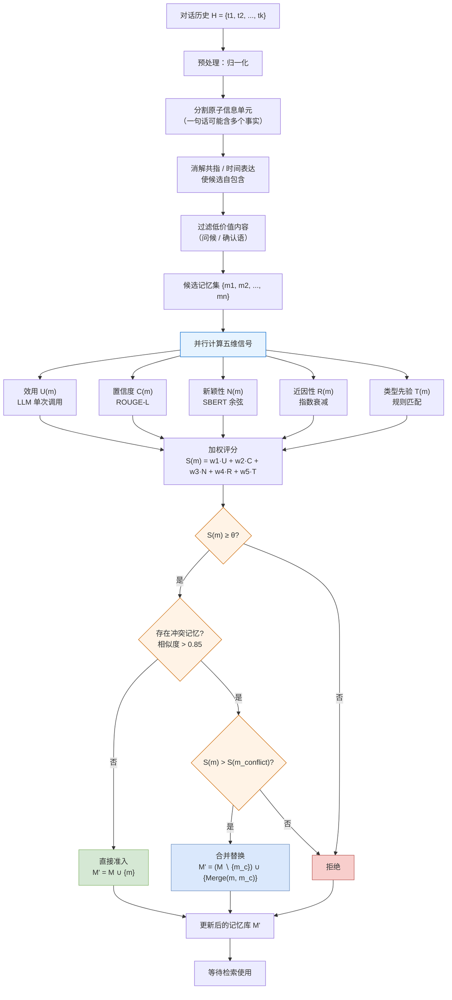
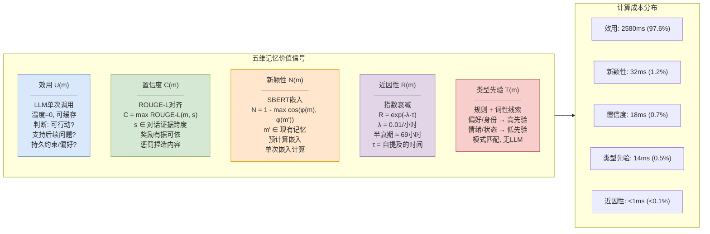
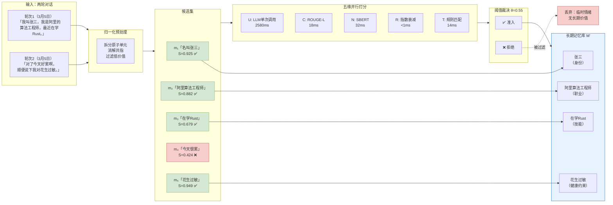
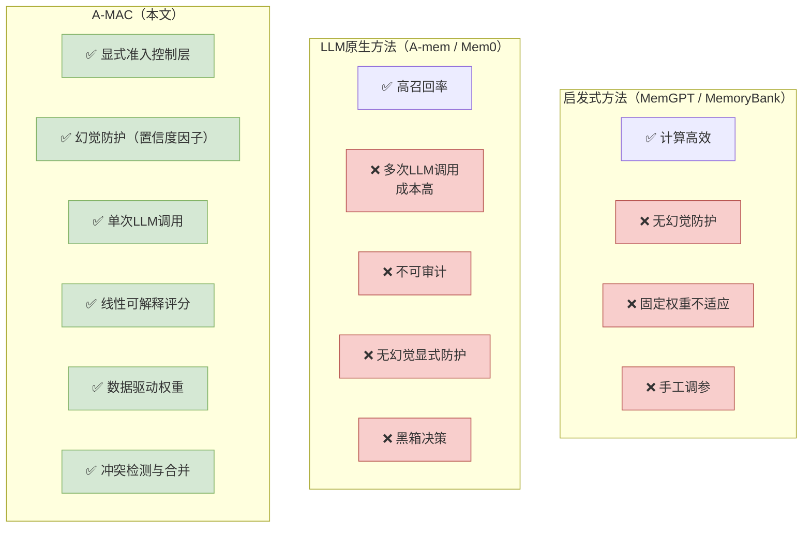

# 论文洞察：Adaptive Memory Admission Control for LLM Agents（A-MAC）

> **论文**: arXiv:2603.04549 [cs.AI]  
> **作者**: Guilin Zhang, Wei Jiang, Xiejiashan Wang, Aisha Behr, Kai Zhao, Jeffrey Friedman, Xu Chu, Amine Anoun  
> **机构**: Workday AI  
> **日期**: 2026年3月4日  
> **代码**: https://github.com/GuilinDev/Adaptive_Memory_Admission_Control_LLM_Agents

---

## 概述

A-MAC 为 LLM Agent 的长期记忆系统提供了一个**显式的准入控制层**。现有 Agent 的记忆管理要么"来者不拒"导致记忆膨胀、幻觉传播，要么完全交给 LLM 黑箱决策、成本高且不可审计。A-MAC 将"一条信息该不该存"建模为**结构化决策问题**，架构分为两条核心路径：

- **准入路径**：从对话中提取候选记忆，用五个可解释因子打分，通过学习到的线性策略和阈值决定"准入 / 更新 / 拒绝"；
- **检索路径**：被准入的记忆进入长期存储，供后续推理使用——论文聚焦准入侧，检索侧不在本文范围内，但准入质量直接决定检索质量。

核心思想一句话：**在信息进入长期记忆之前，插一道可控、可解释、可审计的"门"**。

---

## 一、准入路径

准入路径负责将对话历史转化为经过筛选的长期记忆，包含四个阶段：

- **预处理归一化**：将对话轮次切分为原子信息单元（因为一句话可能含多个事实），消解共指和时间表达使候选自包含，过滤问候/确认语等低价值内容。这一步减少噪声，确保后续评分操作在格式良好的候选上进行。
- **五维信号并行计算**：每个候选记忆同时计算五个互补信号——效用（LLM单次调用）、置信度（ROUGE-L对齐）、新颖性（SBERT余弦距离）、近因性（指数衰减）、类型先验（规则匹配）。
- **线性加权评分**：五个信号通过学习到的权重向量加权求和，得到综合评分 S(m)。
- **阈值决策与冲突合并**：S(m) 超过阈值 θ 则准入；若与现有记忆语义相似度超过0.85但内容不同，则比较评分保留更高者并合并，确保记忆库紧凑且最新。

---

## 二、五维信号详解

### 评分公式

$$\mathcal{S}(m) = w_1 \cdot \mathcal{U}(m) + w_2 \cdot \mathcal{C}(m) + w_3 \cdot \mathcal{N}(m) + w_4 \cdot \mathcal{R}(m) + w_5 \cdot \mathcal{T}(m)$$

约束：$w_i \geq 0$，$\sum w_i = 1$，准入条件 $\mathcal{S}(m) \geq \theta$。

五个因子的设计哲学是**"确定性规则能做的不交给LLM"**：

- **效用 U** 是唯一调用 LLM 的因子——判断"这条信息未来有没有用"需要语义理解，规则做不了。用温度0确保确定性输出，重复候选缓存得分降低API成本。
- **置信度 C** 用 ROUGE-L 检测候选是否有对话证据支撑——最长公共子序列奖励有据可依的重叠，惩罚凭空捏造。这直接对抗幻觉传播。
- **新颖性 N** 用 SBERT 嵌入计算与现有记忆的最大余弦相似度——相似度越高越冗余，越不需要存。预计算现有记忆的嵌入，每条新候选只需一次嵌入计算。
- **近因性 R** 用指数衰减——信息越新越可能有用，λ=0.01/小时对应约69小时半衰期。
- **类型先验 T** 用规则+词性线索分类内容——偏好/身份声明这类持久信息给高先验，情绪/状态这类临时信息给低先验。完全不用 LLM。

---

## 三、关键设计要点

| 设计要点 | 说明 |
|---------|------|
| 显式准入控制层 | 记忆准入不是生成的副产物，而是一等公民的决策环节，可独立优化和审计 |
| 五维可解释分解 | 将"记忆价值"拆成效用、置信度、新颖性、近因性、类型先验五个语义清晰的因子 |
| 混合架构 | 4个规则因子(64ms) + 1个LLM因子(2580ms)，97.6%成本集中在一处，效率与表达力平衡 |
| 线性加权评分 | 权重直接可读——"类型先验权重大"意味着内容分类是该域最关键的准入信号 |
| 数据驱动权重 | 5折交叉验证+网格搜索学习权重和阈值，无需手工调参，可跨域迁移 |
| 幻觉显式防护 | 置信度因子用ROUGE-L检测对话证据支撑，从源头阻止无据内容进入记忆 |
| 冲突检测与合并 | 新旧记忆相似度>0.85时比较评分，保留更高者并合并，确保记忆库紧凑且最新 |
| 阈值可调旋钮 | θ∈[0.5,0.6]为稳健区间，部署时可按业务需求调精度/召回权衡 |

---

## 四、准入处理细节（逐关卡解析）

本节按"一句话要经历哪些关卡才能进记忆库"来讲。论文中的英文关键词在括号中备注，方便对照原文。

### 4.1 进库之前：先做三件打扫工作

**第一，把话拆成"原子信息单元"。** 用户说一句"我上周从阿里跳槽到字节了，现在住杭州，女儿刚上小学"，这里至少有三个独立事实（跳槽、住址、家庭）。A-MAC 把一句话拆成多个原子候选（candidate memory），每个候选是一条语义自包含的信息单元。不拆的话，后续打分只能给整句话一个粗粒度分数，没法区分其中哪些部分值得存、哪些不值得。

**第二，消解共指和时间表达。** "我""他""上周"这些词离开了上下文就没意义。归一化阶段把"我上周"解析成"张三，2026年1月5日"，使候选变成自包含的——即使将来脱离原始对话上下文也能被理解和使用。

**第三，过滤低价值内容。** "好的""谢谢""嗯"这类确认语和问候不进入候选池。这从源头减少了需要评估的候选数量，降低后续计算成本。

### 4.2 第一关：并行算五个分（五维信号提取）

归一化后的每个候选 m 同时进入五条评分通道，五路并行不阻塞：

**通道① 效用 U(m)——唯一需要 LLM 的通道。** LLM 被问三个问题：这条信息是否可行动（actionable）？是否支持可能的后续问题？是否捕获了持久的用户约束或偏好？用温度0确保每次给同一条候选打分结果一致，重复出现的候选缓存得分避免重复调用。这是整个系统中最贵的操作（2580ms，占总延迟97.6%），但只用调一次 LLM。

**通道② 置信度 C(m)——对抗幻觉的看门人。** 系统先从对话历史中找到可能支撑这条候选的原文段落（Support(m)），然后计算候选与每个支撑段落之间的 ROUGE-L 分数，取最大值。ROUGE-L 基于最长公共子序列——候选与原文重叠越多，置信度越高；候选中有原文里找不到的细节（捏造的内容），置信度就低。举个例子：对话里说"张三在字节做推荐算法"，候选提取成"张三在字节做推荐算法，年薪百万"——后半句原文没有，ROUGE-L 分数会被拉低，幻觉内容被挡在门外。

**通道③ 新颖性 N(m)——防冗余的守卫。** 用 Sentence-BERT 把候选和现有记忆库里所有记忆都变成向量，算余弦相似度，取最大值后用1减掉——相似度越高（越冗余），新颖性越低。现有记忆的向量是预计算好的，每条新候选只需一次嵌入计算（32ms）。如果候选和已有记忆几乎一样，新颖性趋近0，分数被拉低，不浪费存储。

**通道④ 近因性 R(m)——时间衰减。** 候选被提及后过去了多久 τ(m)，用指数衰减 exp(-λ·τ) 计算。λ=0.01/小时，对应约69小时半衰期——大约3天后信息的时间价值减半。这一步几乎不花时间（<1ms），纯算术。

**通道⑤ 类型先验 T(m)——内容分类器。** 用规则+词性线索判断候选属于哪类信息：用户偏好（"我喜欢清淡的"）→ 高先验；身份声明（"我是工程师"）→ 高先验；临时情绪（"今天很累"）→ 低先验；过渡状态（"正在等公交"）→ 低先验。这一步也不用 LLM（14ms），但消融实验证明它是最关键的因子。

### 4.3 第二关：加权打分（线性策略聚合）

五个分数出来后，按学习到的权重向量 ω = [w₁, w₂, w₃, w₄, w₅] 加权求和：

$$S(m) = w_1 \cdot U(m) + w_2 \cdot C(m) + w_3 \cdot N(m) + w_4 \cdot R(m) + w_5 \cdot T(m)$$

权重满足两个约束：非负（wᵢ ≥ 0）且归一化（∑wᵢ = 1）。这意味着最终得分 S(m) ∈ [0, 1]，且每个因子的贡献可以直接读权重就知道——"类型先验权重最大"就意味着"内容分类是当前域最关键的准入信号"。这种线性可解释性是 A-MAC 相比纯 LLM 黑箱决策的核心优势：开发者可以拆开每个因子的独立得分和权重贡献，理解为什么某条记忆被准入或拒绝。

### 4.4 第三关：阈值裁决（准入 / 更新 / 拒绝）

得分出来后，跟阈值 θ 比：

- **S(m) ≥ θ → 通过第一道门**，进入冲突检测；
- **S(m) < θ → 直接拒绝**，这条信息不进长期记忆。

阈值 θ 是通过交叉验证学到的，最优值 θ* = 0.55。论文的阈值敏感性分析表明，θ ∈ [0.50, 0.60] 是一个"稳健平台"——在这个区间内 F1 波动很小，部署时不必精确调参。低于0.45则召回拉满但精度暴跌（什么都存），高于0.65则精度没显著提升但召回暴跌（什么都不存）。

### 4.5 第四关：冲突检测与合并

通过阈值的候选还要检查：记忆库里有没有语义相似但内容不同的旧记忆？检测方法是算候选与每条现有记忆的 SBERT 余弦相似度，超过 0.85 就认为可能冲突。

- **不冲突 → 直接准入**：M' = M ∪ {m}，新记忆加入记忆库。
- **冲突且新候选得分更高 → 合并替换**：删掉旧的冲突记忆，写入新候选与旧记忆的合并版本。合并确保信息不丢失——旧记忆中被新候选覆盖的部分失效，未被覆盖的部分保留。
- **冲突但旧记忆得分更高 → 拒绝新候选**：旧记忆更可靠，保留旧的不写新的。

这一步确保记忆库不会因为同一事实的多个版本而膨胀，同时保留更可靠的版本。

### 4.6 第五关：权重和阈值是怎么学出来的

这是"数据驱动"的具体实现：

1. **准备标注数据**：在 LoCoMo 基准上，30 段对话覆盖个人助理、技术支持、研究协作三种场景，每段15-40轮，共约1500条候选记忆，每条都有人工标注的"该不该存"标签。
2. **5折交叉验证**：数据分5份，每次用4份训练1份验证，轮5次取平均。
3. **网格搜索**：遍历所有满足约束（非负、归一化）的权重组合 × 阈值区间[0.3, 0.6]，在训练集上搜索，在验证集上评估 F1。
4. **选最优配置**：平均验证 F1 最高的权重和阈值作为最终策略，在保留的测试集上报告最终结果。

学习结果是：**类型先验 T 获得最大权重**，验证了"区分持久信息和临时信息是记忆准入最可靠的信号"这一直觉。

### 4.7 一图看懂关卡顺序

归一化预处理（4.1）→ 五维并行打分（4.2）→ 线性加权求和（4.3）→ 阈值裁决（4.4）→ 冲突检测与合并（4.5）→ 权重离线学习（4.6）

每一步的设计原则一脉相承：**确定性规则能做的绝不交给 LLM**（ROUGE-L对齐、SBERT余弦、指数衰减、规则分类），LLM 只做非它不可的判断（语义效用评估），从而在质量、成本和速度之间取得平衡。整个准入流程只有一处 LLM 调用（效用因子），其余四个因子合计仅 64ms。

---

## 五、大白话版：一条对话怎么"过五关"进记忆库

抛开术语，A-MAC 里只有 3 种决策结果和 5 个评分因子。我们用一条具体对话把它们逐个讲清楚。

假设用户在 2026 年 3 月 5 日和 Agent 聊了两轮：

> **轮次1**："我叫张三，我是阿里的算法工程师，最近在学 Rust。"  
> **轮次2**："对了今天好累啊，顺便说下我对花生过敏。"

### 第一关：归一化预处理——拆话、消解、过滤

系统先把这两轮对话拆成原子候选：

| 候选编号 | 原子候选内容 | 来源 |
|---------|-------------|------|
| m₁ | "用户名叫张三" | 轮次1 |
| m₂ | "张三是阿里的算法工程师" | 轮次1 |
| m₃ | "张三最近在学 Rust 编程语言" | 轮次1 |
| m₄ | "张三今天很累" | 轮次2 |
| m₅ | "张三对花生过敏" | 轮次2 |

"我叫张三，我是阿里的算法工程师，最近在学Rust"被拆成三条；"对了今天好累啊"这种如果没有后续关联会被过滤掉，但这里保留了m₄用于演示；"对花生过敏"是重要事实，拆成m₅。共指"我"被消解为"张三"，使每条候选自包含。

### 第二关：五维并行打分——五个考官同时阅卷

每个候选同时进入五条评分通道：

| 候选 | 效用 U (LLM) | 置信度 C (ROUGE-L) | 新颖性 N (SBERT) | 近因性 R (衰减) | 类型先验 T (规则) |
|------|-------------|-------------------|-----------------|---------------|-----------------|
| m₁ "名叫张三" | 0.90 (身份关键) | 0.95 (原文直说) | 0.95 (首次出现) | 0.99 (刚说的) | 0.90 (身份声明, 高先验) |
| m₂ "阿里算法工程师" | 0.85 (职业背景) | 0.92 (原文直说) | 0.90 (首次出现) | 0.99 | 0.85 (身份声明, 高先验) |
| m₃ "在学Rust" | 0.60 (可能有用) | 0.88 (原文直说) | 0.85 (首次出现) | 0.99 | 0.50 (技能学习, 中先验) |
| m₄ "今天很累" | 0.15 (临时状态) | 0.90 (原文直说) | 0.80 (首次出现) | 0.99 | 0.10 (临时情绪, 低先验) |
| m₅ "花生过敏" | 0.95 (安全约束) | 0.92 (原文直说) | 0.95 (首次出现) | 0.98 | 0.95 (健康偏好, 高先验) |

**怎么读这张表**：

- **效用 U**：m₅"花生过敏"得了0.95——这是安全约束，未来点餐/推荐食物都必须知道；m₄"今天很累"只有0.15——明天就不累了，存了没用。
- **置信度 C**：五条都有原文支撑（用户自己说的），所以都偏高。如果 LLM 在提取时"脑补"了原文没有的细节（比如"年薪百万"），C 会很低。
- **新颖性 N**：假设记忆库目前是空的，五条都是首次出现，N 都偏高。如果之前已经存过"张三是阿里工程师"，m₂ 的 N 就会接近0。
- **近因性 R**：同一天说的，衰减极小，都接近1。
- **类型先验 T**：这是最关键的因子。m₁和m₂是身份声明（"我叫什么""我在哪工作"），持久信息→高先验；m₅是健康偏好，持久约束→高先验；m₃是技能学习，中等持久→中先验；m₄是临时情绪，转瞬即逝→低先验。

### 第三关：加权打分——五个分合成一个总分

假设学习到的权重是 ω = [0.20, 0.15, 0.15, 0.10, 0.40]（类型先验权重最大，符合消融实验结论）：

| 候选 | U×0.20 | C×0.15 | N×0.15 | R×0.10 | T×0.40 | **S(m)** |
|------|--------|--------|--------|--------|--------|-----------|
| m₁ | 0.180 | 0.143 | 0.143 | 0.099 | 0.360 | **0.925** |
| m₂ | 0.170 | 0.138 | 0.135 | 0.099 | 0.340 | **0.882** |
| m₃ | 0.120 | 0.132 | 0.128 | 0.099 | 0.200 | **0.679** |
| m₄ | 0.030 | 0.135 | 0.120 | 0.099 | 0.040 | **0.424** |
| m₅ | 0.190 | 0.138 | 0.143 | 0.098 | 0.380 | **0.949** |

一眼看出：m₅（花生过敏）和 m₁（名字）得分最高，m₄（今天很累）得分最低。

### 第四关：阈值裁决——过线才能进

阈值 θ* = 0.55：

| 候选 | S(m) | ≥ 0.55? | 决策 |
|------|------|---------|------|
| m₁ "名叫张三" | 0.925 | ✅ | 准入 |
| m₂ "阿里算法工程师" | 0.882 | ✅ | 准入 |
| m₃ "在学Rust" | 0.679 | ✅ | 准入 |
| m₄ "今天很累" | 0.424 | ❌ | **拒绝** |
| m₅ "花生过敏" | 0.949 | ✅ | 准入 |

m₄ 被拒绝了——"今天很累"是临时情绪，类型先验极低(0.10)，拖累了总分。这正是 A-MAC 的价值：它不是什么存什么，而是有选择地只保留有长期价值的信息。

### 第五关：冲突检测——有没有和已有的撞车

假设记忆库已经有"张三是阿里算法工程师"，m₂ 与它的相似度 > 0.85，触发冲突检测。比较得分：如果 m₂ 的新得分更高，合并替换；如果旧记忆得分更高（比如旧记忆的置信度更高），拒绝 m₂。其余四条没有冲突，直接准入。

### 最终结果

记忆库从空变为：{m₁, m₂或旧记忆, m₃, m₅}。"今天很累"被挡在门外。以后用户问"推荐什么菜"，Agent 检索到"花生过敏"，不会推荐含花生的菜——这就是准入控制带来的长期价值。

---

## 六、加工结果全景图

怎么读这张图：

- 两轮对话经过归一化拆成5条候选，每条同时被五个"考官"打分；
- m₄"今天很累"总分0.424低于阈值0.55，被挡在门外——临时情绪无长期价值；
- 其余四条准入，进入长期记忆库；之后 Agent 检索时能用到"花生过敏""名叫张三"等信息；
- 整个过程只调了一次 LLM（效用因子），其余四个因子合计64ms。

---

## 七、实验结果与消融分析

### 7.1 主实验：LoCoMo 基准对比

| 方法 | 精确率 | 召回率 | F1 | 延迟(ms) |
|------|--------|--------|-----|---------|
| Random | 0.278 | 0.278 | 0.278 | <<1 |
| MemGPT | 0.316 | 0.333 | 0.324 | 2765† |
| MemoryBank | 0.368 | 0.583 | 0.452 | 2843† |
| Equal Weights | 0.362 | 0.694 | 0.476 | 2916† |
| A-mem (SOTA) | 0.371 | 1.000 | 0.541 | 3831† |
| **A-MAC (Ours)** | **0.417** | **0.972** | **0.583** | **2644†** |

关键发现：
- F1 = 0.583，相比 SOTA A-mem 提升 **7.8%**（相对）
- 延迟 2644ms，比 A-mem 快 **31%**（3831ms → 2644ms）
- 精确率 0.417 为所有 LLM 方法中最高——A-mem 的完美召回(1.0)是以低精确率(0.371)为代价的，它存了大量永远不会被引用的记忆

### 7.2 消融实验：哪个因子最重要

| 移除因子 | F1(移除后) | ΔF1 | 影响等级 |
|----------|-----------|-----|---------|
| 类型先验 T | 0.476 | **-0.107** | 决定性 |
| 新颖性 N | 0.555 | -0.028 | 中等 |
| 效用 U | 0.560 | -0.023 | 中等 |
| 置信度 C | 0.568 | -0.015 | 轻微 |
| 近因性 R | 0.570 | -0.013 | 轻微 |

**核心洞见**：类型先验(T)是决定性因子——移除后 F1 暴跌至等权重基线水平(0.476)。这验证了"区分持久信息(偏好/身份)与临时信息(情绪/状态)"是记忆准入最可靠的启发式。其余四个因子贡献递减但互补，共同构成从等权重(0.476)到 A-MAC(0.583)的提升。

### 7.3 阈值敏感性

最优 θ* = 0.55（验证集F1=0.571，测试集F1=0.583）。θ ∈ [0.50, 0.60] 是稳健平台——F1波动很小，部署时不必精确调参。低于0.45召回拉满但精度暴跌，高于0.65精度没提升但召回暴跌。

### 7.4 跨域泛化

| 领域 | 样本数 | F1 | 偏差 |
|------|--------|-----|------|
| 个人对话 | 127 | 0.482 | +0.072 |
| 专业对话 | 98 | 0.338 | -0.072 |

同一学习权重在两个领域均有效，无需领域特调。个人对话表现更好是因为偏好/身份声明与类型先验因子天然契合。

---

## 八、与现有方法的本质区别

| 维度 | A-mem (SOTA) | A-MAC | 优势方 |
|------|-------------|-------|--------|
| LLM调用次数 | 多次(属性+关键词+标签+重要性) | **1次**(仅效用) | A-MAC |
| 总延迟 | 3831ms | **2644ms** (-31%) | A-MAC |
| F1 | 0.541 | **0.583** (+7.8%) | A-MAC |
| 精确率 | 0.371 | **0.417** (+12.4%) | A-MAC |
| 召回率 | 1.000 | 0.972 (-2.8%) | A-mem |
| 可审计性 | 低 | **高**(线性权重) | A-MAC |

A-mem 的完美召回(1.0)是以精确率(0.371)为代价的——它存入了大量永远不会被引用的记忆，导致记忆膨胀和检索质量下降。A-MAC 的学习阈值有效过滤了这些噪声，用2.8%的召回损失换来12.4%的精确率提升。

---

## 九、一句话总结全过程

对话进来先拆成原子候选（归一化）→ 五个考官并行打分：效用问LLM、置信度查原文、新颖性比向量、近因性算衰减、类型先验看规则 → 学习权重加权求和 → 过阈值才准入 → 有冲突比评分合并 → 只有有长期价值的信息进入记忆库。整个过程只调一次 LLM，97.6%的成本集中在一处，四个规则因子合计仅64ms，实现了"显式、可解释、可审计"的记忆准入控制。

---

*报告生成日期: 2026-10-12*
