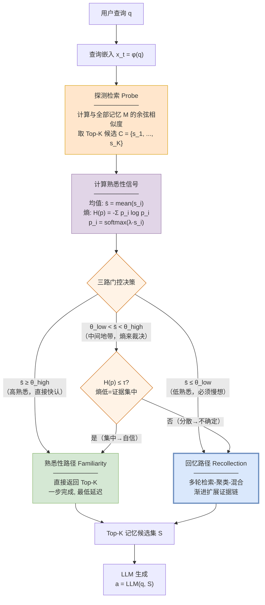
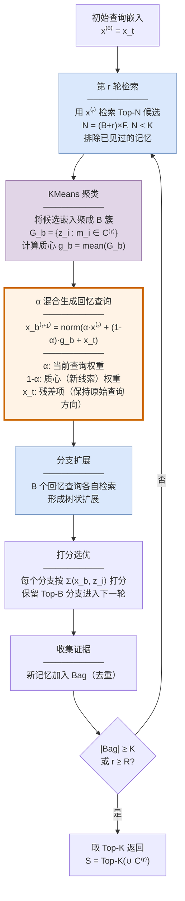
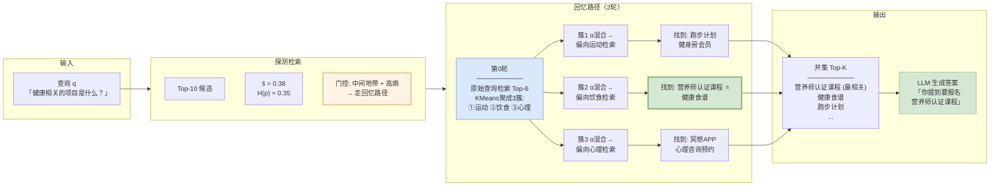
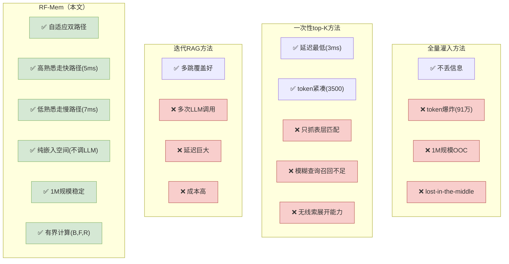

# 论文洞察：RF-Mem — Evoking User Memory via Recollection-Familiarity Adaptive Retrieval

> **论文**: arXiv:2603.09250 [cs.IR]  
> **标题**: Evoking User Memory: Personalizing LLM via Recollection-Familiarity Adaptive Retrieval  
> **作者**: Yingyi Zhang, Junyi Li, Wenlin Zhang 等11人  
> **机构**: 大连理工大学 / 香港城市大学 / 华为技术有限公司  
> **日期**: 2026年3月10日  
> **会议**: ICLR 2026  
> **代码**: https://github.com/Applied-Machine-Learning-Lab/ICLR2026_RF-Mem

---

## 概述

RF-Mem 将认知科学中的**回忆-熟悉性双过程理论**（Recollection-Familiarity Dual-Process Theory）嵌入到 LLM 的记忆检索器中，实现了自适应双路径检索。现有方法的两个极端——全量灌入（成本爆炸）和一次性 top-K 相似搜索（只抓表层匹配）——被统一到一个受不确定性引导的框架中：

- **熟悉性路径（Familiarity，快路径）**：当探测检索的相似度均值高、熵低时，直接返回 top-K，一步完成，低延迟；
- **回忆路径（Recollection，慢路径）**：当相似度均值低或熵高（证据不确定）时，进入"检索→聚类→α混合→迭代扩展"的渐进式证据链重建，在嵌入空间中模拟人类缓慢的情境重构。

核心思想一句话：**像人一样，熟悉就快认，不熟悉就慢想——用熵信号决定走哪条路**。

---

## 一、双路径检索架构

### 门控决策的三种情况

| 条件 | 判定 | 走哪条路 | 认知科学类比 |
|------|------|---------|------------|
| s̄ ≥ θ_high | 高熟悉度，证据充足 | Familiarity（快认） | 一眼认出熟人 |
| s̄ ≤ θ_low | 低熟悉度，证据不足 | Recollection（慢想） | 努力回忆细节 |
| θ_low < s̄ < θ_high 且 H(p) ≤ τ | 中等熟悉但证据集中 | Familiarity（快认） | 虽然不确定但有把握 |
| θ_low < s̄ < θ_high 且 H(p) > τ | 中等熟悉且证据分散 | Recollection（慢想） | 不确定且线索散乱 |

**关键设计——熵作为"中间地带"的裁决者**：均值相似度只告诉我们"平均有多相关"，但不告诉我们"证据是集中在一条线索上还是散落在多条线索上"。熵补上了这个缺口：低熵=证据集中（一个候选明显高于其他），可以直接用 top-K；高熵=证据分散（多个候选势均力敌），需要深入挖掘。

---

## 二、熟悉性路径（快路径）

熟悉性路径就是标准的稠密检索：编码查询 → 计算与每条记忆的余弦相似度 → 取 Top-K → 返回。**一步完成，无额外计算**，延迟最低（3-4ms）。

这对应认知科学中的"熟悉性"过程：当你看到一张熟悉的脸，你不需要回忆在哪里见过、什么时候见过——你只是"知道"见过。同理，当查询与某条记忆高度相似时，直接取 top-K 就够了，不需要聚类、混合、迭代。

---

## 三、回忆路径（慢路径）⭐核心创新

回忆路径是一个**有界的"检索→聚类→混合"循环**，模拟人类在不确定时逐步重构证据链的过程：

### 3.1 候选检索

每轮用当前的回忆查询 x⁽ʳ⁾ 检索 Top-N 候选。N = (B+r)×F，其中 B 是束宽（分支数），F 是扇出（每分支候选数），r 是轮次。**N 随轮次增大**——因为越往后，查询已经被聚类质心"拉"向不同方向，如果不增大检索范围就会反复检索到同样的记忆。已检索过的记忆自动排除。

### 3.2 KMeans 聚类

把候选记忆嵌入聚成 B 簇。每个簇 G_b 的质心 g_b = mean(z_i : m_i ∈ G_b)。**质心是这一簇记忆的"语义锚点"**——它不是某一条具体记忆，而是一组相关记忆的抽象代表。

**为什么聚类**：原始 top-K 检索返回的是散落的个体，聚成 B 簇后，每个簇代表一个"线索方向"。沿这些方向分别扩展，就像人在回忆时从不同角度切入——"上次见面是在哪？""他当时穿了什么？""有没有其他人在场？"——每条线索独立展开。

### 3.3 α 混合生成回忆查询 ⭐

$$\mathbf{x}_{b}^{(r+1)} = \text{norm}\big(\alpha \cdot \mathbf{x}^{(r)} + (1-\alpha) \cdot \mathbf{g}_{b}^{(r)} + \mathbf{x}_t\big)$$

这是回忆路径的核心公式。它把三样东西混合在一起：

- **α · x⁽ʳ⁾**：当前查询方向——保持推理的连续性，不让查询跑偏；
- **(1-α) · g_b**：簇质心——注入新线索方向，把查询"拉"向这组记忆的语义中心；
- **x_t**：原始查询——残差项，确保不管扩展几轮，查询始终"记得"最初在问什么。

**α 的作用**：α 大则偏保守（多沿用当前方向，少探索新线索）；α 小则偏激进（多沿质心方向探索）。实验表明 α ∈ [0.3, 0.6] 效果最好——太小会丢失原始查询意图，太大会被噪声淹没。

**残差项 x_t 的作用**：没有它，经过几轮混合后查询会越来越偏离原始问题。加上残差项，查询在扩展的同时始终锚定原始意图——就像人在回忆时虽然发散思考，但始终记得"我在回忆什么"。

### 3.4 分支扩展与选优

B 个回忆查询各自检索 → 每个分支产生新的候选集 → 按分支内总相似度打分 → 保留 Top-B 分支进入下一轮。**这是树搜索的 beam search**——宽度为 B，深度为 R，总计算量有上界。

### 3.5 停止条件

达到最大轮数 R，或收集到的记忆数达到 K。最终从所有轮次的并集中取 Top-K 返回。

---

## 四、关键设计要点

| 设计要点 | 说明 |
|---------|------|
| 双过程理论驱动 | 将认知科学的回忆-熟悉性双过程嵌入检索器，不是启发式拼接而是有理论根基的框架 |
| 熵引导自适应切换 | 均值相似度判断"够不够相关"，熵判断"证据集不集中"——两者结合做三路门控 |
| 快路径零额外成本 | 熟悉性路径就是标准 top-K，无聚类、无混合、无迭代——高熟悉度查询几乎零开销 |
| 慢路径有界扩展 | 回忆路径受束宽B、扇出F、最大轮数R三重约束，计算量多项式有界，不会无限扩展 |
| α混合+残差 | 回忆查询同时融合当前方向、质心方向和原始查询——扩展但不跑偏 |
| 聚类减冗余 | KMeans 聚类把散落候选归为B个语义簇，沿簇质心分头扩展，避免重复检索 |
| N随轮次增大 | 每轮增大检索范围防止反复检索同一批记忆，公式 N=(B+r)×F |
| 纯嵌入空间操作 | 回忆路径全程只用向量搜索+小规模KMeans，不调LLM——成本远低于迭代RAG |
| 模块化可组合 | RF-Mem是检索层，可与MemoryBank索引、HyDE查询扩展、Search-o1迭代RAG叠加使用 |

---

## 五、回忆路径处理细节（逐关卡解析）

本节按"一个不确定的查询在回忆路径中经历哪些关卡"来讲。英文关键词在括号中备注，方便对照原文。

### 5.1 进路径之前：探测检索估算"信心"

查询到来后不是直接走快路径或慢路径，而是先做一次**探测检索**（probe retrieval）——取 Top-K 候选，计算两个信号：

- **均值相似度 s̄**：K 个候选的平均余弦相似度。高 → "这些记忆跟查询很相关"；
- **熵 H(p)**：把 K 个相似度分数做温度softmax归一化后算信息熵。低 → "有一个候选明显比其他强"；高 → "好几个候选势均力敌"。

**为什么需要两个信号而不只用均值**：均值高不代表证据集中。假设 K=10 个候选的相似度都是0.5，均值0.5不算低，但10个势均力敌——你不知道该信哪个。熵=最大值（均匀分布），告诉你"证据分散，需要深入挖掘"。反过来如果1个0.9、其余都是0.1，均值虽然也是0.18，但熵极低——那个0.9的就是答案，直接走快路径。

### 5.2 第一关：候选检索——扩大范围排除已见

进入回忆路径后，第0轮用原始查询 x⁽⁰⁾ = x_t 检索 Top-N 候选。N = (B+r)×F，其中 B=束宽(默认3)，F=扇出(默认2)，r=轮次。第0轮 N=3×2=6，第1轮 N=4×2=8，依此类推。

**为什么 N 要随轮次增大**：经过α混合后，查询被聚类质心"拉"向不同方向，如果不增大检索范围就会反复检索到同样的记忆。增大 N 让每轮有"新鲜血液"进入候选池。已检索过的记忆（Seen集合）自动排除——这保证了每轮都在探索新的记忆区域。

### 5.3 第二关：KMeans聚类——从散落到B条线索

Top-N 候选是散落的个体，彼此之间可能有关也可能无关。KMeans 把它们聚成 B 簇，每簇 G_b 的质心 g_b 是这组记忆的语义中心。

**质心为什么是"线索锚点"而不是某条具体记忆**：质心是多条记忆的平均向量，它不代表某一条记忆，而代表一个"语义方向"。沿这个方向检索，能找到更多与这组记忆相关的记忆——就像人在回忆时抓住一个模糊的印象（"好像跟运动有关"），然后沿这个印象展开。

**聚成 B 簇而不是1簇或N簇**：B=1则没有分支，退化为单线索迭代；B=N则每条记忆自成一簇，失去聚类减冗余的意义。B=3 是在"线索多样性"和"计算成本"之间的平衡点。

### 5.4 第三关：α混合——把线索注入查询 ⭐

这是回忆路径最核心的操作。每个簇质心 g_b 与当前查询 x⁽ʳ⁾ 混合，生成 B 个回忆查询：

$$\mathbf{x}_b^{(r+1)} = \text{norm}\big(\alpha \cdot \mathbf{x}^{(r)} + (1-\alpha) \cdot \mathbf{g}_b^{(r)} + \mathbf{x}_t\big)$$

**三个组成部分各自的含义**：

- **α · x⁽ʳ⁾**（当前查询方向，权重α）：保持推理连续性。没有它，每轮查询都会被质心完全重置，丢失前几轮积累的方向信息。α越大越保守（多沿用已有方向）。
- **(1-α) · g_b**（质心方向，权重1-α）：注入新线索。质心代表一组相关记忆的语义中心，沿它检索能找到更多同类记忆。1-α越大越激进（多沿新线索探索）。
- **x_t**（原始查询，无权重，残差项）：不管扩展几轮，查询始终"记得"最初在问什么。没有它，几轮混合后查询会偏离原始问题——就像人回忆时发散太远忘了在回忆什么。

**α 的敏感性**：实验表明 α ∈ [0.3, 0.6] 效果最好。α=0 则查询完全被质心主导（丢失原始意图）；α=1 则完全不探索（退化为标准top-K）。适度平衡是关键。

### 5.5 第四关：分支扩展与beam search

B 个回忆查询各自独立检索 → 每个分支产生新的候选集 → 按分支内总相似度打分 → 保留 Top-B 分支进入下一轮。

**这是 beam search**——宽度为 B、深度为 R 的树搜索。总计算量 = O(R × B × F × c_sim + R × c_clust(B))，远低于全量灌入的 O(M)。

### 5.6 第五关：停止与返回

停止条件：达到最大轮数 R，或收集到的记忆数 ≥ K。最终从所有轮次的并集中取 Top-K 返回。

**最终返回的是所有轮次的并集 Top-K**——不是最后一轮的结果。这意味着回忆路径的输出包含了从第0轮到第R轮的所有候选，按相似度排序取前K。这保证了即使最相关的记忆出现在第0轮（原始查询直接检索到的），也不会被后续轮次的扩展结果淹没。

### 5.7 一图看懂关卡顺序

探测检索估算信心（5.1）→ 门控决策走快或慢 → 候选检索扩大范围排除已见（5.2）→ KMeans聚成B条线索（5.3）→ α混合把线索注入查询（5.4）→ beam search扩展选优（5.5）→ 停止取并集Top-K（5.6）

设计原则一脉相承：**确定性能用规则做的不交给 LLM**（均值/熵门控、KMeans聚类、α混合），LLM 只做最终生成。回忆路径全程在嵌入空间操作，不调一次 LLM——成本远低于让 LLM 迭代生成查询的迭代RAG方案。

---

## 六、大白话版：一个查询怎么"走"过双路径

抛开术语，RF-Mem 做的事情可以用一个日常场景来比喻：

> 假设你是一个私人助手 Agent，用户问你："我上次提到对什么食物过敏来着？"

### 场景①：熟悉性路径（快路径）——一眼认出

用户记忆库里有100条对话片段。你先把这个问题变成向量，跟100条记忆算相似度，取最相关的10条。

发现：Top-1 相似度0.85，均值0.62 > θ_high(0.6)，熵0.12 < τ(0.2)——**高均值+低熵=证据集中且相关**。

走快路径：直接返回这10条。其中第1条就是"我对花生过敏"。一步完成，延迟3ms。

**这就是"一眼认出熟人"**——不需要回忆在哪说的、什么时候说的，你直接知道答案在那条记忆里。

### 场景②：回忆路径（慢路径）——努力回忆细节

用户问："我上次说要做的一个跟健康相关的项目是什么来着？"

探测检索：Top-10 均值0.38 < θ_low(0.3)... 不对，0.38 > θ_low 但 < θ_high(0.6)，进入中间地带。看熵：H(p)=0.35 > τ(0.2)——**中等相似但证据分散**。

走慢路径：10条候选里有"要开始运动计划""想学营养学""关注过冥想APP""买了一本健康食谱"——势均力敌，不知道哪个是用户真正说的"项目"。

**第0轮**：检索 Top-6（N=3×2），KMeans聚成3簇：
- 簇1：{运动计划, 健身房会员} → 质心方向"运动健康"
- 簇2：{营养学, 健康食谱} → 质心方向"饮食健康"  
- 簇3：{冥想APP, 心理健康} → 质心方向"心理健康"

**α混合**（α=0.5）：原始查询"健康相关的项目"分别跟三个质心混合：
- 回忆查询1 = 0.5×原始查询 + 0.5×"运动健康" + 原始查询残差 → 偏向运动方向检索
- 回忆查询2 = 0.5×原始查询 + 0.5×"饮食健康" + 原始查询残差 → 偏向饮食方向检索
- 回忆查询3 = 0.5×原始查询 + 0.5×"心理健康" + 原始查询残差 → 偏向心理方向检索

**第1轮检索**：三个回忆查询各自检索 Top-8（N=4×2），排除已见。发现：
- 回忆查询2 检索到新记忆："报名了一个营养师认证课程"——这就是用户说的"健康相关的项目"！

**停止**：收集到的记忆数达到K，取并集 Top-K 返回。

**总延迟**：7ms（两轮检索+聚类+混合），远低于让 LLM 迭代生成查询的迭代RAG方案。

### 为什么不能直接用快路径

快路径的 top-K 里"报名营养师认证课程"可能排在第15位（相似度不够高），不在 top-10 里。因为"健康相关的项目"和"营养师认证"的字面相似度不高——需要通过"饮食健康"这个中间线索才能连上。**回忆路径的价值就在于：通过聚类→质心→混合，找到原始查询直接搜不到的相关记忆**。

---

## 七、加工结果全景图

怎么读这张图：
- 探测检索发现 s̄=0.38 在中间地带，但熵0.35>τ=0.2（证据分散）→ 走回忆路径；
- 第0轮把6条候选聚成3簇（运动/饮食/心理），各自α混合后分头检索；
- 簇2（饮食方向）的回忆查询检索到了"营养师认证课程"——这是原始查询直接搜不到的（因为"健康项目"和"营养师认证"字面相似度低）；
- 最终从所有轮次的并集中取 Top-K，"营养师认证课程"排在最前面。

---

## 八、实验结果

### 8.1 主实验：PersonaMem（个性化生成准确率）

| 记忆规模 | 方法 | 延迟(ms) | Token数 | 准确率 |
|---------|------|---------|--------|--------|
| **32K** | Zero Memory | NA | 465 | 0.3854 |
| | Full Context | NA | 24658 | 0.6129 |
| | Dense Retrieval (Familiarity) | 3.14 | 3516 | 0.5908 |
| | Recollection only | 7.09 | 3711 | 0.6214 |
| | **RF-Mem (自适应)** | **5.09** | **3567** | **0.6350** |
| **128K** | Full Context | NA | 115601 | 0.3231 |
| | Dense Retrieval | 3.24 | 3540 | 0.5259 |
| | **RF-Mem** | **4.27** | **3566** | **0.5394** |
| **1M** | Full Context | NA | 912149 | OOC |
| | Dense Retrieval | 4.42 | 3816 | 0.4518 |
| | **RF-Mem** | **6.28** | **3828** | **0.4589** |

关键发现：
- 32K 规模 RF-Mem 用仅3567 token 超过 Full Context 的24658 token（0.6350 vs 0.6129）
- 128K 规模 Full Context 崩溃（准确率0.323），RF-Mem 稳定领先
- 1M 规模 Full Context 直接 OOC（超出上下文），RF-Mem 仍稳定工作
- RF-Mem 比纯 Recollection 模式延迟更低（5.09 vs 7.09ms）且准确率更高——自适应切换比"总走慢路径"更好

### 8.2 检索基准：PersonaBench & LongMemEval

| 基准 | 方法 | Recall@5 | Recall@10 | 延迟(ms) |
|------|------|---------|----------|---------|
| PersonaBench | Familiarity | 0.4484 | 0.5964 | 8.40 |
| (MiniLM) | Recollection | 0.4491 | 0.6062 | 9.65 |
| | **RF-Mem** | **0.4701** | **0.6071** | **9.16** |
| LongMemEval-S | Familiarity | 0.7136 | 0.8282 | 24.91 |
| (MiniLM) | Recollection | 0.7351 | 0.8425 | 50.62 |
| | **RF-Mem** | **0.7375** | **0.8473** | **39.58** |

关键发现：
- RF-Mem 在 Recall@5 和 Recall@10 上均最高
- 延迟介于 Familiarity 和 Recollection 之间——高熟悉度查询走快路径省时间，低熟悉度走慢路径花时间
- LongMemEval-S 上 RF-Mem 达到 Recall@50=1.0（完美召回），同时延迟比纯 Recollection 低22%

### 8.3 消融与互补性

**两条路径的互补性**：
- Familiarity 在事实型查询上强（"你的电话号码"→直接匹配）
- Recollection 在情境型查询上强（"你之前对类似情况怎么处理的"→需要线索展开）
- RF-Mem 通过自适应切换取两者之长

**α 和 τ 的敏感性**：
- α ∈ [0.3, 0.6] 效果最好——平衡混合
- τ ≈ 0.2-0.25 效果最好——适度熵门控

**模块化组合**：
- 与 MemoryBank 索引叠加 → 仍最高
- 与 HyDE 查询扩展叠加 → 仍最高
- 与 Search-o1 迭代RAG叠加 → 仍最高

---

## 九、与现有方法的本质区别

| 维度 | 全量灌入 | 一次性top-K | 迭代RAG | **RF-Mem** |
|------|---------|-----------|---------|-----------|
| token成本 | 91万(OOC) | 3500 | 高(多轮) | **3567** |
| 延迟 | NA | 3ms | 高 | **5ms(自适应)** |
| 模糊查询召回 | 低(淹没) | 低(表层) | 高 | **高(线索展开)** |
| LLM调用 | 0(全灌入) | 0 | 多次 | **0(纯嵌入)** |
| 1M规模 | 不可用 | 可用 | 可用但慢 | **可用且稳定** |
| 自适应 | 否 | 否 | 否 | **是(熵引导)** |

---

## 十、理论保障

论文在附录F给出了形式化理论分析：

**Lemma 1（单调性）**：在单调似然比假设下，熟悉性路径的错误率随 s̄ 单调不增、随 H(p) 单调不减。且 C(Familiarity) < C(Recollection)。

**Theorem 1（阈值最优性）**：在所有关于 (s̄, H) 单调的策略类中，双阈值策略（θ_high, θ_low, τ）最小化点风险 L = E(错误) + β·C(成本)。

**Proposition 2（门控可靠性）**：探测分数服从次高斯分布时，误选概率以 exp(-Kδ²/(2σ²)) 指数衰减。增大K收紧可靠性。

**Proposition 3（复杂度）**：T_Fam = O(K·c_sim)，T_Rec = O(R·(BF)·c_sim + R·c_clust(B))，当 BF+RF << M 时远低于全量处理。

这些理论保障说明：**双阈值门控不是启发式，而是单调策略类中的最优选择**；探测K越大门控越可靠；回忆路径的计算量有确定的多项式上界。

---

## 十一、一句话总结全过程

查询到来先做探测检索 → 算均值相似度 s̄ 和熵 H(p) → 高均值走快路径（直接top-K，3ms）→ 低均值走慢路径（KMeans聚B簇→α混合质心与查询→B个回忆查询分头检索→beam search选优→R轮后取并集top-K，7ms）→ 慢路径全程纯嵌入空间不调LLM → 1M规模稳定工作且91万token降至3567。

核心转变：**从"所有查询一刀切"到"熟悉的快认、不熟悉的慢想"**——用熵信号自适应切换，在延迟和召回间取得最优平衡。

---

*报告生成日期: 2026-10-12*
