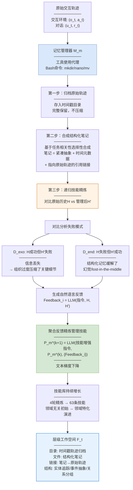
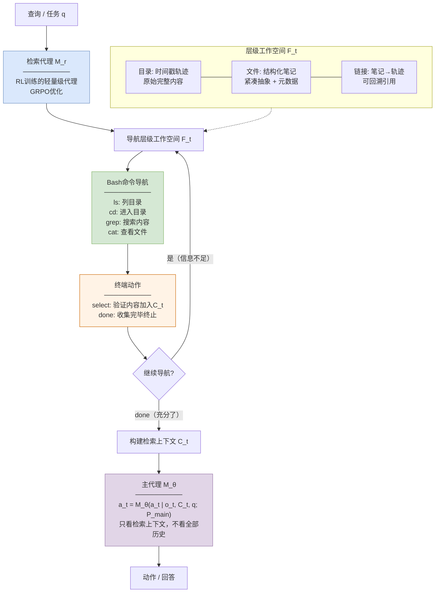
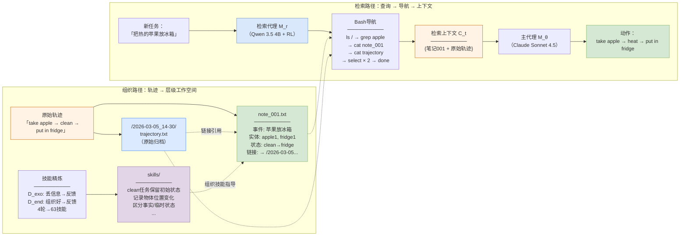
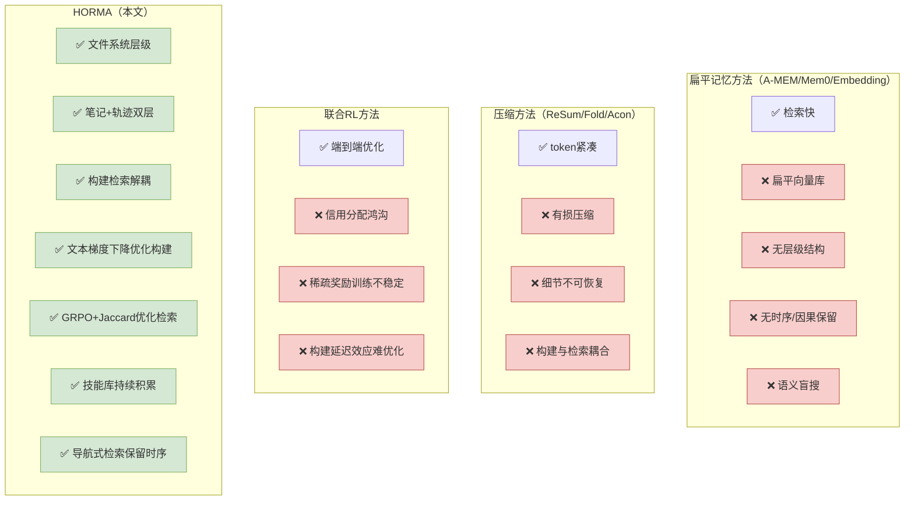

# 论文洞察：HORMA — Hierarchical Organize-and-Retrieve Memory Agent

> **论文**: arXiv:2606.11680  
> **标题**: Organize then Retrieve: Hierarchical Memory Navigation for Efficient Agents  
> **作者**: Hao-Lun Hsu, Nikki Lijing Kuang, Boyi Liu, Zhewei Yao, Yuxiong He  
> **机构**: Duke University / Snowflake AI Research  
> **日期**: 2026年6月10日

---

## 概述

HORMA 将 LLM Agent 的工作记忆组织成**类文件系统的层级结构**，并将记忆管理显式解耦为两个独立模块：

- **组织路径（写入）**：记忆管理器 M_m 将原始轨迹归档到时间戳目录，并合成结构化笔记（笔记链接回原始轨迹），通过递归技能精炼迭代优化组织策略；
- **检索路径（读取）**：检索代理 M_r 用 Bash 命令（ls/grep/cd/cat）导航层级工作空间，通过 RL（GRPO）训练的轻量级代理选择最小且充分的上下文。

核心动机：**记忆构建和记忆检索在时间尺度和功能角色上根本不同**——构建影响的是长期结构（延迟显现），检索影响的是每步推理质量（即时显现）。联合优化会产生严重的**信用分配鸿沟**（credit assignment gap）：任务失败时无法判断是组织不好还是检索不好。解耦后各司其职、独立优化。

核心思想一句话：**先组织成文件系统，再导航检索——不是扁平 top-K，而是像人翻文件夹一样找信息**。

---

## 一、组织路径（写入）



组织路径负责将原始交互轨迹转化为层级化的、可导航的记忆工作空间，包含三个阶段：

**原始轨迹归档**：每次交互 (a_t, o_t) 或对话轮次 (u_t, r_t) 完成后，管理器先把它完整存入一个**时间戳目录**——不压缩、不摘要、不丢弃。这保证了原始信息永远可回溯。

**结构化笔记合成**：管理器基于任务相关性，**选择性**地合成结构化笔记。每条笔记包含三样东西：紧凑的任务相关抽象、时间元数据、指向原始轨迹的引用链接。笔记是原始轨迹的"摘要+索引"——你读笔记知道大概，需要细节时顺着链接翻原始轨迹。这种设计实现了**信息密度与可回溯性的平衡**：检索时只读笔记（省 token），需要细节时展开到原始轨迹（不丢信息）。

**递归技能精炼**：这是组织路径最核心的创新。管理器的组织策略不是一次设定的，而是通过**对比分析**迭代进化：
- **D_exo（外生集）**：用原始历史H能成功但用管理后H'失败 → 说明组织过程中丢了关键信息 → 生成"别丢这个"的反馈；
- **D_end（内生集）**：用管理后H'能成功但用原始历史H失败 → 说明结构化记忆帮了忙（过滤噪声/缓解lost-in-the-middle）→ 生成"这种组织方式好"的反馈。

反馈聚合后通过"文本梯度下降"更新管理器提示词——本质上是用自然语言做梯度下降，让管理器的组织技能越来越强。4轮精炼后积累63条领域特化技能。

---

## 二、检索路径（读取）



检索路径负责从层级工作空间中导航提取任务相关上下文，包含三个阶段：

**Bash命令导航**：检索代理不是一个相似度计算器，而是一个**会翻文件系统的代理**——用 ls 列目录、cd 进目录、grep 搜内容、cat 看文件。它利用目录层级、时间组织和溯源元数据来定位相关内容，而不是靠语义相似度盲搜。

**select/done 动作**：代理在导航过程中可以随时 `select` 验证过的内容加入检索上下文 C_t，或 `done` 终止检索。这允许代理**迭代验证**——先看一眼笔记，觉得不够再深入原始轨迹，够了就停。

**RL优化检索策略**：检索代理用 GRPO（Group Relative Policy Optimization）训练，奖励函数是基于检索上下文 C_t 与真实证据 E 的**Jaccard相似度**：

$$J(C_t, E) = \frac{|C_t \cap E|}{|C_t \cup E|}$$

这个奖励鼓励代理**精准且紧凑**地构建上下文——召回相关证据（分子），惩罚无关冗余（分母）。训练后的代理学会了层级探索、从失败命令中恢复、精炼搜索轨迹等策略。

---

## 三、关键设计要点

| 设计要点 | 说明 |
|---------|------|
| 显式解耦构建与检索 | 记忆管理器(异步组织)与检索代理(同步导航)独立优化，消除信用分配鸿沟 |
| 类文件系统层级工作空间 | 不是扁平向量库而是目录/文件/链接结构，支持导航式检索 |
| 笔记+轨迹双层抽象 | 结构化笔记(紧凑摘要)链接原始轨迹(完整细节)，检索先读笔记再按需展开 |
| 对比技能精炼 | D_exo(信息丢失) vs D_end(结构有帮助)对比分析，生成反馈迭代更新管理器提示词 |
| 文本梯度下降 | 用自然语言反馈做"梯度下降"更新管理策略，不修改LLM参数，技能持续积累 |
| 导航式检索 | 检索代理用Bash命令翻文件系统，利用层级/时间/溯源元数据定位，而非语义盲搜 |
| select/done迭代验证 | 代理可以先看笔记、再深入轨迹、够了就停——迭代构建最小充分上下文 |
| Jaccard证据奖励 | RL奖励=检索上下文与真实证据的Jaccard相似度，直接优化检索精度和紧凑性 |
| 轻量级检索器泛化 | Qwen 3.5 4B在LoCoMo训练，零样本迁移到ALFWorld和LongMemEval均有效 |
| 组织质量是天花板 | 组织不好检索再强也没用——实验证明小模型管理+大模型检索仍然不行 |

---

## 四、组织与检索处理细节（逐关卡解析）

### 4.1 为什么解耦：信用分配鸿沟

现有系统把记忆构建和检索绑在一起联合优化。当一个长程任务失败时，你不知道：
- 是记忆组织得不好（关键信息被丢了或放错位置了）？
- 还是检索得不好（信息在记忆库里但没找到）？
- 还是推理得不好（找到了但没用对）？

这就是**信用分配鸿沟**。稀疏的任务级奖励给构建和检索提供了纠缠的、微弱的监督信号。

HORMA 的解法：**构建用文本梯度下降优化（非RL），检索用RL优化（GRPO+Jaccard奖励）**。两者各走各的优化路径，互不干扰。

### 4.2 组织之前：先定好文件系统结构

管理器 M_m 初始化时收到一个**领域无关的组织提示词** P_m^(0)，指定三条高层原则：

- **实体追踪**（entity tracking）：记录对话中出现的实体（人、物、地点）及其状态变化；
- **事件抽象**（event abstraction）：把多轮交互抽象成事件摘要；
- **关系分组**（relation grouping）：把相关实体和事件组织到同一目录。

这个初始提示词不依赖具体任务——不管你是做家务(ALFWorld)还是长对话(LoCoMo)，都是这三条原则。后续通过技能精炼逐渐加入领域特化技能。

### 4.3 第一关：归档原始轨迹——一字不改地存

每次交互完成，管理器先把原始轨迹存入时间戳目录。这一步不调LLM做摘要，不做任何加工——**完整保留原始内容**。

为什么：后续检索代理可能需要展开到原始轨迹看细节。如果原始内容被压缩了，细节就永久丢失了。归档是"保险"——即使笔记写得不好，原始轨迹还在。

### 4.4 第二关：合成结构化笔记——选择性抽象

管理器基于任务相关性，**选择性地**为某些轨迹合成笔记。笔记包含：
- 紧凑的任务相关抽象（不是逐字摘要，而是"发生了什么、涉及谁、结果如何"）
- 时间元数据（什么时候发生的）
- 指向原始轨迹的引用链接（顺着链接能翻回原文）

**为什么是选择性而非全量**：不是每条交互都值得写笔记。"走进卧室"这种动作不需要笔记，但"在卧室找到了钥匙"值得写。管理器判断哪些交互有任务相关性，只为这些写笔记。

### 4.5 第三关：递归技能精炼——对比学习怎么组织得更好 ⭐

这是组织路径最核心的创新。管理器的组织策略不是一次设定的，而是通过对比分析迭代进化：

**Step 1：跑两遍任务**
- 用原始历史H跑一遍（无组织基线）
- 用管理后历史H'跑一遍（HORMA组织）

**Step 2：分类失败模式**
- **D_exo（信息丢失）**：H成功但H'失败 → 组织过度压缩了关键细节 → 需要"别丢这个"的技能
- **D_end（结构有帮助）**：H失败但H'成功 → 结构化记忆过滤了噪声/缓解了lost-in-the-middle → 需要"这种组织方式好"的技能

**Step 3：生成自然语言反馈**
```
Feedback_i = LLM(Feedback Instruction, H, H')
```
LLM对比H和H'，生成具体的、可执行的自然语言反馈："在Clean任务中，需要保留物体的初始状态（clean/dirty），当前笔记丢失了这个信息。"

**Step 4：聚合反馈更新管理器提示词**
```
P_m^(k+1) = LLM(技能增强指令, P_m^(k), {Feedback_i})
```
把多条反馈聚合，更新管理器的提示词。这被作者称为"文本梯度下降"——用自然语言做梯度下降，不修改LLM参数。

**Step 5：技能库持续增长**
4轮精炼后积累63条技能。技能库从领域无关逐渐变得领域特化。例如在LongMemEval上学会的技能包括"保留用户偏好变化的时序轨迹""区分事实陈述与临时情绪"等。

### 4.6 第四关：检索代理训练——学会翻文件系统

检索代理 M_r 不是相似度计算器，而是**会用Bash命令翻文件系统的代理**。

**动作空间**：
- `ls`：列目录内容
- `cd`：进入子目录
- `grep`：搜索关键词
- `cat`：查看文件内容
- `select`：把当前查看的内容加入检索上下文C_t
- `done`：收集完毕，终止检索

**RL训练**：用GRPO优化，奖励=检索上下文C_t与真实证据E的Jaccard相似度 J(C_t, E) = |C_t ∩ E| / |C_t ∪ E|。这个奖励直接优化"找回相关证据"且"不回无关内容"。

**训练效率**：只用4块H200 GPU，在LoCoMo训练集（7段对话1089个QA）上训练Qwen 3.5 4B。训练后零样本迁移到ALFWorld和LongMemEval——在LongMemEval上甚至超过了Claude Sonnet 4.5的检索配置（58.0 vs 55.9）。

### 4.7 第五关：组织质量是天花板

论文的一个关键发现：**组织不好，检索再强也救不回来**。

实验设计：用Qwen 3.5 4B做管理器（组织能力弱），换成Claude Sonnet 4.5做检索器（检索能力强）→ 性能提升很小。反过来，用Claude做管理器（组织能力强），即使检索器弱，性能也不错。

结论：如果管理器没把信息组织好（目录结构混乱、笔记遗漏关键信息），检索代理再怎么导航也找不到需要的东西。**组织质量是检索质量的 ceiling**。

### 4.8 一图看懂关卡顺序

**组织**：初始化组织原则（4.2）→ 归档原始轨迹（4.3）→ 选择性合成笔记（4.4）→ 对比分析精炼技能（4.5）

**检索**：Bash导航工作空间（4.6）→ select/done迭代验证 → GRPO+Jaccard优化 → 零样本跨域泛化

设计原则：**组织用文本梯度下降（非RL），检索用RL——因为构建的延迟效应使RL的稀疏奖励不可靠，而检索的即时效应使RL可行**。

---

## 五、大白话版：一次交互怎么"组织"进文件系统，一个查询怎么"翻"出来

抛开术语，HORMA做的事情可以用"整理办公桌"来比喻。

假设你是一个做家务的机器人 Agent（ALFWorld场景），任务是"把一个干净的苹果放到冰箱里"。

### 组织阶段：交互怎么变成文件系统

**第1步：归档原始轨迹**

你经历了一连串交互：
```
think: 我需要找一个苹果
go to countertop 1
take apple 1 from countertop 1
go to sink 1
clean apple 1 with sink 1
go to fridge 1
put apple 1 in fridge 1
```
管理器把这一整段原始轨迹存到一个时间戳目录 `/2026-03-05_14-30/trajectory.txt`，一字不改。

**第2步：合成结构化笔记**

管理器判断这段轨迹有任务相关性，写一条笔记：
```
/note_001.txt
──────────
事件：把苹果放到冰箱
涉及实体：apple 1（初始位置：countertop 1）, fridge 1
关键状态：apple 1 经过清洗(clean)后放入冰箱
时间：2026-03-05 14:30
原始轨迹：→ /2026-03-05_14-30/trajectory.txt
```
笔记是紧凑的抽象——你没读原始轨迹也知道"苹果从台面拿的、洗过了、放冰箱了"。但如果你想知道"中间去过水槽吗"，顺着链接翻原始轨迹就能看到。

**第3步：技能精炼**

下一次做类似任务"把干净的杯子放柜子里"，管理器发现笔记里忘了记录"杯子初始是dirty状态"——D_exo失败（信息丢失）。生成反馈："在Clean类任务中，笔记必须保留物体的初始清洁状态。"这条反馈加入技能库，下次写笔记就不会漏了。

### 检索阶段：查询怎么翻文件系统

新任务来了："把一个热的苹果放到冰箱里"。你需要回忆之前做过类似的任务。

**检索代理启动**：
```
> ls /                          # 列根目录
  /2026-03-05_14-30/            # 时间戳目录
  /note_001.txt                 # 结构化笔记
  /note_002.txt
  /skills/                      # 技能库

> grep "apple" /note_*.txt      # 搜索苹果相关笔记
  /note_001.txt: 事件：把苹果放到冰箱...

> cat /note_001.txt             # 查看笔记内容
  事件：把苹果放到冰箱
  关键状态：apple 1 经过清洗(clean)后放入冰箱
  原始轨迹：→ /2026-03-05_14-30/trajectory.txt

> select /note_001.txt          # 笔记有用，加入上下文

> cat /2026-03-05_14-30/trajectory.txt  # 展开看原始细节
  think: 我需要找一个苹果
  go to countertop 1
  take apple 1 from countertop 1
  go to sink 1
  clean apple 1 with sink 1
  go to fridge 1
  put apple 1 in fridge 1

> select /2026-03-05_14-30/trajectory.txt  # 细节也有用

> done                          # 收集完毕
```

检索代理构建的上下文 C_t = {笔记001, 原始轨迹}。主代理只看这个上下文就知道："上次苹果从台面拿的、洗过后放冰箱了。这次任务要'热的'苹果，所以流程类似但需要加热而不是清洗。"

### 如果用扁平 top-K 会怎样

扁平 top-K 检索可能返回"apple""fridge""countertop"这些关键词的零散片段，但不知道它们的**时序关系**（先去台面拿苹果→再去水槽洗→最后放冰箱）。HORMA的导航式检索通过翻文件系统，找到了完整的笔记和轨迹，保留了**时序结构和因果关系**。

---

## 六、加工结果全景图



怎么读这张图：
- 左侧组织路径：原始轨迹同时归档到时间戳目录（不丢信息）和合成为结构化笔记（紧凑抽象），笔记通过链接引用原始轨迹；
- 技能库通过对比精炼持续增长，指导笔记合成质量；
- 右侧检索路径：检索代理用Bash命令导航工作空间，先看笔记（省token），需要细节时展开原始轨迹（不丢信息），select验证后done终止；
- 主代理只看检索上下文C_t就行动，不看全部历史——token预算从91万降到1000以内。

---

## 七、实验结果

### 7.1 ALFWorld（交互任务成功率）

| 方法 | 小上下文(1950tok) | 大上下文(2200tok) |
|------|-----------------|-----------------|
| Truncation | 17.9% | 34.3% |
| Slide Window | 29.1% | 70.1% |
| Fold | 17.9% | 59.0% |
| HIAGENT | 27.0% | 64.9% |
| ReSum | 18.7% | 71.6% |
| **HORMA** | **56.7%** | **73.9%** |

- 小上下文下HORMA比次优(ReSum 18.7%)高3倍——在极紧的token预算下结构化记忆优势最大
- Clean类任务：HORMA达74.2%（小）/83.9%（大），大多数baseline为0%——因为Clean需要记住物体初始状态，扁平检索丢了这个信息
- Cool类任务（大）：HORMA达95.2%，Truncation仅4.8%——因为Cool需要记住"先用过冰箱"这种时序信息

### 7.2 对话基准（L-J分数）

| 方法 | LoCoMo(10K) | LongMemEval(50K) |
|------|-----------|-----------------|
| No limit | 55.9 | 20.4 |
| Truncation | 32.2 | 34.1 |
| A-MEM | 30.4 | 51.8 |
| Mem0 | 43.4 | 43.6 |
| **HORMA** | **51.6** | **55.9** |

- LoCoMo: HORMA 51.6 接近无限制的55.9天板，远超Mem0(43.4)和A-MEM(30.4)
- LongMemEval: HORMA 55.9 超过了无限制的20.4——因为超长上下文中信息稀释，结构化检索反而更好
- LongMemEval KU(知识更新): HORMA 89.7，远超所有baseline——因为HORMA的结构化笔记保留了状态变迁轨迹

### 7.3 Token效率

| 基准 | HORMA token占比 |
|------|----------------|
| LoCoMo | **3.07%-22.17%** of baseline |
| LongMemEval | **1.24%-16.19%** of baseline |

所有HORMA变体（Claude/Qwen/Qwen-GRPO）和嵌入检索增强均在**1000 token以内**完成每次查询。

### 7.4 消融实验

| 检索器 | 技能 | RL | ALFWorld | LoCoMo | LongMemEval |
|--------|------|-----|---------|--------|-------------|
| Claude | ✗ | ✗ | 51.5 | 42.2 | 43.6 |
| Claude | ✓ | ✗ | **73.9**(+22.4) | **51.6**(+9.4) | **55.9**(+12.3) |
| Qwen 4B | ✗ | ✗ | 35.8 | 27.0 | 30.8 |
| Qwen 4B | ✓ | ✗ | 40.3(+4.5) | 32.6(+5.6) | 40.6(+9.8) |
| Qwen 4B | ✓ | ✓ | 64.9(+29.1) | 42.2(+15.2) | **58.0**(+27.2) |

核心发现：
- **技能精炼**对Claude贡献最大（+22.4 ALFWorld），因为大模型有强组织能力，技能精炼能充分发挥
- **RL训练**让Qwen 4B检索器从40.3跃升到64.9（+29.1），且零样本迁移到LongMemEval达58.0——**超过Claude的55.9**
- 技能和RL都降低检索调用次数N_call——更高效的导航意味着更少的翻文件操作

### 7.5 组织质量是天花板

用Qwen 4B管理器 + Claude检索器 → 性能提升很小。用Claude管理器 + Qwen检索器 → 性能不错。

**结论：组织质量决定了检索质量的上限。管理器必须用强模型，检索器可以用轻量模型+RL。**

---

## 八、与现有方法的本质区别



| 维度 | 扁平(A-MEM) | 压缩(ReSum) | 联合RL | **HORMA** |
|------|-----------|-----------|--------|-----------|
| 存储结构 | 扁平向量 | 压缩文本 | 文本记忆 | **文件系统层级** |
| 信息保全 | 可回溯 | **有损** | 可回溯 | **笔记+轨迹双层** |
| 构建优化 | 无 | 无 | RL(不稳定) | **文本梯度下降** |
| 检索优化 | 相似度 | 相似度 | RL(纠缠) | **GRPO+Jaccard** |
| 信用分配 | N/A | N/A | **鸿沟** | **解耦消除** |
| 时序保留 | 弱 | 弱 | 中 | **目录层级+时间戳** |
| token效率 | 中 | 高 | 中 | **极高(3%-22%)** |

---

## 九、一句话总结全过程

**组织**：原始轨迹归档到时间戳目录（不丢信息）→ 选择性合成结构化笔记（紧凑抽象+链接回原始轨迹）→ 对比H vs H'失败模式 → D_exo(丢信息) vs D_end(组织好) → 自然语言反馈 → 文本梯度下降更新管理器提示词 → 4轮精炼积累63技能。

**检索**：RL训练的轻量代理用Bash命令(ls/grep/cd/cat)导航文件系统 → 先读笔记(省token) → 需要细节展开原始轨迹(不丢信息) → select验证 → done终止 → Jaccard奖励优化精准且紧凑的上下文构建。

核心转变：**从"扁平向量相似度盲搜"到"文件系统导航式检索"，从"构建检索联合RL"到"文本梯度下降+GRPO解耦优化"**——token降至基线的3%-22%，轻量检索器零样本迁移超越大模型。

---

*报告生成日期: 2026-10-12*
