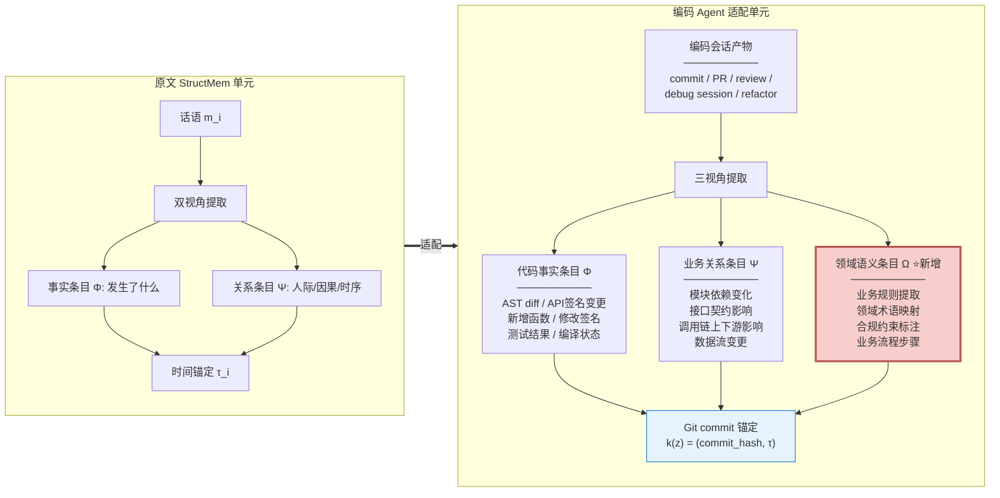
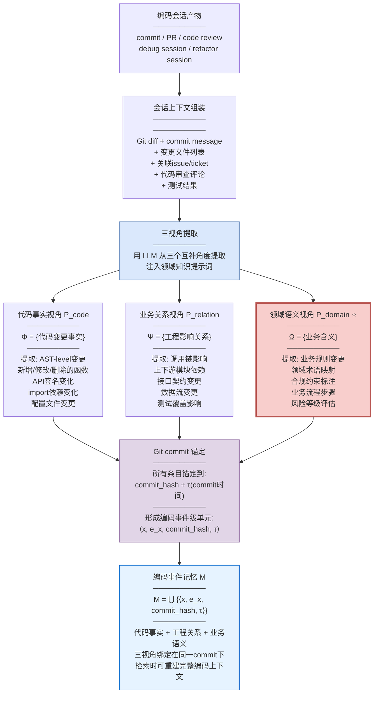
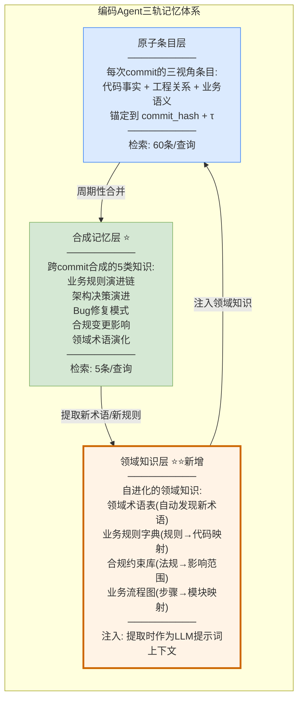
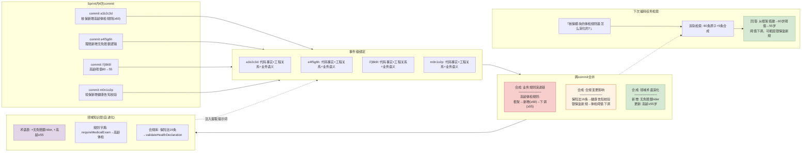

# StructMem 编码 Agent 业务领域适配方案

> 基于 arXiv:2604.21748 (StructMem) 的事件级绑定 + 跨事件合并框架，适配到具有大量业务专有领域知识的编码 Agent 场景。

---

## 概述

StructMem 原文面向对话场景：每条话语提取事实+关系双视角条目，周期性合并语义相关事件。适配到编码 Agent 的业务领域场景，核心变化在于——**代码不是自然语言，它有结构（AST）、有依赖（调用图）、有版本（Git）、有业务语义（领域规则）**。

业务领域编码 Agent 的记忆面临三重挑战：

1. **领域术语鸿沟**：通用 LLM 不理解"保单批改""核保规则""赔付系数"等专有概念，需要领域知识注入；
2. **业务规则隐式化**：业务规则散落在代码逻辑中（if-else 分支、计算公式、校验规则），没有文档显式描述，需要从代码中提取并结构化；
3. **跨模块业务依赖**：一个业务规则可能横跨多个模块（投保→核保→缴费→出单），修改一处影响多处，需要跨事件合成业务逻辑链。

适配后的架构仍分两层：

- **事件级绑定（写入）**：编码会话产物（commit/PR/review/debug session）做三视角提取——代码事实条目 + 业务关系条目 + 领域语义条目，锚定到 Git commit 时间戳；
- **跨事件合并（提炼）**：周期性缓冲积累的编码事件 → 语义检索相关历史 commit → 按时间戳重建完整编码上下文 → LLM 合成跨 commit 业务规则链和架构演进假设。

核心增益：**在不需要构建知识图谱的情况下，用时间戳+语义检索+批量合成捕获跨 commit 的业务逻辑演进——适配代码场景"改动分散但逻辑关联"的特性**。

---

## 一、记忆基本单元重定义



### 为什么从双视角扩展为三视角

原文的双视角（事实+关系）在对话场景够用，但在业务编码场景不够：

- **事实条目 Φ** 记录"代码改了什么"——AST diff、API 签名变更。这是代码层面的客观事实。
- **关系条目 Ψ** 记录"代码改动之间的影响"——模块依赖变化、调用链上下游影响。这是工程层面的关系。
- **领域语义条目 Ω**（新增）记录"这次改动背后的业务含义"——提取了哪条业务规则、修改了哪个领域概念、涉及哪个合规约束。**这是通用 LLM 最缺失的一层**——代码事实和工程关系都可以从代码本身读出，但业务含义需要领域知识才能提取。

**举例**：一个 commit 把 `if (amount > 100000)` 改成 `if (amount > 50000)`。

- 事实条目：`ThresholdCheck.java` 第42行常量从100000改为50000
- 关系条目：`ThresholdCheck.check()` 被 `UnderwritingService.evaluate()` 调用，阈值降低会影响核保通过率
- **领域语义条目**：业务规则"大额保单需人工核保"的阈值从10万下调至5万——这可能是监管新规要求，需要标注合规约束

没有领域语义条目，Agent 只知道"阈值改了"但不知道"为什么改""改的是什么业务规则""是否涉及合规"。

---

## 二、事件级绑定路径（写入）



### 领域语义条目提取的关键设计

**领域知识注入提示词**：提取领域语义条目时，LLM 提示词需要注入业务领域知识，否则通用 LLM 无法理解代码背后的业务含义：

```
你是{保险/银行/电商/医疗}领域的代码分析专家。
以下是该领域的核心业务概念:
- {领域术语表: 保单批改、核保规则、赔付系数...}
- {业务流程: 投保→核保→缴费→出单→理赔}
- {合规约束: 银保监发[2024]XX号、GDPR Article 17...}

请从以下代码变更中提取:
1. 本次变更涉及哪条业务规则?
2. 修改了哪个领域概念的定义?
3. 是否涉及合规约束? 哪条?
4. 属于哪个业务流程步骤?
5. 风险等级评估(高/中/低)?
```

**领域术语表维护**：领域术语表本身也是记忆库的一部分——随着 Agent 处理更多 commit，新的领域术语会被发现并加入术语表，形成**自进化的领域知识层**。

---

## 三、跨事件合并路径（提炼）

```mermaid
flowchart TD
    T["触发条件:<br/>积累编码事件超过时间阈值<br/>(默认: 一个Sprint周期 ~2周)"] --> BUF["缓冲区<br/>──────────<br/>C_buf = Sort_τ{M_buffer}<br/>按时间排序本Sprint内<br/>所有commit的三视角条目"]

    BUF --> ENC["编码聚合查询<br/>──────────<br/>拼接缓冲区所有条目文本<br/>编码为聚合向量<br/>──────────<br/>代表「这个Sprint改了什么」"]

    ENC --> RET["语义检索历史种子<br/>──────────<br/>用聚合向量与全部历史条目<br/>算余弦相似度<br/>取 Top-K(K=15) 种子<br/>──────────<br/>找到「历史上类似改动」"]

    RET --> RECON["编码上下文重建 ⭐<br/>──────────<br/>对每个种子 commit_hash:<br/>E_τ(x*) = {x' | commit(x') = commit(x*)}<br/>──────────<br/>按commit_hash找回同一次提交的<br/>全部代码事实+工程关系+业务语义<br/>重建完整编码事件"]

    RECON --> CROSS["跨commit结构<br/>──────────<br/>C_cross = C_buf ∪ ⋃ E_τ(x*)<br/>──────────<br/>本Sprint事件 + 历史相关事件<br/>按commit完整重建"]

    CROSS --> SYN["合并合成 ⭐⭐<br/>──────────<br/>C_cons = L(P_cons ∥ C_cross, Domain_KB)<br/>──────────<br/>LLM在语义重建的编码事件簇上<br/>合成跨commit业务规则链<br/>──────────<br/>合成类型:<br/>① 业务规则演进链<br/>② 架构决策演进<br/>③ Bug修复模式<br/>④ 合规变更影响<br/>⑤ 领域术语演化"]

    SYN --> M2["更新记忆库<br/>──────────<br/>合成记忆加入 M<br/>原始条目保留不删除<br/>──────────<br/>三轨记忆:<br/>① 原子条目(代码细节)<br/>② 合成记忆(跨commit业务链)<br/>③ 领域术语表(自进化知识层)"]

    style BUF fill:#dae8fc,stroke:#6c8ebf
    style RECON fill:#fff3e6,stroke:#cc6600,stroke-width:3px
    style SYN fill:#f8cecc,stroke:#b85450,stroke-width:3px
    style M2 fill:#e6f3ff,stroke:#0066cc
```



### 跨事件合并的五种合成类型

业务编码场景的跨事件合并不只是"把相关 commit 汇总"，而是要合成出五种不同维度的跨 commit 知识：

| 合成类型 | 触发条件 | 合成内容 | 业务价值 |
|---------|---------|---------|---------|
| **业务规则演进链** | 多次commit修改同一业务规则 | "保单批改阈值从10万→5万→3万，最近一次因银保监[2026]12号文下调" | 追溯业务规则演变历史 |
| **架构决策演进** | 多次commit改变模块结构 | "理赔模块从单体拆分为独立微服务，先抽接口、再拆服务、最后独立部署" | 理解架构演进脉络 |
| **Bug修复模式** | 多次commit修复同类Bug | "NullPointerException 集中在理赔计算模块，根因是DTO未初始化" | 沉淀Bug修复经验 |
| **合规变更影响** | commit标注了合规约束 | "GDPR Article 17 变更影响了用户数据删除模块3处、日志模块2处" | 合规审计追溯 |
| **领域术语演化** | 多次commit引入新领域概念 | "新增'保全批改'概念，区别于'保单批改'，涉及投保人信息变更" | 自进化领域知识层 |

### 合并触发时机：Sprint周期

原文用1小时触发合并（对话场景的时间局部性）。编码场景的时间尺度不同——**代码改动的时间局部性以 Sprint（约2周）为单位**：同一 Sprint 内的 commit 往往围绕同一批功能/需求，语义相关性高。

但也不是绝对的——**紧急 hotfix 可能跨 Sprint 关联**。因此触发条件设计为：
- **默认**：积累满一个 Sprint 周期触发批量合并；
- **紧急**：检测到 `incident-hotfix` 类型的 commit 时立即触发（不等待 Sprint 结束）；
- **手动**：开发者完成一个 feature 后可手动触发合并。

---

## 四、领域知识层设计



### 三轨记忆的协同关系

| 记忆层 | 内容 | 检索时机 | 作用 |
|--------|------|---------|------|
| 原子条目层 | 每次commit的代码事实+工程关系+业务语义 | 查询时检索60条 | 提供细节 |
| 合成记忆层 | 跨commit合成的业务规则链/架构演进/Bug模式 | 查询时检索5条 | 提供跨事件推理 |
| 领域知识层 | 术语表/规则字典/合规库/流程图 | **提取时注入**（非检索时） | 为LLM提供领域理解能力 |

**关键区别**：原文 StructMem 是双轨（原子+合成），适配后变为三轨——新增的**领域知识层不是检索时使用的，而是提取时注入的**。它的作用是让 LLM 在做三视角提取时"懂业务"，从而能提取出有业务含义的领域语义条目。

**自进化机制**：领域知识层会从合成记忆中自动提取新发现的术语和规则——如果合成记忆中出现了"保全批改"这个新概念，它会自动加入领域术语表，下次提取时 LLM 就能识别这个概念。这形成了一个**越用越懂业务**的正循环。

---

## 五、具体案例：保险业务编码场景

假设保险系统的编码 Agent 在一个 Sprint 内处理了以下 commit：

> **commit a1b2c3d**（Sprint开始）：核保模块新增"高龄投保人额外体检"规则  
> **commit e4f5g6h**（Sprint中期）：理赔模块修改赔付计算公式，引入"无免赔额"逻辑  
> **commit i7j8k9l**（Sprint后期）：核保模块再次修改，"高龄"阈值从60岁下调至55岁  
> **commit m0n1o2p**（Sprint结束）：投保流程新增"健康告知问卷"必填校验

### 第一阶段：事件级绑定——每个commit出三视角条目

**commit a1b2c3d** "核保新增高龄体检规则"：

| 视角 | 条目内容 |
|------|---------|
| 代码事实 Φ | `UnderwritingRule.java` 新增 `requireMedicalExam(age >= 60)` 方法 |
| 工程关系 Ψ | `UnderwritingService.evaluate()` 调用链新增体检规则分支 |
| **领域语义 Ω** | 业务规则：高龄投保人(≥60岁)需额外体检。业务流程步骤：核保。风险等级：中 |

锚定到 commit_hash=a1b2c3d, τ=2026-03-01

**commit e4f5g6h** "理赔修改赔付公式"：

| 视角 | 条目内容 |
|------|---------|
| 代码事实 Φ | `ClaimCalculator.java` `calculatePayout()` 修改免赔额逻辑：`deductible = 0 if noDeductibleRider` |
| 工程关系 Ψ | `ClaimCalculator` 被 `ClaimService.process()` 调用，赔付金额计算逻辑变化影响所有理赔请求 |
| **领域语义 Ω** | 业务规则：附加"无免赔额" rider 的保单理赔时不扣免赔额。业务流程步骤：理赔。合规约束：无。风险等级：高（涉及赔付金额） |

锚定到 commit_hash=e4f5g6h, τ=2026-03-08

**commit i7j8k9l** "高龄阈值下调"：

| 视角 | 条目内容 |
|------|---------|
| 代码事实 Φ | `UnderwritingRule.java` `requireMedicalExam(age >= 60)` → `requireMedicalExam(age >= 55)` |
| 工程关系 Ψ | 与 commit a1b2c3d 修改同一文件同一方法，阈值参数变更 |
| **领域语义 Ω** | 业务规则变更：高龄投保人体检阈值从60岁下调至55岁。**与commit a1b2c3d是同一业务规则的演进**。合规约束：可能因银保监新规要求。风险等级：中 |

锚定到 commit_hash=i7j8k9l, τ=2026-03-12

**commit m0n1o2p** "投保新增健康告知校验"：

| 视角 | 条目内容 |
|------|---------|
| 代码事实 Φ | `ApplicationForm.java` 新增 `validateHealthDeclaration()` 校验方法，`healthQuestionnaire` 字段设为必填 |
| 工程关系 Ψ | `ApplicationService.submit()` 调用链新增校验前置条件 |
| **领域语义 Ω** | 业务规则新增：投保时必须填写健康告知问卷。业务流程步骤：投保。合规约束：《保险法》第16条如实告知义务。风险等级：高（合规要求） |

锚定到 commit_hash=m0n1o2p, τ=2026-03-15

### 第二阶段：跨事件合并——合成跨commit业务链

**Sprint结束触发合并**。

**缓冲区**：4个commit的12条三视角条目（4×3），按时间排序。

**语义检索种子**：聚合查询"核保体检规则/理赔免赔额/健康告知校验"→ 与历史条目算相似度 → 找到种子：3个月前的 commit `x9y8z7w` "核保模块新增体检规则框架"。

**编码上下文重建**：种子 commit_hash=x9y8z7w → 找回同次提交的全部条目 → 重建完整事件："3个月前搭建了核保体检规则框架，本次Sprint在此框架上新增高龄规则并下调阈值"。

**合并合成**：LLM 看到本Sprint 4个commit + 历史1个commit的全部三视角条目 → 合成5类跨commit知识：

| 合成类型 | 合成内容 |
|---------|---------|
| **业务规则演进链** | "高龄投保人体检规则：3个月前搭建框架(commit x9y8z7w) → 本Sprint新增规则阈值60岁(commit a1b2c3d) → 阈值下调至55岁(commit i7j8k9l)。演进原因可能是监管要求扩大体检覆盖范围。" |
| **架构决策演进** | "核保规则模块从硬编码阈值演进为参数化配置（age >= 55），为后续规则引擎化奠定基础。" |
| **Bug修复模式** | （本Sprint无Bug修复，跳过） |
| **合规变更影响** | "commit m0n1o2p 涉及《保险法》第16条如实告知义务，影响投保流程的健康告知校验。commit i7j8k9l 可能因银保监新规要求下调体检阈值（待确认）。" |
| **领域术语演化** | "新增术语：'无免赔额rider'（commit e4f5g6h引入）、'高龄投保人'定义从≥60岁调整为≥55岁（commit i7j8k9l）。更新领域术语表。" |

### 第三阶段：领域知识层自进化

合成记忆中的新术语和新规则自动更新领域知识层：

| 领域知识层更新 | 内容 |
|-------------|------|
| 领域术语表 | 新增"无免赔额rider""高龄投保人(≥55岁)"；更新"健康告知问卷"为必填项 |
| 业务规则字典 | 新增映射：`requireMedicalExam(age>=55)` → 高龄投保人体检规则；`validateHealthDeclaration()` → 如实告知义务校验 |
| 合规约束库 | 新增：《保险法》第16条 → 影响 `ApplicationForm.validateHealthDeclaration()`；银保监新规(待确认) → 影响 `UnderwritingRule.requireMedicalExam()` |
| 业务流程图 | 更新：投保步骤新增"健康告知校验"前置条件；核保步骤更新"高龄体检"阈值 |

**下次 Agent 处理类似 commit 时**，领域知识层已包含"高龄投保人≥55岁""无免赔额rider"等术语——LLM 提取领域语义条目时能直接识别这些概念，不需要从零推断。

### 最终效果



---

## 六、与原文 StructMem 的适配差异总结

| 维度 | 原文（对话场景） | 适配（编码+业务领域） | 增益来源 |
|------|---------------|---------------------|---------|
| 记忆基本单元 | 话语 m_i | 编码会话产物（commit/PR/review） | 代码有结构化元信息 |
| 提取视角 | 双视角（事实+关系） | **三视角**（代码事实+工程关系+**领域语义**） | ⭐新增领域语义层解决通用LLM不懂业务的问题 |
| 时间锚定 | 话语时间戳 τ_i | **Git commit_hash + τ** | commit_hash是更强的唯一标识 |
| 合并触发 | 1小时 | **Sprint周期(~2周)** + 紧急hotfix立即触发 | 代码改动的时间局部性以Sprint为单位 |
| 种子检索 | Top-15语义相似 | Top-15语义相似 + **AST结构相似** | 结构相似捕获"同一模块不同函数"的关联 |
| 事件重建 | 时间戳等值查询 | **commit_hash等值查询** | commit比时间戳更精确（同一commit可能跨多个文件） |
| 合成类型 | 跨事件关系假设 | **5类**: 业务规则演进/架构决策/Bug模式/合规变更/术语演化 | 编码场景的合成维度更丰富 |
| 记忆层级 | 双轨（原子+合成） | **三轨**（原子+合成+**领域知识层**） | ⭐领域知识层自进化，注入提取而非检索 |
| 领域知识 | 不涉及 | **术语表/规则字典/合规库/流程图** | 解决业务领域知识鸿沟 |
| 检索 | 60条原子+5条合成 | 60条原子+5条合成+领域知识层注入提取 | 检索不变但提取质量提升 |
| 幻觉控制 | Constrained提示词 | Constrained + **领域术语表约束** + commit_hash溯源 | 双重约束：时间戳引用+领域术语锚定 |

**核心适配增益**：新增的**领域语义视角(Ω)和领域知识层**是编码 Agent 业务场景的关键——它让 Agent 从"只懂代码不懂业务"升级为"代码与业务语义对齐"。随着 Agent 处理更多 commit，领域知识层自进化，Agent 对业务的理解越来越深——形成"越用越懂业务"的正循环。

---

## 七、落地实施建议

### 7.1 分阶段实施

| 阶段 | 目标 | 周期 |
|------|------|------|
| **Phase 1: 原子条目层** | 实现三视角提取 + commit锚定，不做合并 | 2-4周 |
| **Phase 2: 合成记忆层** | 实现 Sprint周期合并 + 5类合成 | 4-6周 |
| **Phase 3: 领域知识层** | 实现术语表自进化 + 规则字典 + 合规库 | 6-8周 |
| **Phase 4: 闭环优化** | 领域知识层注入提取 → 提取质量提升 → 合成质量提升 | 持续 |

### 7.2 领域知识冷启动

领域知识层不能从零开始——需要**冷启动注入**：

1. **导入现有领域文档**：产品PRD、业务规则文档、合规手册 → 预提取为领域术语表和规则字典的初始版本
2. **历史commit回填**：对过去6-12个月的commit批量跑三视角提取 → 从结果中挖掘已有的领域术语和规则
3. **人工校验**：冷启动的领域知识层需要领域专家人工校验一轮，确保术语映射准确

### 7.3 与现有工具集成

| 现有工具 | 集成方式 |
|---------|---------|
| Git | commit作为事件源，commit_hash作为锚定键 |
| CI/CD | 测试结果/编译结果作为代码事实条目的组成部分 |
| Issue Tracker (Jira) | issue/ticket关联作为会话上下文的一部分 |
| Code Review (Gerrit/PR) | review评论作为工程关系条目的补充 |
| 领域文档 (Confluence) | 作为领域知识层的冷启动数据源 |
| IDE (VS Code) | 编码Agent查询记忆库时通过IDE插件注入上下文 |

---

*方案生成日期: 2026-10-12*
