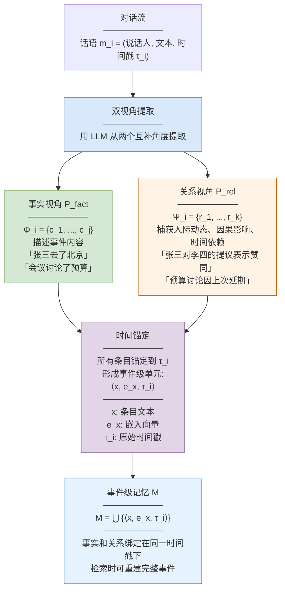
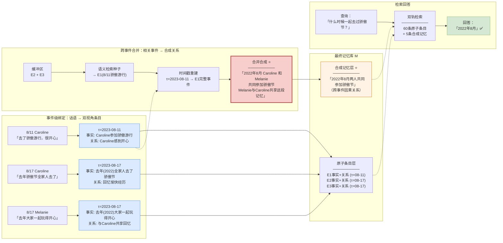
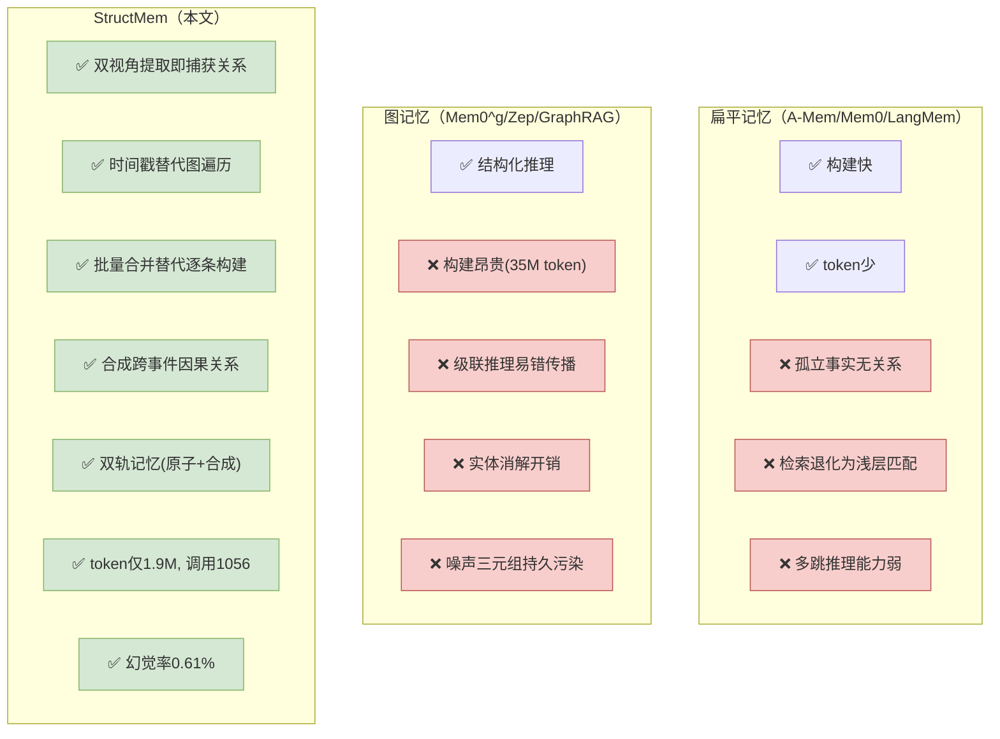

# 论文洞察：StructMem — Structured Memory for Long-Horizon Behavior in LLMs

> **论文**: arXiv:2604.21748 [cs.CL]  
> **标题**: StructMem: Structured Memory for Long-Horizon Behavior in LLMs  
> **作者**: Buqiang Xu, Yijun Chen, Jizhan Fang, Ruobin Zhong, Yunzhi Yao, Yuqi Zhu, Lun Du, Shumin Deng  
> **机构**: 浙江大学 / 蚂蚁集团 / 浙大-蚂蚁知识图谱联合实验室  
> **日期**: 2026年4月23日  
> **代码**: https://github.com/zjunlp/LightMem

---

## 概述

StructMem 提出了一种**结构增强的层级记忆框架**，在扁平记忆（高效但无结构）和图记忆（有结构但昂贵脆弱）之间找到了第三条路。核心洞察：对话记忆的基本单元不应该是孤立的事实或三元组，而应该是**时间锚定的关系事件**（temporally grounded relational event）——它同时保留了"发生了什么"和"事件之间如何关联"。

架构分为两个层级：

- **事件级绑定（写入）**：对每条话语做双视角提取——事实条目（发生了什么）+ 关系条目（人际动态、因果影响、时间依赖），全部锚定到原始时间戳，形成完整的事件级单元；
- **跨事件合并（提炼）**：周期性地缓冲积累的事件 → 语义检索历史相关事件 → 按时间戳重建完整事件上下文 → LLM 合成跨事件关系假设，形成互补的抽象层。

核心思想一句话：**每条话语不只记"发生了什么"，还记"和别的事有什么关系"——然后定期把相关事件合并成更高层的叙事摘要，在不需要图结构的情况下实现跨事件推理**。

---

## 一、事件级绑定路径（写入）



事件级绑定负责将每条话语转化为时间锚定的双视角记忆条目，包含两个阶段：

### 双视角提取

对每条话语 m_i，用 LLM 从两个互补角度提取：

$$\Phi_i \cup \Psi_i = L(P_{\text{fact}} \| m_i) \cup L(P_{\text{rel}} \| m_i)$$

- **事实条目 Φ_i**：描述事件内容——"张三去了北京""会议讨论了预算"。这是传统记忆系统都会提取的客观事实。
- **关系条目 Ψ_i**：捕获人际动态、因果影响和时间依赖——"张三对李四的提议表示赞同""预算讨论因上次延期"。这是 StructMem 的核心创新——**在提取时就捕获关系信息，而不是事后构建图结构**。

**为什么用自然语言而非三元组**：图记忆系统用 (实体, 关系, 实体) 三元组表示关系，但"将流动的叙事压缩成刚性三元组往往会造成语义损失"。StructMem 用自然语言描述关系，保留了上下文的细微差别，同时避免了实体消解的开销。

### 时间锚定

所有条目（事实+关系）都锚定到原始时间戳 τ_i：

$$M \leftarrow \bigcup_{i=1}^{N} \{ \langle x, e_x, \tau_i \rangle \mid x \in \Phi_i \cup \Psi_i \}$$

**关键设计——事实和关系绑定在同一时间戳下**：同一条话语产生的事实条目和关系条目共享同一个 τ_i。这意味着检索时可以通过时间戳重建完整事件——找到 τ_i 就能同时找到这条话语的所有事实和关系。这种绑定是后续跨事件合并的基础。

---

## 二、跨事件合并路径（提炼）

```mermaid
flowchart TD
    T["触发条件：<br/>积累事件超过时间阈值(1小时)"] --> BUF["缓冲区<br/>──────────<br/>C_buf = Sort_τ{M_buffer}<br/>按时间排序未合并的条目"]

    BUF --> ENC["编码聚合查询<br/>──────────<br/>拼接缓冲区所有条目文本<br/>用嵌入模型编码为聚合向量"]

    ENC --> RET["语义检索种子<br/>──────────<br/>用聚合向量与全部历史条目<br/>算余弦相似度<br/>取 Top-K(K=15) 作为种子 S_k"]

    RET --> RECON["事件上下文重建<br/>──────────<br/>对每个种子 x*:<br/>E_τ(x*) = {x' | τ(x') = τ(x*)}<br/>──────────<br/>按时间戳找回同时间戳的<br/>所有事实+关系条目<br/>重建完整事件"]

    RECON --> CROSS["跨事件结构<br/>──────────<br/>C_cross = C_buf ∪ ⋃ E_τ(x*)<br/>──────────<br/>当前事件 + 语义相关的历史事件<br/>按时间戳完整重建"]
    
    CROSS → SYN["合并合成<br/>──────────<br/>C_cons = L(P_cons ∥ C_cross)<br/>──────────<br/>LLM 在语义重建的事件簇上<br/>合成跨事件关系假设<br/>──────────<br/>不是有损摘要！<br/>是显式合成跨事件因果关系<br/>形成互补抽象层"]

    SYN --> M2["更新记忆库<br/>──────────<br/>合成记忆加入 M<br/>原始条目保留不删除<br/>──────────<br/>双轨记忆:<br/>原子条目(细节) + 合成记忆(跨事件关系)"]

    style BUF fill:#dae8fc,stroke:#6c8ebf
    style RET fill:#d5e8d4,stroke:#82b366
    style RECON fill:#fff3e6,stroke:#cc6600
    style SYN fill:#f8cecc,stroke:#b85450,stroke-width:3px
    style M2 fill:#e6f3ff,stroke:#0066cc
```

跨事件合并负责周期性地将语义相关的历史事件连接起来，形成更高层的关系抽象，包含四个阶段：

### 缓冲与触发

系统缓冲积累的未合并条目。当积累事件超过时间阈值（默认1小时）时触发合并。**为什么是周期性而非每条都合并**：利用**时间局部性**（temporal locality）——语义相关的事件自然聚集在短时间窗口内。批量处理比逐条处理效率高得多，将跨事件组织从"每条事件一次操作"降为"周期性批量处理"。

### 语义检索种子

把缓冲区所有条目文本拼接编码为聚合查询向量，与全部历史条目算余弦相似度，取 Top-15 作为种子。**种子是"当前事件可能和哪些历史事件有关"的候选**。

### 事件上下文重建

对每个种子 x*，按其时间戳 τ(x*) 找回同一时间戳下的所有条目：

$$E_\tau(x^*) = \{x' \in M \mid \tau(x') = \tau(x^*)\}$$

**这是时间锚定的回报**：因为事件级绑定时所有条目都锚定到时间戳，现在只要知道一个种子的时间戳，就能重建那个时刻的完整事件——包括所有事实条目和关系条目。不需要实体消解，不需要图遍历，一次时间戳查询即可。

### 合并合成

$$M \leftarrow C_{\text{cons}} = L(P_{\text{cons}} \| C_{\text{cross}})$$

LLM 在语义重建的事件簇上合成跨事件关系假设。**这不是有损摘要**——传统摘要是对顺序文本做有损压缩，StructMem 的合成是在语义重建的事件簇上**显式合成跨事件因果关系**，形成互补的抽象层。原始条目保留不删除，合成记忆是叠加而非替代。

---

## 三、关键设计要点

| 设计要点 | 说明 |
|---------|------|
| 时间锚定的关系事件 | 记忆基本单元不是孤立事实或三元组，而是绑定到时间戳的双视角事件 |
| 双视角提取 | 事实(发生了什么)+关系(人际/因果/时序依赖)在同一时间戳下，提取时即捕获结构 |
| 自然语言而非三元组 | 关系用自然语言描述，保留上下文细微差别，避免实体消解开销和语义损失 |
| 时间局部性批处理 | 语义相关事件自然聚集在短时间窗口，周期性批量合并替代逐条图构建 |
| 时间戳重建事件 | 种子条目→时间戳→同一时间戳全部条目，一次查询重建完整事件，无需图遍历 |
| 合成而非摘要 | 跨事件合成显式生成因果关系假设，是叠加的抽象层而非有损压缩 |
| 双轨记忆 | 原子条目(细节保真)+合成记忆(跨事件关系)，检索时同时使用 |
| 无图模式 | 不需要实体消解、关系消歧、图维护——用时间戳+语义检索替代图遍历 |
| 约束合成降幻觉 | 默认Constrained提示词要求时间戳引用+具体依赖聚焦，幻觉率0.61% vs 无约束7.45% |

---

## 四、处理细节（逐关卡解析）

本节按"一条话语要经历哪些关卡才能进记忆，以及跨事件合并时怎么把相关事件连起来"来讲。

### 4.1 进记忆之前：确定记忆基本单元

StructMem 的第一个设计决策是：**记忆的基本单元是什么？**

- 扁平记忆的答案是"孤立的事实"——高效但没有结构，检索退化为浅层相似匹配；
- 图记忆的答案是"实体-关系三元组"——有结构但构建昂贵、脆弱、易错传播；
- StructMem 的答案是**"时间锚定的关系事件"**——同时保留"发生了什么"(事实)和"和别的事有什么关系"(关系)，绑在同一个时间戳上。

这个选择是后续所有设计的基石。

### 4.2 第一关：双视角提取——一条话语出两类条目

对每条话语 m_i，LLM 从两个互补角度提取：

**事实视角**：用 P_fact 提示词提取事件内容条目 Φ_i。例如话语"张三说他下周要去北京出差，李四建议他顺便拜访客户王五"→ 事实条目："张三下周去北京出差""李四建议拜访王五"。

**关系视角**：用 P_rel 提示词提取人际动态、因果影响和时间依赖条目 Ψ_i。同样的话语 → 关系条目："李四对张三的出差计划提出了建议""张三的北京行程可能与客户王五有关联"。

**为什么需要两个视角**：只提取事实的话，"李四建议张三拜访王五"这个因果关系就丢失了——你只知道"张三要去北京"和"李四建议拜访王五"两个孤立事实，但不知道后者是前者的建议、也不知道建议者是李四。关系条目显式捕获了这些连接。

**为什么用自然语言而非三元组**：如果用 (张三, 去北京, 下周) (李四, 建议, 拜访王五) 这种三元组，"建议"这个关系的上下文就丢了——什么场合建议的？为什么？自然语言"李四建议张三在出差时顺便拜访客户王五"保留了完整上下文。

### 4.3 第二关：时间锚定——事实和关系绑在同一时间戳

所有条目（事实+关系）都锚定到话语 m_i 的原始时间戳 τ_i，形成事件级单元 ⟨x, e_x, τ_i⟩。

**这一步看起来简单但至关重要**：它建立了"同一时刻的所有条目"的绑定关系。后续跨事件合并时，只要找到一个种子的时间戳，就能一次查询找回那个时刻的所有事实和关系——不需要实体消解（"张三"和"老张"是不是同一个人），不需要图遍历（顺着边走多跳），只需要一个时间戳等值查询。

### 4.4 第三关：缓冲等待——不是每条都合并，攒够了再批量处理

提取后的条目进入缓冲区，按时间排序。当积累事件超过时间阈值（1小时）时触发合并。

**为什么不每条都合并**：图记忆系统每来一条新事件就要做实体消解、关系消歧、图更新——每条事件4次级联LLM调用，去重开销随图增长呈二次膨胀。StructMem 利用时间局部性（语义相关的事件自然聚集在短时间窗口内），批量处理替代逐条处理。

**效果**：API调用从图记忆的53514次降到StructMem的1056次——50倍降低。

### 4.5 第四关：语义检索种子——找"当前事件可能和哪些历史有关"

把缓冲区所有条目文本拼接编码为聚合查询向量，与全部历史条目算余弦相似度，取 Top-15 作为种子。

**为什么用聚合查询而非单条查询**：单条条目的语义太窄，可能只匹配到高度相似的历史条目。聚合查询代表了"这一段时间内发生了什么"，能匹配到语义相关的历史事件簇——即使单个条目之间相似度不高。

### 4.6 第五关：事件上下文重建——时间戳是万能钥匙 ⭐

对每个种子 x*，按其时间戳 τ(x*) 找回同一时间戳下的所有条目：

$$E_\tau(x^*) = \{x' \in M \mid \tau(x') = \tau(x^*)\}$$

**这是 StructMem 最精妙的设计**：不需要实体消解（"张三"和"老张"是不是同一个人），不需要图遍历（顺着边走多跳），不需要符号推理——**一个时间戳等值查询就重建了那个时刻的完整事件**，包括所有事实和所有关系。

**为什么这比图遍历好**：图遍历需要"张三→(关系)→某事件→(关系)→另一事件"这样的多跳路径，每跳都可能因为实体消解错误或关系抽取错误而断链。时间戳重建是确定性的——τ(x*) 是一个确定的值，等值查询零错误。

### 4.7 第六关：合并合成——显式生成跨事件因果关系 ⭐

LLM 在语义重建的事件簇上合成跨事件关系假设：

$$M \leftarrow C_{\text{cons}} = L(P_{\text{cons}} \| C_{\text{cross}})$$

**这不是有损摘要**。传统摘要把长文本压缩成短文本，丢失细节。StructMem 的合成是在多个完整事件（每个都有事实+关系）的基础上，**显式生成跨事件因果关系假设**——"张三上周去北京出差的行程与李四之前建议拜访王五有关""预算讨论的延期是因为上次会议时间冲突"。

这些跨事件关系是**新信息**——不存在于任何单条记忆条目中，而是通过合成多个事件的关系条目推断出来的。实验证明（Figure 3c）：扁平检索在60条条目后性能饱和——瓶颈不是覆盖率而是知识推理能力；跨事件合成突破了这一瓶颈（Figure 3d：K=0时性能与扁平检索持平，K>0后显著提升）。

### 4.8 约束合成降幻觉

合成提示词 P_cons 默认使用 **Constrained** 模式，要求：
- 时间戳引用：合成的每条跨事件关系必须引用具体时间戳
- 具体依赖聚焦：只合成有明确证据支撑的因果关系

**效果**：Constrained模式下幻觉率0.61%（GPT评判），而Unconstrained模式（去掉约束）暴涨到7.45%——12倍差距。这证明了约束合成对控制跨事件关系质量的必要性。

### 4.9 一图看懂关卡顺序

双视角提取（4.2）→ 时间锚定（4.3）→ 缓冲等待（4.4）→ 语义检索种子（4.5）→ 时间戳重建事件（4.6）→ 合并合成跨事件关系（4.7）→ 约束降幻觉（4.8）

设计原则一脉相承：**时间戳是万能钥匙**——提取时锚定到时间戳，合并时按时间戳重建事件。不需要图结构的实体消解和关系消歧，用时间戳等值查询+语义检索替代图遍历，在效率和质量之间取得平衡。

---

## 五、大白话版：一段对话怎么"绑定"成事件，多个事件怎么"合并"成关系

抛开术语，StructMem 做的事情可以用"写日记+定期回顾"来比喻。

假设用户 Caroline 和 Melanie 在 2023年8月有一次对话：

> **8月11日 Caroline 说**："我昨天去了骄傲游行，特别开心！"  
> **8月17日 Caroline 说**："去年骄傲节真的太好玩了，全家人都去了。"  
> **8月17日 Melanie 说**："是啊去年骄傲节大家一起玩得很开心！"

然后用户问："Caroline 和 Melanie 什么时候一起去过骄傲节？"

### 事件级绑定：每条话语出两类条目

**8月11日 Caroline 的话语**：
- 事实条目 Φ：`Caroline 参加了骄傲游行（2023-08-11）`
- 关系条目 Ψ：`Caroline 对骄傲游行的体验感到开心`

两者都锚定到 τ = 2023-08-11。

**8月17日 Caroline 的话语**：
- 事实条目 Φ：`Caroline 去年（2022年）参加了骄傲节，全家人一起去了`
- 关系条目 Ψ：`Caroline 回忆去年骄傲节的经历，感到愉快`

锚定到 τ = 2023-08-17。

**8月17日 Melanie 的话语**：
- 事实条目 Φ：`Melanie 去年（2022年）参加了骄傲节，和大家一起玩得开心`
- 关系条目 Ψ：`Melanie 与 Caroline 共享去年骄傲节的愉快回忆`

锚定到 τ = 2023-08-17。

### 跨事件合并：把相关事件连起来

**触发**：8月17日的两条话语积累了，触发合并。

**缓冲**：C_buf = [8月17日 Caroline 条目, 8月17日 Melanie 条目]，按时间排序。

**语义检索种子**：聚合查询"骄傲节回忆、全家人、一起开心"→ 与历史条目算相似度 → 找到种子：8月11日的 `Caroline 参加了骄傲游行`。

**事件重建**：种子时间戳 τ = 2023-08-11 → 找回同时间戳的所有条目 → 重建完整事件：`Caroline 参加了骄傲游行` + `Caroline 对骄傲游行感到开心`。

**合并合成**：LLM 看到当前事件（8月17日两人回忆去年骄傲节）+ 历史事件（8月11日Caroline参加游行）→ 合成跨事件关系：

> "2023年8月17日，Caroline 和 Melanie 回忆起去年（2022年）一起参加骄傲节的愉快经历。Melanie 与 Caroline 共享这段记忆，表明两人在2022年8月共同参加了骄傲节活动。"

这条合成记忆是**新信息**——没有任何单条条目说"两人2022年一起去了"，但通过合成 Caroline 的事实（"去年全家人去了"）、Melanie 的事实（"去年大家一起玩得开心"）和 Melanie 的关系条目（"共享回忆"），推断出了"一起去过"这个跨事件关系。

### 检索回答

用户问"什么时候一起去过？"→ 检索原子条目（60条）+ 合成记忆（5条）→ 合成记忆中有"2022年8月共同参加"→ 回答："2022年8月。"

### 如果用扁平记忆会怎样

扁平记忆只存事实条目，不存关系条目，不合成跨事件关系。检索到"Caroline 去年去了骄傲节""Melanie 去年去了骄傲节"——但不知道她们是**一起**去的（因为没有关系条目记录"共享回忆"）。回答："她们没有一起去过。"——错误。

### 如果用图记忆会怎样

图记忆构建 (Caroline, 参加了, 骄傲节) (Melanie, 参加了, 骄傲节) 三元组——但两个节点之间没有"一起"的边。也无法推断出"一起去过"。回答："2023年6月。"——错误（时间也错了）。

---

## 六、加工结果全景图



怎么读这张图：
- 左侧事件级绑定：每条话语提取事实+关系两类条目，锚定到时间戳；
- 中间跨事件合并：缓冲→语义检索种子→时间戳重建事件→合成跨事件因果关系；
- 右侧记忆库：双轨——原子条目层（细节保真）+ 合成记忆层（跨事件关系）；
- 合成记忆层是"新信息"——不存在于任何单条条目中，而是通过合成多个事件推断出来的；
- 检索时同时使用原子条目和合成记忆，合成记忆提供跨事件推理能力。

---

## 七、实验结果

### 7.1 主实验：LoCoMo基准（LLM-as-judge评分）

| 方法 | Overall | Multi-hop | Open-domain | Single-hop | Temporal |
|------|---------|-----------|-------------|------------|----------|
| FullContext | 73.83 | 68.79 | 56.25 | **86.56** | 50.16 |
| A-Mem | 64.16 | 56.03 | 31.25 | 72.06 | 60.44 |
| Mem0 | 66.88 | 67.13 | 51.15 | 72.93 | 59.19 |
| Mem0^g | 68.44 | 65.71 | 47.19 | 75.71 | 58.13 |
| Zep | 75.14 | **74.11** | **66.04** | 79.79 | 67.71 |
| Memobase | 75.78 | 70.92 | 46.88 | 77.17 | **85.05** |
| **StructMem** | **76.82** | 68.77 | 46.88 | 81.09 | 81.62 |

关键发现：
- **Overall 76.82**，超过 Memobase(75.78) 和 Zep(75.14)，SOTA
- **Temporal 81.62**，得益于跨事件合成的时序推理能力
- **跨3个judge模型一致**：GPT(76.82)、Qwen(77.01)、DeepSeek(79.35)均为最高，Fleiss' κ=0.8341（近乎完美一致）

### 7.2 效率对比

| 方法 | 构建Token(M) | API调用 | 运行时间(s) |
|------|------------|---------|-----------|
| Mem0^g | 35.825 | 53514 | 115670 |
| A-Mem | 11.494 | 11754 | 60607 |
| Mem0 | 12.196 | 9181 | 30057 |
| MemoryOS | 2.868 | 5534 | 24220 |
| **StructMem** | **1.937** | **1056** | **22854** |

- 构建Token仅1.937M，是Mem0^g(35.825M)的**5.4%**
- API调用仅1056次，是Mem0^g(53514)的**2%**
- 运行时间22854s，是Mem0^g(115670)的**19.8%**

### 7.3 消融实验

| 配置 | Multi | Open | Single | Temp |
|------|-------|------|--------|------|
| 扁平记忆 | 66.31 | 46.88 | 78.83 | 78.50 |
| 图记忆 | 66.67 | 48.96 | 80.50 | 76.64 |
| StructMem w/o 跨事件 | 66.31 | 46.88 | 80.86 | 79.44 |
| **StructMem** | **68.77** | 46.88 | **81.09** | **81.62** |

核心发现：
- **图记忆在Temporal上反而下降**（78.50→76.64）——图构建的噪声传播损害了时序推理
- **事件级结构**提升Temporal(78.50→79.44)和Single(78.83→80.86)——双视角提取捕获了关系信息
- **跨事件合并**进一步提升Temporal(79.44→81.62)——跨事件因果关系合成是时序推理的关键

### 7.4 内部机制分析

**扁平检索60条后饱和**（Figure 3c）：增加检索条目数不再提升性能——瓶颈是知识推理而非覆盖率。

**K=0与扁平持平，K>0显著提升**（Figure 3d）：不引入跨事件合成(K=0)时性能与扁平检索一样在饱和点；引入跨事件合成后突破瓶颈——证明合成记忆提供了原子条目中不存在的新信息。

### 7.5 幻觉率

| 评判模型 | 事件级提取幻觉率 | 跨事件合成幻觉率(约束) | 跨事件合成幻觉率(无约束) |
|---------|---------------|-------------------|-------------------|
| GPT | 0.78% | **0.61%** | 7.45% |
| Qwen | 1.61% | 3.41% | 20.00% |
| DeepSeek | 2.84% | 3.63% | 15.14% |
| 均值 | **2.36%** | — | — |

约束合成将幻觉率从7.45%降到0.61%（GPT评判）——**12倍降低**。

---

## 八、与现有方法的本质区别



| 维度 | 扁平记忆 | 图记忆 | **StructMem** |
|------|---------|--------|--------------|
| 记忆单元 | 孤立事实 | 实体-关系三元组 | **时间锚定关系事件** |
| 关系捕获 | 无 | 事后图构建 | **提取时双视角** |
| 实体消解 | 不需要 | 需要(昂贵易错) | **不需要(时间戳替代)** |
| 构建方式 | 逐条 | 逐条级联 | **周期性批量** |
| 构建Token | ~11M | ~36M | **1.9M** |
| API调用 | ~9000+ | ~53000+ | **1056** |
| 跨事件推理 | 无 | 图遍历 | **语义合成** |
| 噪声风险 | 低 | 高(错误传播) | **低(约束合成0.61%)** |
| 多跳能力 | 弱 | 中 | **强(合成新信息)** |

---

## 九、一句话总结全过程

**事件级绑定**：每条话语双视角提取——事实条目(发生了什么)+关系条目(人际/因果/时序依赖)——全部锚定到时间戳，形成完整事件单元。

**跨事件合并**：攒够1小时触发 → 缓冲区按时间排序 → 聚合编码语义检索Top-15种子 → **种子时间戳等值查询重建完整事件**（无需图遍历）→ LLM在语义重建的事件簇上合成跨事件因果关系（非有损摘要，是新信息）→ 约束合成将幻觉率压到0.61%。

**检索**：双轨——60条原子条目(细节)+5条合成记忆(跨事件关系)→ 突破扁平检索60条饱和瓶颈。

核心转变：**从"事后建图"到"提取时绑关系"**——不需要实体消解和图遍历，用时间戳+语义检索+批量合成替代，token降为图记忆的5.4%，API调用降为2%，Temporal推理提升至81.62。

---

*报告生成日期: 2026-10-12*
