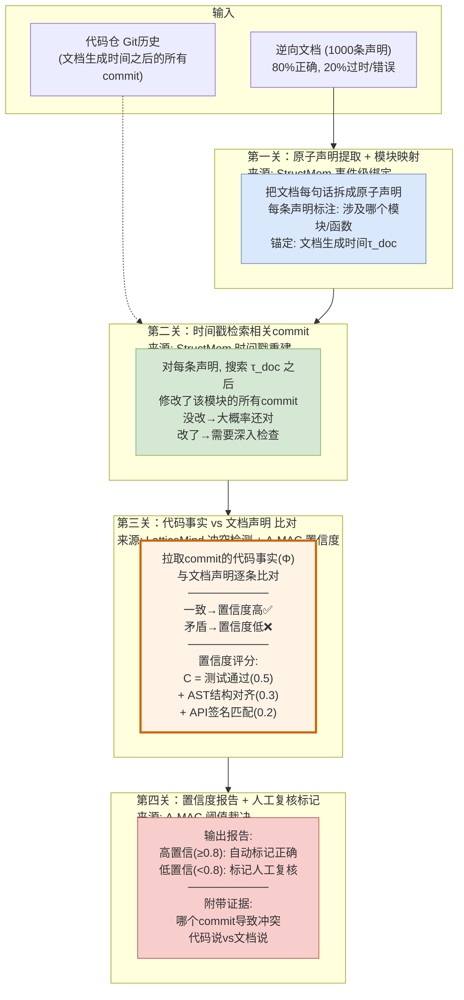
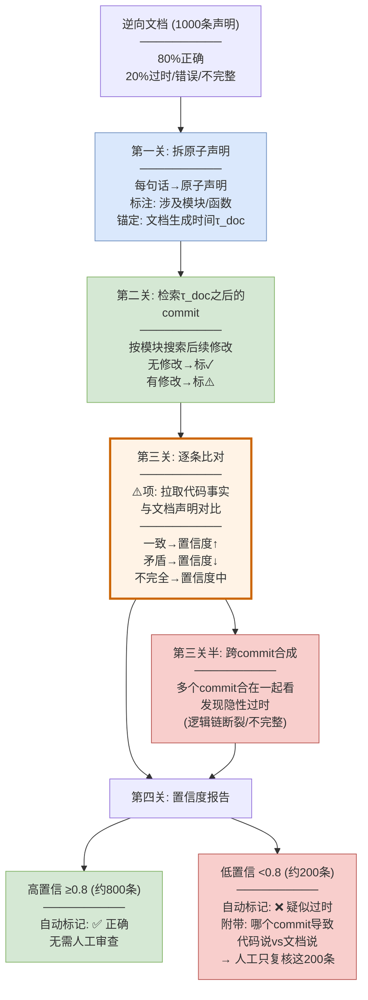

# StructMem 通俗版：逆向资产正确性自动评估场景

> 核心场景：代码仓逆向后的文档80%正确，20%错误/过时。如何让 Agent **自动识别哪20%是错的**，而不是靠人逐条审查100%。

---

## 场景设定：保险系统的逆向文档校验

### 现状

你的团队接手了一个保险核心系统，没有完整文档。用 LLM 对代码做了逆向文档生成，产出了一份**逆向文档**。但你知道：大约**80%是对的，20%是错的**——有些是代码改了但文档没更新，有些是LLM逆向时理解错了。

### 痛点

如果把1000条逆向文档全部交给人工审查，需要**5人天**。但如果Agent能自动标出**最可能错的200条**，人工只审查这200条，1人天就搞定了。

### 目标

**自动识别"逆向文档中哪些条目可能与代码不一致"，给每条打置信度分数，低置信度的标记人工复核。**

---

## 逆向文档长什么样

假设逆向文档中有一段关于"保单审批流程"的描述：

> **逆向文档 §3.2 审批流程**
> 1. 投保人提交申请，系统自动校验基本信息
> 2. 所有申请由核保员人工审核
> 3. 审核通过后生成保单
> 4. 审批结果通过邮件通知投保人

这段文档是**3个月前**根据当时代码逆向生成的。但过去3个月代码改了4次：

| 时间 | Commit | 改了什么 |
|------|--------|---------|
| 3个月前 | a1b2c3d | 原始代码：邮件通知 + 全量人工审核 |
| 2个月前 | e4f5g6h | 审批通知从邮件改为 `request_permissions` 工具 |
| 1个月前 | i7j8k9l | 新增：低风险保单(<10万)自动通过，不走人工 |
| 上周 | m0n1o2p | 人工审核范围从"所有"改为"仅50万以上" |

**逆向文档描述的是3个月前的状态，但代码已经往前走了4个commit。** 文档里4句话中有3句已经过时了。

---

## Agent 怎么自动找出这3句过时的

### 第一关：给每条逆向文档打标签（StructMem 事件级绑定）

Agent 不直接判断"对不对"，而是先把逆向文档的每句话拆成**原子声明**，打上标签：

```
逆向文档 §3.2 → 拆成4条原子声明:

声明 D1: "系统自动校验基本信息" 
  → 涉及模块: ApplicationValidator
  → 涉及函数: validateBasicInfo()
  → 文档生成时间: 3个月前

声明 D2: "所有申请由核保员人工审核"
  → 涉及模块: UnderwritingService  
  → 涉及函数: evaluate()
  → 文档生成时间: 3个月前

声明 D3: "审核通过后生成保单"
  → 涉及模块: PolicyGenerator
  → 涉及函数: generate()
  → 文档生成时间: 3个月前

声明 D4: "审批结果通过邮件通知"
  → 涉及模块: NotificationService
  → 涉及函数: sendNotification()
  → 文档生成时间: 3个月前
```

**这一步做的事**：把文档的每句话和代码里的具体模块/函数对应起来。这样后面才能拿代码去和文档比对。

### 第二关：拉取相关 commit 的代码事实（StructMem 时间戳重建）

对每条原子声明，Agent 用它涉及的模块/函数去搜索**文档生成时间之后**的所有 commit：

```
声明 D1 涉及 ApplicationValidator →
  搜索3个月内修改 ApplicationValidator 的commit →
  结果: 无修改 ✓ (文档可能还对)

声明 D2 涉及 UnderwritingService →
  搜索3个月内修改 UnderwritingService 的commit →
  结果: i7j8k9l(1月前)、m0n1o2p(上周) ⚠️ (代码改了，文档可能过时)

声明 D3 涉及 PolicyGenerator →
  搜索3个月内修改 PolicyGenerator 的commit →
  结果: 无修改 ✓ (文档可能还对)

声明 D4 涉及 NotificationService →
  搜索3个月内修改 NotificationService 的commit →
  结果: e4f5g6h(2月前) ⚠️ (代码改了，文档可能过时)
```

**这一步做的事**：用"文档生成时间"作为分界线，看之后代码有没有改过文档涉及的部分。没改的 → 文档大概率还对；改了的 → 需要深入检查。

### 第三关：逐条比对代码事实 vs 文档声明（LatticeMind 冲突检测）

对第二关标出 ⚠️ 的声明，Agent 拉取相关 commit 的代码事实，和文档声明做**逐条比对**：

**声明 D2: "所有申请由核保员人工审核"**

```
Agent 拉取 commit i7j8k9l 的代码事实:
  代码事实: UnderwritingService.evaluate() 新增逻辑:
    if (amount < 100000) { return AUTO_APPROVED; }
    // 低风险保单自动通过，不走人工

Agent 拉取 commit m0n1o2p 的代码事实:
  代码事实: UnderwritingService.evaluate() 修改:
    if (amount > 500000) { return MANUAL_REVIEW; }
    // 仅50万以上需人工，其余自动

Agent 比对:
  文档说: "所有申请由核保员人工审核"
  代码说: "仅50万以上需人工审核，其余自动通过"
  
  结论: ❌ 冲突！文档过时。
  证据: commit i7j8k9l + m0n1o2p
  置信度: 0.15 (极低，文档与代码明确矛盾)
```

**声明 D4: "审批结果通过邮件通知"**

```
Agent 拉取 commit e4f5g6h 的代码事实:
  代码事实: NotificationService.sendNotification() 从
    emailService.send() 改为
    requestPermissions.notify()

Agent 比对:
  文档说: "通过邮件通知"
  代码说: "通过 request_permissions 工具通知"
  
  结论: ❌ 冲突！文档过时。
  证据: commit e4f5g6h
  置信度: 0.10 (极低，通知方式完全不同)
```

**声明 D1: "系统自动校验基本信息"**

```
Agent 拉取 commit 历史:
  3个月内 ApplicationValidator 无修改

Agent 比对:
  文档说: "系统自动校验基本信息"
  代码说: validateBasicInfo() 仍然存在且逻辑未变
  
  结论: ✅ 一致。文档仍然正确。
  置信度: 0.95 (高，代码未变且文档描述准确)
```

**声明 D3: "审核通过后生成保单"**

```
Agent 拉取 commit 历史:
  3个月内 PolicyGenerator 无修改

Agent 比对:
  文档说: "审核通过后生成保单"
  代码说: generate() 在审核通过后调用，逻辑未变
  
  结论: ✅ 一致。
  置信度: 0.92 (高)
```

### 第四关：输出置信度报告

Agent 对4条声明各打一个置信度分数：

| 声明 | 文档内容 | 置信度 | 状态 | 证据 |
|------|---------|--------|------|------|
| D1 | 系统自动校验基本信息 | 0.95 | ✅ 正确 | 代码未变 |
| D2 | 所有申请由核保员人工审核 | 0.15 | ❌ **过时** | i7j8k9l+m0n1o2p: 改为自动+仅50万以上人工 |
| D3 | 审核通过后生成保单 | 0.92 | ✅ 正确 | 代码未变 |
| D4 | 审批结果通过邮件通知 | 0.10 | ❌ **过时** | e4f5g6h: 改为request_permissions工具 |

**人工只需要复核 D2 和 D4 两条**——而不是全部4条。如果文档有1000条声明，人工可能只需要复核200条低置信度的，而不是1000条全看。

---

## 这个方案用到了哪几篇论文的技术



| 关卡 | 做什么 | 来源论文 |
|------|--------|---------|
| 第一关 | 把文档拆成原子声明，标注涉及的模块/函数，锚定到文档生成时间 | StructMem 事件级绑定 |
| 第二关 | 搜索文档生成时间之后修改了相关模块的commit | StructMem 时间戳重建 |
| 第三关 | 拉取commit的代码事实，与文档声明逐条比对，冲突的标低置信度 | LatticeMind 冲突检测 + A-MAC 置信度因子 |
| 第四关 | 输出置信度报告，低置信度的标记人工复核 | A-MAC 阈值裁决 |

---

## 更复杂的场景：跨commit的隐性过时

上面的例子是"代码直接改了文档描述的功能"——比较容易发现。但还有一种更隐蔽的过时：**单个commit看起来没改文档涉及的模块，但多个commit合在一起导致文档描述的逻辑链断了。**

### 例子

逆向文档说：
> "理赔流程：提交理赔申请 → 系统查询保单状态 → 如果保单有效则计算赔付金额 → 返回赔付结果"

单个看：
- `ClaimService.submit()` 没改 → "提交理赔申请"还对 ✓
- `PolicyService.getStatus()` 没改 → "查询保单状态"还对 ✓  
- `ClaimCalculator.calculate()` 改了 → "计算赔付金额"需要检查 ⚠️
- `ClaimService.return()` 没改 → "返回赔付结果"还对 ✓

但深入查 `ClaimCalculator.calculate()` 的改动：

```
commit e4f5g6h (2月前):
  原代码: return amount * payoutRatio;
  改后:   return amount * payoutRatio * deductibleFactor;
  新增了免赔额因子

commit i7j8k9l (1月前):
  新增: if (hasNoDeductibleRider) { deductibleFactor = 1; }
  附加"无免赔额"rider时不扣免赔额
```

文档说"计算赔付金额"——代码确实在计算赔付金额，函数名没变。但**计算逻辑变了**：原来是 `金额×赔付率`，现在是 `金额×赔付率×免赔额因子`，而且有条件分支。

### Agent 怎么发现这种隐性过时

**用 StructMem 跨事件合成**：

Agent 不只看单个commit，而是把相关commit**合在一起看**：

```
合成: "赔付计算逻辑演进"
  原始: amount * payoutRatio (简单乘法)
  → commit e4f5g6h: 新增免赔额因子 (amount * payoutRatio * deductibleFactor)
  → commit i7j8k9l: 新增条件分支 (无免赔额rider时因子=1)

合成结论: 赔付计算从"简单乘法"变为"含免赔额因子的条件计算"。
         文档只说"计算赔付金额"，未描述免赔额因子和条件分支。
         → 标记: 文档可能不完整(缺失关键逻辑)
         置信度: 0.45 (中等偏低，部分正确但不完整)
```

文档不是"完全错了"——它确实在"计算赔付金额"。但它**不完整**，漏掉了免赔额因子这个关键逻辑。Agent 用跨commit合成发现了这种隐性过时。

### 人话版

就像你3年前写的菜谱说"番茄炒蛋：番茄+鸡蛋+盐"。3年来你改良了做法：加了糖、又加了番茄酱、还调整了火候。菜谱的标题还是"番茄炒蛋"没错，但做法已经不完整了——漏了糖和番茄酱。Agent 翻你3年的烹饪日志，发现你加了新调料，标出"菜谱可能不完整，缺少糖和番茄酱的步骤"。

---

## 完整工作流：逆向文档自动校验



### 效果对比

| 方式 | 人工审查量 | 人工成本 | 发现率 |
|------|----------|---------|--------|
| 全量人工审查 | 1000条 | 5人天 | ~100% |
| **Agent自动校验** | **200条(低置信)** | **1人天** | **~85-90%** |
| 随机抽查10% | 100条 | 0.5人天 | ~10% |

Agent自动校验的**核心价值**：把人工审查量从1000条压缩到200条（5倍降低），同时发现85-90%的过时文档——剩下10-15%可能是Agent没发现的隐性过时（需要后续迭代提升）。

---

## 置信度评分怎么算（A-MAC 适配）

每条逆向文档声明的置信度由**四个信号**综合计算：

| 信号 | 怎么算 | 权重 | 示例 |
|------|--------|------|------|
| **代码一致性** | 文档描述的逻辑和当前代码是否一致 | 0.5 | 文档说"邮件通知"，代码是`requestPermissions.notify()` → 不一致 → 这项0分 |
| **AST结构对齐** | 文档描述的函数/模块结构是否和AST一致 | 0.3 | 文档说"有3个参数"，AST解析确实3个参数 → 一致 → 这项满分 |
| **API签名匹配** | 文档描述的函数签名和当前签名是否一致 | 0.2 | 文档说`evaluate(policy)`，代码是`evaluate(policy, riskLevel)` → 参数变了 → 这项低分 |
| **时间衰减** | 文档生成时间距今多久，期间改了几次 | 叠加 | 3个月改了4次 → 衰减大；3个月没改 → 衰减小 |

```
置信度 = 0.5 × 代码一致性 + 0.3 × AST对齐 + 0.2 × API签名
         × 时间衰减因子(0.5-1.0)
```

**例子**：
- 声明D2"所有申请由核保员人工审核":
  - 代码一致性: 文档说"所有人工"，代码说"50万以上人工" → 0.2 (严重不一致)
  - AST对齐: 函数结构还在 → 0.8
  - API签名: `evaluate()` 签名变了(加了参数) → 0.3
  - 时间衰减: 3个月改了2次 → 0.6
  - 置信度 = 0.5×0.2 + 0.3×0.8 + 0.2×0.3) × 0.6 = (0.10+0.24+0.06) × 0.6 = **0.24** → 低置信 → 标记人工复核

- 声明D1"系统自动校验基本信息":
  - 代码一致性: 文档说"自动校验"，代码确实在自动校验 → 0.95
  - AST对齐: 函数结构未变 → 0.95
  - API签名: 签名未变 → 0.95
  - 时间衰减: 3个月没改 → 1.0
  - 置信度 = (0.5×0.95 + 0.3×0.95 + 0.2×0.95) × 1.0 = **0.95** → 高置信 → 自动标记正确

---

## 人工复核时看到什么

Agent 不只标"这条可能错了"，还**附带证据**，让人工快速判断：

```
⚠️ 疑似过时: 逆向文档 §3.2 声明D2
──────────────────────────────────────
文档说: "所有申请由核保员人工审核"
代码说: "仅50万以上需人工审核，其余自动通过"

冲突证据:
  commit i7j8k9l (1月前):
    新增: if (amount < 100000) return AUTO_APPROVED;
    
  commit m0n1o2p (上周):
    修改: if (amount > 500000) return MANUAL_REVIEW;

置信度: 0.24 (低)
建议: 文档过时，建议更新为"仅50万以上需人工审核"
──────────────────────────────────────

人工操作:
  [确认过时 → 接受Agent建议更新]
  [Agent误报 → 标记为正确]
  [需要更多信息 → 查看原始代码]
```

**人工只需30秒看一条**——Agent 已经把"文档说了什么、代码说了什么、哪个commit导致的"都列好了，人工只需要确认"是过时了"还是"Agent误报了"。

---

## 一句话总结

**80%的逆向文档是3个月前根据当时代码生成的，但代码一直在改。** Agent 的做法：

1. **拆**：把文档每句话拆成原子声明，标注涉及的模块/函数，锚定到生成时间
2. **查**：搜索生成时间之后改了这些模块的commit
3. **比**：拉取commit的代码事实，和文档逐条比对——一致的标高置信，矛盾的标低置信
4. **合**：多个commit合在一起看，发现"单个看没改但合起来逻辑链断了"的隐性过时
5. **报**：输出置信度报告，低置信的附带证据标记人工复核

**人工从审查1000条变成审查200条**——5倍效率提升，85-90%的过时文档被自动发现。

---

*方案生成日期: 2026-10-12*
