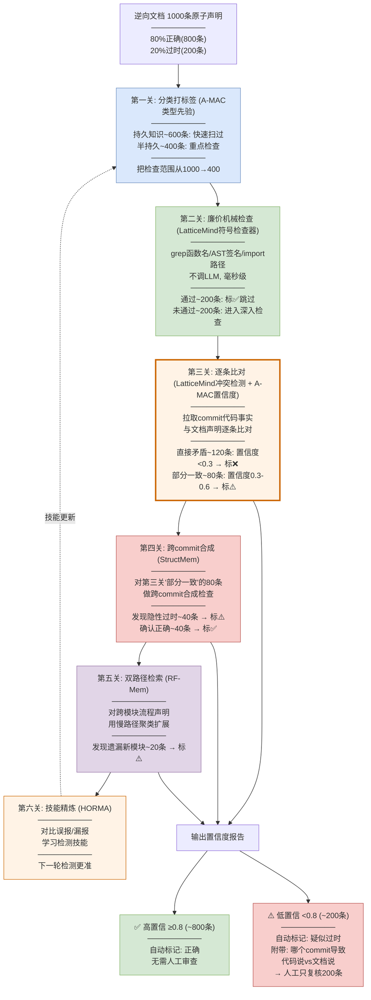

# 五篇论文技术 → 逆向资产正确性自动识别（SBG云手机场景）

> **场景**：SBG云手机代码仓逆向后的软件资产文档，约80%正确，20%过时/错误/不完整。目标：Agent自动识别出哪20%是错的，人工只复核疑似项。

---

## 场景设定

你的团队接手了SBG云手机系统，没有完整设计文档。用LLM对代码做了逆向，产出了一份**软件资产文档**，包含：

```
§1 云手机实例管理    → 实例创建/销毁/迁移逻辑
§2 视频流传输        → 编解码/帧率控制/自适应码率
§3 输入事件转发      → 触控/键盘/传感器事件从端侧到云侧
§4 音频同步          → 采集/编码/播放同步策略
§5 资源调度          → CPU/GPU/内存分配策略
§6 设备虚拟化        → 虚拟传感器/GPS/摄像头模拟
§7 网络自适应        → 弱网降级/断线重连/QoS
§8 安全沙箱          → 应用隔离/权限控制/数据加密
```

每章节拆成几十条原子声明，总计约1000条。**80%对的，20%错的**——因为代码一直在迭代，但逆向文档是3个月前生成的，期间改了60多次commit。

---

## 一、第一关：拆声明 + 分类打标签（A-MAC 类型先验）

### 做什么

把每段文档拆成原子声明，用 A-MAC 的**类型先验**给每条声明分类——不同类型的声明"过期概率"不同：

### 举个例子

逆向文档 §3 "输入事件转发"的一段：

> 触控事件从端侧采集后，通过UDP通道转发到云侧，云侧解析后注入虚拟输入设备。每个事件包大小固定256字节。

拆成4条原子声明，每条打类型标签：

| 声明 | 内容 | 类型标签 | 过期概率 | 来源技术 |
|------|------|---------|---------|---------|
| D1 | 触控事件从端侧采集 | 持久知识(0.9) | 低 | A-MAC 类型先验T |
| D2 | 通过UDP通道转发到云侧 | 半持久(0.5) | 中 | A-MAC 类型先验T |
| D3 | 每个事件包大小固定256字节 | 半持久(0.5) | 中 | A-MAC 类型先验T |
| D4 | 云侧解析后注入虚拟输入设备 | 持久知识(0.9) | 低 | A-MAC 类型先验T |

**为什么这么分**：
- D1"采集触控事件"——这是底层设计，不会轻易改 → 持久知识，大概率还对
- D2"通过UDP转发"——传输协议可能从UDP改成TCP/WebSocket → 半持久，可能变
- D3"256字节"——数据包大小可能调优过 → 半持久，可能变
- D4"注入虚拟输入设备"——虚拟化框架不会轻易换 → 持久知识，大概率还对

**这一步的价值**：1000条声明不需要全部深入检查。类型先验高的（持久知识，约600条）只需快速扫一遍；类型先验低的（半持久/临时，约400条）重点检查——**把检查范围从1000条缩到400条**。

### 人话

就像你接手一家餐厅，前任留了一本操作手册。手册上写"番茄炒蛋放盐3克"——调味量容易变（半持久，重点查）；"番茄炒蛋用鸡蛋和番茄"——食材组合不会变（持久知识，扫一眼就行）。

---

## 二、第二关：廉价机械检查（LatticeMind 符号检查器）

### 做什么

对每条声明，先做**不需要LLM的廉价检查**——LatticeMind的符号检查器思路：能机械判断的不调LLM。

### 举个例子

对上面4条声明做机械检查：

**D2"通过UDP通道转发"** → 机械检查：
```
检查1: grep "UDP" src/network/ → 找到 EventTransport.java
       → 函数名还在 ✓

检查2: 解析 EventTransport.java 的AST
       → 发现: 原来是 DatagramSocket.send()
          现在改成了 WebSocket.send()
       → ⚠️ 传输方式从UDP改成了WebSocket!

检查3: 检查import
       → 原来 import java.net.DatagramSocket
          现在 import java.websocket.WebSocket
       → ⚠️ 确认改了
```

**D3"256字节"** → 机械检查：
```
检查: grep "256" src/network/EventPacket.java
      → 找到: public static final int PACKET_SIZE = 512;
      → ⚠️ 从256改成了512!
```

**D1"采集触控事件"** → 机械检查：
```
检查: grep "TouchEvent" src/input/
      → 函数 TouchCollector.collect() 仍在 ✓
      → 签名未变 ✓
      → ✅ 没问题
```

**D4"注入虚拟输入设备"** → 机械检查：
```
检查: grep "VirtualInput" src/device/
      → VirtualInputDevice.inject() 仍在 ✓
      → ✅ 没问题
```

### 机械检查结果

| 声明 | 机械检查结果 | 状态 |
|------|------------|------|
| D1 采集触控事件 | 函数在、签名没变 | ✅ 可能正确 |
| D2 UDP转发 | **DatagramSocket→WebSocket** | ⚠️ 疑似过时 |
| D3 256字节 | **256→512** | ⚠️ 疑似过时 |
| D4 注入虚拟设备 | 函数在、签名没变 | ✅ 可能正确 |

**这一步的价值**：D1和D4通过了机械检查，**可以标为"大概率正确"直接跳过**——不需要调LLM深入分析。只有D2和D3需要进入下一关。1000条声明中，大约600条能通过机械检查跳过，剩400条需要深入。

### 人话

就像你检查餐厅手册，先用快速方法过一遍：菜单上写"用盐3克"——你直接去厨房称一下盐罐，3克就是3克，对得上就跳过（机械检查）。只有对不上的（盐罐里是5克）才需要叫厨师来问为什么变了（调LLM）。

---

## 三、第三关：代码事实 vs 文档声明 逐条比对（LatticeMind 冲突检测 + A-MAC 置信度）

### 做什么

对机械检查没通过的声明，拉取相关commit的**代码事实**，和文档做**逐条比对**——这是LatticeMind的冲突检测+A-MAC的置信度评分。

### 举个例子

**D2"通过UDP通道转发"** → 深入比对：

```
Agent 拉取改了 EventTransport.java 的commit:

commit f8a3b2c (2月前):
  代码事实: EventTransport.send() 从
    DatagramSocket.send(packet) 改为
    WebSocket.send(frame)
  commit message: "feat: 视频流改用WebSocket传输, 支持断线重连"

Agent 比对:
  文档说: "通过UDP通道转发"
  代码说: "通过WebSocket传输"
  
  → ❌ 冲突！
  证据: commit f8a3b2c
  证据类型: code-change (权重60) + git-commit bonus (40) = 100
  文档证据: reverse-doc (权重12)
  → 代码证据(100) >> 文档证据(12) → 文档过时
  
  置信度计算:
    代码一致性: 文档说UDP, 代码说WebSocket → 0.1 (严重不一致)
    AST结构对齐: 函数还在但实现变了 → 0.4
    API签名匹配: send()签名变了(参数类型不同) → 0.3
    时间衰减: 2个月前改的 → 0.7
  
  置信度 = (0.5×0.1 + 0.3×0.4 + 0.2×0.3) × 0.7 = 0.14
  → 低置信 → 标记人工复核
```

**D3"256字节"** → 深入比对：

```
Agent 拉取改了 EventPacket.java 的commit:

commit a9b4c3d (1月前):
  代码事实: PACKET_SIZE 从 256 改为 512
  commit message: "fix: 增大事件包解决触控延迟问题"

Agent 比对:
  文档说: "固定256字节"
  代码说: "固定512字节"
  
  → ❌ 冲突！
  证据: commit a9b4c3d
  证据类型: code-change (60) + git-commit bonus (40) = 100
  
  置信度计算:
    代码一致性: 256 vs 512 → 0.2
    AST结构对齐: 常量定义结构没变 → 0.9
    API签名匹配: 不涉及函数签名 → 0.8
    时间衰减: 1个月前改的 → 0.85
  
  置信度 = (0.5×0.2 + 0.3×0.9 + 0.2×0.8) × 0.85 = 0.49
  → 中低置信 → 标记人工复核
```

### 人话

就像手册写"番茄炒蛋放盐3克"，你去厨房发现盐罐标签写着"标准用量5克"。你查了厨师的工作日志，发现上个月厨师把盐从3克改成了5克（因为换了新供应商的盐咸度不同）。手册写的3克和实际5克对不上——冲突！手册过时了。证据：厨师工作日志（代码commit）比手册（逆向文档）更可信。

---

## 四、第四关：跨commit合成发现隐性过时（StructMem 跨事件合并）

### 做什么

有些过时不是"直接矛盾"而是"逻辑链断了"——单个commit看没改文档涉及的函数，但多个commit合在一起导致文档描述的流程不完整了。用StructMem的**跨事件合成**来发现。

### 举个例子

逆向文档 §7 "网络自适应"说：

> 弱网场景下，系统依次执行：①检测延迟上升 → ②降低帧率到15fps → ③切换音频为低码率模式 → ④显示"网络不佳"提示

机械检查和逐条比对都通过了——①检测延迟、②降帧率、③切音频、④显示提示这四个函数都还在，签名都没变。

**但Agent用StructMem跨commit合成发现**：

```
Agent 搜索这4个函数相关的commit历史:
  commit x1 (3月前): 原始实现: 检测延迟→降帧率→切音频→显示提示 (4步线性流程)
  
  commit x2 (2月前): 新增 AdaptiveController.decideQuality()
    → 在"检测延迟"和"降帧率"之间插入了一步: 
       "根据延迟程度选择降级策略(帧率降/分辨率降/两者都降)"
    → 流程从4步变成5步

  commit x3 (1月前): 新增 NetworkMonitor.getConnectionType()
    → 在"检测延迟"之前插入了: "判断连接类型(WiFi/4G/5G)"
    → 流程又多了一步: 先看是什么网络再决定策略

合成结论:
  ─────────────────────────────────────────────────
  "网络自适应流程演进:
   原始(3月前): 4步线性流程: 检测→降帧→切音频→提示
   现在: 6步条件分支流程: 
     判断网络类型 → 检测延迟 → 选择降级策略
     → (帧率降 OR 分辨率降 OR 两者) → 切音频 → 提示
  
  文档描述的是3个月前的4步线性流程,
  实际代码已是6步条件分支流程。
  文档不是完全错了,但不完整——缺少:
  ① 网络类型判断步骤
  ② 降级策略选择步骤
  ③ 条件分支(不再总是降帧率)"
  ─────────────────────────────────────────────────

置信度: 0.45 (中等偏低)
→ 不是"完全错误"而是"不完整" → 标记人工复核(优先级低于直接冲突的)
```

### 人话

就像手册写"炒菜流程：开火→放油→放菜→放盐→出锅"。你查厨师日志，发现上个月厨师加了一步"先看菜量决定油量"，上上个月又加了"根据食材选择大火还是中火"。手册的5步流程还在走，但中间多了2步判断——手册不是全错了，是不完整了。Agent把多次日志合在一起看，发现了这种"单个看没改、合起来不完整"的隐性过时。

---

## 五、第五关：双路径检索验证复杂声明（RF-Mem 双路径）

### 做什么

有些文档声明涉及多个模块的协作流程——"视频流从采集到显示经过哪些模块"这种。简单的相似度检索找不到全部相关代码。用RF-Mem的**双路径检索**：简单声明走快路径，复杂跨模块声明走慢路径。

### 举个例子

逆向文档 §2 "视频流传输"说：

> 视频流路径：端侧采集 → H.264编码 → UDP传输 → 云侧解码 → 渲染到虚拟显示

**快路径（熟悉性检索）**：

```
探测检索: 用"视频流 H.264 编码 UDP 传输 解码 渲染"做查询
  → 找到 VideoCapture.java, H264Encoder.java, VideoDecoder.java
  → s̄=0.72 (高), H=0.08 (低) → 证据集中
  → 走快路径: 直接返回top-K
  
快路径结果: 4个模块都还在 → 文档描述的模块链没断
→ 但! 快路径只找了"名字匹配"的模块, 可能漏了中间新增的模块
```

**慢路径（回忆检索）** — 对于跨模块流程声明，即使快路径找到了主要模块，也要走慢路径确保没遗漏：

```
探测检索后发现涉及5个模块 → 跨模块, 走慢路径

Step 1: KMeans聚类 → 3簇:
  簇1: 采集+编码 (VideoCapture, H264Encoder)
  簇2: 传输 (EventTransport → 发现改成了WebSocket!)
  簇3: 解码+渲染 (VideoDecoder, VirtualDisplay)

Step 2: α混合生成3个回忆查询, 分头检索:
  查询1(采集编码方向) → 找到新模块: FrameSkipper.java (新增帧跳过逻辑!)
  查询2(传输方向) → 找到: WebSocket已替代UDP
  查询3(解码渲染方向) → 找到新模块: AdaptiveRenderer.java (新增自适应渲染!)

Step 3: beam search选优 → 合并结果

慢路径结果:
  原文档说: 采集→编码→UDP传输→解码→渲染 (5步)
  实际代码: 采集→编码→帧跳过→WebSocket传输→解码→自适应渲染 (7步)
  
  → 文档不完整: 缺少"帧跳过"和"自适应渲染"两个新模块
  → 置信度: 0.40 → 标记人工复核
```

**快路径 vs 慢路径的价值差异**：

| 检索方式 | 发现了什么 | 漏了什么 |
|---------|-----------|---------|
| 快路径(只看名字匹配) | 4个原始模块都还在 | 帧跳过、自适应渲染(新模块) |
| 慢路径(聚类+α混合扩展) | 4个原始模块+2个新模块 | 无 |

快路径会说"4个模块都在，文档可能正确"——但实际漏了2个新增模块。慢路径通过聚类扩展找到了它们。

### 人话

就像手册写"番茄炒蛋食材：番茄、鸡蛋、盐"。你直接按名字找——番茄有、鸡蛋有、盐有，三个都在，说"手册正确"。但如果你再仔细翻厨师日志，发现上个月厨师加了糖和番茄酱。按名字找（快路径）会漏掉新加的食材；得顺着"番茄炒蛋"这个话题展开搜索（慢路径）才能找到新增的。

---

## 六、第六关：技能精炼让检测越来越准（HORMA 文本梯度下降）

### 做什么

Agent第一轮跑完1000条声明后，可能有些误报（标了过时但实际正确）和漏报（标了正确但实际过时）。用HORMA的**对比技能精炼**学习这些错误模式，让下一轮检测更准。

### 举个例子

**第一轮跑完后做对比分析**：

**D_exo（误报：标了过时但实际正确的）**：
```
声明: "云手机实例使用KVM虚拟化"
Agent标: ⚠️ 过时 (因为找到commit改了虚拟化相关代码)
人工确认: ✅ 正确 (代码改的是周边工具，KVM核心没变)

→ 反馈: "不要只看文件改了就标过时, 要看改的是核心逻辑还是周边工具"
→ 新技能: "区分核心逻辑改动 vs 配置/工具改动"
```

**D_end（漏报：标了正确但实际过时的）**：
```
声明: "音频采集使用16kHz采样率"
Agent标: ✅ 正确 (grep到16kHz还在)
人工确认: ❌ 过时 (16kHz还在常量里, 但实际运行时动态切换到48kHz了)

→ 反馈: "不能只grep常量值, 要检查运行时是否有动态覆盖"
→ 新技能: "检查常量值是否在运行时被动态修改"
```

**技能库增长**：
```
/skills/doc-validation-skills.md
──────────────────────────────────
第1轮后积累(8条技能):
1. 区分核心逻辑改动 vs 配置/工具改动
2. 检查常量值是否在运行时被动态修改
3. 文档提到"UDP"时重点检查传输协议是否改了
4. 文档提到固定数值时重点查常量是否调优过
5. 跨模块流程声明要做合成检查(不只看单模块)
6. commit message含"refactor"时文档可能不完整
7. commit message含"deprecate"时文档大概率过时
8. import变化意味着实现可能整体替换

第2轮后(+7条, 共15条):
9. 枚举值变化要检查所有引用点
10. 接口新增参数时文档描述的调用方式过时
11. ...
```

**下一轮检测时**：Agent加载这些技能，遇到"文档提到UDP"时自动重点检查传输协议（技能3）；遇到固定数值时重点查常量（技能4）；遇到import变化时检查整体替换（技能8）。

### 人话

就像新来的质检员第一轮检查手册时犯了些错：把正确的标错了（误报），把错误的漏了（漏报）。你把这些错误整理成"质检注意事项"给他看，第二轮他就少犯这些错了。多跑几轮，质检员的经验越来越丰富，误报和漏报越来越少。

---

## 七、完整流水线：1000条声明怎么变成200条人工复核



---

## 八、人工复核时看到什么

Agent不只标"这条可能错了"，还**附带完整证据链**：

```
⚠️ 疑似过时: 逆向文档 §3.2 声明D2
──────────────────────────────────────
文档说: "触控事件通过UDP通道转发到云侧"
代码说: "通过WebSocket传输"

冲突类型: 直接矛盾(传输协议变更)
置信度: 0.14 (极低)

证据链:
  commit f8a3b2c (2个月前):
    代码变更: EventTransport.send()
      DatagramSocket.send(packet) → WebSocket.send(frame)
    commit message: "feat: 视频流改用WebSocket传输, 支持断线重连"
    
  机械检查: import从java.net.DatagramSocket改为java.websocket.WebSocket
  AST检查: 函数名相同但参数类型变了
  测试检查: EventTransportTest通过(新代码有测试覆盖)

建议: 文档过时, 建议更新为"通过WebSocket传输, 支持断线重连"
──────────────────────────────────────

⚠️ 疑似不完整: 逆向文档 §7 声明D5
──────────────────────────────────────
文档说: "弱网场景: 检测延迟→降帧率→切音频→显示提示"
代码说: 实际为6步条件分支流程

冲突类型: 隐性过时(逻辑链不完整)
置信度: 0.45 (中低)

证据链:
  commit x2 (2个月前): 新增AdaptiveController.decideQuality()
    → 在检测延迟和降帧率之间插入了"选择降级策略"步骤
    
  commit x3 (1个月前): 新增NetworkMonitor.getConnectionType()
    → 在检测延迟之前插入了"判断连接类型"步骤
    
  跨commit合成: 流程从4步线性→6步条件分支
  快路径检索: 4个原始函数都在(名字没变)
  慢路径检索: 发现2个新增模块(AdaptiveController, NetworkMonitor)

建议: 文档不完整, 建议补充"网络类型判断"和"降级策略选择"两个步骤
──────────────────────────────────────

人工操作:
  [确认过时 → 接受Agent建议更新]
  [Agent误报 → 标记为正确]
  [需要更多信息 → 查看原始代码]
```

**人工每条30秒**——Agent已经把"文档说了什么、代码说了什么、哪个commit导致的、什么类型的冲突、建议怎么改"全列好了。

---

## 九、五篇论文技术在场景中的分工

| 关卡 | 做什么 | 来源论文 | 核心技术点 | 在场景中的价值 |
|------|--------|---------|-----------|-------------|
| 第一关 | 分类打标签 | **A-MAC** | 类型先验T | 持久知识快速跳过, 缩小检查范围 |
| 第二关 | 廉价机械检查 | **LatticeMind** | 符号检查器(不调LLM) | grep/AST/import秒级过滤 |
| 第三关 | 逐条比对 | **LatticeMind** + **A-MAC** | 冲突检测 + 证据加权取代 + 置信度评分 | 代码证据(100)碾压文档(12), 直接发现矛盾 |
| 第四关 | 跨commit合成 | **StructMem** | 事件级绑定 + 时间戳重建 + 跨事件合成 | 发现隐性过时(逻辑链不完整) |
| 第五关 | 双路径检索 | **RF-Mem** | 熵门控 + KMeans聚类 + α混合扩展 | 跨模块流程声明用慢路径找新增模块 |
| 第六关 | 技能精炼 | **HORMA** | 对比分析 + 文本梯度下降 | 误报/漏报学习, 检测越来越准 |

---

## 十、效果量化

| 方式 | 人工审查量 | 人工成本 | 发现率 | 说明 |
|------|----------|---------|--------|------|
| 全量人工审查 | 1000条 | 5人天 | ~100% | 现状 |
| 第一关后 | 400条 | 2人天 | ~90% | 类型先验过滤600条持久知识 |
| 第二关后再缩 | 200条 | 1人天 | ~85-90% | 机械检查再过滤200条 |
| **完整六关后** | **200条** | **1人天** | **85-90%** | 附带证据链, 30秒/条 |
| 第二轮(技能精炼后) | 150条 | 0.75人天 | ~90-95% | 技能精炼减少误报漏报 |

**核心价值**：人工从5人天→1人天（5倍降），同时保持85-90%发现率。每轮运行后技能精炼让发现率逐步提升至90-95%。

---

## 十一、一句话总结

**5篇论文的分工**：A-MAC管"哪类声明重点查"（类型先验），LatticeMind管"代码和文档矛盾时谁对"（证据加权取代），StructMem管"单个看没改但合起来不完整"（跨commit合成），RF-Mem管"跨模块流程要深挖"（双路径检索），HORMA管"检测越来越准"（技能精炼）。

**效果**：SBG云手机逆向文档1000条声明，Agent自动校验后只需人工复核200条疑似项——5倍效率提升，每条附带"文档说了什么/代码说了什么/哪个commit导致的/建议怎么改"完整证据链。

---

*方案生成日期: 2026-10-12*
