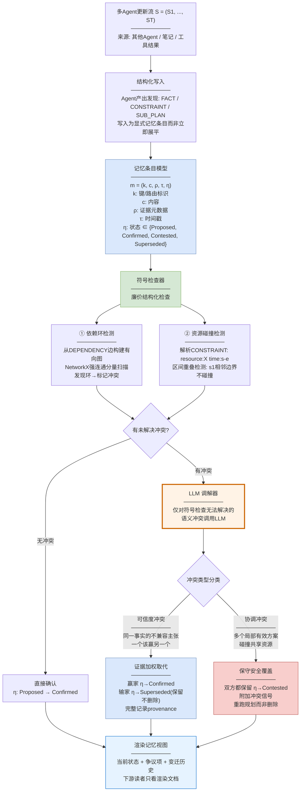
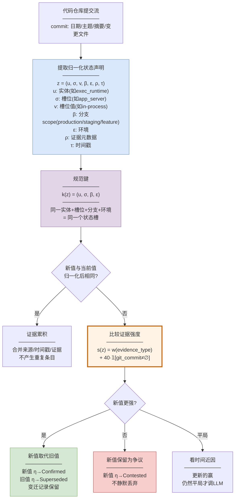
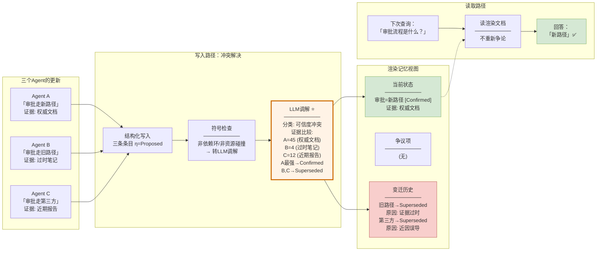
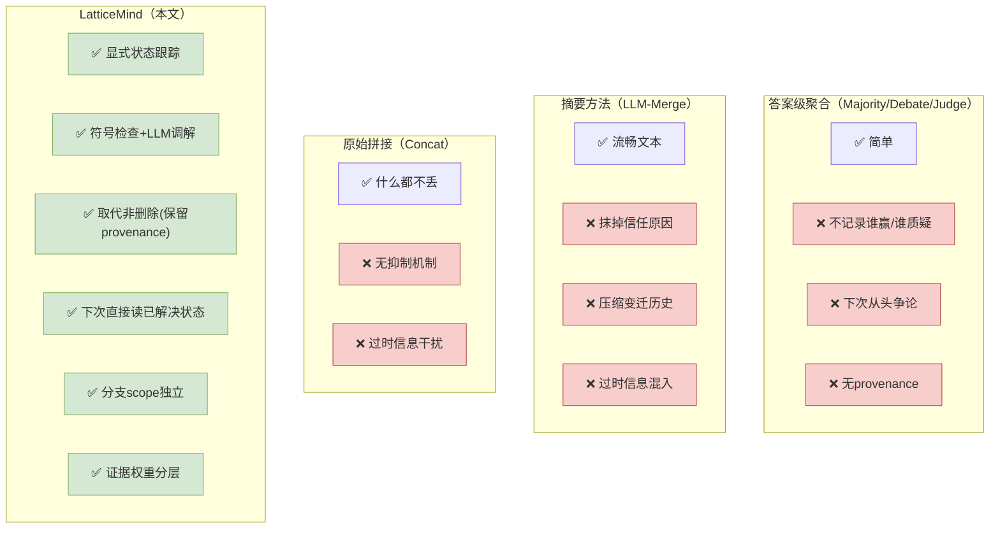

# 论文洞察：LatticeMind — A Conflict-Aware Memory Primitive for Multi-Agent Systems

> **论文**: arXiv:2608.08236 [cs.AI]  
> **标题**: LatticeMind: A Conflict-Aware Memory Primitive for Multi-Agent Systems  
> **作者**: Heng Zhou, Lian Zhang, Yutao Fan, Tiancheng He, Siki Chen, Hejia Geng, Philip Torr, Zhenfei Yin  
> **机构**: 中国科学技术大学 / UIUC / 上海AI实验室 / 北邮 / 牛津大学  
> **日期**: 2026年8月8日

---

## 概述

LatticeMind 提出了一种**冲突感知的记忆原语**，将矛盾处理从"答案选择问题"重新定义为"记忆更新问题"。现有多Agent系统的聚合策略（多数投票、辩论、裁判）只决定输出什么，但不记录哪个主张赢了、哪个被质疑、为什么后来者取代了前者——下次同类问题来了又要从头争论。

LatticeMind 的核心做法：每条记忆条目携带**显式状态**（Proposed/Confirmed/Contested/Superseded），先用**廉价符号检查**捕捉机械冲突（依赖环、资源碰撞），只对无法符号解决的**语义冲突**才调用 LLM 调解。调解分为两条路径——**可信度冲突**（一个主张该赢另一个）走证据加权取代；**协调冲突**（多个局部有效方案碰撞共享资源）保守保留双方并重跑规划。

架构分为两条核心路径：

- **写入路径**：Agent 产出结构化发现 → 符号检查捕捉机械冲突 → LLM 调解解决语义冲突 → 更新条目状态 → 渲染可审计的记忆视图；
- **读取路径**：下游读者只看渲染后的记忆文档（当前状态+争议项+变迁历史），不需要重新争论。

核心思想一句话：**冲突不是在输出时选一个答案，而是在写入时记录谁赢、谁被质疑、为什么取代——下次直接读已解决的状态**。

---

## 一、写入路径



写入路径负责将多Agent的更新流转化为冲突已解决的可审计记忆，包含四个阶段：

### 结构化写入

Agent 产出结构化发现（FACT/CONSTRAINT/SUB_PLAN），写入为显式记忆条目而非立即展平为最终答案。每条条目 m = (k, c, ρ, τ, η) 携带五元组：键（路由标识）、内容、证据元数据、时间戳、状态。**所有条目初始状态为 Proposed**。

### 符号检查器

廉价的结构化检查，不需要 LLM，做两件事：

- **依赖环检测**：从 DEPENDENCY 边构建有向图，用 NetworkX 强连通分量扫描发现环——如果 A 依赖 B、B 依赖 C、C 又依赖 A，就是机械冲突；
- **资源碰撞检测**：解析 CONSTRAINT 内容 `resource:X time:s-e`，对同一资源的区间做重叠检测——如果两个方案都要在同一时间段用同一资源，就是机械冲突。

**为什么先做符号检查**：依赖环和资源碰撞是"机械性"冲突，不需要语义理解就能检测，成本极低。先把这些廉价捕捉的冲突解决，只把真正需要语义判断的冲突留给 LLM——节省 API 调用。

### LLM 调解器

只对符号检查无法解决的**语义冲突**调用 LLM。调解器先分类冲突类型，然后走不同路径：

**可信度冲突**：同一事实的不兼容主张（Agent A 说新政策、Agent B 说旧政策）。走**证据加权取代**：赢家 η→Confirmed，输家 η→Superseded（保留不删除，完整记录 provenance）。

**协调冲突**：多个局部有效方案碰撞共享资源（Agent B 提议周二上线、Agent C 提议周二也有部署窗口）。走**保守安全覆盖**：双方都保留 η→Contested，附加冲突信号，重跑规划而非删除任何一方。

### 渲染记忆视图

最终记忆视图被外部化为文档：当前状态 + 争议项 + 变迁历史。下游读者只看渲染文档，不需要重新争论——**冲突在写入时已解决并持久化**。

---

## 二、软件状态实例化

LatticeMind 的更新规则可实例化到长程软件项目状态追踪场景——这正是"适合编码场景新旧代码逻辑冲突校验"的来源。



### 状态声明模型

代码仓库的每次提交被提取为归一化状态声明 z = (u, σ, v, β, ε, ρ, τ)：

- **u（实体）**：如 `exec_runtime`、`permissions_flow`、`app_server`
- **σ（槽位）**：如 `app_server`、`approvals`、`execution`、`config_reload`
- **v（槽位值）**：如 `in-process`、`request_permissions`、`hot-reload`
- **β（分支scope）**：production / staging / feature-preview——**不同分支的状态可以共存**
- **ε（环境）**：运行环境标识
- **ρ（证据元数据）**：证据类型 + git commit hash
- **τ（时间戳）**：提交时间

### 规范键

$$k(z) = (u, \sigma, \beta, \varepsilon)$$

同一实体+槽位+分支+环境 = 同一个状态槽。**这意味着 production 分支和 feature 分支对同一槽位的不同值可以和平共存**——它们不是冲突，而是不同 scope 的独立状态。只有同一 scope 内的值不一致才是冲突。

### 证据加权取代

$$s(z) = w(\text{evidence type}) + 40 \cdot \mathbf{1}[\text{git commit} \neq \emptyset]$$

| 证据类型 | 权重 |
|---------|------|
| code-change | 60 |
| incident-hotfix | 60 |
| config-observation | 45 |
| runtime-observation | 40 |
| branch-experiment | 25 |
| human-note | 12 |
| stale-observation | 4 |
| **git-commit bonus** | **+40** |

**设计原则**：代码提交的事实权重大于人工笔记，远大于过时观察。git commit bonus（+40）使一条带 commit hash 的代码变更可以直接取代一条无 commit 的人工笔记，不需要 LLM 介入。只有证据强度完全平局时才看时间近因，仍然平局才调 LLM——**LMM 只做非它不可的判断**。

### 四种更新策略

| 策略 | 触发条件 | 动作 |
|------|---------|------|
| 可信度调解 | 同一事实不兼容主张 | 强者Confirmed，弱者Superseded(保留) |
| 协调处理 | 依赖环/资源碰撞 | 双方Contested，重跑规划 |
| 槽位优先合并 | 同键不同值 | 赢家当前状态，输家Contested |
| 证据累积 | 同键同值重现 | 合并来源/时间戳/证据，不产生重复 |

---

## 三、关键设计要点

| 设计要点 | 说明 |
|---------|------|
| 冲突是记忆问题非答案问题 | 不在输出时选一个答案，而在写入时记录谁赢/谁质疑/为什么取代 |
| 显式条目状态 | η ∈ {Proposed, Confirmed, Contested, Superseded}——Superseded是终态不可回退 |
| 符号检查先行 | 依赖环/资源碰撞用NetworkX/区间重叠廉价检测，不调LLM |
| LLM调解仅限语义冲突 | 只对符号检查无法解决的调用LLM，平均每例1.29次 |
| 可信度vs协调分流 | 可信度走证据加权取代，协调走保守保留+重跑规划 |
| 取代非删除 | 输家标记Superseded但保留，完整provenance可审计 |
| 分支scope独立 | (u,σ,β,ε)键使不同分支/环境的值和平共存，不误判为冲突 |
| 证据权重分层 | code-change(60) > human-note(12) > stale-observation(4)，git bonus(+40) |
| 渲染外部化 | 下游只看渲染文档(当前状态+争议+变迁)，不需要重新争论 |
| Label-blind评估 | 去掉来源名称提示，测试真正的冲突解决能力而非信任暗示 |

---

## 四、冲突处理细节（逐关卡解析）

### 4.1 为什么需要冲突感知记忆：现有聚合的盲区

三个 Agent 回答"当前审批政策是什么"：
- Agent A 读到权威文档，写新政策；
- Agent B 只看过时笔记，写旧政策；
- Agent C 引用近期第三方报告，但报告的近因是误导性的。

多数投票：可能B+C赢了（2:1），输出旧政策——错了。
辩论：可能A说服了其他人——但下次同类问题来了又要从头辩论。
裁判：选一个输出——但不记录为什么选这个、另一个为什么被质疑。

**LatticeMind 的做法**：三个主张都写入记忆，A的标Confirmed、B的标Superseded（记录"被A取代，原因是A有权威文档"）、C的标Contested（记录"近因误导，证据不足"）。下次同类问题来了直接读记忆——已解决，不需要重新争论。

### 4.2 第一关：结构化写入——发现不是答案是记忆条目

Agent 产出的不是最终答案，而是结构化发现（FACT/CONSTRAINT/SUB_PLAN）。每条发现写入为记忆条目 m = (k, c, ρ, τ, η)，初始状态 η = Proposed。

**为什么结构化而非自由文本**：自由文本摘要会产生流畅的文字但抹掉"为什么这个事实被信任""它取代了哪个旧主张"。结构化条目强制每个发现携带键、内容、证据、时间戳、状态——后续的状态转换和 provenance 追溯才有基础。

### 4.3 第二关：符号检查——廉价捕捉机械冲突

符号检查器做两件事，都不调 LLM：

**依赖环检测**：从 DEPENDENCY 边构建有向图，用 NetworkX 强连通分量扫描。如果 A 依赖 B、B 依赖 C、C 依赖 A → 环 → 机械冲突。

**资源碰撞检测**：解析 CONSTRAINT `resource:X time:s-e`，对同一资源做区间重叠检测。如果 Agent B 提议周二10-12点用资源X、Agent C 提议周二11-13点也用资源X → 区间重叠 → 机械冲突。

**为什么先做符号检查**：依赖环和资源碰撞是"机械性"的——不需要语义理解就能检测。先把这些廉价解决的冲突处理掉，只把真正需要语义判断的冲突留给 LLM。平均每例1.29次 LLM 调用——远低于每例都调 LLM 的方案。

### 4.4 第三关：LLM 调解——只处理语义冲突 ⭐

符号检查无法解决的冲突（如"Agent A 说新政策 vs Agent B 说旧政策"——两者不构成依赖环也不碰撞资源，但内容矛盾）才调用 LLM 调解器。

调解器先**分类冲突类型**：

**可信度冲突**：同一事实的不兼容主张。走**证据加权取代**：
- 比较证据强度 s(z) = w(evidence_type) + 40·𝟙[git_commit≠∅]
- 强者 η→Confirmed，弱者 η→Superseded（保留不删除）
- 记录取代原因和完整 provenance

**协调冲突**：多个局部有效方案碰撞共享资源。走**保守安全覆盖**：
- 双方都保留 η→Contested
- 附加冲突信号
- 重跑规划而非删除任何一方

**为什么分流**：可信度冲突有明确的"谁对谁错"——证据强的赢。协调冲突没有"谁对谁错"——两个方案可能都合理但互斥（比如两个部署窗口冲突），需要的是重新规划而非选一个。把它们混为一谈会导致要么错误删除合理方案，要么无法解决明确的对错问题。

### 4.5 第四关：状态转换——取代不是删除

记忆条目的状态机：

```
Proposed → Confirmed    （无冲突或调解后赢家）
Proposed → Contested    （有冲突但无法明确解决）
Confirmed → Superseded  （被更强的后续主张取代）
Superseded = 终态        （不可回退）
```

**Superseded 是终态不可回退**：一旦一个主张被标记为 Superseded，它不能"复活"回到 Confirmed。如果旧主张后来又被证明是对的，需要新写一条条目来取代当前的 Confirmed——形成一条取代链。

**取代 ≠ 删除**：被 Superseded 的条目留在记忆里，完整保留 provenance（为什么被取代、被谁取代、什么时候取代）。这使得：
- 当前查询只看 Confirmed 条目（当前可信的事实）；
- 历史查询可以翻 Superseded 条目（过去相信过什么、什么时候改的、为什么改）。

### 4.6 软件状态实例化：代码逻辑冲突校验

在编码场景中，LatticeMind 的更新规则实例化为**槽位优先状态记忆**：

代码仓库的每次提交被提取为状态声明 z = (u, σ, v, β, ε, ρ, τ)。规范键 k = (u, σ, β, ε) 使不同分支/环境的同一槽位值和平共存——production 分支的 `exec_runtime.app_server = in-process` 和 feature 分支的 `exec_runtime.app_server = external` 不是冲突，而是不同 scope 的独立状态。

只有**同一 scope 内的值不一致**才触发冲突解决。新提交改变了某个槽位的值 → 比较证据强度 → 代码提交（weight=60+40bonus）直接取代人工笔记（weight=12）→ 旧值标 Superseded，新值标 Confirmed，变迁记录保留。

**这就是"新旧代码逻辑冲突校验"**：当新提交的代码逻辑与旧笔记/旧文档矛盾时，系统自动用代码证据取代文本证据，并记录变迁——不需要人工审查就能维护"当前可信的项目状态"。

### 4.7 渲染——下游只看已解决的记忆

渲染器产出三样东西：
- **当前状态**：所有 Confirmed 条目——"现在项目是什么状态"
- **争议项**：所有 Contested 条目——"哪些还没有定论"
- **变迁历史**：Superseded 条目及其取代链——"过去是什么状态、什么时候改的、为什么"

下游读者（Agent 或人）只看渲染文档，不需要接触原始冲突——**冲突在写入时已解决并持久化**。

### 4.8 一图看懂关卡顺序

结构化写入（4.2）→ 符号检查机械冲突（4.3）→ LLM调解语义冲突（4.4）→ 状态转换取代非删除（4.5）→ 软件状态实例化（4.6）→ 渲染已解决记忆（4.7）

设计原则：**符号能做的不调LLM（依赖环/资源碰撞），LLM只做语义调解（可信度/协调分类），取代不删除（Superseded保留provenance）**。

---

## 五、大白话版：三个Agent的矛盾怎么写入记忆，下次怎么直接读

假设三个 Agent 在回答"项目的审批流程是什么"：

> **Agent A**（读了权威文档）：审批走新路径——通过 `request_permissions` 工具  
> **Agent B**（只看过时笔记）：审批走旧路径——邮件审批  
> **Agent C**（引了第三方报告）：审批走第三方系统——近因误导

### 传统做法：争论后选一个

多数投票：B+C 赢了（2:1）→ 输出"邮件审批"——错了。  
下次又有人问审批流程？从头争论。

### LatticeMind 做法：写入记忆，解决冲突

**Step 1：结构化写入**

三条发现各自写入记忆：
- m_A = (key=审批流程, content=新路径, evidence=权威文档, η=Proposed)
- m_B = (key=审批流程, content=旧路径, evidence=过时笔记, η=Proposed)
- m_C = (key=审批流程, content=第三方系统, evidence=近期报告, η=Proposed)

**Step 2：符号检查**

三条主张内容矛盾但不是依赖环也不是资源碰撞 → 符号检查无法解决 → 转给 LLM 调解。

**Step 3：LLM 调解**

调解器分类：这是**可信度冲突**（同一事实的不兼容主张，一个该赢）。

证据比较：
- m_A：权威文档 → evidence_type = config-observation (weight=45)
- m_B：过时笔记 → evidence_type = stale-observation (weight=4)
- m_C：近因误导的报告 → evidence_type = human-note (weight=12)

m_A 最强 → η_A → Confirmed；m_B → Superseded（保留，记录"被m_A取代，原因：证据过时"）；m_C → Superseded（保留，记录"被m_A取代，原因：近因误导"）。

**Step 4：渲染**

渲染文档：
```
当前状态：
  审批流程 = 新路径（request_permissions工具）
  [Confirmed] 证据：权威文档

争议项：
  （无）

变迁历史：
  旧路径（邮件审批）→ Superseded
    被取代原因：证据过时（stale-observation）
    被取代时间：2026-08-08
  第三方系统 → Superseded
    被取代原因：近因误导
```

**下次有人问审批流程**：直接读渲染文档 → "新路径" → 不需要重新争论。

### 软件状态场景：新旧代码逻辑冲突

代码仓库的两次提交：
- **commit a684a** (1月)：`exec_runtime.app_server = external`（外部app server）
- **commit da368** (3月)：`exec_runtime.app_server = in-process`（切换到进程内）

同时有一条**旧文档笔记**（2月写的）：`exec_runtime.app_server = external`

**LatticeMind 处理**：
- 规范键 k = (exec_runtime, app_server, production, default) → 同一槽位
- 新值 in-process（commit da368, evidence=code-change, weight=60+40=100）
- 旧值 external（commit a684a, evidence=code-change, weight=60+40=100）→ 平局
- 旧文档笔记 external（evidence=human-note, weight=12）→ 最弱
- 看时间近因：da368(3月) > a684a(1月) → da368 赢
- 结果：`exec_runtime.app_server = in-process` [Confirmed]，`external` [Superseded]

**这就是"新旧代码逻辑冲突校验"**：新提交的代码逻辑自动取代旧文档，不需要人工审查。

---

## 六、加工结果全景图



怎么读这张图：
- 左侧三个 Agent 产出不兼容主张，全部写入记忆（不立即选一个）；
- 中间写入路径：符号检查无法解决（非机械冲突）→ LLM 调解分类为可信度冲突 → 证据加权比较 → A 最强 Confirmed，B/C Superseded（保留不删除）；
- 右侧渲染记忆：当前状态（新路径 Confirmed）+ 变迁历史（旧路径/第三方被取代的原因）；
- 下次查询直接读渲染文档，不重新争论。

---

## 七、实验结果

### 7.1 主实验：ConflictBank（Label-blind协议）

| 方法 | 准确率 | 与LatticeMind的McNemar检验 |
|------|--------|--------------------------|
| No-Merge | 0.32 | p=3.6×10⁻¹⁵ (49/0) |
| Debate | 0.45 | p=3.8×10⁻¹¹ (40/1) |
| Judge | 0.60 | p=5.8×10⁻⁸ (29/1) |
| Majority Vote | 0.61 | p=1.1×10⁻⁷ (28/1) |
| Single-Agent | 0.63 | p=2.2×10⁻⁷ (27/1) |
| **LatticeMind** | **0.97** | *reference* |

- **0.97 vs 最强baseline 0.63**——36个百分点差距
- 所有baseline在p<10⁻⁶水平被拒绝
- Label-blind协议（去掉来源名称提示）下，所有baseline降8-15分，LatticeMind仅降2分——证明优势不靠名称暗示

### 7.2 消融实验

| 配置 | 准确率 | 冲突残留率 | ΔF1 |
|------|--------|----------|-----|
| 完整 | **0.96** | **0.00** | — |
| −checker | 0.84 | 0.10 | -12 |
| −reconciler | 0.82 | 0.08 | -14 |
| 完整(重复) | 0.96 | 0.02 | 0 |

- 移除符号检查器：降12分（p=0.07，受50样本限制）
- 移除LLM调解器：降14分（p<0.05，显著）
- **两者互补**：检查器捕捉机械冲突，调解器解决语义冲突，缺一不可

### 7.3 软件状态追踪

| 方法 | Budgeted long-noise | Repo bridge |
|------|-------------------|-------------|
| Concat | 0.52 | 0.18 |
| LLM-Merge | 0.51 | **0.61** |
| LLM-Merge-Inc | 0.70 | 0.41 |
| **StateMemory** | **0.83** | 0.51 |

**按指标分解（Budgeted long-noise）**：

| 指标 | Concat | LLM-Merge | LLM-Merge-Inc | StateMemory |
|------|--------|-----------|--------------|-------------|
| 当前状态 | 0.78 | **1.00** | **1.00** | **1.00** |
| Scope状态 | 0.78 | 0.89 | 0.89 | **0.89** |
| Provenance | 0.50 | 0.00 | 0.61 | **0.81** |
| 时序推理 | 0.23 | 0.18 | 0.38 | **0.77** |
| 过时抑制 | 0.67 | 0.78 | 0.78 | **0.78** |

核心发现：
- **Provenance（0.81 vs 0.61）和时序推理（0.77 vs 0.38）是最大优势**——自由文本摘要压缩掉了"为什么信任这个事实"和"什么时候改的"
- Authority-overwrite场景：Concat 0.25 vs StateMemory 0.83——过时主张必须主动抑制时结构化记忆优势最大

### 7.4 学习算子泛化

用QLoRA在Qwen2.5-14B上训练三个算子：

| 算子 | 5折留一均值 |
|------|-----------|
| compare-claims | **1.00** |
| update-memory | **1.00** |
| extract-state | 0.30 → 0.48(两阶段) |

- **冲突解决规则完全可学习且跨仓库泛化**（compare/update均1.00饱和）
- **瓶颈在提取而非冲突解决**——extract-state均值0.30，两阶段提升到0.48

---

## 八、与现有方法的本质区别



| 维度 | 答案级聚合 | 摘要方法 | 原始拼接 | **LatticeMind** |
|------|----------|---------|---------|----------------|
| 冲突解决时机 | 输出时 | 写入时(有损) | 不解决 | **写入时(无损)** |
| 条目状态 | 无 | 无 | 无 | **Proposed/Confirmed/Contested/Superseded** |
| Provenance | 无 | 抹掉 | 保留但无结构 | **显式记录** |
| 过时抑制 | 无 | 无 | 无 | **证据权重取代** |
| 下次复用 | 重新争论 | 读摘要 | 读全文 | **读已解决状态** |
| 分支scope | 不区分 | 不区分 | 不区分 | **(u,σ,β,ε)独立** |

---

## 九、一句话总结全过程

**写入**：Agent产出结构化发现（FACT/CONSTRAINT/SUB_PLAN）→ 全部写入记忆 η=Proposed → 符号检查器廉价捕捉依赖环/资源碰撞（不调LLM）→ 只对语义冲突调LLM调解（平均1.29次/例）→ 分类可信度（证据加权取代）vs协调（保守保留+重跑规划）→ 赢家Confirmed，输家Superseded（保留不删除）。

**软件状态实例化**：代码提交→提取(u,σ,v,β,ε,ρ,τ)→规范键(u,σ,β,ε)使不同分支scope独立→证据权重 code-change(60)+git-bonus(40) > human-note(12) > stale-observation(4)→新代码自动取代旧文档。

**读取**：下游只看渲染文档（当前状态+争议项+变迁历史）→ 不重新争论。

核心转变：**从"每次争论选一个答案"到"写入时解决冲突并持久化"**——0.97 vs 0.63准确率，证明标签盲测下真正的冲突解决能力。消融证明符号检查器和LLM调解器互补（各降12-14分）。学习算子研究中 compare-claims/update-memory 均达1.00饱和——冲突解决规则完全可学习且跨仓库泛化，瓶颈在提取。

---

*报告生成日期: 2026-10-12*
