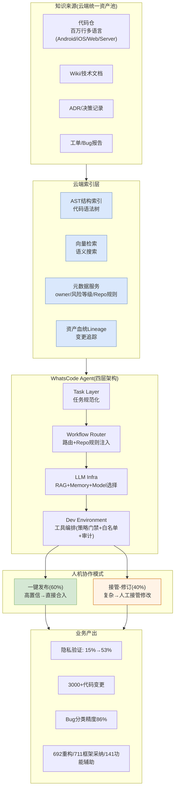

# WhatsCode — Meta/WhatsApp 资产治理解决方案视图

> arXiv: [2512.05314](https://arxiv.org/abs/2512.05314) | ICSE-SEIP 2026 | 25个月部署(2023-2025)

---

## 解决方案全景图



---

## 核心架构：四层分离

| 层 | 职责 | 关键设计 |
|----|------|---------|
| **Task Layer** | 将开发者意图规范化为任务类型(新功能/自动修复/测试生成/自由任务) | 统一接口，分类路由 |
| **Workflow Router** | 任务→可执行计划，选择执行组件 | Repo规则注入(owner/构建约定/测试约定)；子Agent委派；Agentless管道复用；模型选择(第三方+Meta AI) |
| **LLM Infra** | LLM基础设施 | RAG(代码+文档动态检索)；深度研究(异构知识综合)；Memory(跨步骤上下文+自动压缩) |
| **Dev Environment** | 开发者工具抽象 | 策略门禁(操作前验证)；白名单命令执行(按Repo定制)；Provenance审计 |

---

## 资产治理机制

### 1. 统一资产池(云端模式)

```
代码 + Wiki + ADR + 工单 → 统一索引
├── AST结构索引(代码语法树)
├── 向量检索(语义搜索)
├── 元数据(owner / 风险等级 / Repo规则)
└── 资产血统Lineage(变更追踪)
```

**不是每个仓存一套资产**——万亿行代码集中索引，Agent从云端服务检索上下文。

### 2. 动态上下文装配(三层策略)

| 策略 | 做什么 | 例子 |
|------|--------|------|
| 多源检索 | RAG + 深度研究，按需获取 | 代码库 + Wiki + 技术文档 + 帖子 |
| 动态规则注入 | 按文件路径/规则scope自动加载 | 编辑Android文件→注入Android规则 |
| Memory管理 | 跨步骤保持上下文 + 自动压缩 | 多周功能开发期间上下文连续性 |

### 3. 代码变更自动触发索引更新

```
代码commit合入 → 资产血统Lineage检测 → 自动更新AST/向量/元数据索引
```

### 4. 黑名单过滤

test/废弃目录默认不进Agent上下文。

### 5. 人机协作(两种稳定模式)

| 模式 | 占比 | 触发条件 | 流程 |
|------|------|---------|------|
| 一键发布 | 60% | 高置信 | Agent→diff→人审→一键合入 |
| 接管-修订 | 40% | 复杂决策 | Agent→diff→人接管修改→合入 |

### 6. 四级自治等级

```
Level 1: 纯建议(人审后决定)
Level 2: 有条件自动(通过验证后自动)
Level 3: 人审后自动合入
Level 4: 全自动(无需人审)
```

---

## 演进路径(25个月)

```
2023 Foundation Era: 隐私自动化
  ├── PrivacyCAT: 需求映射(RAG+JSON)
  ├── 隐私审查发现(向量库+代码→审查链接)
  └── 覆盖率 15%→53%

2024 Agentless Era: 确定性工作流
  ├── 11种lint类型自动修复(Java/Erlang/C++/Swift/Kotlin)
  ├── 1000+代码变更合入
  └── 限制: 单文件单上下文，扩展需人工模板

2025 Agentic Era: 自主Agent
  ├── 四层架构(Task/Router/LLM/DevEnv)
  ├── 端到端功能开发(发现→设计→规划→执行→运营)
  ├── Bug分类(90%精度) + 事故调查(21%根因识别)
  └── 跨仓协调 + 审查驱动迭代
```

---

## 我们借鉴的技术点

| WhatsCode做法 | 我们方案对应 | 借鉴价值 |
|--------------|------------|---------|
| AST+向量+元数据多源检索 | 检索增强: 语义+结构双索引 | ⭐⭐⭐ |
| 代码变更自动触发索引更新 | 增量同步: commit合入触发检测 | ⭐⭐⭐ |
| 资产带owner/风险等级 | 审核: 审核清单按owner分发+高风险优先 | ⭐⭐ |
| test/废弃目录黑名单 | 审核: 黑名单过滤减少25%扫描量 | ⭐⭐⭐ |
| 一键发布+接管-修订 | 增量同步: 高置信自动刷新/低置信给田主 | ⭐⭐ |
| 四级自治等级 | 审核: 置信度分级跳过/标存疑 | ⭐⭐ |

---

*生成日期: 2026-10-15*
