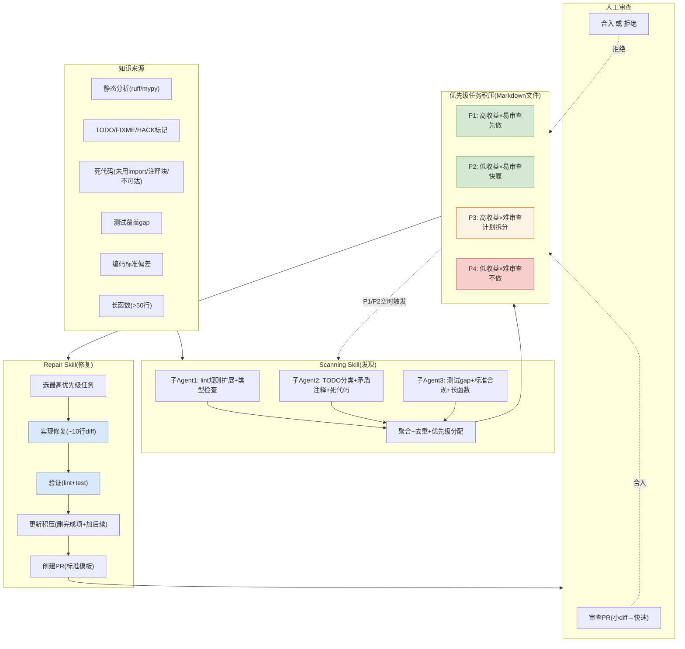

# Pomona — Bloomberg 资产治理解决方案视图

> arXiv: [2606.06752](https://arxiv.org/abs/2606.06752) | ISSRE'26 Industry Track | 3个月团队部署

---

## 解决方案全景图



---

## 核心架构：Scanning + Repair 双技能循环

### Kaizen哲学：持续小步改进

```
Scanning(发现) → Backlog(优先级) → Repair(小PR) → 人审 → 更新Backlog → 循环
```

### 任务发现：三路并行子Agent

| 子Agent | 扫什么 | 优先级分配 |
|---------|--------|-----------|
| 子Agent 1 | ruff规则扩展 + mypy严格类型检查 | 按收益×易审查矩阵 |
| 子Agent 2 | TODO/FIXME/HACK/XXX标记 + 矛盾注释 + 死代码 | 自文档化删除=P1, 清晰修复=P1/P2, 需调查=P3, 愿景=P4 |
| 子Agent 3 | 测试覆盖gap + 编码标准合规 + 长函数(>50行) | 纯逻辑模块优先, 复杂分支优先 |

### 优先级矩阵(收益×易审查)

| | 易审查 | 难审查 |
|---|--------|--------|
| **高收益** | P1 先做 | P3 值得做，计划拆分 |
| **低收益** | P2 快赢 | P4 停车场(不做) |

### 小diff约束

- 每个PR强制约10行diff
- 超过则拆分(如:一次只lint一个目录，后续加到Backlog)
- 后期调整为100行上限 + 确定性检查自动拒绝超限PR

---

## 资产治理机制

### 1. Backlog即资产(Markdown文件随仓库版本管理)

```
backlog.md (仓库根目录)
├── P1: [BUG] mutable default parameters in auth.py:42
├── P1: [DEAD] unused import in models.py:15
├── P2: [STYLE] reorder imports in utils.py
├── P3: [TODO] refactor payment flow (needs investigation)
└── P4: [ASPIRATION] migrate to async framework
```

**特性**：集中存储 + 随代码版本管理 + 人可手动编辑 + git历史追踪

### 2. 全链路审计

```
每个PR包含:
├── 动机(为什么要改)
├── 资源链接(相关lint规则/TODO/标准)
├── 改动内容(小diff)
├── 验证结果(lint+test通过)
└── AI生成标记(emoji前缀)
```

### 3. 人机协作(低摩擦+低风险)

| 设计原则 | 实现 |
|---------|------|
| 低摩擦 | 发现和修复全自动后台运行，不改变开发活动 |
| 低风险 | 人审后才合入，小diff降低审查负担 |
| 聚焦质量 | 只做质量改进，不做功能开发 |

### 4. 变更风险分级

- 高风险模块: 限制修改范围
- 资产优先级: 主分支权威代码 > 历史PR/Bugfix，过滤临时/实验分支

---

## 部署效果

| 指标 | 数据 |
|------|------|
| PR合并率 | 32/39 = 82.1% |
| 中位关闭时间 | 2小时14分钟 |
| 无修改合入 | 25/32 (78%) |
| 问卷意愿 | 10/12 愿意采用 |
| 最受欢迎特性 | 小diff(10/12) + 聚焦质量(10/12) |

---

## 我们借鉴的技术点

| Pomona做法 | 我们方案对应 | 借鉴价值 |
|------------|------------|---------|
| 小diff降低审核负担 | 审核: 只把存疑项给田主(审核量降低) | ⭐⭐⭐ |
| 收益×易审查优先级矩阵 | 审核: 按风险等级排序检测项 | ⭐⭐ |
| 过滤临时/实验分支 | 审核: 黑名单过滤(置信度低的跳过) | ⭐⭐ |
| Backlog随仓库版本管理 | 资产: 审核清单随代码仓存储 | ⭐⭐ |
| Scanning+Repair双技能 | 检测+spec-update刷新(发现+修复循环) | ⭐⭐ |

---

*生成日期: 2026-10-15*
