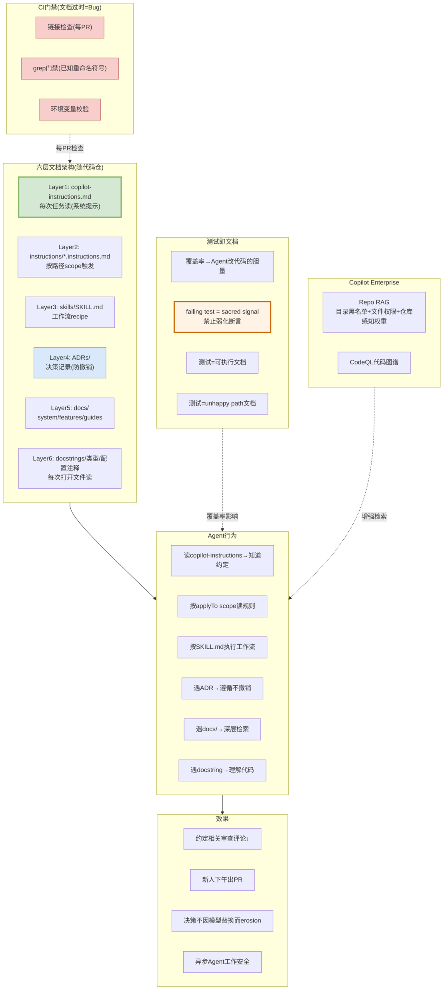

# Documentation Is the New Source Code — Microsoft ISE 资产治理解决方案视图

> [devblogs.microsoft.com/ise](https://devblogs.microsoft.com/ise/documentation-is-the-new-source-code/) | 2026年9月 | Liza Shakury

---

## 解决方案全景图



---

## 核心架构：六层文档 = Agent的系统提示词

### 核心原则

> **"things the model needs on every task go in the system prompt; things it occasionally needs live one grep away"**

| 层 | 文件 | Agent何时读 | 作用 |
|----|------|-----------|------|
| L1 | `.github/copilot-instructions.md` | 每次任务 | 架构概览+配置+环境变量+开发命令+CI门禁+Git约定+跨切面约定 |
| L2 | `.github/instructions/*.instructions.md` | 编辑匹配applyTo路径 | 后端规则(编辑Python时) / 前端规则(编辑TS时) |
| L3 | `.github/skills/<name>/SKILL.md` | 工作流被调用时 | PR创建/审查/issue总结等recipe |
| L4 | `ADRs/NNN-*.md` | 被链接或搜索时 | **防止AI撤销已定决策**: "Did you read ADR 007?" |
| L5 | `docs/system|features|guides/` | 深层检索时 | 系统架构/每个功能一篇/操作指南 |
| L6 | docstrings/类型提示/配置注释 | 每次打开文件时 | 代码级文档，最小粒度 |

---

## 资产治理机制

### 1. 文档过时 = CI Bug

```
每PR自动检查:
├── 链接检查: docs/中的链接是否有效
├── grep门禁: 已重命名符号是否还出现在docs/
└── 环境变量校验: copilot-instructions.md中的env var是否还存在
```

**不做事后全量审查**——每PR检查，文档过时就阻止合入。

### 2. ADR防止AI撤销决策

```
场景: AI提议用pattern X
↓
ADR 007: "我们否决了X，因为Y"
↓
AI: "Did you read ADR 007?" → 自动遵循，不撤销
```

**没有ADR**: AI每次都会重新提议被否决的pattern（模型没有跨session记忆）。
**有ADR**: AI在建议中引用ADR，循环闭合。

### 3. 测试是唯一Agent可执行的文档

| 测试的作用 | 说明 |
|-----------|------|
| 覆盖率→胆量 | 覆盖好的模块Agent大胆改；没测试的模块Agent小心改 |
| failing test = sacred signal | 禁止Agent弱化断言让测试变绿: "fix the code, not the assertion" |
| 测试=unhappy path文档 | 测试捕获: 空输入/超时/并发竞争/配置缺失——AI最易幻觉的场景 |
| 测试=可执行示例 | Agent grep测试文件学习函数契约 |

### 4. 文档风格指南(AI可读)

| 规则 | 为什么 |
|------|--------|
| 开头放数据流 | Agent在读规则前先理解全局 |
| 表格优于散文 | 表格让Agent一眼回答"LOG_LEVEL默认值是什么" |
| 写出确切命令 | Agent会粘贴你写的，所以确保可粘贴 |
| **标注审查日期** | `Last reviewed: 2026-05` → 过时信号 |
| 链接不要复制 | 顶层指向ADR/guides，Agent按需深入 |
| 编码否定项 | "不要给没改的代码加docstring" → 抑制AI的默认扩张行为 |
| 过时就删除 | 过时文档比没有更糟(主动误导) |

### 5. 资产归档方式: 全部随代码仓

```
代码仓/
├── .github/
│   ├── copilot-instructions.md     ← L1
│   ├── instructions/*.instructions.md  ← L2
│   └── skills/<name>/SKILL.md     ← L3
├── ADRs/                           ← L4
├── docs/
│   ├── system/                     ← L5
│   ├── features/
│   └── guides/
├── src/
│   └── *.py (docstrings)           ← L6
└── tests/                          ← 可执行文档
```

**不存云端**——全部随代码仓，版本跟代码走，PR一起审，CI一起检查。

---

## 我们借鉴的技术点

| Microsoft做法 | 我们方案对应 | 借鉴价值 |
|-------------|------------|---------|
| 六层文档架构 | specgo四域资产(0-arch/0-biz/0-tech/0-qual) | ⭐⭐ 对标 |
| 文档过时=CI Bug | 增量同步: commit合入触发增量过时检测 | ⭐⭐⭐ |
| ADR防止AI撤销决策 | 生成增强: 领域大模型注入防止AI写错业务语义 | ⭐⭐ |
| **标注审查日期** | 审核: 最久没审的优先检测 | ⭐⭐⭐ |
| 测试是可执行文档 | specgo qual/dt-guidelines(测试覆盖率门禁) | ⭐⭐ |
| grep门禁+链接检查 | 审核: CI检查资产与代码一致性 | ⭐⭐⭐ |
| 编码否定项(抑制AI扩张) | 生成: analyze skill加约束"不写没改的" | ⭐⭐ |

---

*生成日期: 2026-10-15*
