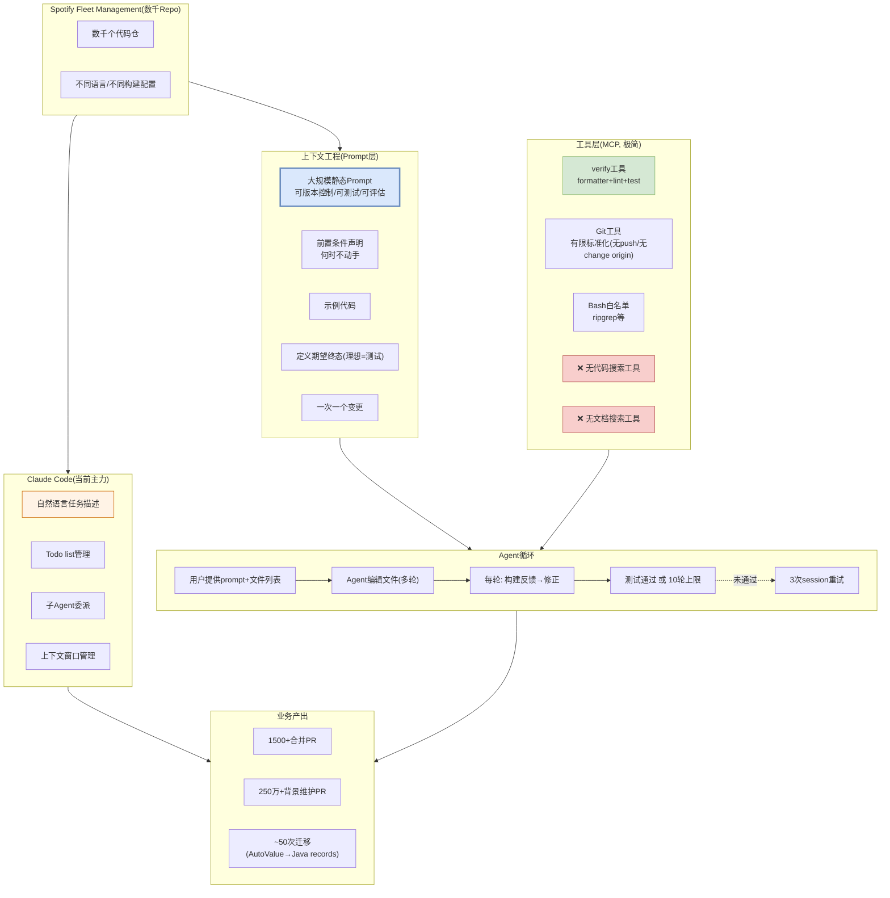

# Background Coding Agents (Honk) — Spotify 资产治理解决方案视图

> [engineering.atspotify.com](https://engineering.atspotify.com/2025/11/context-engineering-background-coding-agents-part-2) | 2025-2026 | 数千Repo规模

---

## 解决方案全景图



---

## 核心架构：上下文工程是核心挑战

### 关键认知

> "How do we tell our background coding agent what to do?" — 上下文工程是大规模Agent的核心难题

### Agent选型演进

| 阶段 | Agent | 问题 |
|------|-------|------|
| v1: 开源Agent | Goose/Aider | 难以产出可合并PR |
| v2: 自研agentic loop | 自研 | 需要用户写git-grep选文件(太广爆context/太窄不够用)；复杂多文件变更跑超10轮 |
| v3: Claude Code | Anthropic | 自然语言任务描述+Todo管理+子Agent+上下文管理 → **当前主力** |

### Prompt设计六大原则

| 原则 | 说明 |
|------|------|
| 为Agent量身定制 | 自研Agent要步骤式prompt；Claude Code要终态描述 |
| 声明前置条件 | "何时不动手"(语言级别不支持时) |
| 用示例 | 少量具体代码示例影响输出 |
| 定义期望终态 | 理想形式=测试("make code better"不是好prompt) |
| 一次一个变更 | 多变更合并→耗尽context window→部分结果 |
| 向Agent要prompt反馈 | session后Agent自己知道prompt缺什么 |

### 工具层设计(极简策略)

**为什么极简**: 工具越多→不可预测的维度越多。静态prompt可版本控制/可测试/可评估。

| 有什么 | 为什么 | 
|--------|-------|
| verify工具(formatter+lint+test) | 封装内部构建系统，减少噪声 |
| Git工具(有限) | 无push/无change origin，标准化commit |
| Bash白名单 | ripgrep等 |

| 没什么 | 为什么 |
|--------|--------|
| ❌ 代码搜索工具 | 要求用户将相关上下文前置到prompt中 |
| ❌ 文档搜索工具 | 或通过单独的工作流Agent生成prompt |

---

## 资产治理机制

### 1. 存量代码统一元模型

```
数千Repo → 统一元模型
├── API废弃标记
├── 兼容约束
├── 跨模块依赖契约
└── 服务/模块资产域隔离
```

### 2. 代码变更自动刷新知识索引

```
Agent改代码 → 合入PR → 自动刷新知识索引 → 下次Agent读到最新资产
```

### 3. 跨模块修改自动拉取依赖契约

```
Agent改模块A的公开方法 → 自动拉取所有调用方(模块B/C/D) → 级联修改
```

### 4. 资产归档方式: 云端索引+代码仓

```
代码仓(数千个)
    │
    │ ← 代码变更触发
    ↓
云端知识索引服务
├── 统一元模型
├── API废弃/兼容标记
├── 依赖契约
└── 向量检索索引
    │
    │ ← Agent检索时调用
    ↓
Claude Code / 自研Agent
```

### 5. Prompt即资产(版本控制)

```
prompts/
├── migrate-autovalue-to-records.md   ← 可版本控制
├── update-deployment-manifest.md     ← 可测试
└── swap-config-flag.md               ← 可评估性能
```

Prompt作为**可版本控制的静态资产**，而非动态MCP工具调用——这是Spotify的关键设计决策。

---

## 反模式(Anti-patterns)

| 反模式 | 问题 |
|--------|------|
| 过度泛化的prompt | 期望Agent心灵感应猜意图 |
| 过度具体的prompt | 遇到意外情况就崩溃 |
| 动态工具过多 | 增加不可预测维度 |

---

## 我们借鉴的技术点

| Spotify做法 | 我们方案对应 | 借鉴价值 |
|------------|------------|---------|
| 存量代码统一元模型 | specgo四域资产模型(arch/biz/tech/qual) | ⭐⭐ 对标 |
| 按服务/模块资产域隔离 | specgo按功能域拆分文档 | ⭐⭐ 对标 |
| 代码变更自动刷新知识索引 | 增量同步: spec-update增量刷新 | ⭐⭐⭐ |
| 跨模块修改拉取依赖契约 | 检索: AST结构指纹+代码位置索引 | ⭐⭐ |
| Prompt即资产(版本控制) | 资产: 各域README索引(随代码仓) | ⭐⭐ 对标 |
| 极简工具策略 | 不过度设计(我们的原则) | ⭐⭐⭐ |

---

*生成日期: 2026-10-15*
