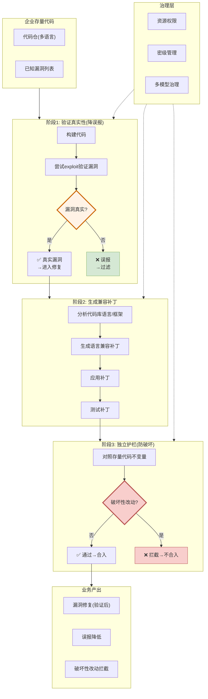

# CodeMender — Google/DeepMind 资产治理解决方案视图

> [cloud.google.com/security/codemender](https://cloud.google.com/security/codemender) + [DeepMind博客](https://deepmind.google/blog/introducing-codemender-an-ai-agent-for-code-security/) | Google Cloud托管产品

---

## 解决方案全景图



---

## 核心架构：验证→修复→回归 三阶段独立护栏

### 核心原则

> **"验证真实性再修复"** — 不验证就标记=误报；不护栏就合入=破坏

### 阶段1: 验证真实性

```
漏洞报告 → 构建代码 → 尝试exploit → 漏洞真实?
├── 是: 进入修复
└── 否: 过滤(不浪费工程师时间)
```

**关键**：先验证再标记存疑——降低误报率。不做"可能有问题"的模糊标记。

### 阶段2: 生成兼容补丁

```
分析代码库语言/框架 → 生成语言兼容补丁 → 应用 → 测试
```

### 阶段3: 独立护栏(防破坏)

```
补丁 → 对照存量代码不变量 → 破坏性改动?
├── 否: 合入
└── 是: 拦截(不合入)
```

**独立护栏**: 不是让同一个Agent既修又审，而是独立的检查机制。

---

## 资产治理机制

### 1. 验证后再标记存疑

```
传统: 漏洞扫描 → 标记100个"可能有问题" → 工程师审95个误报
CodeMender: 漏洞扫描 → 构建验证 → 只标5个真实漏洞 → 工程师审5个
```

### 2. 对照存量代码不变量

```
存量代码不变量:
├── 函数契约(input X → output Y)
├── 并发安全约束
├── 性能基线
├── API兼容性
└── 配置依赖关系

Agent改代码 → 检查不变量是否被破坏 → 破坏则拦截
```

### 3. 资源权限+密级+多模型治理

| 治理维度 | 作用 |
|---------|------|
| 资源权限 | Agent只能访问授权的代码/工具 |
| 密级管理 | 不同密级代码用不同模型处理 |
| 多模型治理 | 不同任务用不同模型(安全/性能/质量) |

### 4. 资产归档方式: 云端托管产品

```
Google Cloud(托管)
├── CodeMender Agent
├── 代码索引(云端)
├── 漏洞数据库
├── 不变量基线
└── 审计日志
    │
    │ ← 接入企业代码仓
    ↓
企业代码仓(客户侧)
```

---

## 与其他大厂的关键差异

| 维度 | CodeMender | WhatsCode | Microsoft ISE |
|------|-----------|-----------|---------------|
| **核心场景** | 安全漏洞修复 | 全流程开发效率 | 文档即系统提示 |
| **验证机制** | 先exploit验证再修复 | 四级自治等级 | CI门禁(链接/grep/env) |
| **护栏** | 独立护栏(对照不变量) | 策略门禁+白名单 | failing test = sacred |
| **资产归档** | 云端托管 | 云端索引 | 随代码仓 |
| **误报控制** | ⭐验证真实性降误报 | 人机协作60/40 | 过时=CI Bug |

---

## 我们借鉴的技术点

| CodeMender做法 | 我们方案对应 | 借鉴价值 |
|---------------|------------|---------|
| **验证真实性再标记存疑** | 审核: 置信度评分(先验证再标存疑) | ⭐⭐⭐ |
| 对照存量代码不变量拦截破坏性改动 | 审核: 代码AST比对事实(Ground Truth) | ⭐⭐ |
| 独立护栏(修复和审查分离) | 审核: 检测器与生成器分离 | ⭐⭐ |
| 资源权限+密级管理 | 暂不需要(单仓场景) | ⭐ |

---

*生成日期: 2026-10-15*
