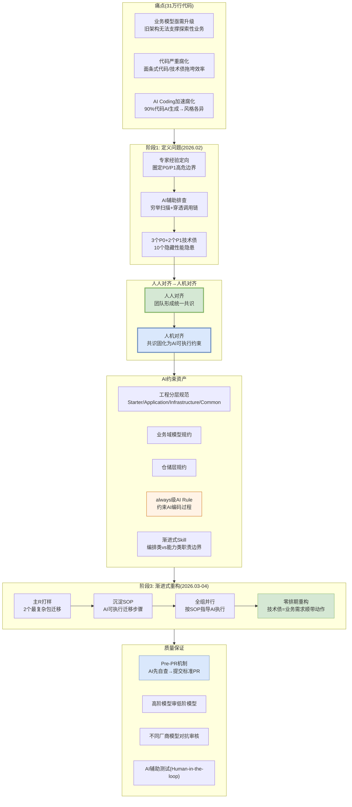

# 美团 — 31万行代码AI重构 资产治理解决方案视图

> [tech.meituan.com](https://tech.meituan.com/2026/05/07/Agent-AI-Coding.html) | 2026年5月 | 31万行代码 / 90%AI生成

---

## 解决方案全景图



---

## 核心方法论：人人对齐→人机对齐

### 核心认知

> "管理AI Coding与评测Agent的底层逻辑一模一样——先让人形成统一共识，再将共识固化为AI可执行约束"

### 顺序至关重要

```
❌ 错误顺序: 直接写AI Rule → 不同人不同解释 → 失败
✅ 正确顺序: 人人对齐(团队共识) → 人机对齐(AI Rule) → 成功
```

### 从评测Agent到管理Coding的方法论复用

| 评测Agent | 管理AI Coding |
|-----------|--------------|
| 标准对齐(1个独裁者好过10个民主者) | 团队工程标准对齐 |
| 人机对齐(人机一致率≥90%) | AI Rule约束大模型产出 |
| 评测指标优化 | 规范前置到Pre-CR环节 |

---

## 资产治理机制

### 1. 团队共识固化为Rule资产

```
团队共识/编码规约/历史坑/业务边界
  ↓ 人人对齐
工程分层规范 + 业务域模型规约 + 仓储层规约
  ↓ 人机对齐
always级AI Rule(约束AI编码过程)
  + 渐进式Skill(编排类vs能力类职责边界)
  + Pre-CR环节(提交前规范校验)
```

### 2. SOP即资产(可复用迁移步骤)

```
主R打样(2个最复杂包)
  ↓ 沉淀SOP
AI可执行迁移步骤:
  Step1: 补齐业务对象+数据转换层
  Step2: Application层重建接口契约
  Step3: 修复上游全链路参数依赖
  ↓ 全组并行
其他成员按SOP指导AI完成剩余包迁移
```

### 3. Pre-PR机制(审核前置)

```
传统: AI生成代码 → 人工CR(规范+逻辑+Bug全看) → 瓶颈
美团: AI生成代码 → AI自查(规范+Bug+异常+一致性+性能) → 标准PR → 人工只看业务逻辑
```

| CR分工 | 谁做 |
|--------|------|
| 规范类问题 | AI审查 |
| Bug类/异常处理 | AI审查 |
| 业务逻辑初筛 | AI审查 |
| 技术方案评审 | 人(前置) |
| 业务逻辑最终判断 | 人(Review) |

### 4. 多模型对抗审查

```
高阶模型 → 审查 → 低阶模型产出    (Judge Model)
不同厂商模型A → 审查 → 不同厂商模型B产出    (互补)
```

### 5. AI辅助测试(Human-in-the-loop)

| 步骤 | 人做什么 | AI做什么 |
|------|---------|---------|
| 建立范围 | 审核测试范围 | 流量监控+代码变更双向扫描 |
| 风险分级 | 判定风险等级 | 读代码回答: 改了多少/分支在哪/旧数据兼容 |
| 设计分组 | 审核分组合理性 | 判定表先拆后合生成最小Case组合 |
| 生成步骤 | 校验步骤匹配改动 | 一步操作多维验证模板展开 |
| 验证覆盖 | 确认无盲区 | 接口×维度覆盖矩阵自动生成 |

### 6. 零排期重构(技术债=业务需求顺带动作)

```
传统重构: 推倒重来 或 申请专项排期
美团路径: 技术债拆解 → 借业务需求迭代"顺带"消化
  ├── 借功能迭代需求 → 顺势设计新业务模型
  ├── 借功能升级需求 → 设计新质检模型+全量迁移
  └── 不停止业务交付 → 渐进式消化
```

### 7. 资产归档方式: 随代码仓

```
代码仓/
├── .cursor/rules          ← AI Rule(always级)
├── .cursor/skills         ← Skill(渐进式加载)
├── docs/
│   ├── engineering-standards/  ← 工程分层规范
│   ├── domain-models/          ← 业务域模型规约
│   └── repository-standards/   ← 仓储层规约
└── src/
    └── (四层架构: Starter/Application/Infrastructure/Common)
```

---

## 关键经验

| 经验 | 说明 |
|------|------|
| AI重新定义经验价值 | "能看全"→门槛为零；经验价值=能判断什么重要 |
| 技术债可迭代消化 | 不需排期，拆解为业务需求顺带动作 |
| 工程师角色变了 | 从"写代码"→"设计并维护能让AI可靠产出的工程环境" |

---

## 我们借鉴的技术点

| 美团做法 | 我们方案对应 | 借鉴价值 |
|---------|------------|---------|
| 团队共识固化为Rule资产 | 生成增强: 领域大模型注入(业务语义校验) | ⭐⭐⭐ |
| always级AI Rule约束生成 | 生成: analyze skill加约束(不写没改的) | ⭐⭐ |
| Pre-PR机制(AI先自查) | 审核: 置信度评分(高置信跳过) | ⭐⭐ |
| 高阶模型审低阶模型 | 审核: 领域大模型校验逆向资产 | ⭐⭐⭐ |
| 不同厂商模型对抗 | 暂不需要(单领域场景) | ⭐ |
| AI辅助测试(Human-in-the-loop) | specgo qual/dt-guidelines | ⭐⭐ |
| 持续重构而非专项 | 增量同步: 持续精炼 | ⭐⭐ |
| 主R打样→SOP分发 | 冷启动: 人工校准种子样本 | ⭐⭐ |

---

*生成日期: 2026-10-15*
