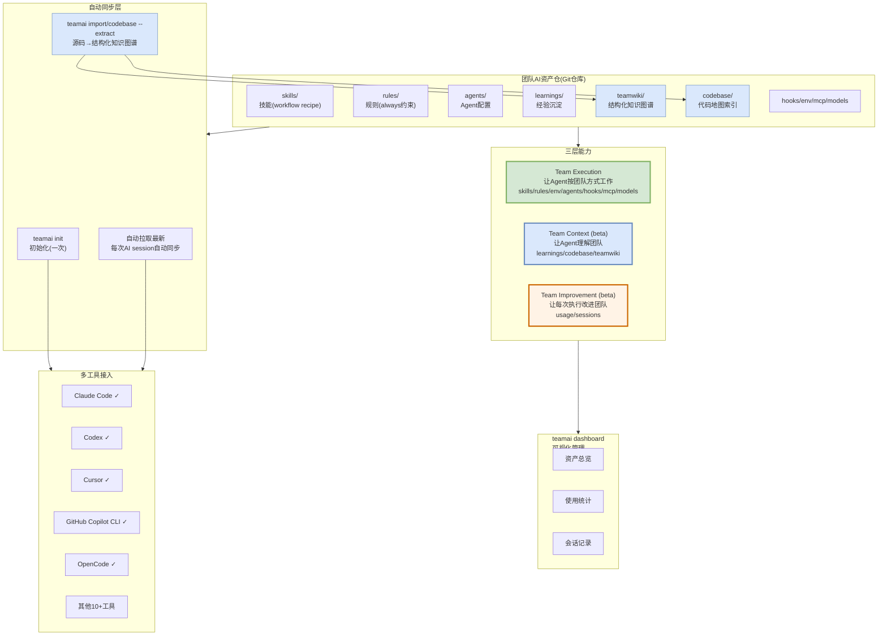

# TeamAI-CLI — 腾讯 资产治理解决方案视图

> [github.com/Tencent/teamai-cli](https://github.com/Tencent/teamai-cli) | MIT协议 | npm包teamai-cli | 5.5k stars

---

## 解决方案全景图



---

## 核心架构：三层能力 + Git驱动

### 设计理念

> "Make Every Team AI Native" — 团队的AI资产统一沉淀在一个Git仓库，自动同步到所有AI工具

### 三层能力

| 层 | 名称 | 包含什么 | 状态 |
|----|------|---------|------|
| **Team Execution** | 让Agent按团队方式工作 | skills, rules, env, agents, hooks, mcp, models | ✅ 正式 |
| **Team Context** | 让Agent理解团队 | learnings, codebase(结构化知识图谱), teamwiki | 🟦 beta |
| **Team Improvement** | 让每次执行改进团队 | usage(使用统计), sessions(会话记录) | 🟧 beta |

### Git驱动(非云端)

```
团队AI资产仓(Git)
├── skills/teamai/          ← 核心skill
├── rules/                  ← always级规则
├── agents/                 ← Agent配置
├── learnings/              ← 经验沉淀
├── teamwiki/               ← 结构化知识图谱
├── codebase/               ← 代码地图索引
├── hooks/                  ← 钩子
├── env/                    ← 环境配置
├── mcp/                    ← MCP服务配置
└── models/                 ← 模型配置
```

**初始化一次后自动同步** — 每次AI session自动拉取最新资产，无需手动同步。

---

## 资产治理机制

### 1. 源码→结构化知识图谱

```
teamai import / teamai codebase --extract

源代码 → 解析 → 结构化知识图谱
├── 组件(类/模块/服务)
├── 接口(函数签名/参数/返回值)
├── 配置(YAML/JSON/properties)
├── 跨仓依赖(模块间调用关系)
└── 写入 teamwiki/
```

### 2. 代码地图定位

```
Agent在代码里看到 BrowserCloserTask.java
  ↓ 代码地图索引
返回: BrowserCloserTask.java → teamwiki/browser-closer.md
  ↓ 直接定位
不用: 在全量文档中搜索关键词
```

### 3. 优先召回权威资产+过滤噪声

```
检索结果排序:
1. ⭐ 权威资产(rules/learnings) — 高优先
2. 结构化知识图谱(teamwiki/codebase) — 中优先
3. 普通文档 — 低优先
4. 噪声(测试/临时/实验) — 过滤
```

### 4. 经验沉淀(learnings)

```
Agent执行任务 → 遇到问题 → 解决方案
  ↓ 沉淀到 learnings/
下次Agent遇到类似问题 → 自动检索learnings → 复用方案
```

### 5. 使用统计+会话记录(Team Improvement)

```
Agent session → 记录使用情况
  ├── 哪些skill被调用
  ├── 哪些rule生效
  ├── 会话中Agent做了什么
  └── usage/sessions/ 存档
    ↓ Dashboard可视化
团队可以看到: 哪些资产有用/哪些没用/哪些需要改进
```

### 6. 多工具统一接入

| 工具 | skills | rules | env | agents | hooks | mcp | models | learnings | codebase | teamwiki | usage | sessions |
|------|--------|-------|-----|--------|-------|-----|--------|-----------|----------|----------|-------|----------|
| Claude Code | ✓ | ✓ | ✓ | ✓ | ✓ | ✓ | ✓ | ✓ | ✓ | ✓ | ✓ | ✓ |
| Codex | ✓ | ✓¹ | ✓ | ✓ | ✓ | ✓ | ✓ | ✓ | ✓ | ✓ | ✓ | ✓ |
| Cursor | ✓ | ✓ | ✓ | ✓ | ✓ | ✓ | — | ✓ | ✓ | ✓ | ✓ | ✓ |
| GitHub Copilot CLI | ✓ | ✓ | ✓ | ✓ | ✓ | ✓ | — | ✓ | ✓ | ✓ | ✓ | ✓ |
| OpenCode | ✓ | ✓¹ | ✓ | ✓ | ✓ | ✓ | ✓ | ✓ | ✓ | ✓ | — | — |

> ¹ Rules stay on. Not limited by path.

---

## 与其他大厂的关键差异

| 维度 | TeamAI-CLI | WhatsCode | Microsoft ISE | Spotify |
|------|-----------|-----------|---------------|---------|
| **开源** | ✅ MIT | ❌ 内部 | ❌ 博客 | ❌ 内部 |
| **资产归档** | 随Git仓库 | 云端索引 | 随代码仓 | 云端索引 |
| **多工具接入** | ⭐13+工具 | Meta内部工具 | Copilot Enterprise | Claude Code |
| **结构化知识图谱** | ⭐codebase --extract | AST索引 | CodeQL | 元模型 |
| **经验沉淀** | ⭐learnings/ | Memory管理 | ADR | Prompt版本控制 |
| **使用统计** | ⭐usage/sessions | 审计日志 | 无 | 无 |

**TeamAI-CLI是唯一开源的**，且是唯一做了"经验沉淀(learnings)+使用统计(usage)"的——这是"Team Improvement"层的核心。

---

## 我们借鉴的技术点

| TeamAI-CLI做法 | 我们方案对应 | 借鉴价值 |
|---------------|------------|---------|
| **源码→结构化知识图谱** | 生成: AST结构化感知(tree-sitter) | ⭐⭐⭐ |
| **代码地图定位源文件** | 检索: 代码位置索引(代码↔文档双向) | ⭐⭐⭐ |
| **优先召回权威资产** | 检索: 按来源可信度排序 | ⭐⭐⭐ |
| **过滤噪声** | 审核: 黑名单过滤+置信度跳过 | ⭐⭐ |
| **经验沉淀(learnings)** | 持续精炼: 技能精炼(从误报/漏报学习) | ⭐⭐ |
| **Git驱动(随仓库)** | 资产: 随代码仓(我们已这么做) | ⭐⭐ 对标 |
| **多工具统一接入** | 暂不需要(单场景) | ⭐ |

---

*生成日期: 2026-10-15*
